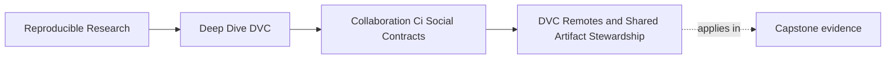

# DVC Remotes and Shared Artifact Stewardship


<!-- page-maps:start -->
## Page Maps




<!-- page-maps:end -->

DVC remotes are not just storage locations.

In a team workflow, they are part of the collaboration contract. They decide whether
another maintainer, CI, or a recovery drill can reconstruct the state that the repository
claims exists.

If the remote story is weak, the repository may look complete in Git while being
unusable to everyone except the original author.

## Remote availability is part of review

When DVC-tracked data or outputs change, Git may only carry metadata. The actual content
must be available through the shared remote when collaborators need it.

That means review should ask:

- did the author push required DVC objects?
- can CI pull them from a clean environment?
- does the remote configuration point to the intended shared location?
- are permissions sufficient for reviewers and automation?
- are release artifacts protected from accidental deletion?

The key point is that a merged pointer without shared content is a broken promise.

## Remote discovery and object availability are separate

Two handoffs can both fail `dvc pull` for different reasons:

| Failure | Remote objects exist? | Clone knows the remote? | Repair |
| --- | --- | --- | --- |
| missing remote object | no | yes | publish the required object |
| undiscoverable remote | yes | no | track the shared remote route |

Run:

```bash
make -C programs/reproducible-research/deep-dive-dvc/capstone reviewer-handoff-audit
```

Compare:

```text
workspace/missing-remote-object/evidence/receipts.json
workspace/undiscoverable-remote/evidence/receipts.json
```

In the first case, `dvc remote list` names `shared`, but the pull receipt reports missing
content. In the second, the author configured the remote with local-only state, so the
reviewer's remote list is empty even though the object store contains the bytes.

A remote contract therefore needs both:

1. a discoverable route
2. available objects at that route

Do not diagnose both failures as “the remote is broken.”

## Track routes, not credentials

DVC separates repository configuration from machine-local configuration:

| Surface | Appropriate content | Handoff role |
| --- | --- | --- |
| `.dvc/config` | shared remote name and non-secret route | tells a clone which storage contract belongs to the repository |
| `.dvc/config.local` | credential references and machine-specific overrides | stays local and must not be the only discovery record |
| CI secret store | short-lived or scoped credentials | authorizes the job without committing secrets |

The exact route may still need environment-specific indirection. The invariant is that a
new reviewer can discover what remote contract applies without receiving the author's
private config file.

## Development and release remotes may need different rules

Small projects can start with one remote. Larger teams often need clearer boundaries.

Example model:

| Remote | Use | Policy |
| --- | --- | --- |
| development remote | candidate runs and collaborative work | writable by trusted contributors |
| release remote | promoted artifacts and release bundles | restricted, audited, often append-oriented |
| archive remote | older evidence kept for recovery | slower access, stronger retention |

This is not mandatory architecture for every course exercise. It is a way to name the
different trust levels that appear as a project grows.

## Push and pull are social operations

`dvc push` is not merely a sync command. It makes local evidence available to other
people.

`dvc pull` is not merely a download command. It tests whether the shared state can be
restored from the remote.

That is why a review route often needs both ideas:

```bash
# trusted author or publication job
dvc push

# clean reviewer or CI job
dvc pull
dvc status --json
```

The author or trusted publication job pushes before review. CI or another maintainer pulls
during verification. Those actions support one collaboration story, but they should not
run with the same authority.

The audit's mutating-route case demonstrates the boundary. All files and objects are
complete, yet the handoff blocks because its reviewer instructions include `dvc push`.
Routine verification should prove that shared state is readable, not grant permission to
change it.

## Permission failures should be designed

Remote permissions should match the risk.

Examples:

- contributors can push development candidate artifacts
- release artifact deletion is restricted
- CI can read the objects it needs
- pull-request CI cannot publish or garbage-collect shared objects
- release automation can write only to the intended boundary
- recovery roles have documented access

If everyone can delete everything, recovery depends on luck. If nobody can read the data,
CI cannot verify the repository. Stewardship means choosing permissions that support the
workflow instead of discovering gaps during an incident.

## Remote state needs ownership

Someone needs to know who owns:

- remote configuration changes
- credential rotation
- object retention rules
- release artifact protection
- cleanup of obsolete candidate artifacts
- recovery access validation

This ownership can be lightweight, but it cannot be imaginary. When nobody owns remote
stewardship, storage gradually becomes a mystery.

Use separate owners when the authority differs:

| Responsibility | Typical owner | Evidence of health |
| --- | --- | --- |
| repository remote route | repository maintainers | cache-cold clone discovers expected remote |
| credential issuance and rotation | platform or storage steward | scoped access test and rotation record |
| candidate object publication | change author or trusted job | object can be pulled by read-only CI |
| promoted object retention | release or data steward | recovery drill restores named release state |
| domain acceptance | domain reviewer | result contract and decision record |

Storage administration does not decide whether a result is scientifically acceptable.
Domain review does not grant itself deletion authority over recovery evidence.

## Review checkpoint

You understand this core when you can:

- explain why DVC remotes are part of collaboration, not only storage
- identify when a merge depends on a missing `dvc push`
- distinguish an absent object from an undiscoverable remote route
- explain why shared routes and secret credentials belong in different config surfaces
- separate publication authority from read-only review authority
- distinguish development and release artifact policies
- explain how permissions affect CI and recovery
- name the ownership needed for remote stewardship

Shared artifacts are only shared when another maintainer can actually recover them.
