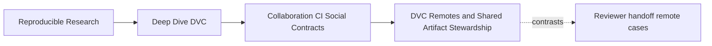
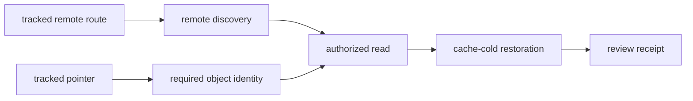
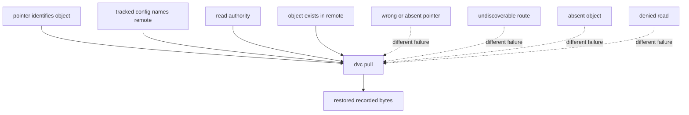
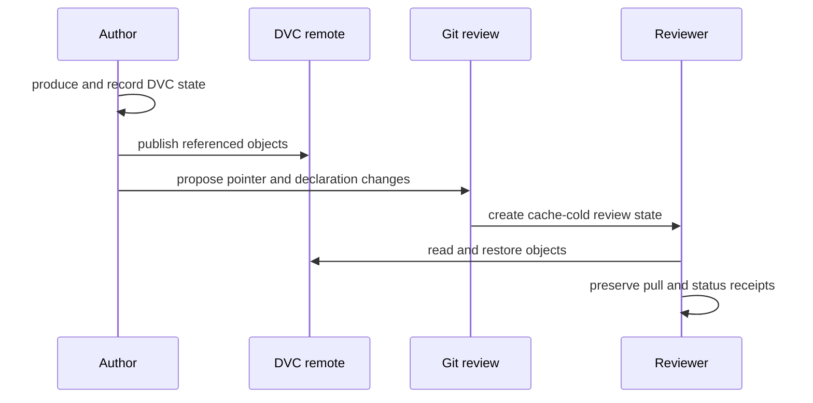

# DVC Remotes and Shared Artifact Stewardship

<!-- page-maps:start -->
## Page Maps




<!-- page-maps:end -->

A DVC pointer says which content is required. A remote makes that content available to
other authorized users. Neither promise is complete without the other.

Shared artifact stewardship means maintaining the whole route:

> tracked pointer → discoverable remote → available object → authorized read → verified
> restoration

The remote is not merely a bucket. It is part of the repository's collaboration contract.

## Separate identity, location, and authority

Three questions are easy to blur:

| Question | Evidence |
| --- | --- |
| Which bytes are required? | DVC pointer or lock identity |
| Where should a reviewer request them? | tracked remote configuration |
| Is this reviewer allowed to read them? | credential and storage policy |

A pointer cannot answer location. A configured URL cannot prove the object exists. Valid
credentials cannot identify which bytes belong to the reviewed state.



Diagnose the broken edge rather than treating every pull failure as the same incident.

## Compare two blocked audit cases

Generate the handoffs:

```bash
make PROGRAM=reproducible-research/deep-dive-dvc capstone-reviewer-handoff-audit
audit=artifacts/audit/reproducible-research/deep-dive-dvc/reviewer-handoff
```

Inspect the summary rows:

```bash
rg 'MISSING_REMOTE_OBJECT|UNDISCOVERABLE_REMOTE' "$audit/summary.tsv"
```

They both block, but for different reasons:

| Case | Remote discoverable? | Objects published? | Pull succeeds? |
| --- | --- | --- | --- |
| missing object | yes | no | no |
| undiscoverable remote | no in clean clone | yes | no |

The first is a publication failure. The second is a repository-configuration failure.
Retrying credentials will not publish an absent object. Pushing the object again will not
teach a clean clone which remote to use.

## Track the route, not credentials

Shared repository configuration should identify the remote route:

```bash
dvc remote add -d shared s3://research-artifacts/project
git add .dvc/config
```

Machine-specific or sensitive configuration belongs outside tracked shared state:

```bash
dvc remote modify --local shared access_key_id '...'
dvc remote modify --local shared secret_access_key '...'
```

The exact credential mechanism depends on the storage backend. Prefer provider-native
identity, short-lived credentials, or secret management over copying secrets into files.

The rule is:

- track enough non-secret configuration for authorized users to discover the route;
- keep secrets and personal overrides local or externally managed;
- document the expected credential acquisition path without recording secret values.

If `.dvc/config.local` is the only place that names the remote, the author's machine knows
something the repository does not.

## A successful author push is not enough

Suppose the author runs:

```bash
dvc push
```

Success shows that the author's current configuration and credentials could publish the
objects selected by that command. It does not prove:

- a reviewer can discover the same remote;
- the reviewer has read authority;
- every pointer in the proposed commit resolves;
- older required objects remain retained;
- the author pushed from the intended repository state;
- the review route avoids mutation.

Use a clean read path as independent evidence:

```bash
git clone <repository> reviewer
cd reviewer
dvc remote list
dvc pull
```

The reviewer should not inherit the author's cache or local configuration.

## Publish objects before the pointer becomes shared history

A safe handoff orders operations by recoverability:



The exact organizational gate may vary. The invariant is that shared history must not
promise objects that the authorized audience cannot retrieve.

If a pointer is merged before publication, teammates receive a valid identity with no
shared bytes. The author's warm cache hides the defect.

## Read-only review and write-enabled publication

Separate roles:

| Role | Needed remote authority | Typical operations |
| --- | --- | --- |
| reviewer | read | `dvc pull`, inspect, local `dvc repro` |
| CI verifier | read | clean pull, status, test, local reproduction |
| author | read and scoped write | pull existing state, push new objects |
| publication job | controlled write | publish approved object set |
| storage administrator | policy and lifecycle management | retention, access, audit |

The audit blocks a handoff whose review route contains `dvc push`. Review should not
require write credentials to shared storage.

Benefits include:

- safer fork and external-contributor review;
- lower impact if verifier credentials leak;
- clearer distinction between evidence checking and publication;
- fewer accidental remote mutations;
- more precise branch-protection rules.

## Development and release storage may differ

A project can use multiple remotes when their responsibilities are explicit:

| Remote | Purpose | Durability | Writers | Readers |
| --- | --- | --- | --- | --- |
| development | fast team iteration | shorter retention | contributors | team |
| release | accepted artifact preservation | governed retention | publication job | wider audience |
| archive | long-term reconstruction | archival policy | release automation | maintainers/auditors |

Name each remote by durable responsibility rather than delivery order or migration history.

Multiple remotes create obligations:

- which pointer histories each remote must satisfy;
- who promotes objects between boundaries;
- how reviewers discover the correct route;
- how integrity is checked after transfer;
- what happens when retention expires.

A second remote is not a backup unless restoration from it is tested.

## Steward object lifecycle

Object availability can decay after a successful handoff. Stewardship needs:

- retention policy tied to result lifetime;
- ownership for access and billing;
- integrity checks;
- deletion and garbage-collection rules;
- recovery drills from cache-cold state;
- incident escalation for missing objects;
- migration plans when storage changes.

Before garbage collection, determine which Git revisions, tags, releases, or experiments
must remain reconstructable. “No one used it recently” is not enough.

### Availability is time-bounded evidence

A pull receipt proves availability at the time and from the identity that ran it. It does
not guarantee future retention. State the time and policy:

> On the reviewed commit, the cache-cold CI identity restored all recorded objects from
> the tracked `review` remote. The remote's retention policy covers accepted revisions for
> three years.

The first sentence is observed evidence. The second is a governance claim requiring its
own policy evidence.

## Diagnose remote failures precisely

Use a decision table:

| Observation | Likely boundary | Next evidence |
| --- | --- | --- |
| `dvc remote list` is empty | discovery | inspect tracked `.dvc/config` |
| remote listed, authentication denied | authority | inspect identity and access policy |
| remote listed, object missing | publication or retention | identify object hash and publication receipt |
| pull succeeds, pipeline dependency absent | Git completeness | inspect tracked stage dependencies |
| pull succeeds, status stale | recorded currency | preserve status and compare lock/input state |
| reviewer route requires push | role design | inspect handoff contract and credentials |

Do not delete caches or force reproduction before preserving the evidence that identifies
the failed boundary.

## Write a remote stewardship contract

A repository-specific contract should answer:

```text
Discoverability:
Which tracked configuration names each shared remote?

Read authority:
Which human and automation identities can restore reviewed state?

Publication:
Who may write, and which gate verifies objects before pointers merge?

Retention:
Which histories must remain reconstructable, and for how long?

Integrity:
How are restored identities checked against recorded pointers?

Recovery:
How often does a cache-cold drill test the route?

Incident ownership:
Who responds to absent objects, denied reads, and configuration drift?

Migration:
How will old pointers remain recoverable when storage moves?
```

## Review checkpoint

You understand shared artifact stewardship when you can:

- distinguish pointer identity from object availability;
- distinguish absent objects from an undiscoverable route;
- explain why tracked remote configuration must exclude secrets;
- show why a clean reviewer provides stronger evidence than the author workspace;
- separate read-only verification from write-enabled publication;
- name retention, integrity, recovery, and migration owners;
- state the time boundary of an availability receipt.

The collaboration standard is not “the author ran `dvc push`.” It is:

> Every reviewed pointer has a discoverable, authorized, tested restoration route whose
> ownership and retention match the lifetime of the claim.
