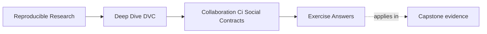

# Exercise Answers


<!-- page-maps:start -->
## Page Maps




<!-- page-maps:end -->

These answers are model explanations, not the only acceptable wording.

What matters is whether the reasoning turns collaboration expectations into verifiable
contracts.

## Answer 1: Rewrite a memory-based rule

Stronger contract:

> Pull requests that change DVC-tracked data pointers, `dvc.lock`, `dvc.yaml`, or produced
> metrics must pass a clean verification route that pulls required objects from the shared
> remote and verifies declared state before merge.

Why this is stronger:

- it names the state changes that trigger review
- it gives CI or reviewers a concrete check
- it does not rely on the author remembering a local upload
- it protects the next maintainer from a metadata-only merge

The main lesson is that important team promises need visible evidence.

## Answer 2: Design a DVC-aware CI route

Reasonable route:

```bash
dvc pull
dvc status
dvc repro
dvc metrics show
```

For the capstone, the route may be wrapped as:

```bash
make -C capstone confirm
```

What this checks:

- a clean executor can pull shared objects
- declared DVC state is inspectable
- the pipeline can reproduce or verify as expected
- metrics are available for review

For expensive workflows, the route may be split into faster metadata checks and scheduled
full recovery checks. The important point is that CI should prove shared state, not only
local code style.

## Answer 3: Review a merge blocker

Strong review comment:

> This pull request changes `dvc.lock` and metrics, but the current checks do not prove
> that the referenced DVC objects can be pulled from the shared remote. Please run or add a
> remote-backed verification route before merge. Otherwise another maintainer may receive
> a repository state that exists in Git metadata but cannot be restored.

The merge should wait because the shared artifact contract is incomplete.

## Answer 4: Define remote stewardship

Risks of everyone being able to write and delete:

- release artifacts can be removed accidentally
- candidate artifacts can contaminate promoted state
- recovery may fail because retention rules are unclear
- CI credentials may have broader permissions than needed

Rules to consider:

- writable development remote for active collaboration
- protected release remote or protected release prefix
- restricted deletion for promoted artifacts
- documented owner for remote configuration and credential rotation
- CI read access scoped to what it needs

The main lesson is that release evidence usually deserves stronger protection than
development evidence.

## Answer 5: Plan a recovery drill

Reasonable drill:

```bash
git clone <repo-url>
dvc pull
make -C capstone confirm
make -C capstone recovery-review
```

Starting condition:

- clean checkout with no private workspace files

Success means:

- required DVC objects pull from shared remotes
- verification route passes
- recovery documentation is sufficient for someone other than the original author

Findings that should become fixes:

- missing remote objects
- unclear credentials
- stale recovery documentation
- missing verification commands
- release artifacts not protected or not restorable

The main lesson is that recovery claims become reliable only when rehearsed.

## Answer 6: Review a data-changing pull request

A strong checklist confirms why the data changed, identifies old and new content, verifies
the new object is remotely recoverable, shows downstream impact, and preserves a rollback
route. A pointer diff without these facts is not sufficient review evidence.

## Answer 7: Build a remote-presence CI check

CI should use read-only credentials where possible and report missing object identities
without downloading unnecessary content. Forks need an explicit safe behavior because
secrets are unavailable. The check must never mutate or garbage-collect the remote.

## Answer 8: Resolve a pointer merge conflict

The team first decides which content is authoritative or reruns the producing process from
merged inputs. DVC then records the resulting object and Git records its pointer. Editing
hash fragments by hand can create metadata that names no meaningful artifact.

## Answer 9: Define ownership for shared artifacts

Repository maintainers can own declarations, platform operators can own remote durability,
domain reviewers can own scientific acceptance, and incident owners can coordinate
recovery. Explicit separation creates review and continuity rather than bureaucracy.

## Answer 10: Conduct a no-oral-history handoff

Every undocumented credential route, command, data origin, expected metric, or recovery
assumption is a real course finding. Repair the durable surface and repeat until the
teammate can complete the route from written evidence.

## Self-check

If your answers consistently explain:

- which human expectation needs an enforceable check
- how CI proves shared state from a clean context
- why incomplete DVC evidence blocks merge
- how remote policies protect collaboration and release evidence
- how recovery drills produce fixes

then you are using Module 07 correctly.
