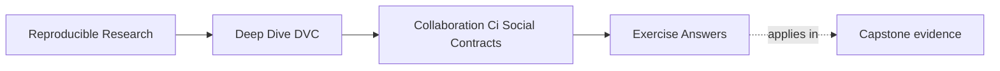
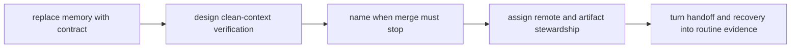

# Exercise Answers


<!-- page-maps:start -->
## Page Maps




<!-- page-maps:end -->

These answers are model explanations, not the only acceptable wording.

## How to use the answer page well

Do not read the model answer first and then collapse the whole module into "add one more
CI job."

A better rhythm is:

1. finish the exercise with your own contract and stewardship packet
2. name the shared promise, failure trigger, and responsible owner
3. compare your reasoning with the model answer
4. revise anywhere your answer still relies on memory, personal trust, or undeclared
   ownership

What matters is whether the reasoning turns collaboration expectations into verifiable
contracts.

Strong Module 07 answers usually do five things:

- they replace memory-based habits with visible checks
- they make CI prove shared state from a clean context
- they block merges when shared-state evidence is incomplete
- they treat remotes as governed infrastructure
- they use handoffs and drills to reveal missing contracts

The strongest self-study packets also leave behind seven concrete artifacts:

- one rewritten team rule
- one DVC-aware CI route
- one merge-blocking review comment
- one stewardship table
- one recovery drill
- one seven-case handoff classification
- one no-oral-history handoff decision record

If your answers rely only on "the team should be careful," the reasoning is still too
thin.

## Answer 1: Rewrite a memory-based rule

Stronger contract:

> Pull requests that change DVC-tracked data pointers, `dvc.lock`, `dvc.yaml`, produced
> metrics, or published release artifacts must pass a clean verification route that pulls
> required objects from the shared remote and confirms declared state before merge.

What this names clearly:

- trigger: pointer, lock, pipeline, metric, or release-state changes
- verification: remote-backed clean-context check
- failure action: merge blocks until the missing object or broken contract is repaired

Why memory is not enough:

- memory disappears exactly when reviewers, future maintainers, and CI need explicit
  evidence most

## Answer 2: Design a DVC-aware CI route

Reasonable route:

```bash
dvc remote list
dvc pull
dvc status --json
dvc repro
```

If the repository has a governed wrapper, that may be the stronger surface:

```bash
make PROGRAM=reproducible-research/deep-dive-dvc capstone-reviewer-handoff-audit
```

What this proves:

- a clean executor can recover required objects
- declared DVC state is inspectable
- the pipeline can reproduce or verify as expected
- metrics or release evidence exist for review

Least-privilege note:

- CI should use read-only access where possible and avoid mutation-capable remote
  credentials for ordinary verification

Fork note:

- untrusted forks should skip secret-backed remote checks or fall back to a safe reduced
  route that reports the limitation explicitly

## Answer 3: Review a merge blocker

Strong review comment:

> This pull request changes `dvc.lock` and metrics, but the current checks do not prove
> that the referenced DVC objects can be pulled from the shared remote. Please add or run
> a remote-backed clean-context verification route before merge. Until then, another
> maintainer may receive Git metadata that points to unrecoverable shared state.

Why author testimony is not enough:

- "I pushed it locally" is not durable shared evidence, especially once the review moves
  beyond the author's machine

## Answer 4: Define remote stewardship

Risks of one fully open remote:

- promoted artifacts can be deleted accidentally
- experimental state can contaminate release evidence
- retention and cleanup decisions become ambiguous
- CI or automation credentials may be broader than necessary

Rules to consider:

- separate development and protected release locations
- restricted deletion for promoted artifacts
- explicit ownership for remote configuration and policy
- narrow credentials for CI and routine users

Who should handle rotation or incidents:

- a named platform or storage steward with a documented backup owner and escalation route

## Answer 5: Plan a recovery drill

Reasonable drill:

```bash
git clone <repo-url>
dvc pull
make PROGRAM=reproducible-research/deep-dive-dvc capstone-reviewer-handoff-audit
make PROGRAM=reproducible-research/deep-dive-dvc capstone-recovery-review
```

Starting condition:

- clean checkout with no warm local cache and no private helper files

Success means:

- required objects pull from the shared remote
- the governed verification route passes
- a different maintainer can complete the route from written evidence

Findings that should become fixes:

- missing remote objects
- unclear credential instructions
- stale recovery documentation
- missing review commands
- unprotected release artifacts

Recommended cadence:

- rehearse on a scheduled basis and after important remote, release, or CI changes

## Answer 6: Predict the clean handoff outcomes

The generated result is:

| Finding | Result | Decision | Failed checks |
| --- | --- | --- | --- |
| `COMPLETE_HANDOFF` | `PASS` | `ACCEPT` | none |
| `MISSING_REMOTE_OBJECT` | `PASS` | `BLOCK` | pull, clean status, repro, result match |
| `UNDISCOVERABLE_REMOTE` | `PASS` | `BLOCK` | discovery, pull, clean status, repro, result match |
| `UNTRACKED_STAGE_DEPENDENCY` | `PASS` | `BLOCK` | clean status, repro, result match |
| `STALE_EXECUTION_RECORD` | `PASS` | `BLOCK` | clean status, result match |
| `MUTATING_REVIEW_ROUTE` | `PASS` | `BLOCK` | read-only review authority |
| `MISSING_RESULT_CONTRACT` | `PASS` | `BLOCK` | result contract, result match |

`PASS / BLOCK` means the audit successfully reproduced evidence that should block the
handoff. Audit correctness and handoff acceptance are different decisions.

The complete case is accepted because its clean reviewer can:

- discover the tracked remote route
- pull the recorded input and output
- observe clean pre-reproduction status
- reproduce without private files
- avoid remote writes
- read an expected claim
- match the restored result to that claim

Do not reduce this to “all commands exited zero.” The authority and interpretation checks
are not command exit codes.

## Answer 7: Separate remote discovery from object availability

### Missing remote object

Evidence:

- `remote_list` succeeds and names `shared`
- `pull` fails
- the reviewer cannot recover the input or recorded result

Review comment:

> The clone discovers the configured shared remote, but the DVC objects named by this Git
> revision are absent. The change author or trusted publication job must push those
> objects. Unblock when a new cache-cold clone pulls successfully, reports clean
> pre-reproduction status, and matches the result contract.

### Undiscoverable remote

Evidence:

- the author used local-only remote configuration
- the reviewer remote list does not name `shared`
- the object store contains bytes, but the clone has no route to them

Review comment:

> The required objects exist, but the repository does not carry a discoverable shared
> remote route. A repository maintainer must track the non-secret route or a documented
> environment mapping. Unblock when a new clone discovers the expected remote without
> inheriting author-local configuration.

Both cases fail pull. The first lacks content; the second lacks discovery. Their owners and
repairs differ.

## Answer 8: Distinguish incomplete source from stale execution

| Case | Pull | Pre-repro status | Repro | Missing or stale evidence | Repair |
| --- | --- | --- | --- | --- | --- |
| untracked dependency | succeeds | not clean | fails | `policy/severity-policy.json` is absent from Git | track or replace the dependency |
| stale execution | succeeds | not clean | succeeds | pointer changed without matching execution record and result | reproduce, then submit lock and output evidence |

The untracked dependency cannot be recreated from DVC storage because it is a Git-owned
pipeline input. The stale case has all required source and objects; the reviewer can
rebuild it.

Successful reproduction does not accept the stale handoff because the question is:

> Was the submitted revision coherent before the reviewer repaired it?

The required receipt is `dvc status --json` captured after pull and before reproduction.
After reproduction, status describes the repaired reviewer workspace, not the submitted
state.

Evidence-complete blockers:

> Pull succeeds, but the declared policy dependency is absent from the clone, so status
> and reproduction fail. Track the policy or declare a recoverable source, then rerun from
> a new clone.

> Pull succeeds and reproduction can repair the workspace, but pre-reproduction status is
> stale and the restored submitted result does not match the handoff claim. Submit
> matching execution evidence, then rerun from a new clone.

## Answer 9: Review authority and result meaning

A reasonable authority table is:

| Operation | Pull-request reviewer | Trusted publication job |
| --- | --- | --- |
| discover configured remote | allowed | allowed |
| pull objects | allowed | allowed |
| inspect status | allowed | allowed |
| reproduce locally | allowed | allowed |
| push objects | denied | allowed after gates |
| delete or garbage-collect shared objects | denied | separate governed maintenance only |

Corrected review route:

```bash
dvc remote list
dvc pull
dvc status --json
dvc repro
```

Publication remains a separate trusted operation:

```bash
dvc push
```

The incident result contract should name:

```json
{
  "record_count": 4,
  "severity_total": 11,
  "weekend_handoffs": 2
}
```

It should also name the pointer, pipeline declaration, and generated result path used as
evidence. Executable output is not automatically reviewable because an exit code does not
say what values are expected or which conclusion they support.

An untrusted fork should run checks that require no secrets and report the remote-backed
route as unavailable, not passed. Trusted post-fork CI must resolve that limitation before
merge.

## Answer 10: Conduct a no-oral-history handoff review

A complete decision record for the accepted case can say:

> **Claim:** the selected sample has four records, severity total 11, and two weekend
> handoffs. **Revision:** the generated reviewer clone's checked-out commit.
> **Starting state:** cache-cold clone with no author workspace files. **Discovery:** the
> remote-list receipt names `shared`. **Availability:** pull succeeds and restores the
> tracked input and result. **Submitted state:** status is clean before reproduction.
> **Reproducibility:** reproduction succeeds without private dependencies. **Meaning:** the
> restored summary matches the handoff claim. **Authority:** read-only remote operations
> plus local workspace writes. **Decision:** `ACCEPT` for independent recovery and review
> of this bounded result; no release or scientific-validity claim is made.

Author-only facts to exclude include:

- warm cache contents
- local-only remote configuration
- untracked policy files
- shell history showing which command the author intended
- generated output that was never recorded or published

If any excluded fact is required to decide, it is a contract gap. The highest-value repair
is the one that moves that fact into tracked configuration, recoverable data, automated
evidence, or a bounded result contract.

## Self-check

If your answers consistently explain:

- which human expectation needs an enforceable check
- how CI proves shared state from a clean context
- why incomplete DVC evidence blocks merge
- why pre-reproduction status preserves the submitted-state claim
- how discovery differs from availability
- why review authority and result interpretation are separate contracts
- how remote policies protect collaboration and release evidence
- how recovery drills produce fixes

then you are using Module 07 correctly.
