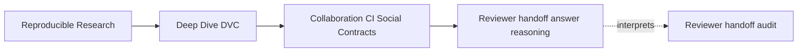
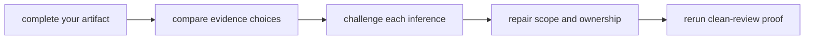

# Exercise Answers

<!-- page-maps:start -->
## Page Maps




<!-- page-maps:end -->

These answers model reasoning rather than provide text to copy. Your design can differ if
it gives an independent reviewer equally precise evidence, authority, decisions, and
limits.

Before reading a model answer:

1. finish the corresponding artifact;
2. underline each accept or block claim;
3. link it to an exact receipt;
4. name any conclusion broader than the receipt;
5. revise after comparison.

## Answer: Bound the reviewer handoff claim

A suitable claim:

> At the reviewed Git revision, a cache-cold reviewer with tracked repository state and
> authorized read access to the configured DVC remote can restore the recorded input and
> result, verify clean submitted state before reproduction, execute the declared pipeline
> without private files, and confirm the incident-summary result contract.

A model boundary table:

| Surface | Required state | Evidence | Owner |
| --- | --- | --- | --- |
| Git repository | declarations, script, policy, pointer, contract | clean clone and tracked-file inventory | contributors and reviewers |
| remote route | non-secret route in tracked config | `dvc remote list` receipt | maintainer |
| DVC objects | input and recorded result available | cache-cold pull receipt | author or publication job |
| execution record | lock/result current for declared inputs | pre-repro status | author and CI |
| result contract | expected fields and values present | tracked contract plus comparison | result owner |
| reviewer permissions | read remote, write local workspace only | route policy and credential scope | CI/security owner |

The audit does not prove:

- long-term remote retention;
- secure credential distribution in another deployment;
- scientific representativeness of the sample;
- promotion or release eligibility.

The important scope choice is “this bounded result at this revision,” not “the project is
reproducible.”

## Answer: Predict all seven handoff decisions

Model predictions:

| Case | First failed boundary | Decision |
| --- | --- | --- |
| complete handoff | none | accept |
| missing remote object | object availability | block |
| undiscoverable remote | route discovery | block |
| untracked stage dependency | Git completeness | block |
| stale execution record | submitted-state currency | block |
| mutating review route | review authority | block |
| missing result contract | result meaning | block |

The observed downstream failed checks need context. Missing objects prevent status,
reproduction, and result matching, but those are consequences of unavailable bytes.

A useful correction for a common wrong prediction:

> I grouped missing object and undiscoverable remote as “pull failures.” The receipts show
> that the former lists a tracked remote but lacks content, while the latter has content
> that the clean clone cannot locate. The repairs and owners therefore differ.

`PASS / BLOCK` means the audit correctly reproduced the blocking defect. It does not mean
the handoff should pass review.

## Answer: Map receipts to collaboration promises

Representative evidence rows:

| Case | Evidence | Observation | Inference | Not proved |
| --- | --- | --- | --- | --- |
| complete | remote list | `shared` appears | route is discoverable | object availability |
| complete | pull | two objects restored | required recorded bytes readable now | future retention |
| complete | pre-repro status | empty JSON | submitted declared state clean | scientific validity |
| missing object | pull | referenced object absent | publication/retention promise failed | route discovery failure |
| undiscoverable | remote list | shared route absent | clean clone lacks repository route | objects absent |
| untracked dependency | repro | policy path missing | Git handoff incomplete | DVC remote incomplete |
| stale record | status then repro | stale before, success after | CI repaired local state | submitted state was current |
| mutating route | contract | review includes push | verification demands write authority | files are incomplete |
| missing contract | successful repro | result generated | pipeline executes | result supports a known claim |

The strongest entries name what each receipt cannot prove. This prevents a successful
command from becoming a universal certificate.

## Answer: Write a remote stewardship contract

A model allocation:

| Boundary | Development remote | Accepted-results remote |
| --- | --- | --- |
| route | tracked, role-named configuration | tracked, role-named configuration |
| writers | authorized contributors | protected publication identity |
| readers | internal team | internal reviewers and recovery identities |
| retention | supports active development history | three years for accepted revisions |
| publication gate | verify object identity before pointer review | only after accepted result decision |
| recovery | periodic cache-cold pull | scheduled cache-cold reconstruction |

Credentials remain in provider identity or secret management. Tracked configuration names
the route but stores no secret values.

Decision examples:

| Symptom | Boundary | Action |
| --- | --- | --- |
| tracked route absent | discovery | add reviewed non-secret route |
| access denied | authority | repair identity or policy, not object |
| object absent | publication/retention | locate trustworthy object and publish identity |
| integrity mismatch | identity | quarantine and investigate; do not accept by filename |
| retention expired | governance | restore from archive or declare unrecoverable |
| review requests push | role separation | remove mutation and use publication job |

An author push receipt is useful publication evidence. Independent cache-cold pull is the
review evidence.

## Answer: Review submitted state before repair

Model comparison:

| Evidence | Complete | Stale |
| --- | --- | --- |
| pull | succeeds | succeeds |
| status before repro | empty | `summarize_incidents` has changed data dependency |
| submitted result | matches claim | reflects earlier data |
| reproduction | succeeds or converges | succeeds and updates local state |
| post-repro result | coherent | locally repaired and coherent |
| decision | accept | block |

Timeline:

```mermaid
sequenceDiagram
  participant Git as Submitted state
  participant Reviewer
  participant DVC

  Git->>Reviewer: clone pointer, lock, and result record
  Reviewer->>DVC: pull recorded objects
  Reviewer->>DVC: status before reproduction
  DVC-->>Reviewer: stage is stale
  Reviewer->>DVC: reproduce locally
  DVC-->>Reviewer: coherent regenerated result
  Reviewer->>Reviewer: block submitted state; retain repair evidence separately
```

CI rule:

> A handoff cannot pass when pre-reproduction status reports a stale stage, even if local
> reproduction succeeds. The contributor must submit and publish coherent recorded state.

Successful repro still supports the narrower claim that the declared pipeline can produce
coherent local state from recovered inputs.

## Answer: Design a least-authority CI contract

Model permission matrix:

| Identity | Git read | DVC read | DVC write | CI artifact write | Release write |
| --- | --- | --- | --- | --- | --- |
| review job | yes | yes | no | scoped | no |
| publication job | yes | yes | scoped | scoped | only if explicitly owned |
| external fork job | proposed public state | no private secret | no | scoped | no |

Model receipt order:

1. bind job to proposed Git identity;
2. record tracked remote discovery;
3. pull from a cache-cold project state;
4. preserve pre-repro status and restored result;
5. reproduce locally;
6. compare result with contract;
7. publish structured receipts and decision.

The publication job activates only after acceptance and uses a distinct write identity.

Fork behavior should never expose secrets to untrusted code. If private DVC data prevents
full review, run safe structural checks on the fork and a privileged read-only handoff
audit only in a maintainer-controlled context. The merge policy must identify that split.

Forbidden caches include project DVC objects and prior generated results before the
restoration check. Package-download caches can be allowed with integrity controls.

## Answer: Write six boundary-specific merge decisions

Concise model decisions:

### Missing object

> Block. The tracked remote is discoverable, but the pull receipt shows referenced
> content is absent. The cache-cold reviewer cannot recover the proposed state. The
> publication owner must publish the exact object and rerun the clean pull gate.

### Undiscoverable route

> Block. The audit storage contains the objects, but the clean clone's remote-list receipt
> has no shared route. The maintainer must track a non-secret repository route and rerun
> discovery and pull.

### Untracked dependency

> Block. Pull succeeds, but reproduction cannot find the declared severity policy. The
> contributor must recover and commit the exact source-side dependency, then repeat the
> full handoff audit.

### Stale execution

> Block. Pre-repro status identifies changed input data and the submitted result does not
> match the claim. Successful CI reproduction proves local repair only. Submit coherent
> lock/result state and publish its objects before reverification.

### Mutating review route

> Block. All content checks pass, but the contract requires `dvc push` during review.
> Remove shared mutation from verification and reserve publication for a separate
> accepted-state identity.

### Missing result contract

> Block. Pull and reproduction succeed, but no tracked claim defines the expected result.
> The result owner must add a contract for claim-relevant fields and comparison, then rerun
> the audit.

Accepted-case comment:

> Accept the bounded handoff claim: the current clean reviewer discovers the tracked
> remote, restores objects, observes clean submitted state, reproduces without mutation,
> and matches the incident-summary contract. This does not approve scientific
> representativeness, storage retention, security policy, or promotion.

## Answer: Plan a cache-cold recovery drill

A model drill:

**Claim**

An internal read-only reviewer can reconstruct the selected accepted revision after the
remote migration.

**Initial state**

Fresh clone, empty project DVC cache, no generated outputs, reviewer identity with new
remote read access, no migration-operator credentials.

**Injected failures**

- route remains pointed at old storage;
- one required object is absent from new storage.

**Evidence**

Record Git revision, remote list, pull receipts, object identities, pre-repro status,
reproduction, result comparison, and all interventions.

**Recovery**

- discovery failure: correct tracked non-secret route, create a new clone, retest;
- object failure: locate verified content in old storage/archive, publish under migration
  authority, verify identity, retest with reviewer authority.

**Acceptance**

New cache-cold reviewer discovers only approved routes, restores every required object,
reports clean submitted state, reproduces, and matches the contract.

**Measures**

Time to first decisive classification, time to restore, time to complete proof, authority
escalations, undocumented actions, and lost evidence.

**Limits**

One revision and identity are tested; future retention and every historical revision need
separate policy or sampling.

## Answer: Design a joined handoff manifest

A model shape:

```json
{
  "schema": "reviewer-handoff-manifest/v1",
  "handoff_id": "example-handoff-identity",
  "submitted": {
    "git_commit": "example-git-sha",
    "dvc_yaml_sha256": "example-declaration-sha256",
    "dvc_lock_sha256": "example-lock-sha256",
    "remote_role": "review",
    "data_object": "example-data-object-identity",
    "result_object": "example-result-object-identity",
    "result_contract_sha256": "example-contract-sha256"
  },
  "review": {
    "executor": "cache-cold-ci",
    "permission_mode": "read_only",
    "remote_discovery_receipt": "example-discovery-receipt",
    "pull_receipt": "example-pull-receipt",
    "pre_repro_status_receipt": "example-status-receipt",
    "repro_receipt": "example-repro-receipt",
    "result_comparison": {
      "status": "match",
      "receipt": "example-comparison-receipt"
    }
  },
  "decision": {
    "status": "ACCEPT",
    "failed_checks": []
  },
  "started_at": "2030-01-01T12:00:00Z",
  "completed_at": "2030-01-01T12:05:00Z",
  "verifier": "review-policy-identity"
}
```

The handoff ID and submitted Git identity bind receipts to one review. The executor
creates the observations; a policy-controlled verifier evaluates them. The manifest must
not contain credentials, signed URLs, tokens, or secret environment dumps.

A JSON file written manually by the contributor is a claim, not independent review
evidence.

## Answer: Assemble an independent collaboration review

A strong opening:

> This packet evaluates whether a cache-cold, read-only reviewer can reconstruct the
> incident-summary claim from tracked Git state and shared DVC objects. The accepted case
> passes discovery, restoration, submitted-state currency, reproduction, authority, and
> interpretation. Six adversarial cases isolate one primary boundary each and block with
> reproducible receipts.

Artifact map:

| Artifact | Review purpose |
| --- | --- |
| `handoff-claim.md` | bounds acceptance |
| `boundary-predictions.tsv` | exposes declaration-based reasoning |
| `case-evidence.tsv` | maps receipts to narrow inferences |
| `remote-stewardship.md` | assigns storage lifecycle ownership |
| `submitted-state-review.md` | separates submitted evidence from repair |
| `ci-contract.md` | defines clean state and least authority |
| `merge-decisions.md` | makes failures actionable |
| `recovery-drill.md` | rehearses cache-cold restoration |
| `handoff-manifest.json` | binds one run and decision |

Unresolved risks should include:

- actual production remote retention;
- credential issuance and rotation;
- broader historical reconstruction;
- scientific validity;
- release or promotion policy;
- executor-environment reproducibility.

Regeneration and enforcement:

```bash
make PROGRAM=reproducible-research/deep-dive-dvc capstone-reviewer-handoff-audit
make PROGRAM=reproducible-research/deep-dive-dvc capstone-reviewer-handoff-selftest
jq empty artifacts/learning/deep-dive-dvc/collaboration-handoff/handoff-manifest.json
```

The review is standalone when another learner can trace each decision to one finding and
the decisive receipt, then identify the correct owner and reverification route.

## Self-review standard

Your packet should preserve these distinctions:

- pointer identity versus object availability;
- object availability versus remote discoverability;
- DVC storage completeness versus Git completeness;
- submitted recorded state versus CI-repaired local state;
- review authority versus publication authority;
- executable output versus interpretable result;
- audit `PASS` versus handoff `ACCEPT`;
- current restoration evidence versus future retention policy.

Those distinctions are the practical collaboration skill of Module 07.
