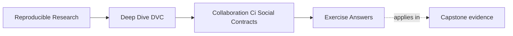
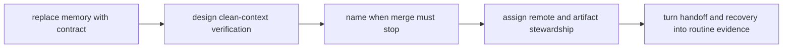

# Exercise Answers


<!-- page-maps:start -->
## Page Maps




<!-- page-maps:end -->

These answers are model explanations, not the only acceptable wording.

## How to use the answer page well

Do not read the model answer first and then collapse the whole module into "add one more
CI job."

A better rhythm is:

1. finish the exercise with your own contract and stewardship packet
2. name the shared promise, failure trigger, and responsible owner
3. compare your reasoning with the model answer
4. revise anywhere your answer still relies on memory, personal trust, or undeclared
   ownership

What matters is whether the reasoning turns collaboration expectations into verifiable
contracts.

Strong Module 07 answers usually do five things:

- they replace memory-based habits with visible checks
- they make CI prove shared state from a clean context
- they block merges when shared-state evidence is incomplete
- they treat remotes as governed infrastructure
- they use handoffs and drills to reveal missing contracts

The strongest self-study packets also leave behind six concrete artifacts:

- one rewritten team rule
- one DVC-aware CI route
- one merge-blocking review comment
- one stewardship table
- one recovery drill
- one handoff repair list

If your answers rely only on "the team should be careful," the reasoning is still too
thin.

## Answer 1: Rewrite a memory-based rule

Stronger contract:

> Pull requests that change DVC-tracked data pointers, `dvc.lock`, `dvc.yaml`, produced
> metrics, or published release artifacts must pass a clean verification route that pulls
> required objects from the shared remote and confirms declared state before merge.

What this names clearly:

- trigger: pointer, lock, pipeline, metric, or release-state changes
- verification: remote-backed clean-context check
- failure action: merge blocks until the missing object or broken contract is repaired

Why memory is not enough:

- memory disappears exactly when reviewers, future maintainers, and CI need explicit
  evidence most

## Answer 2: Design a DVC-aware CI route

Reasonable route:

```bash
dvc pull
dvc status
dvc repro
dvc metrics show
```

If the repository has a governed wrapper, that may be the stronger surface:

```bash
make -C capstone confirm
```

What this proves:

- a clean executor can recover required objects
- declared DVC state is inspectable
- the pipeline can reproduce or verify as expected
- metrics or release evidence exist for review

Least-privilege note:

- CI should use read-only access where possible and avoid mutation-capable remote
  credentials for ordinary verification

Fork note:

- untrusted forks should skip secret-backed remote checks or fall back to a safe reduced
  route that reports the limitation explicitly

## Answer 3: Review a merge blocker

Strong review comment:

> This pull request changes `dvc.lock` and metrics, but the current checks do not prove
> that the referenced DVC objects can be pulled from the shared remote. Please add or run
> a remote-backed clean-context verification route before merge. Until then, another
> maintainer may receive Git metadata that points to unrecoverable shared state.

Why author testimony is not enough:

- "I pushed it locally" is not durable shared evidence, especially once the review moves
  beyond the author's machine

## Answer 4: Define remote stewardship

Risks of one fully open remote:

- promoted artifacts can be deleted accidentally
- experimental state can contaminate release evidence
- retention and cleanup decisions become ambiguous
- CI or automation credentials may be broader than necessary

Rules to consider:

- separate development and protected release locations
- restricted deletion for promoted artifacts
- explicit ownership for remote configuration and policy
- narrow credentials for CI and routine users

Who should handle rotation or incidents:

- a named platform or storage steward with a documented backup owner and escalation route

## Answer 5: Plan a recovery drill

Reasonable drill:

```bash
git clone <repo-url>
dvc pull
make -C capstone confirm
make -C capstone recovery-review
```

Starting condition:

- clean checkout with no warm local cache and no private helper files

Success means:

- required objects pull from the shared remote
- the governed verification route passes
- a different maintainer can complete the route from written evidence

Findings that should become fixes:

- missing remote objects
- unclear credential instructions
- stale recovery documentation
- missing review commands
- unprotected release artifacts

Recommended cadence:

- rehearse on a scheduled basis and after important remote, release, or CI changes

## Answer 6: Review a data-changing pull request

A strong checklist asks:

- where the new data came from
- whether the object is recoverable from the governed remote
- which stages or outputs change because of it
- how metrics or decisions moved
- how the team would roll back if the change is rejected later

The main lesson is that pointer diffs are evidence handles, not complete review packets.

## Answer 7: Build a remote-presence CI check

CI should:

- use read-only credentials when possible
- verify object availability without destructive operations
- report exact missing object identities or paths
- explain clearly when forked pull requests cannot access the remote-backed route

The check must never mutate, delete, or garbage-collect the remote. Strong failure output
tells the team which shared-state promise failed and what evidence is missing.

## Answer 8: Resolve a pointer merge conflict

Legitimate conflict story:

- two branches both regenerate or replace the same governed artifact from different
  inputs, policies, or code states

Safe resolution route:

- decide which content is authoritative or regenerate from the intended merged state
- record the resulting object through normal DVC workflow
- commit the resulting pointer as a reference to real content

Why manual hash editing is unsafe:

- it can create metadata that names no meaningful or recoverable artifact

## Answer 9: Define ownership for shared artifacts

Healthy separation often looks like:

- repository maintainers own pointer and declaration review
- storage or platform owners manage remote durability and credentials
- domain reviewers own scientific or release acceptance
- incident owners coordinate recovery when shared evidence breaks

Why one person should not silently own every boundary:

- concentrated implicit ownership fails under absence, role change, or incident pressure

## Answer 10: Conduct a no-oral-history handoff

Every undocumented credential path, recovery command, data origin, expected metric, or
release assumption discovered by the teammate is a real finding.

High-value repair examples:

- add the missing command to the runbook
- automate a repeated manual check
- clarify the expected output or metric location
- document where release evidence lives and who owns it

The highest-value missing contract is usually the first place where the teammate must ask,
"What am I supposed to trust here?"

## Self-check

If your answers consistently explain:

- which human expectation needs an enforceable check
- how CI proves shared state from a clean context
- why incomplete DVC evidence blocks merge
- how remote policies protect collaboration and release evidence
- how recovery drills produce fixes

then you are using Module 07 correctly.
