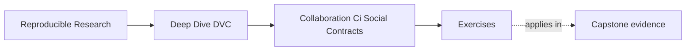
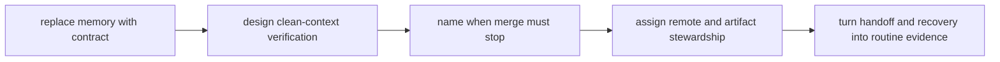
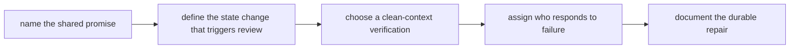

# Exercises


<!-- page-maps:start -->
## Page Maps




<!-- page-maps:end -->

Use these exercises to practice collaboration judgment, not only DVC command vocabulary.

The goal of the day is to stop treating team reliability as a personality trait. Most
collaboration failures around DVC are contract failures: someone assumed a push, a review,
or a recovery route would happen because responsible people remember things. Mature teams
replace that assumption with visible checks, scoped authority, and documented recovery.

## How to work through this set

Treat the ten exercises as one full lab day on social contracts for shared data state.

Before each answer:

1. name the shared artifact or promise at risk
2. name the clean-context check that would verify it
3. say who must act when the check fails

Do the exercises in order. The day is one progression:

- Exercises 1-3 replace memory-based habits with CI and review contracts
- Exercises 4-5 assign stewardship and design a recovery drill
- Exercises 6-8 review real collaboration failure surfaces around data changes and merges
- Exercises 9-10 turn ownership and handoff into durable team practice

Keep one collaboration packet as you go. By the end of the day it should contain:

- one rewritten memory-based team rule
- one DVC-aware CI route
- one merge-blocking review comment
- one remote stewardship note
- one recovery drill design
- one no-oral-history handoff repair list

If those six artifacts are missing, you are probably still describing good team behavior
instead of designing it.

## Recommended working layout

If you want one lab tree that can support the whole day, use something like:

```text
module07-lab/
├── artifacts/
├── notes/
├── review/
├── runbooks/
└── workflows/
```

Keep one contract table while you work:

| Human expectation | Triggering state change | Verifying check | Failure owner | Why memory is too weak |
| --- | --- | --- | --- | --- |

Also keep one stewardship table:

| Surface | Primary owner | Backup owner | Evidence of health | Escalation path |
| --- | --- | --- | --- | --- |



Use that route on purpose. It keeps the day centered on verifiable team behavior instead
of on vague advice like "be careful with the remote."

## Exercise 1: Rewrite a memory-based rule

A team says:

> Remember to push data before merging.

Rewrite this as a stronger collaboration contract.

Your answer should name:

- what CI or review should verify
- which files or state changes trigger the check
- why memory is not enough
- one sentence naming what happens when the check fails

Study note:
The exercise matters because memory-based rules are invisible right when the repository
needs the most clarity.

## Exercise 2: Design a DVC-aware CI route

Write a short CI verification route for a DVC pull request.

It should cover:

- clean checkout assumptions
- remote object availability
- declared pipeline state
- metric or release evidence when relevant

You do not need platform-specific YAML. A command sequence and explanation are enough.

What to hand in:

- the route
- one sentence about least-privilege credentials
- one sentence about what the route should skip on untrusted forks

Study note:
The strongest route proves shared state from less local context than the author had.

## Exercise 3: Review a merge blocker

A pull request changes `dvc.lock` and `metrics/metrics.json`.

CI passes formatting and unit tests, but nobody has checked whether DVC objects can be
pulled from the shared remote.

Write a review comment that explains:

- why the merge should wait
- what evidence is missing
- what exact verification route would unblock it
- one sentence explaining why "the author says they pushed it" is not enough

Study note:
This is where many students first learn that a passing code check is not the same as a
passing shared-state check.

## Exercise 4: Define remote stewardship

A team has one remote that everyone can write to and delete from.

Write a short note that explains:

- what risks this creates
- which permissions or ownership rules you would consider
- why release artifacts may need stronger protection than development artifacts
- one sentence naming who should handle credential rotation or remote incidents

Study note:
Shared storage is infrastructure, not background scenery.

## Exercise 5: Plan a recovery drill

Design a small recovery drill for the capstone or an equivalent DVC project.

Your answer should include:

- the starting condition
- the commands or checks to run
- what success means
- what kind of finding should become a repository fix
- how often the drill should be rehearsed

Study note:
Recovery claims become trustworthy only when rehearsed by someone who did not create the
state originally.

## Midday self-check

Before you move into pull-request review, pointer conflicts, and handoff repair, make
sure your packet can already answer these questions clearly:

- which human expectation should become a contract
- how CI proves shared state from a clean context
- why some merges must block on remote-backed evidence
- why remotes and release artifacts need explicit stewardship

If you cannot answer those four questions in plain language, return to Exercises 1-5 and
make the packet more explicit before continuing.

## Exercise 6: Review a data-changing pull request

Create a review checklist for a change to one tracked dataset and its pointer. Require
evidence for:

- origin
- remote availability
- affected stages
- metric change
- rollback route

Study note:
Data review gets stronger when reviewers stop treating pointer changes as self-explanatory.

## Exercise 7: Build a remote-presence CI check

Design a non-destructive CI step that verifies every required DVC object is available
before merge. Explain:

- credentials
- least privilege
- failure output
- fork behavior

Study note:
Good CI output tells the team exactly which shared-state promise failed.

## Exercise 8: Resolve a pointer merge conflict

Describe how two branches can legitimately change the same tracked artifact. Resolve the
conflict by choosing or regenerating content, not by manually combining hash lines.

What to hand in:

- the conflict story
- the resolution route
- one sentence explaining why manual hash editing is unsafe

Study note:
This exercise matters because DVC pointers are references to governed content, not text
fragments to splice.

## Exercise 9: Define ownership for shared artifacts

Assign owners for:

- pointer review
- remote administration
- retention
- incident response
- scientific acceptance

Explain why one person should not silently own every boundary.

Study note:
Ownership is useful only when it survives vacations, role changes, and incidents.

## Exercise 10: Conduct a no-oral-history handoff

Give a teammate only the repository and authorized remote access. Ask them to recover,
reproduce, and explain one result. Turn every question they must ask into a documentation
or automation repair.

What to hand in:

- the teammate questions
- the repair list
- one sentence naming the highest-value missing contract you discovered

Study note:
This final exercise matters because collaboration quality is proven by handoff, not by
confidence in the original author.

## Mastery check

You have a strong grasp of this module if your answers consistently keep five ideas
visible:

- collaboration failures are often missing contracts
- CI should verify shared state from less local context
- merges should block when DVC evidence is incomplete
- remotes are shared artifact infrastructure
- recovery drills turn restoration claims into evidence
