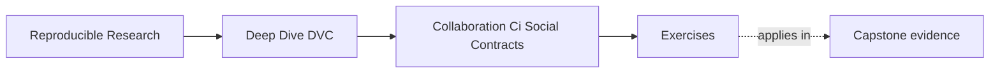
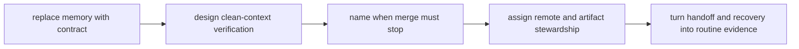
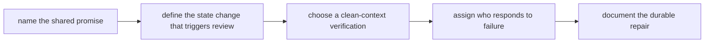

# Exercises


<!-- page-maps:start -->
## Page Maps




<!-- page-maps:end -->

Use these exercises to practice collaboration judgment, not only DVC command vocabulary.

The goal of the day is to stop treating team reliability as a personality trait. Most
collaboration failures around DVC are contract failures: someone assumed a push, a review,
or a recovery route would happen because responsible people remember things. Mature teams
replace that assumption with visible checks, scoped authority, and documented recovery.

## How to work through this set

Treat the ten exercises as one full lab day on social contracts for shared data state.

Before each answer:

1. name the shared artifact or promise at risk
2. name the clean-context check that would verify it
3. say who must act when the check fails

Do the exercises in order. The day is one progression:

- Exercises 1-3 replace memory-based habits with CI and review contracts
- Exercises 4-5 assign stewardship and design a recovery drill
- Exercises 6-8 review real collaboration failure surfaces around data changes and merges
- Exercises 9-10 turn ownership and handoff into durable team practice

Keep one collaboration packet as you go. By the end of the day it should contain:

- one rewritten memory-based team rule
- one DVC-aware CI route
- one merge-blocking review comment
- one remote stewardship note
- one recovery drill design
- one seven-case handoff classification
- one no-oral-history handoff decision record

If those seven artifacts are missing, you are probably still describing good team behavior
instead of designing it.

## Recommended working layout

Exercises 6-10 use the generated audit tree:

```text
artifacts/audit/reproducible-research/deep-dive-dvc/reviewer-handoff/
├── REVIEWER_HANDOFF_AUDIT_GUIDE.md
├── route.txt
├── summary.tsv
└── workspace/
    └── <case>/
        ├── author/
        ├── reviewer/
        └── evidence/
            ├── finding.json
            └── receipts.json
```

Keep one contract table while you work:

| Case | Discovery | Pull | Status before repro | Repro | Result claim | Decision |
| --- | --- | --- | --- | --- | --- | --- |

Also keep one stewardship table:

| Surface | Primary owner | Backup owner | Evidence of health | Escalation path |
| --- | --- | --- | --- | --- |



Use that route on purpose. It keeps the day centered on verifiable team behavior instead
of on vague advice like "be careful with the remote."

## Exercise 1: Rewrite a memory-based rule

A team says:

> Remember to push data before merging.

Rewrite this as a stronger collaboration contract.

Your answer should name:

- what CI or review should verify
- which files or state changes trigger the check
- why memory is not enough
- one sentence naming what happens when the check fails

Study note:
The exercise matters because memory-based rules are invisible right when the repository
needs the most clarity.

## Exercise 2: Design a DVC-aware CI route

Write a short CI verification route for a DVC pull request.

It should cover:

- clean checkout assumptions
- remote object availability
- declared pipeline state
- metric or release evidence when relevant

You do not need platform-specific YAML. A command sequence and explanation are enough.

What to hand in:

- the route
- one sentence about least-privilege credentials
- one sentence about what the route should skip on untrusted forks

Study note:
The strongest route proves shared state from less local context than the author had.

## Exercise 3: Review a merge blocker

A pull request changes `dvc.lock` and `metrics/metrics.json`.

CI passes formatting and unit tests, but nobody has checked whether DVC objects can be
pulled from the shared remote.

Write a review comment that explains:

- why the merge should wait
- what evidence is missing
- what exact verification route would unblock it
- one sentence explaining why "the author says they pushed it" is not enough

Study note:
This is where many students first learn that a passing code check is not the same as a
passing shared-state check.

## Exercise 4: Define remote stewardship

A team has one remote that everyone can write to and delete from.

Write a short note that explains:

- what risks this creates
- which permissions or ownership rules you would consider
- why release artifacts may need stronger protection than development artifacts
- one sentence naming who should handle credential rotation or remote incidents

Study note:
Shared storage is infrastructure, not background scenery.

## Exercise 5: Plan a recovery drill

Design a small recovery drill for the capstone or an equivalent DVC project.

Your answer should include:

- the starting condition
- the commands or checks to run
- what success means
- what kind of finding should become a repository fix
- how often the drill should be rehearsed

Study note:
Recovery claims become trustworthy only when rehearsed by someone who did not create the
state originally.

## Midday self-check

Before you move into pull-request review, pointer conflicts, and handoff repair, make
sure your packet can already answer these questions clearly:

- which human expectation should become a contract
- how CI proves shared state from a clean context
- why some merges must block on remote-backed evidence
- why remotes and release artifacts need explicit stewardship

If you cannot answer those four questions in plain language, return to Exercises 1-5 and
make the packet more explicit before continuing.

## Exercise 6: Predict the clean handoff outcomes

Before running the audit, inspect:

```text
capstone/repro/reviewer-handoff/
capstone/scripts/audit_reviewer_handoffs.py
```

For each case, predict:

- whether the reviewer discovers the remote
- whether pull succeeds
- whether status is clean before reproduction
- whether reproduction succeeds
- whether the restored result matches its claim
- `ACCEPT` or `BLOCK`

Then run:

```bash
make -C programs/reproducible-research/deep-dive-dvc/capstone reviewer-handoff-audit
```

Compare your table with `summary.tsv` and each `finding.json`.

What to hand in:

- prediction table
- corrected table
- one explanation of why `PASS / BLOCK` is not contradictory

Study note:
Prediction makes you reason from the handoff contracts instead of memorizing labels.

## Exercise 7: Separate remote discovery from object availability

Compare:

```text
workspace/missing-remote-object/evidence/receipts.json
workspace/undiscoverable-remote/evidence/receipts.json
```

For each case:

1. read `remote_list`
2. read `pull`
3. identify whether the remote route or the required bytes are missing
4. assign the repair to an owner
5. write an unblock condition

What to hand in:

- two short evidence records
- two different review comments
- one sentence explaining why both should not be reported as “remote failure”

Study note:
The same failed command can sit behind different contracts and different repairs.

## Exercise 8: Distinguish incomplete source from stale execution

Compare:

```text
workspace/untracked-stage-dependency/evidence/receipts.json
workspace/stale-execution-record/evidence/receipts.json
```

Build this table:

| Case | Pull | Pre-repro status | Repro | Missing or stale evidence | Repair |
| --- | --- | --- | --- | --- | --- |

Then answer:

- why does one reproduction fail while the other succeeds?
- why does successful reproduction not accept the stale handoff?
- which files must the author add or regenerate?
- which receipt must be captured before reproduction changes the workspace?

What to hand in:

- completed table
- one paragraph separating recoverability from submitted-state coherence
- one evidence-complete blocker for each case

Study note:
This exercise prevents “repro passed” from erasing the state that arrived for review.

## Exercise 9: Review authority and result meaning

Compare:

```text
workspace/mutating-review-route/reviewer/handoff-contract.json
workspace/missing-result-contract/reviewer/handoff-contract.json
```

The first case executes correctly but asks a reviewer to run `dvc push`. The second pulls
and reproduces but omits the expected result claim.

Design:

- a read-only pull-request route
- a separate trusted publication route
- a result contract for the incident summary
- fork behavior when remote credentials are unavailable

What to hand in:

- authority table naming read and write operations
- corrected review route
- corrected result contract
- one sentence explaining why executable output is not automatically reviewable

Study note:
Infrastructure success and result interpretation are different review authorities.

## Exercise 10: Conduct a no-oral-history handoff review

Use only the generated `complete-handoff/reviewer/` clone and its receipts. Do not inspect
the author workspace until your decision is written.

Produce a handoff record containing:

1. bounded claim
2. Git revision under review
3. cache starting condition
4. remote discovery evidence
5. pull evidence
6. pre-reproduction status evidence
7. reproduction evidence
8. result-to-claim comparison
9. authority used
10. `ACCEPT` or `BLOCK` with limits

Afterward, inspect one blocked author workspace. Write down any fact that was visible only
there and explain why it cannot be required for ordinary review.

What to hand in:

- complete decision record
- list of author-only facts you deliberately excluded
- one highest-value contract repair for a real project you know

Study note:
Collaboration quality is proven when the reviewer can make a bounded decision without
asking the author to narrate the workspace.

## Mastery check

You have a strong grasp of this module if your answers consistently keep five ideas
visible:

- collaboration failures are often missing contracts
- CI should verify shared state from less local context
- merges should block when DVC evidence is incomplete
- remotes are shared artifact infrastructure
- recovery drills preserve pre-repair observations
- executable output still needs a result contract
