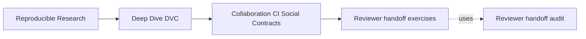
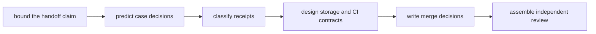
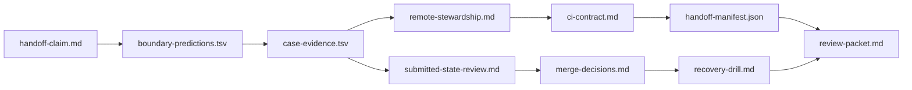

# Exercises

<!-- page-maps:start -->
## Page Maps




<!-- page-maps:end -->

These exercises produce one collaboration-review packet. You will work from the
cache-cold handoff audit rather than inventing generic team advice.

Every decision must name:

- the collaboration promise under review;
- the exact receipt that supports or defeats it;
- the consequence for an independent reviewer;
- the boundary owner and repair;
- the check that proves the repair;
- the claim limit.

## Working directory and source evidence

Generate the audit:

```bash
make PROGRAM=reproducible-research/deep-dive-dvc capstone-reviewer-handoff-audit
```

Set paths:

```bash
audit=artifacts/audit/reproducible-research/deep-dive-dvc/reviewer-handoff
cases="$audit/workspace"
learning=artifacts/learning/deep-dive-dvc/collaboration-handoff
mkdir -p "$learning"
```

Build:

```text
collaboration-handoff/
├── handoff-claim.md
├── boundary-predictions.tsv
├── case-evidence.tsv
├── remote-stewardship.md
├── submitted-state-review.md
├── ci-contract.md
├── merge-decisions.md
├── recovery-drill.md
├── handoff-manifest.json
└── review-packet.md
```

These names describe durable purpose. Keep generated learning work under `artifacts/`.

## Exercise: Bound the reviewer handoff claim

Write `handoff-claim.md`.

Include:

- the exact incident-summary claim;
- the reviewer's initial state;
- the Git-tracked surfaces required;
- the DVC-remote surfaces required;
- allowed read and local-write authority;
- forbidden shared-storage mutation;
- the seven acceptance checks;
- four claims the audit does not prove.

Add:

| Surface | Required state | Evidence | Owner |
| --- | --- | --- | --- |
| Git repository | | | |
| tracked remote route | | | |
| DVC objects | | | |
| execution record | | | |
| result contract | | | |
| reviewer permissions | | | |

**Evidence to inspect**

```bash
cat "$audit/REVIEWER_HANDOFF_AUDIT_GUIDE.md"
jq '.' \
  programs/reproducible-research/deep-dive-dvc/capstone/repro/reviewer-handoff/handoff-contract.json
```

**Success condition**

A new reviewer can distinguish operational handoff acceptance from scientific,
retention, security, and promotion claims.

**If you are stuck**

Complete the sentence: “Using only tracked state and authorized read access, a reviewer
can…”

## Exercise: Predict all seven handoff decisions

Before reading `summary.tsv`, inspect:

```bash
sed -n '1,260p' \
  programs/reproducible-research/deep-dive-dvc/capstone/scripts/audit_reviewer_handoffs.py
```

Write `boundary-predictions.tsv`:

```text
case	first_boundary	expected_decision	expected_failed_checks	reason
```

Add all seven cases. Then reveal:

```bash
column -t -s $'\t' "$audit/summary.tsv"
```

Append:

```text
observed_decision	observed_failed_checks	prediction_match	correction
```

Do not erase an incorrect prediction. Explain which prerequisite or evidence boundary you
misread.

**Success condition**

The first boundary is causal rather than merely the last failed command. Missing object
and undiscoverable remote must have different primary classifications.

**If you are stuck**

Ask which reviewer operation can no longer begin truthfully after the earliest failure.

## Exercise: Map receipts to collaboration promises

Write `case-evidence.tsv`:

```text
case	evidence_path	observation	inference	not_proved
```

For each case, include:

- `finding.json`;
- the decisive command receipt from `receipts.json`;
- the handoff contract when relevant;
- the result when relevant.

Extract concise reviewer receipts:

```bash
for case in \
  complete-handoff \
  missing-remote-object \
  undiscoverable-remote \
  untracked-stage-dependency \
  stale-execution-record \
  mutating-review-route \
  missing-result-contract
do
  jq --arg case "$case" '{
    case: $case,
    reviewer: .reviewer
  }' "$cases/$case/evidence/receipts.json"
done
```

Include at least one row explaining why successful reproduction does not prove submitted
state was clean.

**Success condition**

No inference says only “the handoff is broken.” It names discovery, availability, Git
completeness, currency, authority, execution, or result meaning.

**If you are stuck**

Use the check names in `finding.json` as the vocabulary for narrow claims.

## Exercise: Write a remote stewardship contract

Write `remote-stewardship.md` for this scenario:

> Researchers publish DVC inputs during development. A protected automation identity
> publishes accepted results. Internal reviewers require read access. Accepted revisions
> must remain reconstructable for three years.

Include:

- durable remote roles and tracked route configuration;
- credential boundaries without secret values;
- publication ordering relative to pointer review;
- read and write identities;
- object-integrity verification;
- retention and garbage-collection rules;
- cache-cold restoration cadence;
- incident ownership;
- migration and archive obligations.

Add a decision table for:

- tracked route absent;
- credential denied;
- object absent;
- object integrity mismatch;
- retention expired;
- review route requests push.

**Success condition**

The contract distinguishes identity, discovery, authorization, availability, integrity,
and retention. It does not use `dvc push` success as the only proof.

**If you are stuck**

Trace one pointer from proposed Git history to a cache-cold reviewer three years later.

## Exercise: Review submitted state before repair

Write `submitted-state-review.md` comparing:

- `complete-handoff`;
- `stale-execution-record`.

For each case, record:

- pull outcome;
- pre-repro status;
- submitted result values;
- reproduction outcome;
- post-repro meaning;
- handoff decision.

Extract decisive evidence:

```bash
jq '.reviewer | {pull, status_before_repro, repro}' \
  "$cases/complete-handoff/evidence/receipts.json"
jq '.reviewer | {pull, status_before_repro, repro}' \
  "$cases/stale-execution-record/evidence/receipts.json"
```

Draw a timeline showing when the reviewer first knows the submitted state is stale and
when local repair occurs.

End with a rule that CI can enforce.

**Success condition**

Your review blocks the stale case despite successful reproduction and explains exactly
which claim that success still supports.

**If you are stuck**

Label every receipt either “about submitted state” or “about reviewer-created state.”

## Exercise: Design a least-authority CI contract

Write `ci-contract.md` for a cache-cold handoff job.

Specify:

- supported merge claim;
- clean initial state and forbidden caches;
- executor identity;
- read-only remote permission;
- command and receipt order;
- required structured artifacts;
- case-specific failure messages;
- fork and untrusted-contribution behavior;
- receipt retention;
- required branch check;
- separate post-acceptance publication job;
- limits.

Include a permission matrix:

| Identity | Git read | DVC read | DVC write | CI artifact write | Release write |
| --- | --- | --- | --- | --- | --- |
| review job | | | | | |
| publication job | | | | | |
| external fork job | | | | | |

**Success condition**

The review job cannot mutate shared DVC storage, and the publication job cannot run before
an independently evidenced acceptance decision.

**If you are stuck**

Remove every permission not needed to answer the merge claim.

## Exercise: Write six boundary-specific merge decisions

Write `merge-decisions.md` with one blocking review comment for every defective case.

Each comment must contain:

```text
Decision
Failed boundary
Evidence
Consequence
Repair owner
Required repair
Reverification
Claim limit
```

Avoid one generic “rerun CI” response. Your missing-object and undiscoverable-route
comments must prescribe different repairs. Your stale-state comment must not accept CI's
locally regenerated result as submitted evidence.

Add one acceptance comment for `COMPLETE_HANDOFF` that states the bounded claim and names
remaining reviews.

**Success condition**

A contributor can act on every comment without oral clarification, and no comment grants
broader approval than the audit supports.

**If you are stuck**

Start from `failed_checks` in each `finding.json`, then locate the earliest decisive
receipt.

## Exercise: Plan a cache-cold recovery drill

Write `recovery-drill.md` for a remote migration.

The drill must define:

- repository revision and target claim;
- reviewer identity and initial state;
- old and new remote roles;
- forbidden author-cache shortcut;
- evidence-preservation route;
- injected missing-object and route-discovery failures;
- classification rule;
- recovery action for each failure;
- pre- and post-recovery identities;
- acceptance checks;
- measures for diagnosis, recovery, and proof;
- owners and escalation;
- residual limits.

Include a drill record template and a schedule triggered by both time and high-risk changes.

**Success condition**

The drill can distinguish “new remote lacks the object” from “clean clone cannot discover
the new route,” and it tests restoration using read authority.

**If you are stuck**

Make the starting reviewer less privileged than the migration operator.

## Exercise: Design a joined handoff manifest

Create syntactically valid `handoff-manifest.json` with placeholder identities.

Include:

- schema identity;
- handoff identifier;
- Git commit;
- DVC declaration and lock identities;
- tracked remote role, not secret credentials;
- data and result object identities;
- result-contract identity;
- reviewer executor identity;
- review permission mode;
- remote discovery receipt;
- pull receipt;
- pre-repro status receipt;
- reproduction receipt;
- result comparison;
- decision and failed checks;
- timestamps;
- manifest verifier.

Validate:

```bash
jq empty "$learning/handoff-manifest.json"
```

Add a section to `ci-contract.md` explaining who creates the manifest, who verifies it,
and how its handoff ID prevents receipts from different runs being mixed.

**Success condition**

The manifest joins one proposed revision, one clean review execution, and one bounded
decision without containing secrets or write credentials.

**If you are stuck**

Imagine the CI web interface disappears. Preserve the identities needed to repeat the
decision from stored artifacts.

## Exercise: Assemble an independent collaboration review

Write `review-packet.md` as the entry point to all prior artifacts.

Include:

- bounded handoff claim;
- exact audit regeneration command;
- artifact map;
- seven-case decision matrix;
- remote stewardship summary;
- submitted-state versus repaired-state distinction;
- CI authority contract;
- merge decision route;
- recovery drill acceptance;
- handoff manifest verification;
- unresolved risks;
- completion commands.

Add:



Verify:

```bash
test -s "$learning/handoff-claim.md"
test -s "$learning/boundary-predictions.tsv"
test -s "$learning/case-evidence.tsv"
test -s "$learning/remote-stewardship.md"
test -s "$learning/submitted-state-review.md"
test -s "$learning/ci-contract.md"
test -s "$learning/merge-decisions.md"
test -s "$learning/recovery-drill.md"
jq empty "$learning/handoff-manifest.json"
test -s "$learning/review-packet.md"
```

**Success condition**

A learner who missed the class can regenerate the source audit, reproduce every accept or
block decision, identify the correct repair owner, and state the limits without asking the
author.

**If you are stuck**

Use the shortest route from claim to decisive receipt, decision, repair, and limit. Do not
summarize every page.

## Completion standard

Your packet is complete when it demonstrates:

- reviewer independence from author cache and memory;
- separate remote discovery and object-availability diagnoses;
- joint Git and DVC completeness;
- preservation of pre-repro submitted-state evidence;
- read-only review and separate publication authority;
- result meaning beyond successful execution;
- boundary-specific merge comments;
- cache-cold recovery rehearsal;
- run-bound structured evidence;
- a standalone review route.
