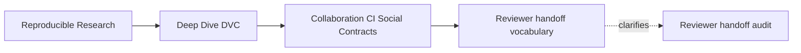
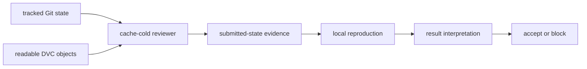
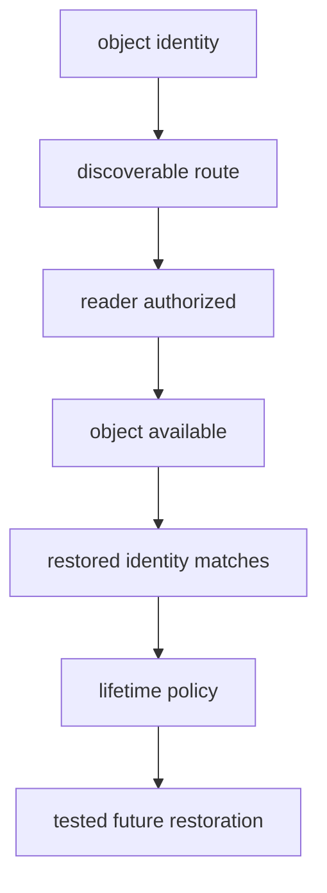
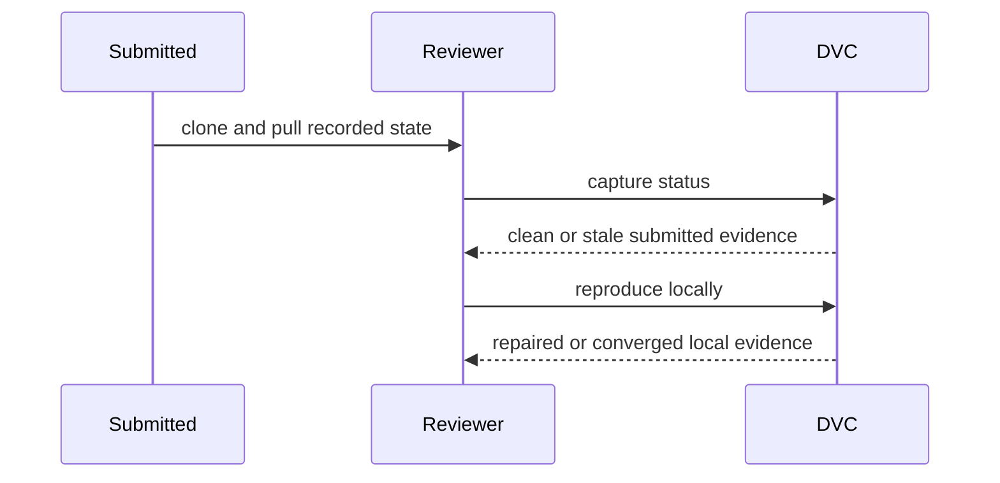

# Module Glossary

<!-- page-maps:start -->
## Page Maps

<!-- page-maps:end -->

Use these terms when reading the generated findings and writing review decisions. The
distinctions matter because similar command failures can have different owners and
repairs, while successful commands can support narrower claims than they appear to.

## Handoff terms

### Reviewer handoff

The repository state, shared objects, permissions, instructions, and claim evidence
provided so another person or automation identity can independently inspect and reproduce
a bounded result.

A handoff is evaluated from the receiver's state, not the author's workspace.

### Handoff claim

The explicit promise about what an independent reviewer can recover, execute, interpret,
and decide.

The module specimen claims that tracked Git state plus read access to the shared DVC remote
is sufficient to restore and explain one incident summary.

### Social contract

A collaboration promise with named responsibilities, evidence, decisions, and repair
ownership.

“Remember to push” is a reminder. “Every reviewed pointer must pass cache-cold pull before
merge” is an executable social contract.

### Independent reviewer

A person or automation identity that does not inherit the author's hidden conveniences and
has only the authority required for review.

Independence is a property of starting state and permissions, not job location.

### Cache-cold reviewer

A reviewer whose project DVC cache and generated outputs do not already contain the
objects being tested.

Tool download caches may still be allowed. Project data caches are excluded when the claim
is remote availability.

### Author-local state

State available to the author but absent from the shared handoff, such as:

- warm DVC cache;
- `.dvc/config.local`;
- untracked policy;
- shell variables;
- write credentials;
- remembered commands.

Author-local state can be legitimate. It becomes a defect when the shared claim depends
on it.

## Remote and object terms

### DVC pointer

A tracked record identifying required content. It supports content identity but does not
prove the object is available, discoverable, or readable.

### Shared DVC remote

Storage intended to make DVC objects available to a defined audience.

“Shared” requires an access and discovery contract; it does not mean public.

### Remote discovery

The reviewer's ability to identify the repository's intended storage route from tracked
non-secret configuration.

Discovery does not prove authorization or object availability.

### Object availability

The condition that the exact referenced content exists in the selected remote and can be
restored by the intended reader.

A pull receipt proves observed availability for a revision, identity, route, and time.

### Read authority

Permission to locate and retrieve required shared objects without changing remote state.

Read authority is the default requirement for review.

### Publication authority

Permission to write new DVC objects or release artifacts to governed shared storage.

It belongs to authors or protected automation according to policy, not ordinary
reviewers.

### Retention

The policy and operational behavior that keep required objects available for a stated
period.

One successful pull is current evidence, not proof of future retention.

### Stewardship

Ownership of discovery, permissions, publication, integrity, retention, recovery,
garbage collection, and migration for shared objects.

Stewardship extends beyond configuring a URL.

## Repository-completeness terms

### Git completeness

The condition that every source-side declaration, implementation, policy, parameter,
pointer, result contract, and non-secret route required by the claim is tracked in Git.

The untracked-dependency case lacks Git completeness even though DVC pull succeeds.

### DVC remote completeness

The condition that every DVC object required by the reviewed recorded state is available
through the governed remote route.

It does not cover scripts or policies that belong in Git.

### Two-store contract

The requirement that Git and DVC storage each contain the artifacts assigned to their
boundary, with identities that form one coherent state.

Neither store compensates for missing content in the other.

### Declared stage dependency

A file or directory listed as an input to a DVC stage.

If it is source-side policy or code, a clean Git clone must provide it. If it is
DVC-tracked data, the pointer and remote object route must provide it.

## Submitted-state terms

### Submitted state

The exact Git, pointer, lock, result, and contract state proposed for review before the
reviewer runs any repair-oriented command.

Merge decisions should evaluate this state, not only what CI can produce from it.

### Recorded-state currency

The condition that recorded stage and result evidence corresponds to current declared
inputs and controls.

Pre-reproduction status is central evidence for this claim.

### Pre-reproduction status

Status captured after recorded objects are restored but before `dvc repro` changes local
state.

It distinguishes a coherent submission from one CI can repair.

### Local repair

A change produced in the reviewer workspace that restores coherence, such as successful
reproduction of a stale stage.

Local repair can prove executable recovery. It does not retroactively make submitted state
current.

### Convergence

The state in which ordinary reproduction finds no further declared work after a coherent
execution.

Convergence is useful after recovery but does not erase the initial incident evidence.

## CI and permission terms

### Shared reproducibility executor

A governed automation environment that acts as an independent reviewer and publishes
evidence for a bounded collaboration claim.

CI becomes such an executor through clean state, explicit authority, ordered receipts, and
decision rules—not merely by running commands remotely.

### Least authority

Giving an identity only the permissions required for its claim.

A reviewer needs DVC read access and local workspace writes. It should not need DVC remote
write or release authority.

### Read-only review route

A verification path that restores, inspects, and reproduces without mutating shared
storage.

Local files may change during reproduction; “read-only” refers to shared authority.

### Publication job

A separate accepted-state workflow with controlled permission to write governed objects
or releases.

Its activation, input revision, written identities, and receipts should be explicit.

### Branch protection

Repository rules preventing shared history from accepting changes without required
evidence and authorization.

For this module, protection can require the cache-cold reviewer-handoff check.

### Required check

An automated decision whose success is necessary for merge.

Name checks by the durable claim they enforce, not by delivery order.

### Override

An authorized decision to accept state without the normally required evidence.

A responsible override records missing evidence, accepted risk, authority, reason, and
follow-up. It is not an invisible bypass.

## Evidence and decision terms

### Command receipt

A structured record of command, exit status, stdout, stderr, and relevant context.

The audit stores receipts for author and reviewer operations in `receipts.json`.

### Decisive receipt

The earliest evidence that establishes the primary failed boundary.

Later commands may fail as consequences. The decisive receipt guides ownership and repair.

### Handoff manifest

A structured record joining proposed Git and DVC identities, reviewer context,
permissions, receipts, result comparison, and decision for one handoff.

It must not include credentials or secret values.

### Handoff identifier

An identity binding receipts and decisions to one review execution.

It prevents valid evidence from different commits or runs being combined accidentally.

### `PASS / ACCEPT`

The audit established expected checks and the bounded handoff satisfies its contract.

### `PASS / BLOCK`

The audit successfully reproduced a handoff defect and the bounded handoff must not be
accepted.

Audit result and collaboration decision answer different questions.

### Blocking decision

A review conclusion that the proposed shared state lacks required evidence or violates the
handoff contract.

A complete decision names failed promise, receipt, consequence, owner, repair,
reverification, and limit.

### Claim limit

An explicit statement of what the evidence does not establish.

Examples include scientific validity, future storage retention, credential security, and
promotion eligibility.

## Result-meaning terms

### Result contract

A tracked description of the claim-relevant output fields, expected values or comparison
rules, evidence paths, and interpretation boundary.

It lets a reviewer decide whether successful output supports the intended claim.

### Executable output

An artifact produced by a successful command.

Execution proves production, not correctness or meaning.

### Interpretable result

Output whose fields and comparison rule are connected to a declared claim.

The missing-result-contract case produces executable output but lacks an interpretable
handoff claim.

## Recovery terms

### Cache-cold drill

A rehearsal beginning without project data cache or generated outputs and using the
intended reviewer identity.

It tests shared reconstruction rather than author convenience.

### First failed boundary

The earliest contract prerequisite defeated by the preserved evidence.

Classifying it prevents downstream symptoms from creating redundant or incorrect repairs.

### Evidence-preserving intervention

A repair action performed after initial state and receipts are saved, with before-and-after
identities recorded.

### Recovery proof

Evidence that the bounded claim can be reconstructed after the failure while preserving
the incident diagnosis.

Restored files without provenance or claim interpretation are incomplete recovery.

## Important contrasts

| Do not substitute | For | Reason |
| --- | --- | --- |
| committed pointer | available object | identity does not publish bytes |
| object availability | remote discovery | content can exist at an unknown route |
| read authority | object availability | permission does not create absent content |
| DVC pull success | Git completeness | source dependencies may be untracked |
| successful repro | clean submitted state | CI may have repaired it |
| review write permission | sufficient review design | excess authority increases risk |
| executable output | result contract | file creation does not define meaning |
| current pull receipt | retention guarantee | availability changes over time |
| audit `PASS` | handoff `ACCEPT` | blocked defects can be successfully reproduced |
| warm author run | independent handoff | local state can hide shared defects |

## Language for review

Prefer:

> The tracked remote is discoverable, but the pull receipt shows the referenced object is
> absent; block object availability and assign publication ownership.

> Pre-reproduction status is stale. Successful local repro demonstrates repairability,
> not coherent submitted state.

> Pull and reproduction succeed, but the missing claim contract prevents result
> interpretation.

Avoid:

> DVC is broken.

> CI fixed it.

> The data is probably somewhere.

> Give the job more permissions.

Precise vocabulary turns collaboration failure into a bounded decision with an owner and
a reproducible repair route.
