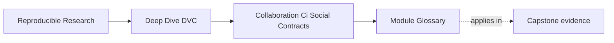

# Module Glossary

<!-- page-maps:start -->
## Page Maps

<!-- page-maps:end -->

This glossary belongs to **Module 07: Collaboration, CI, and Social Contracts** in
**Deep Dive DVC**.

Use it to keep the module language stable while you move between the core lessons, the
worked example, the exercises, and capstone review.

## How to use this glossary

Read the directory index first. Return here when a review rule, CI check, remote policy,
or recovery discussion starts to feel vague.

The goal is not extra theory. The goal is shared language for turning collaboration
expectations into verifiable contracts.

## Terms in this directory

| Term | Meaning in this directory |
| --- | --- |
| social contract | A team agreement that should be visible in review, CI, documentation, or repository policy. |
| shared proof | Evidence another maintainer can inspect without private local context. |
| clean executor | A CI runner or maintainer workspace that starts without the author's private files or cache. |
| clean reviewer handoff | A Git revision, remote route, object set, execution record, review authority, and result contract that a cache-cold reviewer can verify independently. |
| remote discovery | The clone's ability to determine which shared DVC storage route applies to the repository. |
| object availability | The presence of every DVC object required by the reviewed revision at an authorized remote. |
| repository completeness | The condition where every declared Git-owned script, policy, and configuration dependency is tracked and available to the clone. |
| pre-reproduction status | A status receipt captured after remote recovery but before reproduction changes the reviewer workspace. |
| submitted-state coherence | Agreement among the submitted pointers, stage dependencies, lock evidence, and recorded outputs before reviewer repair. |
| repair-oriented reproduction | A reproduction run that may restore local consistency but cannot retroactively prove the submitted revision was coherent. |
| result contract | A bounded statement of expected output values, evidence paths, and permitted interpretation. |
| review authority | The operations and credentials an ordinary reviewer or CI job is permitted to use. |
| publication authority | Trusted permission to write objects or promoted state to shared storage. |
| local-only success | A result that works on one machine but cannot be restored or verified by shared evidence. |
| merge gate | A required check or review condition that must pass before a change reaches shared history. |
| protected branch | A branch with rules such as required CI, review approval, and no force-push. |
| remote-backed verification | A check that proves required DVC objects can be pulled from shared artifact storage. |
| DVC remote | Shared storage for DVC-tracked objects used by collaborators, CI, and recovery routes. |
| artifact stewardship | Ownership and policy for storing, protecting, deleting, and restoring DVC-backed artifacts. |
| development remote | A remote or remote prefix used for active collaborative work and candidate artifacts. |
| release remote | A more protected remote or remote prefix used for promoted artifacts and release evidence. |
| missing data push | A failure where Git metadata references DVC objects that were not uploaded to the shared remote. |
| state claim | A repository assertion about data, outputs, parameters, metrics, or lock evidence. |
| recovery drill | A rehearsal that tests whether the project can be restored from shared evidence. |
| incident readiness | The ability to respond when artifacts, credentials, remotes, or history become unclear or damaged. |
| release boundary | The promoted bundle or surface downstream readers are expected to trust. |
| review route | A documented command sequence or checklist used to verify a change before merge or promotion. |
| unblock condition | The exact new evidence required before a blocked handoff can be reviewed again. |
| remote stewardship owner | The person or role responsible for remote configuration, permissions, retention, and recovery access. |
| rendering of trust | The visible evidence that allows a reviewer to trust a result without relying on author identity. |

## Stable review questions

Use these questions when the module feels abstract:

- What promise is this team relying on?
- Is that promise enforced by CI, review, or policy?
- Can a clean executor pull the required DVC objects?
- Can the clone discover the remote without author-local configuration?
- Was status captured before reproduction repaired the workspace?
- Does review avoid remote write authority?
- Does the restored result match an explicit result contract?
- Do changed DVC files have matching evidence?
- Does the branch rule protect shared history?
- Who owns the remote and release artifact policy?
- Has recovery been rehearsed from a clean starting point?
- Could another maintainer verify this without asking the author for private context?
