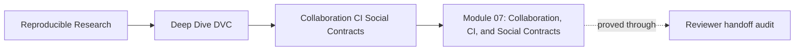
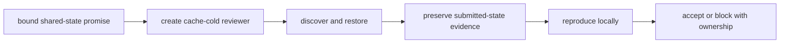
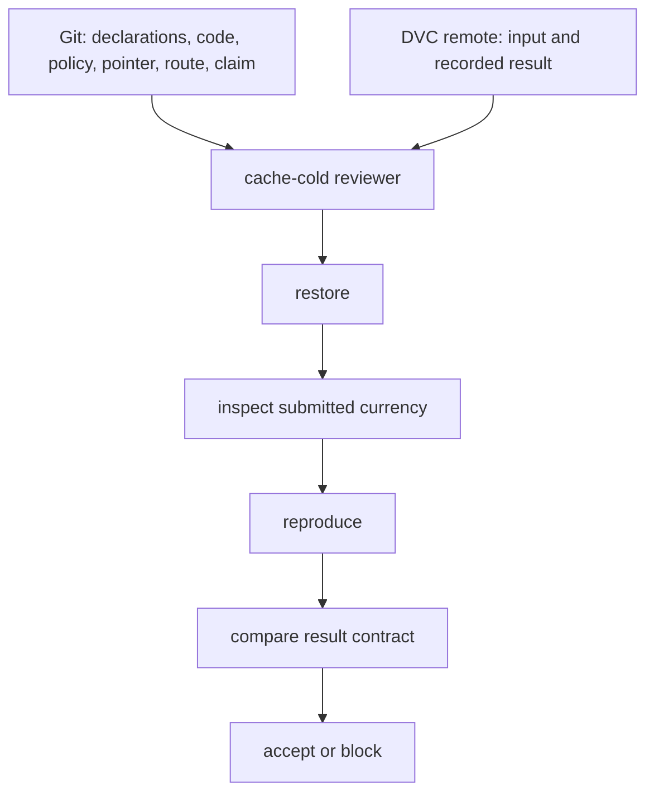
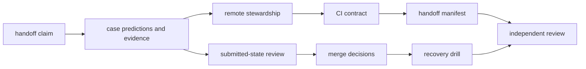

# Module 07: Collaboration, CI, and Social Contracts

<!-- page-maps:start -->
## Page Maps




<!-- page-maps:end -->

A DVC project can work for its author and fail every teammate. The author's cache may hide
unpublished objects, local configuration may hide the remote route, untracked policy may
hide a source dependency, and successful CI reproduction may hide that submitted state
was stale.

This module teaches collaboration from the receiving side:

> Can a cache-cold reviewer recover, inspect, reproduce, and explain the submitted claim
> with tracked repository state and authorized read access alone?

The capstone reviewer-handoff audit answers that question with one accepted case and six
controlled defects.

## Prerequisites

You should already be able to:

- distinguish Git-tracked source from DVC-tracked content;
- read a pointer, `dvc.yaml`, and `dvc.lock`;
- explain DVC stale status;
- run Make targets from the repository root;
- inspect JSON with `jq`;
- distinguish reproduction from recovery.

If status and lock evidence are unclear, revisit Modules 03 and 04. If remote object
identity is unclear, revisit Module 02.

You do not need prior CI administration experience. This module builds permission and
branch-protection choices from the review claim.

## Learning outcomes

After completing the evidence packet, you should be able to:

- define a handoff without relying on author memory;
- separate remote discovery, read authority, object availability, and retention;
- explain why Git and DVC storage must both be complete;
- preserve submitted-state status before CI repair;
- design a cache-cold reviewer job;
- separate read-only verification from write-enabled publication;
- write boundary-specific merge comments;
- rehearse handoff recovery from a least-privileged identity;
- join Git, DVC, execution, and result evidence in one manifest;
- state what a successful handoff does not prove.

## The bounded specimen claim

The specimen summarizes four incident records:

```text
record_count = 4
severity_total = 11
weekend_handoffs = 2
```

A complete handoff gives the reviewer:

- a tracked data pointer;
- a discoverable remote route;
- readable input and recorded-result objects;
- tracked declaration, script, and policy;
- clean recorded state before reproduction;
- a read-only review route;
- a result contract defining expected meaning.



The audit does not test whether the four incidents are representative. It tests whether
the bounded recorded claim can cross the collaboration boundary intact.

## Generate the learning evidence

Run:

```bash
make PROGRAM=reproducible-research/deep-dive-dvc capstone-reviewer-handoff-audit
```

The packet appears under:

```text
artifacts/audit/reproducible-research/deep-dive-dvc/reviewer-handoff/
```

Begin:

```bash
audit=artifacts/audit/reproducible-research/deep-dive-dvc/reviewer-handoff
column -t -s $'\t' "$audit/summary.tsv"
cat "$audit/route.txt"
```

The audit creates independent author, DVC remote, and reviewer workspaces for every case.
It does not modify the source specimen in place.

## Interpret result and decision separately

| Audit result | Handoff decision | Meaning |
| --- | --- | --- |
| `PASS` | `ACCEPT` | the complete handoff satisfies all checks |
| `PASS` | `BLOCK` | the audit successfully reproduced the intended collaboration defect |
| `FAIL` | any | audit enforcement did not establish its expected case |

Do not report six blocked rows as failed tests. The tests pass by proving those handoffs
must not merge.

## The seven cases

| Case | Primary boundary | Decision |
| --- | --- | --- |
| complete handoff | all seven checks pass | accept |
| missing remote object | referenced bytes absent | block |
| undiscoverable remote | route exists only in author-local state | block |
| untracked stage dependency | Git lacks required policy | block |
| stale execution record | submitted result predates changed input | block |
| mutating review route | reviewer is asked to push | block |
| missing result contract | output has no interpretable claim | block |

These cases form a diagnostic vocabulary. They are not an exhaustive security, storage,
or scientific review.

## Full study route

| Reading | Question answered | Evidence action |
| --- | --- | --- |
| [Collaboration Failures and Social Contracts](collaboration-failures-and-social-contracts.md) | what promise does a handoff make? | map seven checks to owners |
| [DVC Remotes and Shared Artifact Stewardship](dvc-remotes-and-shared-artifact-stewardship.md) | why do remote failures differ? | compare missing object with missing discovery |
| [CI as Shared Reproducibility Executor](ci-as-shared-reproducibility-executor.md) | what should a reviewer job prove? | preserve receipts in claim order |
| [Merge Review and Branch Protection](merge-review-and-branch-protection.md) | what must block shared history? | write boundary-specific decisions |
| [Recovery Drills and Incident Readiness](recovery-drills-and-incident-readiness.md) | how is the route rehearsed? | design cache-cold recovery |
| [Worked Investigation: Blocking Incomplete Reviewer Handoffs](worked-investigation-blocking-incomplete-reviewer-handoffs.md) | how do all seven decisions fit? | trace findings and receipts |
| [Exercises](exercises.md) | can you produce the contracts? | build ten-artifact learning packet |
| [Exercise Answers](exercise-answers.md) | where does reasoning overclaim? | revise against model evidence |
| [Glossary](glossary.md) | are boundaries named precisely? | check terminology during review |

Read in this order for a first pass. Plan one substantial session for lessons and the
worked investigation, then another for the cumulative review packet.

## Diagnostic return route

| Symptom | Begin with | Continue with |
| --- | --- | --- |
| pointer committed but teammate cannot pull | remote stewardship | worked investigation remote cases |
| CI turns stale submission green | CI executor | submitted-state exercise |
| review job needs write credentials | CI executor | least-authority contract |
| pull succeeds but repro fails | social contracts | untracked-dependency case |
| output exists but reviewer cannot judge it | merge review | missing-contract case |
| remote migration is planned | recovery drills | stewardship and drill exercises |

Use the full route before relying on this shortcut for the first time.

## Cumulative learning packet

The exercises create:

```text
artifacts/learning/deep-dive-dvc/collaboration-handoff/
├── handoff-claim.md
├── boundary-predictions.tsv
├── case-evidence.tsv
├── remote-stewardship.md
├── submitted-state-review.md
├── ci-contract.md
├── merge-decisions.md
├── recovery-drill.md
├── handoff-manifest.json
└── review-packet.md
```



The packet should work without instructor interpretation.

## Evidence reading order

For each generated case:

1. read `evidence/finding.json`;
2. identify the primary failed check;
3. read the decisive receipt in `evidence/receipts.json`;
4. inspect the reviewer contract or result when relevant;
5. separate submitted-state evidence from post-repro repair;
6. write the decision, owner, repair, reverification, and limit.

This order prevents a successful final command from obscuring the original defect.

## Commands to keep close

Generate all cases:

```bash
make PROGRAM=reproducible-research/deep-dive-dvc capstone-reviewer-handoff-audit
```

Enforce the audit implementation:

```bash
make PROGRAM=reproducible-research/deep-dive-dvc capstone-reviewer-handoff-selftest
```

Inspect one finding:

```bash
jq '.' \
  artifacts/audit/reproducible-research/deep-dive-dvc/reviewer-handoff/workspace/stale-execution-record/evidence/finding.json
```

Inspect its reviewer receipts:

```bash
jq '.reviewer' \
  artifacts/audit/reproducible-research/deep-dive-dvc/reviewer-handoff/workspace/stale-execution-record/evidence/receipts.json
```

## Common reasoning errors

| Error | Correction |
| --- | --- |
| pointer committed means data shared | prove referenced object restoration |
| pull failure means missing object | inspect discovery and authorization first |
| successful pull means repository complete | Git may lack scripts or policies |
| successful repro means submission was coherent | preserve pre-repro status |
| reviewer can push, so permissions are sufficient | verification should not require mutation |
| generated file means result is reviewable | require a claim contract |
| CI passed, so result is scientifically valid | name the bounded job conclusion |
| one successful pull proves retention | availability evidence is time-bound |

## Completion proof

After finishing the exercises:

```bash
learning=artifacts/learning/deep-dive-dvc/collaboration-handoff

test -s "$learning/handoff-claim.md"
test -s "$learning/boundary-predictions.tsv"
test -s "$learning/case-evidence.tsv"
test -s "$learning/remote-stewardship.md"
test -s "$learning/submitted-state-review.md"
test -s "$learning/ci-contract.md"
test -s "$learning/merge-decisions.md"
test -s "$learning/recovery-drill.md"
jq empty "$learning/handoff-manifest.json"
test -s "$learning/review-packet.md"
```

Explain orally:

- Why do missing object and undiscoverable remote require different repairs?
- Why can pull succeed while the Git handoff remains incomplete?
- Why does successful repro not redeem stale submitted state?
- Why must ordinary review avoid `dvc push`?
- What does a result contract contribute after execution succeeds?
- Which evidence is current observation and which is future policy?

If any answer relies on “the author knows where it is,” return to the clean-reviewer
boundary.

## Transition to Module 08

Module 07 establishes that another person can receive the state and its claim. Module 08
asks how the workflow survives deeper loss, scale pressure, and incidents.

Carry forward:

> Recovery begins with a tested handoff boundary; without independent reconstruction,
> author convenience can masquerade as resilience.
