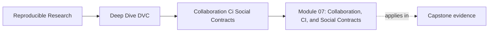

# Module 07: Collaboration, CI, and Social Contracts


<!-- page-maps:start -->
## Page Maps




<!-- page-maps:end -->

Module 07 turns reproducibility from a single-person practice into a team contract.

By now, you know how a DVC project should represent data identity, runtime evidence,
pipeline truth, metric meaning, and controlled experiments. The next pressure is ordinary
collaboration: another person clones the repository, reviews a change, relies on CI, and
expects the same state story to hold without private context.

This module is about shared proof:

- what failures appear when more than one person touches the workflow
- what CI should verify instead of trusting memory
- what branch and review rules should block
- how DVC remotes become part of collaboration, not only storage
- how recovery drills turn "we can restore it" into evidence

The central question is:

> Can another maintainer verify the same result without knowing what happened on my
> laptop?

If the answer is no, the repository still depends on social memory instead of a durable
contract.

The capstone corroboration surface for this module is the controlled reviewer-handoff
specimen in `capstone/repro/reviewer-handoff/`, its audit guide, seven isolated
author/reviewer pairs, and saved discovery, pull, status, reproduction, and result
receipts. That route tests this module's claim directly instead of asking generic
capstone confirmation to stand in for independent review.

## Why this module exists

Reproducibility often fails after the technical model is clear.

Common collaboration failures look familiar:

- a `.dvc` pointer or lockfile is merged but the data was never pushed
- a reviewer trusts a local result without a clean verification route
- CI checks formatting but not DVC state recovery
- a release bundle is promoted without the parameters and metrics needed for review
- a teammate can reproduce the code but not the data-backed result
- branch history is rewritten and nobody knows which artifacts still matter

These are not only human mistakes. They are missing contracts.

The point of Module 07 is not to add ceremony. The point is to decide which promises the
system should enforce because humans under pressure will forget them.

## Study route


Read the module in that order the first time.

If the problem is already partly clear, use this shortcut:

- open Core 1 when the main confusion is "why careful people are not enough"
- open Core 2 when the main confusion is "what CI should prove for DVC"
- open Core 3 when the main confusion is "what should block a merge"
- open Core 4 when the main confusion is "how remotes become team infrastructure"
- open Core 5 when the main confusion is "how do we know recovery will work?"

## Module map

| Page | Purpose |
| --- | --- |
| [Overview](index.md) | explains the module promise and study route |
| [Collaboration Failures and Social Contracts](collaboration-failures-and-social-contracts.md) | teaches how social failures become reproducibility failures |
| [CI as Shared Reproducibility Executor](ci-as-shared-reproducibility-executor.md) | teaches what CI should verify and why local success is not enough |
| [Merge Review and Branch Protection](merge-review-and-branch-protection.md) | teaches merge gates, branch rules, and review evidence |
| [DVC Remotes and Shared Artifact Stewardship](dvc-remotes-and-shared-artifact-stewardship.md) | teaches remote-backed collaboration and artifact stewardship |
| [Recovery Drills and Incident Readiness](recovery-drills-and-incident-readiness.md) | teaches recovery rehearsal and incident response as proof surfaces |
| [Worked Investigation: Blocking Incomplete Reviewer Handoffs](worked-investigation-blocking-incomplete-reviewer-handoffs.md) | compares one accepted handoff with six independently reproducible blocking decisions |
| [Exercises](exercises.md) | gives ten cumulative exercises ending in a no-oral-history handoff decision |
| [Exercise Answers](exercise-answers.md) | explains model answers and review logic |
| [Glossary](glossary.md) | keeps the module vocabulary stable |

## What should be clear by the end

By the end of this module, you should be able to explain:

- why careful teams still need enforceable reproducibility contracts
- what a DVC-aware CI route should verify
- why discovery, object availability, repository completeness, and recorded execution are
  separate contracts
- why pre-reproduction status must be preserved
- which merge events should block until data and lock evidence are complete
- how DVC remotes support collaboration and recovery
- why review should not require remote write authority
- why executable output still needs a result contract
- why recovery drills matter before an incident
- how to write review expectations that another maintainer can follow without private context

## Commands to keep close

These commands form the evidence loop for Module 07:

```bash
make PROGRAM=reproducible-research/deep-dive-dvc capstone-reviewer-handoff-audit
make PROGRAM=reproducible-research/deep-dive-dvc capstone-reviewer-handoff-selftest
dvc remote list
dvc pull
dvc status --json
dvc repro
```

Use the audit to compare controlled handoff outcomes. Use the DVC commands inside a
workspace when checking whether another maintainer can discover, restore, inspect, and
reproduce declared state in claim order.

## Capstone route

Use the capstone after you can name the collaboration failure being prevented.

Best corroboration surfaces for this module:

- `capstone/repro/reviewer-handoff/README.md`
- `capstone/repro/reviewer-handoff/handoff-contract.json`
- `capstone/scripts/audit_reviewer_handoffs.py`
- `capstone/tests/test_reviewer_handoff_audit.py`
- `capstone/docs/reviewer-handoff-audit-guide.md`
- generated `reviewer-handoff/summary.tsv`
- generated per-case `finding.json` and `receipts.json`

Useful proof route:

```bash
make PROGRAM=reproducible-research/deep-dive-dvc capstone-reviewer-handoff-audit
```

The point is not to prove that one author can run the project locally. It is to prove that
a cache-cold reviewer can discover the remote, restore the submitted state, observe it
before repair, reproduce it without private files, and explain the bounded result without
remote write authority.
