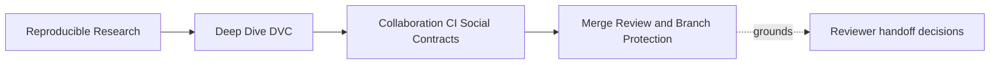
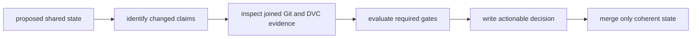
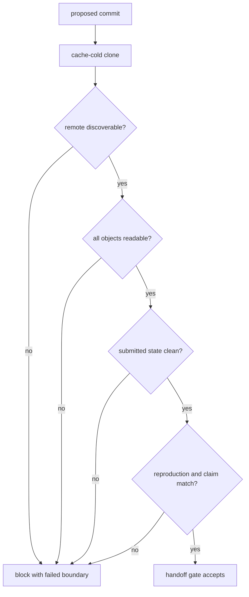

# Merge Review and Branch Protection

<!-- page-maps:start -->
## Page Maps




<!-- page-maps:end -->

A merge changes the shared history that future clones, CI jobs, and recoveries will trust.
For a DVC project, reviewing only the visible source diff is insufficient. A small pointer
change can promise new data objects; a parameter change can make a recorded result stale;
a remote configuration change can alter who can reconstruct history.

Branch protection should preserve a coherent claim across Git state, DVC object
availability, execution records, and result meaning.

## Review the change as a set

Map changed files to obligations:

| Changed surface | Review questions |
| --- | --- |
| `*.dvc` pointer | does the object exist in the shared remote; is the source change intended? |
| `dvc.yaml` | are dependencies, parameters, outputs, and commands truthful? |
| `dvc.lock` | does recorded state correspond to the proposed declarations and inputs? |
| `params.yaml` | were dependent results reproduced and comparisons reviewed? |
| pipeline script or policy | is every declared dependency tracked; do outputs remain meaningful? |
| `.dvc/config` | is the route non-secret, discoverable, and appropriate for reviewers? |
| result contract | does it state what values the reviewer should expect and why? |
| generated result | can it be restored or reproduced; does it match the contract? |

No filename proves readiness by itself. An unchanged lock can be correct when a
documentation-only change occurs and defective when an input pointer changed.

## Determine the claim affected by the diff

Before checking boxes, write:

> This proposal changes `<input/control/implementation/result/storage route>` and claims
> that `<recorded result or reproducibility property>` remains trustworthy.

Examples:

- “The incident sample pointer changes; the recorded summary is claimed current for the
  new sample.”
- “The shared DVC route changes; all required objects are claimed retrievable by the
  reviewer identity.”
- “The severity policy changes; the generated summary and claim contract are claimed to
  reflect the new policy.”

The claim selects the evidence. Without it, reviewers may demand unrelated files or miss a
stale result.

## Use a cache-cold gate

Run the reference audit:

```bash
make PROGRAM=reproducible-research/deep-dive-dvc capstone-reviewer-handoff-audit
audit=artifacts/audit/reproducible-research/deep-dive-dvc/reviewer-handoff
```

The accepted case requires:

```text
remote_discoverable
pull_succeeded
recorded_state_clean_before_repro
repro_succeeded
review_route_avoids_remote_mutation
result_contract_present
result_matches_claim
```

This is a useful merge gate because it tests the proposed state from the reviewer's
boundary, not from the author's convenient workspace.



Acceptance by this gate is necessary for the handoff claim. Other scientific, security,
or release gates may still be required.

## Block stale submissions even when CI can repair them

The stale execution audit case:

- discovers the remote;
- pulls every object;
- successfully reproduces;
- still blocks.

Inspect:

```bash
jq '.findings[] | select(.finding == "STALE_EXECUTION_RECORD")' \
  "$audit/report.json"
```

The submitted data pointer had changed without a corresponding recorded execution. CI's
successful repro creates a coherent local result, but that result is not the submitted
record.

A suitable blocking comment:

> Block: cache-cold status reports `summarize_incidents` stale before reproduction, and
> the submitted summary does not match the handoff claim. CI can regenerate a matching
> local result, which proves the pipeline is executable but not that the proposed lock and
> result are coherent. Reproduce from the proposed inputs, record the resulting state,
> publish its DVC objects, and rerun the handoff gate.

The comment distinguishes evidence, consequence, and repair.

## Review remote failures without guessing

Compare:

```bash
jq '.findings[] |
  select(
    .finding == "MISSING_REMOTE_OBJECT" or
    .finding == "UNDISCOVERABLE_REMOTE"
  )' "$audit/report.json"
```

Write different comments:

### Object absent

> Block: the tracked remote is discoverable, but pull cannot retrieve objects referenced
> by the proposed state. Publish the exact referenced objects from the reviewed revision
> and prove restoration from a cache-cold reviewer.

### Route undiscoverable

> Block: the audit objects exist in shared storage, but the clean clone has no tracked
> remote route. Add a non-secret shared route to tracked DVC configuration; keep
> credentials in the approved external or local mechanism.

Do not suggest changing credentials for an absent object or republishing objects when the
repository lacks the route.

## Review Git completeness independently

The untracked dependency case pulls successfully. It still cannot reproduce because
`policy/severity-policy.json` exists only in the author's workspace.

This exposes a two-store contract:

| Store | Must contain |
| --- | --- |
| Git | declarations, scripts, policies, parameters, pointers, non-secret route configuration |
| DVC remote | content-addressed data and recorded outputs selected for sharing |

Remote completeness cannot compensate for missing source-side dependencies. Branch
protection should detect both.

Review declared dependencies against tracked state:

```bash
git ls-files
dvc dag
```

Those commands contribute evidence, but a project-specific audit should check every
declared dependency directly.

## Separate review and publication permissions

The mutating-route case has complete files, clean state, successful reproduction, and a
matching result. It blocks solely because the handoff contract asks the reviewer to run
`dvc push`.

This is a policy failure:

- reviewers should inspect with read authority;
- publication should occur under a separate accepted-state workflow;
- forks should not receive shared-storage write credentials;
- verification should not mutate what it is judging.

Branch protection should require the read-only review job. A protected post-merge job may
publish under a distinct identity if repository policy calls for it.

## Require result meaning, not only execution

The missing-contract case passes pull, status, and repro. It blocks because no expected
claim tells the reviewer how to interpret `reports/summary.json`.

Execution evidence can say:

> The command ran and produced this file.

A result contract adds:

> For the governed sample, the file should report four records, severity total eleven,
> and two weekend handoffs.

The contract need not hard-code every research outcome. It should define the fields,
units, population or source identity, and comparison rule needed for the reviewed claim.

## Choose required checks by protected promise

| Protected promise | Required check |
| --- | --- |
| all shared pointers resolve | cache-cold remote pull |
| repository declares a discoverable route | tracked remote configuration check |
| source-side pipeline is complete | tracked dependency audit |
| proposed execution record is current | pre-repro status |
| supported environment can run pipeline | clean reproduction |
| reviewer needs read authority only | handoff-route policy check |
| output is interpretable | result-contract validation |

Avoid one broad job named only “tests.” Separate checks when distinct owners and repair
routes benefit from precise failures, while preserving an aggregate handoff decision.

## Write review comments as decisions

A complete blocking comment contains:

```text
Decision:
Block or accept the bounded claim.

Failed promise:
Name the collaboration contract that is not satisfied.

Evidence:
Link the exact receipt and relevant state.

Consequence:
Explain what a clean reviewer cannot conclude.

Repair:
Name the state change needed, without prescribing unrelated work.

Reverification:
Name the gate that must pass after repair.

Limit:
State which other claims this comment does not assess.
```

Avoid comments such as:

- “please run DVC again”;
- “data seems missing”;
- “CI is red”;
- “add the generated files.”

They do not identify the broken boundary or the correct storage owner.

## Protect against bypass

Branch rules should address:

- required status checks;
- stale-check dismissal;
- direct pushes to protected history;
- who may override a block and how that decision is recorded;
- reruns after the reviewed commit changes;
- retention of audit artifacts;
- trusted handling of forked code;
- publication jobs that run only after acceptance.

An override is a governance decision, not a hidden click. Record the missing evidence,
risk accepted, authority, and expiry or follow-up.

## Merge readiness checklist

For a change affecting workflow state:

- [ ] The changed claim is explicit.
- [ ] Git includes every declared source-side dependency.
- [ ] Tracked remote configuration is discoverable and contains no secrets.
- [ ] Every proposed pointer resolves for a cache-cold read-only reviewer.
- [ ] Pre-repro status says the submitted recorded state is coherent.
- [ ] Clean reproduction succeeds in the supported executor.
- [ ] The restored or regenerated result matches its contract.
- [ ] Review does not require remote mutation.
- [ ] Required receipts belong to the current commit.
- [ ] Separate scientific, security, and promotion reviews are named when applicable.

## Review checkpoint

You understand DVC-aware merge review when you can:

- derive evidence requirements from the changed claim;
- review pointers, declarations, locks, remotes, and results as one system;
- block stale submitted state despite successful CI repair;
- distinguish missing objects from missing remote discovery;
- detect Git incompleteness after successful DVC pull;
- preserve read-only review authority;
- write a boundary-specific blocking comment;
- state what a handoff gate does not approve.

The branch-protection standard is:

> Shared history should contain a coherent, independently recoverable claim—not merely
> enough ingredients for CI to repair one after merge.
