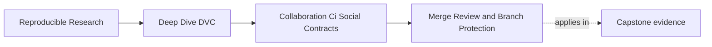

# Merge Review and Branch Protection


<!-- page-maps:start -->
## Page Maps




<!-- page-maps:end -->

In a DVC project, a merge is not only a code event.

It can change:

- data pointers
- pipeline declarations
- lock evidence
- parameters
- metrics
- published release bundles
- recovery expectations

Branch and review rules should reflect that reality.

## What should block a merge

A pull request should not merge when the shared state story is incomplete.

Common blockers:

- DVC metadata changed but required remote objects are missing
- `dvc.yaml` changed but `dvc.lock` evidence was not updated when it should be
- parameters changed without matching metric or review explanation
- metrics changed without baseline or comparability context
- release files changed without paired params, metrics, and manifest evidence
- CI cannot reconstruct the declared state from a clean checkout
- direct changes landed on the protected branch without review

These blockers are not punishment. They keep the main branch reproducible for the next
person.

## Decide from evidence, not file names

A changed `.dvc` pointer is a review trigger, not an automatic rejection. A changed
pointer can belong to a complete handoff or an incomplete one. The decision depends on
what a clean reviewer can recover and inspect.

Run the handoff audit, then read `summary.tsv`:

```bash
make PROGRAM=reproducible-research/deep-dive-dvc capstone-reviewer-handoff-audit
```

Use this decision matrix:

| Audit observation | Merge decision | Required repair |
| --- | --- | --- |
| all handoff checks pass | eligible for domain review | none at the collaboration boundary |
| remote configured, object missing | block | author or publication job pushes the named object |
| object exists, remote undiscoverable | block | maintainer tracks the shared remote route without tracking credentials |
| pull passes, stage dependency absent | block | author commits the dependency or declares a recoverable source |
| pull passes, pre-reproduction status stale | block | author reproduces and submits matching lock/output evidence |
| review route requires `dvc push` | block | CI owner separates verification from publication authority |
| result claim absent | block | domain owner records the expected interpretation and evidence surface |

Notice the ownership changes by row. “Fix CI” is not a useful response when the author
failed to push an object. “Push the data” is not a useful response when the remote route
exists only in local configuration.

## Review files as a set

Reviewers should avoid reading one file in isolation.

Useful pairings:

| Changed file | Review beside |
| --- | --- |
| `dvc.yaml` | `dvc.lock`, command code, expected outputs |
| `dvc.lock` | `dvc.yaml`, params, metrics, DVC output paths |
| `params.yaml` | metrics, experiment or release note |
| metric files | params, baseline, metric definition |
| `.dvc` pointer files | remote availability and data identity |
| `publish/v1/metrics.json` | `publish/v1/params.yaml` and release review |

The pattern is simple: every state claim needs its supporting evidence.

## Branch rules should protect shared history

Protected branches should usually require:

- CI success before merge
- review approval for DVC state changes
- no force-push on shared release branches
- required status checks for recovery or release routes when relevant
- clear ownership for remote and release-bundle changes

The exact platform settings vary, but the principle is stable:

> Shared history should not depend on one person's local state or unilateral rewrite.

Force-push risk is especially serious when people are coordinating Git history with DVC
state and remote artifacts. Rewriting the record can make it harder to know which
artifact evidence was intended to support which commit.

## Review comments should name the missing contract

Weak review comment:

> DVC looks wrong.

Stronger:

> This pull request changes `dvc.lock`, but CI has not shown that the new output objects
> can be pulled from the shared remote. Please push the missing objects or explain why no
> remote-backed artifact change is required.

Weak:

> Metrics changed. Please check.

Stronger:

> `metrics/metrics.json` changed while `params.yaml` also changed. Please add the
> comparison note that explains whether this is a same-control metric change or a
> parameter-driven tradeoff.

Specific comments teach the contract.

## Write a complete blocking comment

A review comment should carry four fields:

| Field | Purpose |
| --- | --- |
| failed contract | names why another maintainer cannot trust the handoff |
| evidence | points to the command or receipt that demonstrates the failure |
| repair owner | says who can correct the boundary |
| unblock condition | states the exact evidence required for rereview |

For the stale-execution case, a complete comment is:

> **Failed contract:** the submitted DVC execution record is stale relative to the
> changed data pointer. **Evidence:** the clean reviewer can pull every object, but
> `dvc status --json` is nonempty before reproduction and the restored summary does not
> match the handoff claim. **Owner:** the change author must reproduce and submit the
> matching lock and output state. **Unblock condition:** rerun the cache-cold review and
> show clean pre-reproduction status plus a result matching the recorded claim.

Do not write “`dvc repro` passed, resolved.” In this case, reproduction repairs the
reviewer workspace. It does not prove that the submitted commit was coherent.

For the missing-result-contract case, the owner is different:

> Execution and recovery pass, but the handoff does not state which result the reviewer
> should explain. The domain owner must add the expected claim and its evidence path
> before this output is reviewable.

The second comment prevents infrastructure checks from pretending to make a domain
decision.

## Merge readiness checklist

Before merge, the reviewer should be able to answer:

- can CI restore and verify the state?
- are DVC-tracked objects available to collaborators?
- can a clone discover the remote without inheriting the author's local config?
- do declarations and lock evidence agree?
- was status clean before any reproduction command changed the workspace?
- can review run without write credentials to shared storage?
- does the result contract explain what the output is supposed to mean?
- are parameter and metric changes explained together?
- are release-boundary changes complete?
- is the branch history protected from accidental rewrite?

If the answer is no, the merge should wait.

## Review checkpoint

You understand this core when you can:

- identify DVC-specific merge blockers
- review DVC files as related evidence instead of isolated diffs
- map each blocked handoff to the responsible repair owner
- write a comment with failed contract, evidence, owner, and unblock condition
- explain why protected branches matter for artifact lineage
- write a review comment that names the missing contract
- define merge readiness without relying on the author's local context

Merge discipline is where the social contract becomes repository policy.
