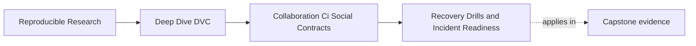
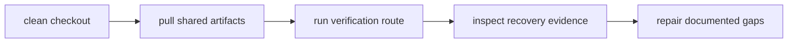

# Recovery Drills and Incident Readiness


<!-- page-maps:start -->
## Page Maps




<!-- page-maps:end -->

"We can recover it" is not evidence.

A recovery drill is evidence.

Module 07 treats recovery as a collaboration surface because incidents rarely happen when
the original author is available, calm, and holding all context. Another maintainer should
be able to restore the repository from documented sources and shared remotes.

## Recovery needs rehearsal

A DVC project can look healthy until someone tries to rebuild it from scratch.

A meaningful recovery route asks:

- can a clean checkout restore the required DVC objects?
- are credentials and remote permissions usable by the right roles?
- do published bundles contain the evidence they promise?
- can the verification route run after restore?
- are recovery instructions current enough for someone other than the author?

If nobody has tried the route, the team has a hope, not a capability.

## Drill from a clean state

A good drill starts from less local context, not more.

Examples:

```bash
git clone <repo-url>
dvc remote list
dvc pull
dvc status --json
dvc repro
```

The exact commands vary. The important constraint is that the person running the drill
does not rely on private workspace files or remembered manual steps.



The drill is successful only if it teaches the team what works and what needs repair.

## Observe before repairing

A recovery command can change the workspace. That is useful during an incident, but it
can erase evidence during a handoff audit.

Use two checkpoints:

| Checkpoint | Question | Commands |
| --- | --- | --- |
| submitted-state observation | was the handed-off state already coherent? | remote discovery, pull, status, result inspection |
| recovery or reproduction | can the clean maintainer rebuild what is missing or stale? | repro, governed verification, recovery review |

The first checkpoint judges the handoff. The second judges recoverability.

Run the controlled audit:

```bash
make PROGRAM=reproducible-research/deep-dive-dvc capstone-reviewer-handoff-audit
```

The stale-execution case demonstrates why both checkpoints matter:

```text
pull_succeeded: true
recorded_state_clean_before_repro: false
repro_succeeded: true
result_matches_claim: false
```

The repository is recoverable, but the submitted handoff is not acceptable. A reviewer
can rebuild the result, yet the author still owes a coherent commit with matching
execution evidence.

## Classify the clean-state failure

Do not use one generic recovery playbook for every failure:

| Observation | Capability lost | First repair |
| --- | --- | --- |
| remote list empty | discovery | restore tracked remote route or documented environment mapping |
| pull reports missing object | remote availability | recover or republish the named object |
| pull passes, dependency absent | Git completeness | recover the tracked source or replace the hidden dependency |
| status stale, repro succeeds | submitted-state coherence | reproduce and record matching lock/output evidence |
| result exists, claim absent | interpretability | restore the result contract and decision context |

This classification tells the incident lead whether to involve the storage steward,
repository maintainer, change author, or domain owner. It also prevents a new remote
credential from being presented as a repair for a missing Git dependency.

## Turn a handoff audit into a drill record

A useful drill record names:

- starting Git revision
- whether the executor had a warm cache
- remote identity and access mode
- pre-repair command receipts
- any repair commands that changed local state
- the restored result and its claim
- owner and due date for every discovered contract gap

Record the boundary honestly. If a reviewer used an author-provided private file, the run
was assisted recovery, not a clean handoff. If the reviewer needed remote write access,
the route did not prove ordinary read-only review.

## Incidents reveal unclear ownership

Common incident questions:

- who can read the remote?
- who can restore release artifacts?
- who can rotate credentials?
- who decides whether an artifact can be deleted?
- where is the release evidence stored?
- which commit and DVC state are authoritative?

If the answers are not known before the incident, the team will invent them under stress.

That is why remote stewardship, branch protection, and recovery documentation belong in
the same module. They are all parts of shared state survival.

## Drill findings should become fixes

A drill that finds a gap should produce a concrete repair:

- update recovery instructions
- add a missing verification command
- fix remote permissions
- push missing artifacts
- protect release objects from deletion
- clarify which bundle is authoritative
- add CI coverage for a state check

Do not let drill notes become another archive of ignored warnings. The value is in turning
surprises into contracts.

Prioritize repairs that remove oral dependencies. A one-time instruction in a chat can
unblock the current drill while leaving the next maintainer exposed. Prefer a tracked
route, a failing check, or a named ownership record that the next clean executor can
discover.

## Recovery is not only disaster response

Recovery drills also help onboarding and review.

A new maintainer who can restore the project from shared evidence learns the system faster
than one who receives private instructions. A reviewer who can run a clean verification
route can challenge results without depending on the author.

Recovery is the strongest version of the collaboration question:

> Does the repository carry enough evidence for someone else to continue?

## Review checkpoint

You understand this core when you can:

- explain why recovery claims need rehearsal
- design a clean-state recovery route
- separate submitted-state observation from repair-oriented reproduction
- classify discovery, availability, Git completeness, coherence, and interpretation
  failures
- record when a drill used assistance or elevated authority
- identify ownership questions before an incident
- turn drill findings into repository or process fixes
- connect recovery readiness to collaboration and onboarding

Untested recovery is an assumption. A drill turns it into evidence.
