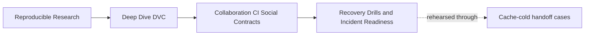
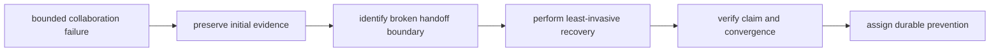
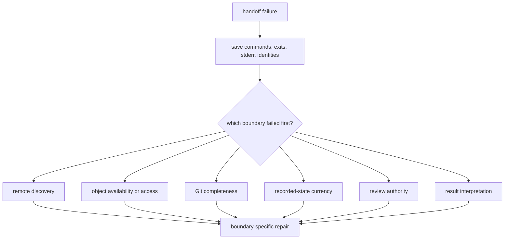

# Recovery Drills and Incident Readiness

<!-- page-maps:start -->
## Page Maps




<!-- page-maps:end -->

A recovery document can look complete while the team remains unable to restore anything.
A drill converts an assumed handoff into observed evidence: a named person or automation
identity begins without the author's cache, follows the documented route, encounters real
failure modes, and proves the recovered claim.

Module 08 covers deeper loss and incident survival. This lesson focuses on the
collaboration boundary: can a new reviewer reconstruct what the repository promises, and
can the team diagnose precisely when that handoff fails?

## Define the drill claim

Avoid the broad objective “test disaster recovery.” Choose a bounded claim:

> From a cache-cold clone and read-only remote access, the reviewer can discover storage,
> restore the recorded incident data and result, prove submitted state is clean, reproduce
> locally, and explain the result contract.

Name:

| Field | Example |
| --- | --- |
| repository revision | reviewed Git commit |
| starting state | no project DVC cache or generated outputs |
| reviewer identity | same read authority used by CI |
| remote route | tracked repository configuration |
| target claim | incident summary contract |
| time expectation | diagnostic evidence within an agreed window |
| forbidden shortcut | copying author's cache or using write credentials |

The drill is meaningful only if its initial state removes the conveniences it is meant to
test.

## Use the audit as a rehearsal

Run:

```bash
make PROGRAM=reproducible-research/deep-dive-dvc capstone-reviewer-handoff-audit
audit=artifacts/audit/reproducible-research/deep-dive-dvc/reviewer-handoff
```

The audit creates seven isolated handoffs:

- one complete handoff;
- missing remote object;
- undiscoverable remote;
- untracked stage dependency;
- stale execution record;
- mutating review route;
- missing result contract.

These are not seven random breakages. They exercise discovery, availability, source
completeness, execution currency, authority separation, and interpretation.

## Observe before repairing

For each case, inspect in claim order:

1. `evidence/finding.json`;
2. remote discovery receipt;
3. pull receipt;
4. status before reproduction;
5. restored result, when present;
6. reproduction receipt;
7. result contract and comparison.

The exact generated paths are listed in `route.txt`.



Do not begin by:

- copying data from a teammate;
- deleting DVC caches;
- changing remote URLs blindly;
- forcing reproduction;
- granting the reviewer write access;
- editing the expected result to match output.

Those actions can erase the evidence or bypass the contract under test.

## Classify the first failed boundary

Later checks often fail because an earlier prerequisite failed. In the missing-object case,
pull, status, reproduction, and result comparison all fail. The primary boundary is object
availability.

Use:

| Earliest decisive evidence | Classification |
| --- | --- |
| no tracked remote listed | discovery failure |
| remote listed, access denied | authorization failure |
| remote listed, object absent | publication or retention failure |
| pull succeeds, declared file absent | source-completeness failure |
| pull succeeds, pre-repro status stale | submitted-currency failure |
| route requires `dvc push` | authority-design failure |
| reproduction succeeds, claim absent | interpretation failure |

Record downstream consequences separately. This keeps the incident owner and repair
precise.

## Drill remote discovery and missing objects separately

These scenarios need different recovery actions.

### Undiscoverable route

Evidence:

- remote objects exist;
- clean reviewer configuration cannot identify the remote;
- pull cannot begin correctly.

Recovery:

- add the non-secret shared route to tracked configuration;
- keep credentials in the approved identity mechanism;
- recreate the clean clone;
- prove remote discovery and pull.

### Missing object

Evidence:

- tracked route is present;
- reviewer reaches the remote;
- referenced object is absent.

Recovery:

- identify the exact missing content identity;
- locate a trustworthy source, such as an authorized author cache or archive;
- publish under the correct write authority;
- verify the written identity;
- repeat cache-cold pull with read authority.

If no trustworthy source remains, the correct outcome is unrecoverable for that object,
not a fabricated replacement with the same filename.

## Drill incomplete Git state

The untracked-dependency case demonstrates a subtle failure:

- DVC pull succeeds;
- data and recorded outputs are available;
- the pipeline depends on an author-only policy file;
- clean reproduction fails.

Recovery requires recovering the exact source-side dependency from trustworthy history or
the author, reviewing it, and committing it. Adding a guessed policy until the command
runs would create a new result contract, not recover the submitted one.

The incident record should answer:

- where the missing dependency came from;
- how its identity was established;
- which results were invalidated;
- which tracked-dependency check will prevent recurrence.

## Drill stale submitted state

The stale case is operationally recoverable but review-blocking:

- every required object can be pulled;
- status before reproduction shows a stale stage;
- reproduction succeeds;
- regenerated result matches the claim.

The recovery drill must preserve both truths:

1. the submitted handoff was incoherent;
2. the declared pipeline can produce coherent local state.

Do not overwrite the first with the second. Save pre- and post-repro receipts and require
the author or governed automation to record and publish the coherent state before merge.

## Drill permission separation

Use the actual review identity, not an administrator credential.

Expected:

- remote discovery works;
- required objects are readable;
- local reproduction can write inside the isolated workspace;
- review receipts can be published to the CI artifact boundary;
- remote push is denied or absent from the route.

Then test the publication identity separately:

- it activates only after acceptance;
- it can write only the intended storage scope;
- it verifies published identities;
- it records an auditable receipt.

A drill that uses one broad credential cannot prove least-authority design.

## Measure diagnosis, recovery, and proof separately

Capture:

| Measure | Meaning |
| --- | --- |
| time to first decisive boundary | diagnostic clarity |
| time to restore required state | operational recoverability |
| time to produce accepted proof packet | review readiness |
| number of undocumented interventions | documentation debt |
| authority escalations required | permission-design debt |
| evidence lost during response | incident-process weakness |

Fast file restoration with no trustworthy claim evidence is not complete recovery.

Avoid optimizing only for a single total duration. A slower, evidence-preserving recovery
can be safer than a fast intervention that destroys diagnosis.

## Turn findings into durable changes

Each drill finding needs:

```text
Observed gap:
What failed from the declared starting state?

Evidence:
Which receipt makes the failure reproducible?

Risk:
Which handoff or recovery claim is unsupported?

Owner:
Who controls the source boundary?

Repair:
Which repository, storage, permission, or contract state changes?

Acceptance:
Which cache-cold check proves the repair?

Prevention:
Which routine gate detects recurrence?

Limit:
Which adjacent risks remain untested?
```

Examples:

| Finding | Durable prevention |
| --- | --- |
| author forgot to publish object | pre-merge cache-cold pull gate |
| remote known only locally | tracked-configuration check |
| declared policy untracked | tracked-dependency audit |
| stale lock/result submitted | pre-repro status gate |
| verifier needs write credential | split review and publication jobs |
| output lacks meaning | required claim-contract schema |

## Schedule drills by change and time

Run a handoff drill:

- when remote location or credential model changes;
- when retention or garbage-collection policy changes;
- after workflow dependency structure changes;
- when CI executor or cache policy changes;
- before a high-value release;
- periodically for long-lived repositories;
- after an incident reveals a boundary not covered by current cases.

Event-driven drills catch risky changes. Periodic drills catch quiet decay such as expired
credentials, lost ownership, and storage retention drift.

## Write the drill record

A standalone record should include:

```text
Claim and scope
Repository revision
Starting state and reviewer identity
Expected remote and result contract
Command and receipt route
Observed first failed boundary
Interventions in time order
Pre- and post-recovery identities
Acceptance checks
Durations
Owners and follow-up
Residual limits
```

Keep generated evidence under `artifacts/`. Durable repository policy belongs in the
appropriate repository documentation, not in transient drill output.

## Do not overclaim a successful drill

The reviewer-handoff audit does not prove:

- production storage durability;
- future object retention;
- correct secret rotation;
- full incident response readiness;
- scientific validity;
- release promotion eligibility.

A drill proves the tested claim under the tested revision, identity, storage route, and
time. Name those boundaries.

## Review checkpoint

You understand collaboration recovery drills when you can:

- design a cache-cold, read-only starting state;
- preserve evidence before intervention;
- classify the first failed boundary;
- choose different repairs for discovery and object absence;
- recover source-side dependencies without inventing them;
- retain proof that submitted state was stale even after successful repair;
- test review and publication identities separately;
- convert each finding into an owned, executable prevention.

The drill standard is:

> Recovery is demonstrated when an independent identity can reconstruct and explain the
> bounded claim, while preserving enough evidence to show what failed and why the repair
> is trustworthy.
