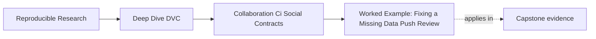

# Worked Example: Fixing a Missing Data Push Review


<!-- page-maps:start -->
## Page Maps




<!-- page-maps:end -->

This investigation begins with generated evidence, not an invented CI transcript. You
will diagnose a missing object, prove why the author workspace hid it, distinguish it
from stale execution evidence, and write the exact unblock condition.

The goal is not to scold the author. The goal is to identify which collaboration contract
failed and who can repair it.

## Run the controlled handoffs

From the repository root:

```bash
make -C programs/reproducible-research/deep-dive-dvc/capstone reviewer-handoff-audit
```

The audit creates seven isolated author and reviewer pairs. Start with:

```text
artifacts/audit/reproducible-research/deep-dive-dvc/reviewer-handoff/
├── summary.tsv
└── workspace/
    ├── complete-handoff/
    ├── missing-remote-object/
    └── stale-execution-record/
```

Do not begin with `report.json`. The summary gives the decisions; each case's receipts
show why.

## Establish the accepted reference

Open:

```text
workspace/complete-handoff/evidence/finding.json
```

Every check is `true`. The cache-cold reviewer:

1. discovers the `shared` remote
2. pulls the DVC-tracked input and recorded result
3. observes clean status before reproduction
4. reproduces without private files
5. uses no remote mutation command
6. finds an explicit result claim
7. confirms the result matches that claim

Now read:

```text
workspace/complete-handoff/reviewer/handoff-contract.json
workspace/complete-handoff/reviewer/reports/summary.json
```

The contract expects:

```json
{
  "record_count": 4,
  "severity_total": 11,
  "weekend_handoffs": 2
}
```

The restored result matches. The handoff decision is `ACCEPT`, bounded to this result and
these checks.

## Diagnose the missing-object case

Open:

```text
workspace/missing-remote-object/evidence/finding.json
workspace/missing-remote-object/evidence/receipts.json
```

Read the reviewer receipts in this order:

1. `remote_list`
2. `pull`
3. `status_before_repro`
4. `repro`

The remote list succeeds and names `shared`. Discovery is not the problem. The pull
receipt fails because the referenced objects were never pushed. Without the data and
recorded result:

- pre-reproduction status cannot establish a clean state
- reproduction cannot run
- the generated claim cannot be checked

The failed contract is **remote object availability**.

Weak review comment:

> DVC is broken. Please rerun CI.

Evidence-complete comment:

> **Failed contract:** the Git revision names DVC objects that are absent from the
> configured shared remote. **Evidence:** the cache-cold clone discovers `shared`, but its
> `dvc pull` receipt is nonzero and the required data and result are unavailable.
> **Owner:** the change author or trusted publication job must push the objects.
> **Unblock condition:** a new cache-cold clone must pull successfully, report clean
> pre-reproduction status, and match the recorded result contract.

This comment does not ask CI to repair publication. It assigns the missing push to an
actor with write authority.

## Explain why the author did not notice

Inspect the generated directories:

```text
workspace/missing-remote-object/author/.dvc/cache/
workspace/missing-remote-object/reviewer/.dvc/cache/
```

The author created the data and result locally, so the author's cache satisfies the
pointer. The reviewer clone begins without that cache. Git carries the pointer and lock
metadata, not the cached object bytes.

The author's successful reproduction proves local execution. It does not prove shared
availability.

## Do not confuse missing bytes with stale evidence

Now inspect:

```text
workspace/stale-execution-record/evidence/finding.json
workspace/stale-execution-record/evidence/receipts.json
```

This case has a different signature:

| Check | Missing object | Stale execution |
| --- | --- | --- |
| remote discovered | yes | yes |
| pull succeeds | no | yes |
| status clean before repro | no | no |
| repro succeeds | no | yes |
| restored result matches claim | no | no |

The stale case has all required remote bytes. The author changed and pushed the tracked
data pointer but did not record the dependent execution. Reproduction succeeds in the
reviewer clone because it repairs the local state.

That successful repair does not make the submitted commit acceptable. The change author
must reproduce and commit matching lock/output evidence, then the audit must start from a
new clone.

## Verify the repaired boundary

The complete case represents the evidence required after repair. A trustworthy rerun must
not reuse the failed reviewer workspace because reproduction may have warmed its cache and
changed outputs.

The clean verification sequence is:

```bash
dvc remote list
dvc pull
dvc status --json
dvc repro
```

Then inspect the expected claim and generated result together.

The sequence has two authority boundaries:

- the author or publication job performs `dvc push`
- the reviewer performs remote reads and local reproduction

Do not give ordinary pull-request review remote write authority merely to make the route
convenient.

## Record the repair without overstating it

A final review note can say:

> The original handoff was blocked because the configured shared remote lacked the DVC
> objects named by the submitted Git revision. The author published those objects using
> trusted write authority. A new cache-cold reviewer clone then discovered the remote,
> pulled the recorded input and result, observed clean status before reproduction,
> reproduced without private files, and matched the result contract. This establishes
> independent recoverability and reviewability for the bounded specimen; it does not by
> itself approve the result for release.

That note records:

- original failure
- responsible repair
- fresh verification context
- evidence sequence
- bounded conclusion

## Why this is a mastery example

This investigation exercises the whole module:

- Core 1: availability is separated from discovery, execution, and interpretation
- Core 2: the clean executor preserves status before repair
- Core 3: the blocking comment names evidence, owner, and unblock condition
- Core 4: push and pull use different authorities
- Core 5: the repaired proof starts from a new cache-cold clone

If your diagnosis rests only on the final `dvc repro` exit code, return to the pull and
pre-reproduction status receipts. The handoff decision concerns the submitted state, not
only whether a reviewer can repair it.
