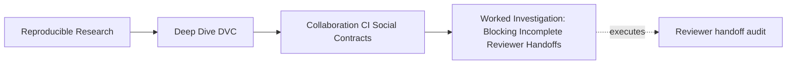
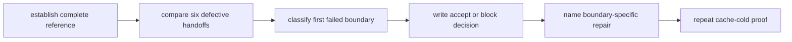
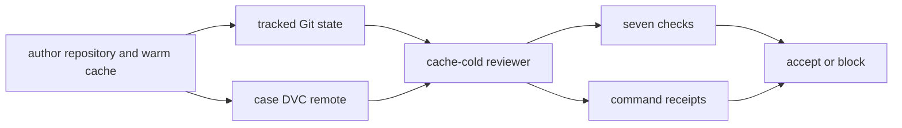
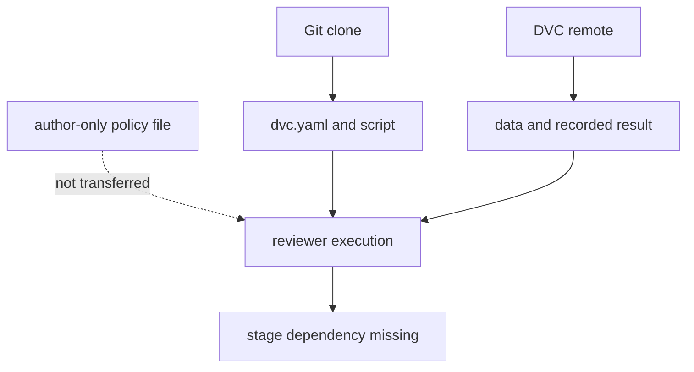

# Worked Investigation: Blocking Incomplete Reviewer Handoffs

<!-- page-maps:start -->
## Page Maps




<!-- page-maps:end -->

This investigation begins from the reviewer's side. You receive a Git clone and read
access to a DVC remote. You do not receive the author's cache, untracked files, private
configuration, shell history, or write credentials.

The question is:

> Can the submitted state be recovered, shown coherent before local repair, reproduced,
> and interpreted from the handoff alone?

You will compare one accepted handoff with six blocked cases. The objective is not to
memorize case names. It is to learn which receipt closes which collaboration promise.

## Generate the isolated handoffs

From the repository root:

```bash
make PROGRAM=reproducible-research/deep-dive-dvc capstone-reviewer-handoff-audit
```

Set short paths:

```bash
audit=artifacts/audit/reproducible-research/deep-dive-dvc/reviewer-handoff
cases="$audit/workspace"
```

Read the summary and route:

```bash
column -t -s $'\t' "$audit/summary.tsv"
cat "$audit/route.txt"
```

Expected decisions:

```text
COMPLETE_HANDOFF             ACCEPT
MISSING_REMOTE_OBJECT        BLOCK
UNDISCOVERABLE_REMOTE        BLOCK
UNTRACKED_STAGE_DEPENDENCY   BLOCK
STALE_EXECUTION_RECORD       BLOCK
MUTATING_REVIEW_ROUTE        BLOCK
MISSING_RESULT_CONTRACT      BLOCK
```

Every audit result is `PASS`. The blocked cases pass by reproducing the intended defect.

## Understand the bounded result

The specimen summarizes a small incident dataset. Its contract expects:

```json
{
  "record_count": 4,
  "severity_total": 11,
  "weekend_handoffs": 2
}
```

Read the source contract:

```bash
jq '.' \
  programs/reproducible-research/deep-dive-dvc/capstone/repro/reviewer-handoff/handoff-contract.json
```

The contract also names:

- the declared pipeline;
- the generated result;
- the tracked data pointer;
- the reviewer command route;
- read-only verification mode.

This contract does not endorse the scientific representativeness of four incidents. It
defines what a reviewer should be able to reconstruct and inspect.

## Learn the generated case anatomy

Each case contains:

```text
workspace/<case>/
├── author/
├── reviewer/
├── shared-dvc-remote/
└── evidence/
    ├── finding.json
    └── receipts.json
```

The reviewer is cloned with `--no-local`, preventing Git from reusing the author's object
layout as a shortcut. DVC data must come from the case's shared remote.

`finding.json` contains the decision and seven checks. `receipts.json` preserves author
setup and reviewer commands, exit codes, stdout, and stderr.



## Establish the accepted reference

Inspect:

```bash
jq '.' "$cases/complete-handoff/evidence/finding.json"
```

All seven checks are true.

Read reviewer receipts:

```bash
jq '.reviewer |
  {
    remote_list,
    pull,
    status_before_repro,
    repro
  }' "$cases/complete-handoff/evidence/receipts.json"
```

The accepted proof route is:

| Receipt | Observation | Inference |
| --- | --- | --- |
| remote list | `shared` is present | repository exposes a route |
| pull | data and result are fetched | recorded objects are readable |
| pre-repro status | `{}` | submitted declared state is clean |
| repro | stages skip or succeed coherently | clean clone can follow declared route |
| contract | expected claim is present | reviewer knows what output means |
| result comparison | values match contract | bounded result is supported |
| review route | no `dvc push` | reviewer does not need publication authority |

Write the acceptance narrowly:

> Accept the reviewer-handoff claim for this specimen: a cache-cold reviewer with
> read-only remote access can restore the recorded state, confirm it is clean before
> reproduction, follow the declared pipeline, and match the incident summary contract.

Do not write “the project is reproducible in every environment.”

## Diagnose the missing-object case

Inspect:

```bash
jq '.' "$cases/missing-remote-object/evidence/finding.json"
jq '.reviewer | {remote_list, pull}' \
  "$cases/missing-remote-object/evidence/receipts.json"
```

Key facts:

- `remote_discoverable` is true;
- `pull_succeeded` is false;
- result restoration and later checks fail as consequences.

The pointer and route exist. The referenced object was not published.

Correct decision:

> Block because the shared remote lacks bytes promised by the reviewed pointer. Publish
> the exact referenced object from a trustworthy source, then prove cache-cold restoration.

Incorrect repairs:

- add another remote without evidence it contains the object;
- give the reviewer write credentials;
- recreate different bytes at the same path;
- copy from the author without verifying content identity;
- run repro without the declared input.

## Diagnose the undiscoverable-route case

Inspect:

```bash
jq '.' "$cases/undiscoverable-remote/evidence/finding.json"
jq '.reviewer | {remote_list, pull}' \
  "$cases/undiscoverable-remote/evidence/receipts.json"
```

The audit created the objects, but the author configured their location only in local
state. The clean clone does not discover the route.

This is not object absence. The repair is tracked non-secret configuration:

> Block because the repository does not identify the shared DVC route for an authorized
> reviewer. Record the route in tracked `.dvc/config`, keep credentials outside Git, and
> repeat the clean-clone pull.

Compare the two remote cases:

| Evidence | Missing object | Undiscoverable route |
| --- | --- | --- |
| tracked remote listed | yes | no |
| object exists in case remote | no | yes |
| primary owner | publisher | repository maintainer |
| correct repair | publish identified content | track discoverable route |

## Diagnose incomplete Git state

Inspect:

```bash
jq '.' "$cases/untracked-stage-dependency/evidence/finding.json"
jq '.reviewer | {pull, status_before_repro, repro}' \
  "$cases/untracked-stage-dependency/evidence/receipts.json"
```

Pull succeeds. The DVC remote is complete for its objects. Reproduction fails because
`policy/severity-policy.json` never entered Git.



Decision:

> Block because a declared source-side dependency is absent from tracked Git state.
> Recover and review the exact policy, commit it, then repeat pull, pre-repro status, and
> reproduction from a new clone.

The lesson is not “put every file in DVC.” Source-side policy belongs in Git here.

## Diagnose stale submitted execution

Inspect the finding:

```bash
jq '.' "$cases/stale-execution-record/evidence/finding.json"
```

Then isolate the decisive receipts:

```bash
jq '.reviewer | {pull, status_before_repro, repro}' \
  "$cases/stale-execution-record/evidence/receipts.json"
```

The route behaves differently from the earlier failures:

- remote discovery succeeds;
- pull succeeds;
- pre-repro status reports changed `data/incidents.csv`;
- reproduction succeeds;
- regenerated local output can become coherent.

The submitted pointer changed after the recorded summary was produced. CI repair does not
make the submitted state acceptable.

Decision:

> Block because the proposed lock and result do not describe the proposed input pointer.
> Successful reviewer reproduction proves the pipeline can repair local state, not that
> the submitted record was current. Record and publish coherent execution state, then
> rerun the gate.

This case is why status must be saved before reproduction.

## Diagnose excessive review authority

Inspect:

```bash
jq '.' "$cases/mutating-review-route/evidence/finding.json"
jq '.' "$cases/mutating-review-route/reviewer/handoff-contract.json"
```

Files are complete, state is clean, reproduction succeeds, and the result matches. The
only failed check is:

```text
review_route_avoids_remote_mutation
```

The contract includes a push in the ordinary review route.

Decision:

> Block because verification requires write authority to shared DVC storage. Remove
> mutation from the reviewer route and reserve publication for a separate accepted-state
> identity.

Completeness does not excuse an unsafe permission model.

## Diagnose missing result meaning

Inspect:

```bash
jq '.' "$cases/missing-result-contract/evidence/finding.json"
jq '.reviewer | {pull, status_before_repro, repro}' \
  "$cases/missing-result-contract/evidence/receipts.json"
```

Pull, clean status, and reproduction succeed. The reviewer still cannot establish what
values the generated JSON is meant to support.

Decision:

> Block because executable output lacks a result contract. Add a tracked contract naming
> the claim-relevant fields, expected values or comparison rule, and evidence paths; then
> repeat the clean review.

Do not infer correctness from file existence or successful execution.

## Build the decision matrix

The seven cases produce a reusable matrix:

| Case | Discovery | Pull | Clean before repro | Repro | Read-only | Contract | Match | Decision |
| --- | --- | --- | --- | --- | --- | --- | --- | --- |
| complete | pass | pass | pass | pass | pass | pass | pass | accept |
| missing object | pass | fail | fail | fail | pass | pass | fail | block |
| undiscoverable route | fail | fail | fail | fail | pass | pass | fail | block |
| untracked dependency | pass | pass | fail | fail | pass | pass | fail | block |
| stale record | pass | pass | fail | pass | pass | pass | fail | block |
| mutating route | pass | pass | pass | pass | fail | pass | pass | block |
| missing contract | pass | pass | pass | pass | pass | fail | fail | block |

Notice that the stale and mutating cases can reproduce successfully. Reproduction is one
boundary, not the entire decision.

## Write a complete review comment

For any case, use:

```text
Decision:
Accept or block the bounded handoff claim.

Failed boundary:
Name the earliest decisive check.

Evidence:
Identify finding.json and the exact receipt.

Consequence:
State what a cache-cold reviewer cannot conclude.

Repair:
Change the owning repository, object, contract, or permission boundary.

Reverification:
Repeat the handoff audit from a new isolated clone.

Limit:
State adjacent claims not evaluated.
```

Do not list every downstream failed check as an independent root cause.

## Verify the audit enforcement

After you can explain all seven findings:

```bash
make PROGRAM=reproducible-research/deep-dive-dvc capstone-reviewer-handoff-selftest
```

The self-test enforces the audit's cases and checks. Passing tests show the teaching audit
still reproduces its declared decisions. They do not automatically validate another
repository's handoff policy.

## Investigation checklist

- [ ] The bounded result claim is explicit.
- [ ] The reviewer starts without author caches and untracked state.
- [ ] Remote discovery is checked separately from object availability.
- [ ] Git completeness is checked after DVC restoration.
- [ ] Pre-repro status is preserved.
- [ ] Successful local repair is not confused with coherent submitted state.
- [ ] Review uses read-only remote authority.
- [ ] Result meaning is checked after execution.
- [ ] The first failed boundary determines ownership and repair.
- [ ] Reverification begins from a new cache-cold clone.
- [ ] Scientific, storage-retention, security, and promotion limits are stated.

The investigation is complete when another learner can reproduce every decision from the
generated packet without asking the author what happened.
