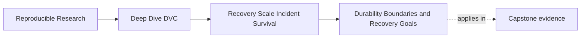
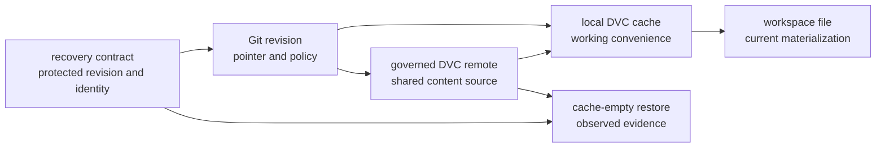
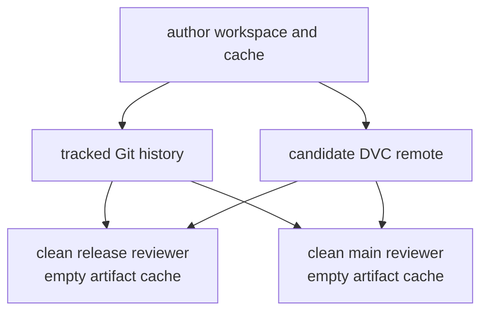

# Durability Boundaries and Recovery Goals


<!-- page-maps:start -->
## Page Maps




<!-- page-maps:end -->

Imagine that the laptop on which a model was trained is unavailable. Git still has
`dvc.yaml`, `dvc.lock`, and a `.dvc` pointer. A storage console shows a bucket with many
hashed objects. Is the result recoverable?

There is not enough evidence to answer yet.

Recovery requires more than stored bytes. A learner must be able to identify the promised
state, locate every required object, obtain access, restore it without hidden local help,
and decide whether the restored result is the one the project meant to preserve. This
page builds that reasoning from the boundary outward.

## Four parts of a durable promise

A useful recovery promise has four cooperating parts:

| Part | Question it answers | Typical evidence |
| --- | --- | --- |
| identity | Which exact state must survive? | Git revision, DVC hash, release manifest, artifact digest |
| storage | Where do the required bytes live? | named DVC remote, immutable release store, governed archive |
| access | Who or what can retrieve them? | documented role, CI identity, tested credentials |
| verification | How is restored meaning checked? | clean-clone drill, checksum, schema check, release verifier |

Missing any part weakens the claim:

- bytes without identity leave the reviewer guessing which object matters
- identity without bytes describes a result that cannot be restored
- storage without access is unavailable when recovery is needed
- successful download without verification proves transfer, not correctness

This is why "it is in DVC" is not a recovery contract. DVC records identity and can move
content, but the project still owns the storage, access, retention, and verification
decisions.

## Follow one artifact through its state locations

Suppose `data/observations.csv` is DVC-tracked. Its state is spread across several
locations:



Git tells DVC which content identity a revision references. The remote may hold the bytes
for that identity. The local cache avoids repeated transfers. The workspace materializes
the file a command can use.

None of those locations is automatically authoritative for the whole promise:

- a workspace file can be edited without recording the new state
- a cache object can be the only surviving copy
- a remote can contain current state but omit an older protected release
- a committed pointer can outlive the content it names

The durability boundary is the combination that the project is willing to defend.

## Define the recovery unit before choosing storage

Do not begin with "back up the bucket." Begin with the unit of state whose loss would
break a real promise.

Possible recovery units include:

- one input dataset and its `.dvc` pointer
- all outputs required to resume the current mainline pipeline
- a published release plus the data, parameters, metrics, and lock evidence that explain
  it
- a tagged scientific analysis that must remain auditable
- a short-lived experiment candidate kept only until a decision closes

The unit must be small enough to identify and complete enough to be useful.

For a promoted model, preserving `models/model.json` alone may be too small. A reviewer
may also need the feature data identity, parameter values, evaluation population,
metrics, and manifest. Preserving every cache object ever created may be too large and
still fail to name which revision is promised.

Use this test:

> If these files were restored tomorrow, could the intended user resume, audit, or roll
> back the promised state without private explanation?

If not, the recovery unit is incomplete.

## Protected revisions make history explicit

Current state and historical state are separate promises.

Consider a repository with:

- `main`, used by current automation
- `release-2025-q1`, cited in a published report
- an abandoned experiment that never informed a decision

A bare `dvc push` from `main` can establish current workspace coverage. It does not, by
itself, prove that the release object's content is in the same remote. DVC commands that
inspect multiple Git revisions use explicit revision scopes, and the project must decide
which revisions belong in that scope.

Write the protected set before migration or cleanup:

| Revision | Artifact family | Reason to protect | Recovery proof |
| --- | --- | --- | --- |
| `main` | current inputs and outputs | collaboration and CI continuity | clean clone pulls current pointer |
| `release-2025-q1` | published dataset and release evidence | later audit | clean clone checks out tag, pulls, and matches digest |
| abandoned candidate | none after review closes | no remaining decision depends on it | deletion decision record |

The table keeps two errors visible:

- copying only current state and calling the migration complete
- keeping everything because nobody can state what may expire

## Recovery point and recovery time answer different questions

Two objectives turn "recoverable" into a reviewable claim.

Recovery point objective (RPO) asks:

> How much recorded state may be lost?

For a release archive, the answer may be "none of the protected release revisions." For
an exploratory output, losing a day of unpromoted work may be acceptable.

Recovery time objective (RTO) asks:

> How long may restoration take before the promised use is materially harmed?

A 4-terabyte dataset that can be restored eventually may still fail a two-hour incident
objective. A small publication bundle may tolerate a slower archival route if no
operational system depends on it.

Do not confuse the pair:

| Observation | RPO status | RTO status |
| --- | --- | --- |
| every protected revision restores in 12 minutes | met | met if objective is at least 12 minutes |
| current state restores quickly but an older protected release is absent | missed | speed is irrelevant to the missing state |
| every state restores but takes 19 hours against a 2-hour objective | met | missed |
| no objectives were declared | unknown | unknown |

Measure before claiming. A configuration file can name a remote; it cannot prove coverage
or duration.

## Write a contract another maintainer can falsify

This compact shape is enough to make a first recovery claim testable:

```json
{
  "artifact": "data/observations.csv",
  "protected_revisions": [
    {
      "revision": "release-2025-q1",
      "expected_sha256": "61aa...f96",
      "reason": "published evidence remains auditable"
    },
    {
      "revision": "main",
      "expected_sha256": "8ba0...56a",
      "reason": "current work can resume"
    }
  ],
  "recovery_time_objective_seconds": 30,
  "verification_mode": "cache_empty_restore"
}
```

Notice what is absent: "the remote should contain everything." Each claim can fail
clearly.

The contract does not need to use JSON. A table, policy file, or release manifest can
work. It must name:

- the protected recovery unit
- the revision or identity for each promised state
- the authorized content source
- the verification route
- the acceptable loss and duration
- the person or role that can change the promise

## Test from the failure boundary

A convincing drill removes the local advantages whose loss the contract is supposed to
survive.

For local-cache loss, a useful evidence arrangement is:



The reviewers must not share the author's cache. Ideally, each protected revision gets a
separate reviewer so one restore cannot populate evidence for the next.

The verification route should also be read-only. If it runs `dvc push`, it can repair the
candidate remote from an available cache and then report success. That is a migration or
repair route, not independent recovery evidence.

## Read the course audit as a proof

Run:

```bash
make capstone-recovery-readiness-audit
```

Then inspect:

- `summary.tsv` for the case decisions
- `complete-migration/revision-evidence.json` for both successful protected restores
- `current-only-copy/revision-evidence.json` for current success beside release failure
- `stale-release-claim/revision-evidence.json` for successful transfer beside failed
  identity
- each case's `receipts.json` when exact command evidence matters

Ask these questions in order:

1. Which revisions did the contract protect?
2. Did Git resolve each revision?
3. Did an empty-cache reviewer retrieve its object from the candidate remote?
4. Did the restored bytes match the promised identity and shape?
5. Did the measured duration satisfy a previously declared objective?
6. Did verification avoid mutating the storage under test?

That sequence prevents a green pull command from carrying more meaning than it deserves.

## Diagnose claims without collapsing them

Use this decision table when a drill produces mixed evidence:

| Evidence | Defensible conclusion | Unsupported conclusion |
| --- | --- | --- |
| `dvc remote list` names the remote | configuration is discoverable | protected objects exist there |
| current `dvc pull` succeeds | current pointer content is retrievable | protected history is complete |
| historical pull succeeds | bytes for that pointer are retrievable | restored content matches the release claim |
| digest and schema match | restored content matches named checks | every downstream use is valid |
| all protected restores meet RTO | tested recovery objective passed now | future recovery will always meet it |

Good incident notes preserve these boundaries. They state what was tested, what passed,
and what remains outside the proof.

## Review checkpoint

You are ready to continue when you can:

- define a recovery unit without saying only "the project"
- distinguish workspace, local cache, Git metadata, remote content, and release evidence
- name more than one protected revision when history carries obligations
- explain RPO and RTO with separate failure examples
- reject current-only restoration as proof of historical coverage
- require a cache-empty, read-only verification route
- tell the difference between restored bytes and restored meaning

Durability is a bounded promise: named state, governed content, usable access, and a
rehearsed way to disprove false confidence.
