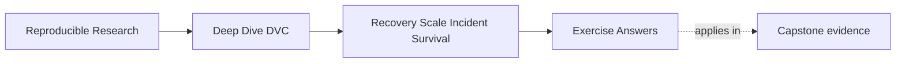
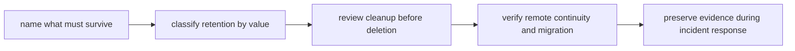

# Exercise Answers


<!-- page-maps:start -->
## Page Maps




<!-- page-maps:end -->

These answers are model explanations, not the only acceptable wording.

## How to use the answer page well

Do not read the model answer first and then reduce the module to "run `dvc pull` if
something goes wrong."

A better rhythm is:

1. finish the exercise with your own durability and incident packet
2. name the protected artifact family, durable location, and verification route
3. compare your reasoning with the model answer
4. revise anywhere your answer blurs retention classes, cleanup scope, or incident
   evidence preservation

What matters is whether the reasoning keeps durability, retention, cleanup, and incident
evidence connected.

Strong Module 08 answers usually do five things:

- they distinguish local convenience from durable authority
- they retain artifacts by value and obligation
- they review cleanup and migration before destructive change
- they test empty-cache recovery instead of assuming it
- they preserve evidence before incident repair rewrites the story

The strongest self-study packets also leave behind six concrete artifacts:

- one durability boundary statement
- one retention table
- one cleanup review record
- one migration route
- one timed recovery drill
- one incident tabletop repair list

If your answers rely only on "the remote should have it," the reasoning is still too
thin.

## Answer 1: Name the durability boundary

Strong recovery goal:

> Release `v1` manifest, metrics, parameters, lock evidence, and the DVC-tracked model
> output they reference must survive local cache loss. A maintainer should be able to
> restore the required objects from the governed remote and run the release recovery route
> from a clean checkout.

Useful checks:

```bash
dvc pull
dvc status
make -C capstone recovery-review
make -C capstone release-audit
```

What counts as a failed recovery promise:

- a clean maintainer checkout cannot restore the referenced objects or cannot complete the
  governed release review route

Why local cache is not enough:

- local cache is a convenience layer on one machine, not the shared durable authority for
  release recovery

## Answer 2: Classify retention value

Promoted release artifact:

- protected, because rollback, downstream trust, and audit may depend on it

Current mainline training data:

- protected or strongly retained, because collaborators and CI need it for current work

Abandoned exploratory candidate output:

- bounded-retention or discard after review, because it no longer supports a live
  decision

Published analysis dataset:

- protected or policy-retained, because publication or stakeholder evidence may depend on
  it

Temporary local debug report:

- safe to discard after review unless it becomes incident evidence

When discardable becomes protected:

- once the artifact is needed to explain, diagnose, or audit an incident, it becomes
  governed evidence until the incident is resolved and documented

## Answer 3: Review a cleanup request

Strong response:

> Before approving `dvc gc --all-branches`, I need a dry run, confirmation of which
> references that scope protects, evidence that required release and current mainline
> objects are safely present in the governed remote, and a retention review showing that
> nothing still promised to users or maintainers will become unrecoverable.

Protected references to consider:

- current mainline
- release tags or bundles
- decision-relevant experiment refs
- any publication or audit surface the repository still promises to support

Useful first checks:

```bash
dvc status
dvc push
dvc gc --all-branches --dry-run
```

Stop condition:

- uncertainty about whether a valuable artifact remains recoverable from governed storage

## Answer 4: Plan a remote migration check

Strong migration check:

1. Inventory protected states: current mainline, releases, publication bundles, recovery
   surfaces.
2. Configure the new remote or new governed prefix.
3. Copy or push the required objects.
4. Verify from a clean checkout against the new remote.
5. Run recovery and release review routes.
6. Compare object coverage and recovery success.
7. Cut over only when rollback remains possible and evidence is complete.

The main lesson is that migration is successful only when recoverability survives the move.

## Answer 5: Write an incident note

Strong incident note:

> CI metrics changed after the base image update, so the executor changed as part of the
> evidence surface. Before accepting the new results, compare dependency and tool
> versions, rerun the governed recovery and metric review routes, and decide whether the
> movement is expected runtime drift or a workflow regression. Update CI image
> documentation and release policy if executor changes can alter comparison meaning.

The main lesson is that CI is part of the reproducibility story, not background plumbing.

## Answer 6: Measure recovery objectives

A strong answer names:

- the artifact family
- recovery point objective
- recovery time objective
- the measured empty-cache recovery result

If the objective is missed, the answer should name whether the failure came from missing
objects, slow transfer, unclear documentation, or weak automation. The point is to report
the real gap, not to declare success from configuration intent alone.

## Answer 7: Audit garbage-collection reachability

The review should enumerate every valued history surface:

- branches
- tags
- experiment refs
- remote copies

Then it should distinguish what is protected, what is mirrored remotely, and what may be
removed safely. Preview evidence and uncertainty handling belong before deletion, not
after.

## Answer 8: Simulate remote unavailability

Likely outcome:

- cached local analysis may continue
- clean recovery and some CI jobs fail
- publication or release restoration may stall

A mature policy names whether a secondary remote, immutable release bundle, or documented
restoration route provides continuity. If nothing does, the missing continuity promise is
the finding.

## Answer 9: Verify a remote migration

Configuration parity is not enough. Strong evidence:

- restores governed revisions from the new remote into an empty cache
- compares object coverage or manifest completeness
- keeps the old remote available until coverage, recovery, and rollback are reviewed

Retiring the old remote requires a governance decision backed by recovery evidence, not
just a successful push.

## Answer 10: Run an incident tabletop

The tabletop should expose:

- who preserves evidence
- who evaluates storage continuity
- who decides repository repairs
- who judges whether scientific conclusions are still trustworthy

Success means finding ambiguities safely and converting them into runbook or policy
repairs. The unanswered questions are not failure of the exercise; they are the value of
the exercise.

## Self-check

If your answers consistently explain:

- which state must survive local loss
- why retention value differs by artifact family
- how cleanup can be reviewed safely
- how remote and CI changes affect recovery
- how incident notes preserve failure, repair, and verification

then you are using Module 08 correctly.
