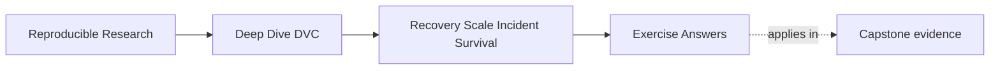
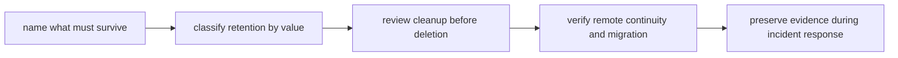

# Exercise Answers


<!-- page-maps:start -->
## Page Maps




<!-- page-maps:end -->

These are worked reasoning models. Your wording and artifact layout may differ. The
decision boundaries should not.

## Compare decisions before prose

Review your packet in this order:

1. Did each page reach an explicit decision?
2. Does the cited evidence support that decision directly?
3. Did you preserve failed evidence before proposing mutation?
4. Did you name the proof limit?
5. Could another maintainer reproduce the reasoning without you?

Use this rubric:

| Level | Characteristics |
| --- | --- |
| needs revision | lists commands or principles without protected scope or decision |
| developing | names protected state but mixes migration, repair, and verification evidence |
| competent | maps obligations to revisions, uses empty-cache evidence, and blocks on precise failures |
| review-ready | also preserves limits, roles, stop conditions, rollback, and source-exit authority |

Do not award full credit because the final complete case is green. The module is about
explaining why the blocked cases must stay blocked.

## Answer: Define a falsifiable recovery contract

A strong explanation:

> The contract protects one artifact family, `data/observations.csv`, at two distinct Git
> revisions. `release-2025-q1` protects a three-row published population, while `main`
> protects a four-row current population. A candidate remote satisfies the recovery point
> objective only when both protected identities restore. Each restore begins without the
> author's artifact cache, matches its SHA-256 and row-count claims, and completes within
> the declared 30-second local objective. Verification may read candidate storage but may
> not push or reconfigure it. Only a complete result permits candidate cutover review;
> legacy retirement has an additional authority gate.

Useful field mapping:

| Contract idea | Field |
| --- | --- |
| recovery unit | `artifact` |
| protected state | `protected_revisions[].revision` |
| semantic reason | `protected_revisions[].reason` |
| content identity | `expected_sha256` and `expected_row_count` |
| loss objective | every listed revision must restore |
| time objective | `recovery_time_objective_seconds` |
| isolation | `verification_mode` |
| read-only route | `recovery_route` contains retrieval and identity checks only |
| authority decision | `cutover_gate` |

Three valid falsifiers:

- `main` restores but `release-2025-q1` reports a missing object.
- Both revisions pull successfully, but the release SHA-256 differs from the contract.
- Both identities match, but one restore exceeds the declared time objective.

Other valid falsifiers include an unresolvable protected Git revision, a verification route
that writes to candidate storage, or a contract with no positive objective.

Weak answer:

> The candidate remote must work.

Why weak: "work" names neither protected scope nor observable failure.

## Answer: Classify retention by obligation

One defensible map:

| State | Obligation | Class | End condition | Authority | Evidence |
| --- | --- | --- | --- | --- | --- |
| `release-2025-q1` observations | published report audit | protected or archive | report retention term closes | release owner | tag, manifest identity, cache-empty restore |
| `main` observations | current collaboration | protected | verified successor becomes authoritative | repository owner | current pointer restore and verifier |
| rejected threshold candidate | closed decision explanation | time-bounded | review window closes and comparison note remains sufficient | experiment owner | decision record and disposition note |
| incident debug extract | open incident diagnosis | protected by hold | incident closes and evidence disposition is approved | incident lead | incident packet identity |
| superseded release model | rollback | time-bounded | 14-day window closes after successor rehearsal | release owner | rollback proof and closure approval |
| ordinary transfer log | no remaining unique evidence | disposable | migration review closes | migration owner | reason it is redundant |

The debug extract demonstrates a class transition. Under ordinary conditions it may be
short-lived. Once it is needed to explain an open incident, a hold overrides the ordinary
expiry. This prevents routine cleanup from destroying failure evidence.

Review-ready answers also separate record and content retention:

- the release tag preserves revision meaning
- candidate or archive storage preserves the DVC object
- the manifest preserves the expected identity
- the restore receipt demonstrates current usability

No single surface substitutes for the rest.

## Answer: Predict the audit before running it

Expected predictions:

| Case | Release restore | Main restore | Other failed check | Decision | Reason |
| --- | --- | --- | --- | --- | --- |
| complete migration | pass | pass | none | `ACCEPT` | whole protected set and contract pass |
| current-only copy | fail | pass | content claim unavailable for release | `BLOCK` | current coverage is not historical coverage |
| release-only copy | pass | fail | content claim unavailable for main | `BLOCK` | audit history alone cannot resume current work |
| stale release claim | pass | pass | release identity mismatch | `BLOCK` | transfer succeeded but restored meaning does not match |
| mutating recovery route | pass | pass | route writes to candidate | `BLOCK` | check can repair the storage it evaluates |
| missing time objective | pass | pass | objective absent | `BLOCK` | duration cannot be judged against a promise |

The key distinctions:

- missing object is an availability failure
- mismatched SHA-256 or row count is an identity failure
- mutating verification is an evidence-independence failure
- absent RTO is a contract-completeness failure

An answer that predicts every failure as "pull fails" has collapsed distinct layers.

## Answer: Build an evidence map from the audit

A review-ready map:

| Question | First surface | Corroboration | Answer |
| --- | --- | --- | --- |
| Did cases reach expected decisions? | `summary.tsv` | `report.json` result fields | all cases should report `PASS` against teaching expectations |
| Missing revision in current-only copy? | case `revision-evidence.json` | failed reviewer receipt | `release-2025-q1` |
| Did Git resolve the release? | release evidence `revision_resolved` | checkout receipt | yes, so failure occurs after Git resolution |
| Which stale claim failed? | stale-case release evidence | contract expected identity | restored release SHA-256 |
| Which command copied only current state? | author receipts | audit implementation | current `dvc push --remote candidate` |
| Did accepted restores meet objective? | complete-case duration checks | per-revision durations | yes for this local lab run |

Why `summary.tsv` comes first:

- it exposes the decision rule compactly
- it prevents a noisy command from becoming the policy
- it tells the reviewer which case deserves deeper inspection

Why receipts still matter:

- they confirm remote name, revision, isolation, and return code
- they expose whether a verification command mutated storage
- they preserve the original failure for incident review

A good prediction comparison names mismatches in your reasoning, not just changed table
cells.

## Answer: Diagnose partial recovery without repairing it

Opening record:

**Failed promise**

The candidate remote cannot restore every protected revision required for cutover.

**First preserved evidence**

The `release-2025-q1` cache-empty pull receipt, its structured revision record, the
successful `main` record, and the contract.

**Impact**

| Status | Obligation |
| --- | --- |
| affected | published audit of `release-2025-q1` |
| unaffected in this test | current `main` collaboration |
| unknown | protected states outside the specimen contract |

**Likely boundary**

Candidate object coverage is incomplete because migration copied current state only.

**Containment**

- keep the legacy remote authoritative
- block candidate cutover and source retirement
- pause garbage collection on implicated storage
- preserve author and reviewer workspaces
- restrict unrecorded repair writes

**Do not run yet**

- `dvc push` to candidate
- remote garbage collection
- source deletion
- a verifier that includes write commands

Hypothesis comparison:

| Hypothesis | Evidence | Decision |
| --- | --- | --- |
| candidate content incomplete | release Git checkout succeeds; release pull fails; main pull succeeds with same candidate access path | supported |
| recovery access globally broken | main reviewer reads candidate successfully | rejected as a global explanation |

The main success narrows diagnosis. It does not prove all permissions behave identically
for every object in a real provider, but in this controlled local specimen it rejects a
blanket access outage.

## Answer: Design a garbage-collection review

Problems with the proposal:

| Proposal element | Mismatch |
| --- | --- |
| `--all-branches` only | policy also protects release tags and a DVC experiment |
| clone may lack refs | "all" applies to visible local references, not unknown remote history |
| no `--dry` | candidates are not reviewable before deletion |
| `--force` | confirmation is bypassed before approval |
| no shared-cache inventory | another project may reference candidate objects |
| no recovery proof | local removal may expose an incomplete remote |

Reference inventory:

```bash
git branch --all
git tag --list
dvc exp list --all
```

The reviewer should first ensure required remote Git refs have been fetched according to
repository policy.

Possible policy-to-scope mapping:

| Obligation | Reference | Scope mechanism |
| --- | --- | --- |
| current mainline | `main` | branch/workspace |
| two releases | governed release tags | `--all-tags` after tag inventory |
| open candidate | named DVC experiment | `--all-experiments` |

Non-destructive preview:

```bash
dvc gc --all-branches --all-tags --all-experiments --dry
```

`--all-commits` alone does not include DVC experiment refs.

Shared-cache addition:

- identify every consuming project
- make its protected references visible
- use DVC's shared-project scope support
- require review from other project owners

Stop conditions:

- protected revision not visible
- policy row lacks a reference identity
- dry candidate cannot be traced to an expired obligation
- shared consumer inventory incomplete
- surviving remote has not passed cache-empty restore
- incident or legal hold unresolved
- rerun produces materially different candidates

Remote collection requires separate storage-owner approval, alternate-copy proof, explicit
remote target, preserved dry evidence, and a disposition record. Local disk pressure is
not that authority.

## Answer: Review the remote authority cutover

Complete-case gate review:

| Gate | Evidence | Decision |
| --- | --- | --- |
| contract | two revisions, identities, isolation, objective | pass |
| candidate population | all protected-history copy receipt | pass for specimen |
| independent recovery | two separate empty-cache reviewers match contract | pass |
| authority | requires deliberate default, ownership, and user-route change | ready for decision, not proved solely by audit |
| source exit | requires rollback closure and final retirement approval | not automatically passed |

Current-only gate review:

| Gate | Evidence | Decision |
| --- | --- | --- |
| contract | complete | pass |
| candidate population | current-only copy | fail against scope |
| independent recovery | release fails, main passes | block |
| authority | must remain legacy | block |
| source exit | release exists only at source | block |

Bounded repair authorization:

> Keep legacy authoritative. Permit the storage operator to copy the policy-protected
> release set, including `release-2025-q1`, from legacy to candidate. Stop on source
> identity mismatch, absent source object, or an unclassified protected revision. Preserve
> the failed bundle and repair receipt. After mutation, use new read-only, cache-empty
> reviewers for every protected revision. Candidate authority remains blocked until all
> identities and objectives pass.

Candidate acceptance does not delete the legacy remote. A rollback interval, unresolved
holds, archive obligations, final candidate audit, and exact retirement approval remain.

## Answer: Interpret recovery executor drift

Content continuity:

- `main` is known for both executors because it resolves, restores, and matches.
- `release-2025-q1` is known only under the accepted executor.
- the new executor never resolves the release Git revision, so candidate DVC content was
  not tested.

RTO comparison:

- the new seven-minute result applies only to the narrower tested scope
- it cannot be compared as an overall recovery improvement against the old full-scope
  18-minute result
- both observed runs meet 30 minutes for the states each actually tested

First boundary:

- shallow Git clone or ref-fetch configuration

Do not diagnose missing candidate DVC content because DVC never received a valid release
revision to test.

After repairing Git reference coverage:

- rerun both protected revisions from empty artifact caches
- compare identities and durations
- preserve the new executor contract
- decide whether full-scope RTO still passes

Suitable note:

> Executor `B` restored current `main` in seven minutes but did not resolve protected
> release `release-2025-q1` because the job used a shallow Git checkout. This run does not
> establish full protected-set recovery or a performance improvement. Repair reference
> coverage and rerun both revisions before accepting executor `B`.

Future receipts should preserve image digest, workflow revision, Git version and clone
depth, fetched refs, DVC version, recovery role, remote name, cache condition, protected
scope, identities, and timing.

## Answer: Complete the incident response

Role split:

| Role | Decision |
| --- | --- |
| incident lead | containment, timeline, impact, closure |
| storage operator | candidate inventory and bounded copy |
| repository maintainer | revision and DVC contract integrity |
| domain reviewer | restored release still represents the cited population |

Timeline model:

| Type | Entry |
| --- | --- |
| fact | release reviewer failed to pull from candidate |
| decision | legacy remains authoritative; candidate cutover paused |
| fact | main reviewer restored expected current identity |
| hypothesis | migration copied current workspace only |
| fact | legacy restored expected release identity |
| decision | authorize protected release copy |
| fact | new candidate reviewers restored both contracted identities |
| decision | remove incident containment after domain review |

Bounded repair:

- source: still-authoritative legacy remote
- target: candidate remote
- scope: approved protected revisions
- mutation: recorded copy by storage operator
- stop: source mismatch or unexpected protected state

Closure proof:

- new clones and empty caches
- read-only candidate access
- both identities and row counts match
- durations meet objective
- domain reviewer accepts release meaning
- regression test keeps current-only copy as a blocked case

Example note under 180 words:

> Candidate cutover was blocked when the release reviewer could not restore
> `release-2025-q1`, although `main` restored successfully. We preserved the failed pull,
> revision evidence, and migration receipts before any write because a repair push would
> erase proof that candidate storage was incomplete. Legacy remained authoritative and
> remote collection was paused. The evidence showed current-only copy scope, not missing
> Git history or a global access outage. The storage operator copied the approved
> protected release set from legacy. New reviewers with empty caches then restored both
> revisions from candidate using read-only access, matched contracted identities and row
> counts, and met the lab objective. The domain reviewer confirmed the published
> population. Candidate authority may enter rollback observation; legacy retirement still
> requires the source-exit gate. The audit permanently retains current-only copy as a
> blocking regression case.

The repair workspace does not provide closure because its cache and write access can
supply hidden evidence.

## Answer: Conduct an independent maintainer handoff

Expected capability table:

| Capability | Durable source | Incoming evidence | Example gap | Repair owner |
| --- | --- | --- | --- | --- |
| explain promise | recovery contract | names both revisions, RPO, RTO | cannot explain release reason | release owner |
| locate authority | DVC config and recovery guide | distinguishes candidate, legacy, rollback | assumes every remote is equivalent | repository owner |
| run proof | Make target and audit guide | creates new bundle and reads summary | needs private shell command | automation owner |
| diagnose failure | structured case evidence | explains current-only block | reads only final `PASS` | instructor or maintainer |
| review cleanup | retention map and GC page | produces scoped `--dry` review | omits experiment ref | storage owner |
| explain access | access runbook | names read role and renewal owner | asks for outgoing maintainer's token | platform owner |
| locate incident evidence | incident guide | finds packet and timeline | packet lives in private folder | incident lead |
| decide authority | cutover contract | names separate candidate and source-exit gates | treats test pass as deletion approval | governance owner |

Final recommendation:

> Accept candidate authority only for the artifact family and two protected revisions
> named by this specimen, based on the generated recovery-readiness bundle. The proof is a
> local-filesystem teaching audit; it does not establish cloud durability, production
> transfer performance, or organizational deletion approval. Retain legacy through the
> stated rollback interval. Retire it only after a final protected-set audit, resolved
> holds, confirmed archival obligations, and exact source-exit approval. The incoming
> maintainer must be able to rerun the audit and block the unsafe cleanup independently.

The durable result is demonstrated capability, not attendance at a handoff meeting.

## Packet self-review

Your packet is review-ready when:

- every recovery claim names artifact family, revision, identity, source, and objective
- retention decisions name obligations and observable end conditions
- predictions precede execution
- evidence maps lead from decision to mechanism
- incident records preserve failed receipts before mutation
- garbage-collection review uses `--dry` and matches every protected reference class
- cutover and source exit remain separate
- executor drift is diagnosed before storage is blamed
- repair and verification use different permissions and workspaces
- the incoming maintainer can reproduce the decisions without private coaching

If your result is shorter than the model because it is precise, that is fine. If it is
shorter because it omits a boundary, revise it.
