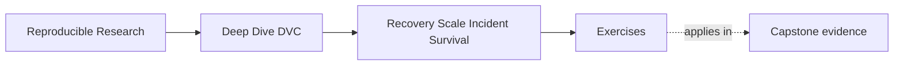
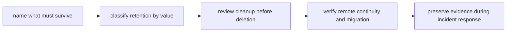

# Exercises


<!-- page-maps:start -->
## Page Maps




<!-- page-maps:end -->

These ten exercises form one evidence packet. You will begin with a vague migration claim,
run the course audit, diagnose mixed recovery, review cleanup scope, and finish with a
cutover and incident decision another maintainer can challenge.

You do not need cloud credentials. The capstone creates isolated Git repositories and
local DVC remotes under the repository's `artifacts/` tree.

## Lab boundary

Work from the Deep Dive DVC course directory. Read the worked example before beginning.

Create a learner-owned directory outside the course source tree:

```text
recovery-readiness-lab/
├── contract-review.md
├── retention-map.md
├── case-predictions.md
├── evidence-map.md
├── cleanup-review.md
├── cutover-review.md
├── executor-review.md
├── incident-packet.md
├── handoff-check.md
└── final-decision.md
```

Do not copy generated audit workspaces into source control. Preserve references to the
generated bundle and quote only the evidence needed for your reasoning.

The exercises build this decision path:


## How to assess your own work

Every submission should distinguish:

- **claim** — what the project promises
- **evidence** — what an observed file, command, or result proves
- **decision** — what action the evidence permits
- **limit** — what remains outside the proof

A command transcript without a decision is incomplete. A decision without evidence is
unsupported. Evidence without limits is easy to overclaim.

## Exercise: Define a falsifiable recovery contract

Read:

```text
capstone/repro/recovery-readiness/recovery-contract.json
capstone/repro/recovery-readiness/README.md
```

In `contract-review.md`, explain the contract in your own words. Include:

- artifact family
- two protected revisions and their different obligations
- identity checks
- recovery point objective expressed for this specimen
- recovery time objective
- permitted content source
- read-only verification requirement
- cutover decision

Then write three observations that would falsify the contract. At least one must involve
content identity rather than transfer failure.

**Evidence rule:** cite exact contract fields. Do not say only "the JSON says so."

**Completion test:** another learner should be able to predict what `ACCEPT` means without
seeing the audit code.

## Exercise: Classify retention by obligation

In `retention-map.md`, classify these states:

| State | Facts |
| --- | --- |
| `release-2025-q1` observations | cited by a published quarterly report |
| `main` observations | used by current collaborators |
| rejected threshold candidate | decision closed; comparison note retained |
| debug extract | reveals the cause of an open data-loss incident |
| superseded release model | rollback window closes in 14 days |
| local transfer log | contains no unique evidence and the migration review closed |

For each state, record:

- active obligation
- retention class: protected, time-bounded, archive, or disposable
- observable end condition
- authority that may change the class
- recovery or disposition evidence

Add a hold rule explaining why the debug extract cannot follow its ordinary expiry while
the incident is open.

**Evidence rule:** age and storage cost may influence implementation, but neither may be
the only classification reason.

**Completion test:** every protected row maps to a concrete revision or artifact identity.

## Exercise: Predict the audit before running it

The audit includes:

- complete migration
- current-only copy
- release-only copy
- stale release claim
- mutating recovery route
- missing time objective

In `case-predictions.md`, create:

| Case | Release restore | Main restore | Other failed check | Expected decision | Reason |
| --- | --- | --- | --- | --- | --- |

Fill it without running the audit.

For the stale-claim case, distinguish "bytes restored" from "promised bytes restored."
For the mutating-route case, explain why a remote write invalidates independent
verification even if later pulls succeed.

**Evidence rule:** derive predictions from the contract and module pages, not the
implementation.

**Completion test:** every blocked case names one precise failed boundary.

## Exercise: Build an evidence map from the audit

Run:

```bash
make capstone-recovery-readiness-audit
```

Locate the generated audit bundle under `artifacts/audit/`. In `evidence-map.md`, record:

| Question | First evidence surface | Corroborating surface | Answer |
| --- | --- | --- | --- |
| Which cases reached the expected decision? |  |  |  |
| Which protected revision is missing from current-only copy? |  |  |  |
| Did Git resolve that revision? |  |  |  |
| Which stale claim failed after successful restore? |  |  |  |
| Which exact command populated only current state? |  |  |  |
| Did all accepted restores meet the declared objective? |  |  |  |

Use `summary.tsv` and `report.json` before raw receipts. Record the generated bundle path
and audit manifest identity so another learner can locate the same run.

**Evidence rule:** one surface should answer the decision; another should explain the
mechanism.

**Completion test:** compare predictions with observations and explain every mismatch.

## Exercise: Diagnose partial recovery without repairing it

Use only the `CURRENT_ONLY_COPY` evidence. In `incident-packet.md`, write the opening
incident record:

- failed promise
- first preserved evidence
- affected obligation
- unaffected obligation
- unknown obligations
- likely failure boundary
- containment actions
- commands that must not run before evidence is preserved

Then write two alternative hypotheses:

- candidate content is incomplete
- recovery access is broken

Use the two revision records and receipts to accept or reject each hypothesis.

Do not propose repair yet.

**Evidence rule:** keep facts, hypotheses, and decisions visibly separate.

**Completion test:** the diagnosis explains why `main` success narrows the failure without
closing the incident.

## Exercise: Design a garbage-collection review

A storage operator proposes:

```bash
dvc gc --all-branches --force
```

The retention map protects `main`, two release tags, and one open DVC experiment. The
review clone may not have fetched every remote ref.

In `cleanup-review.md`:

- identify each mismatch between policy and the proposed scope
- list the reference inventory required before preview
- write a policy-to-scope table
- write a non-destructive preview using the current DVC preview flag
- explain whether `--all-commits` alone would protect the experiment
- name the extra review needed if the cache is shared by another project
- define at least five stop conditions
- define the additional authority required before remote collection

Do not run destructive garbage collection.

**Evidence rule:** the preview command is a candidate-removal observation, not deletion
approval.

**Completion test:** every command flag has a policy reason.

## Exercise: Review the remote authority cutover

In `cutover-review.md`, use the generated audit to evaluate five gates:

| Gate | Required evidence | Observed evidence | Decision |
| --- | --- | --- | --- |
| contract |  |  |  |
| candidate population |  |  |  |
| independent recovery |  |  |  |
| authority |  |  |  |
| source exit |  |  |  |

Evaluate both `COMPLETE_MIGRATION` and `CURRENT_ONLY_COPY`.

For the complete case, decide whether candidate acceptance also authorizes immediate
legacy deletion. Explain rollback interval, holds, and final source-exit review.

For current-only copy, write a bounded repair authorization that names source, target,
protected scope, operator, stop condition, and post-repair proof.

**Evidence rule:** migration writes and verification reads must remain separate.

**Completion test:** candidate acceptance and legacy retirement have separate decisions.

## Exercise: Interpret recovery executor drift

Use this comparison:

| Surface | Accepted executor | New executor |
| --- | --- | --- |
| image | immutable digest `A` | immutable digest `B` |
| DVC | 3.x version recorded | newer 3.x version recorded |
| Git clone | full protected refs | default shallow clone |
| recovery identity | read-only archive role | same role |
| `main` | restores and matches | restores and matches |
| `release-2025-q1` | restores and matches | revision does not resolve |
| duration | 18 minutes | 7 minutes |
| RTO | 30 minutes | 30 minutes |

In `executor-review.md`:

- decide whether content continuity is known for both revisions
- decide whether RTO evidence is comparable
- diagnose the first boundary to repair
- state what must be rerun after repair
- write a release note that does not describe the faster duration as an overall
  improvement
- name the executor fields future receipts must preserve

**Evidence rule:** do not infer a missing DVC object from a Git revision-resolution
failure.

**Completion test:** the review separates executor coverage, content coverage, and
performance.

## Exercise: Complete the incident response

Return to the partial-recovery incident. Assume the legacy remote successfully restores
the expected release identity.

Extend `incident-packet.md` with:

- last known good contract
- roles for incident lead, storage operator, repository maintainer, and domain reviewer
- bounded repair
- a timeline containing facts, hypotheses, and decisions
- independent post-repair verification
- semantic acceptance
- containment removal
- regression check
- durable policy or automation change

Write the final incident note in fewer than 180 words. It must state why the first failed
receipt was preserved and why a new reviewer, rather than the repair workspace, supplied
closure evidence.

**Evidence rule:** a successful push is repair evidence, not recovery evidence.

**Completion test:** the same current-only copy failure would be detected before a future
cutover.

## Exercise: Conduct an independent maintainer handoff

In `handoff-check.md`, design a no-coaching handoff for an incoming maintainer. Include:

- contract discovery
- protected revision explanation
- remote authority and rollback explanation
- read-only audit execution
- one blocked-case diagnosis
- garbage-collection preview review
- credential role explanation without secret values
- incident packet location
- authority for cutover and source retirement

The outgoing maintainer may observe but may not operate the keyboard or supply hidden
commands.

Record:

| Capability | Durable source | Incoming evidence | Gap | Repair owner |
| --- | --- | --- | --- | --- |

Finish `final-decision.md` with a cutover recommendation based on the complete case. State:

- exact accepted scope
- proof bundle
- limits
- rollback interval
- source-exit conditions
- unresolved risks

**Evidence rule:** "knowledge transferred" is not evidence.

**Completion test:** the incoming maintainer can defend the cutover and block an unsafe
cleanup without the outgoing maintainer.

## Packet review

Your packet is ready for answer comparison when it contains:

- a falsifiable contract with RPO and RTO
- a retention map with observable end conditions
- predictions made before executing the audit
- a decision-first evidence map
- an incident record that preserves the first failure
- a garbage-collection scope review with no destructive action
- separate candidate and source-exit decisions
- an executor-drift diagnosis
- a bounded repair and independent closure proof
- a demonstrated handoff and final recommendation

If a page contains only commands or only general principles, revise it. The packet should
connect each action to a protected promise and a reviewable decision.
