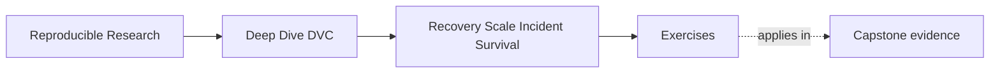
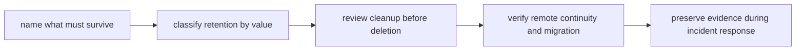
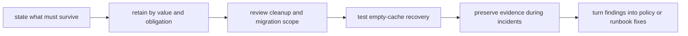

# Exercises


<!-- page-maps:start -->
## Page Maps




<!-- page-maps:end -->

Use these exercises to practice long-lived recovery judgment, not only DVC command
vocabulary.

The goal of the day is to stop treating local cache or current convenience as durable
authority. Recovery at scale depends on knowing what must survive, what may expire, how
cleanup is reviewed, and how incident response preserves evidence before repair.

## How to work through this set

Treat the ten exercises as one full lab day on durability, cleanup, and incident
survival.

Before each answer:

1. name the artifact family or promise under protection
2. name where its durable copy is supposed to live
3. say what evidence would prove the promise still holds

Do the exercises in order. The day is one progression:

- Exercises 1-3 define durability boundaries and retention classes
- Exercises 4-5 review migration and executor-drift incidents
- Exercises 6-8 measure recovery and simulate cleanup or outage risk
- Exercises 9-10 verify migration readiness and rehearse incident coordination

Keep one recovery packet as you go. By the end of the day it should contain:

- one durability boundary statement
- one retention classification table
- one cleanup review record
- one migration verification route
- one timed recovery objective drill
- one incident tabletop repair list

If those six artifacts are missing, you are probably still talking about resilience
instead of testing it.

## Recommended working layout

If you want one lab tree that can support the whole day, use something like:

```text
module08-lab/
├── artifacts/
├── incidents/
├── notes/
├── retention/
└── runbooks/
```

Keep one durability table while you work:

| Artifact family | Must survive local loss? | Durable location | Verification route | Allowed expiry |
| --- | --- | --- | --- | --- |

Also keep one incident table:

| Failure | First evidence to preserve | Immediate action | Long-term repair |
| --- | --- | --- | --- |



Use that route on purpose. It keeps the day centered on durable recoverability rather than
on storage optimism.

## Exercise 1: Name the durability boundary

A release has:

- `publish/v1/manifest.json`
- `publish/v1/metrics.json`
- `publish/v1/params.yaml`
- DVC-tracked model output referenced in `dvc.lock`

Write a short recovery goal that explains:

- what must survive local cache loss
- what a maintainer should run to verify it
- what would count as a failed recovery promise
- one sentence naming why local cache is not enough

Study note:
This is the foundation for the rest of the module. If the durability boundary is vague,
cleanup and incident review will also be vague.

## Exercise 2: Classify retention value

Classify these states as protected, bounded-retention, or safe-to-discard after review:

- promoted release artifact
- current mainline training data
- abandoned exploratory candidate output
- published analysis dataset
- temporary local debug report

Explain one sentence for each classification and add one rule for when a normally
discardable artifact becomes protected incident evidence.

Study note:
Retention follows value and obligation, not age alone.

## Exercise 3: Review a cleanup request

A teammate wants to run:

```bash
dvc gc --all-branches
```

because storage is getting expensive.

Write a review response that explains:

- what evidence you need before approving cleanup
- which protected references must be considered
- what dry-run or remote checks should happen first
- one sentence naming the stop condition that should block deletion

Study note:
The important habit here is to review deletion scope before action, not after regret.

## Exercise 4: Plan a remote migration check

A team is moving from an old DVC remote to a new one.

Describe a migration check that covers:

- inventory of important states
- copying or pushing required objects
- clean checkout verification
- rollback or cutover decision

Study note:
Migration is about continuity of recovery promises, not only changing a URL.

## Exercise 5: Write an incident note

CI started producing different metrics after a base image update.

Write an incident note that explains:

- what changed
- why the executor is part of the evidence story
- what should be checked before accepting or rejecting the new results
- what documentation or policy should be updated

Study note:
The exercise matters because incident notes should preserve evidence before the team
normalizes the new state.

## Midday self-check

Before you move into timed recovery, outage simulation, and migration retirement, make
sure your packet can already answer these questions clearly:

- what state must survive local loss
- why retention classes differ by value and obligation
- how cleanup needs scoped review and dry-run evidence
- why CI image or remote changes can break recovery promises

If you cannot answer those four questions in plain language, return to Exercises 1-5 and
make the packet more explicit before continuing.

## Exercise 6: Measure recovery objectives

Choose one critical artifact family. Define its recovery point and recovery time
objectives, then perform a timed clean-cache recovery and compare the result with those
objectives.

What to hand in:

- the chosen artifact family
- the recovery objectives
- the measured result
- one sentence explaining what failed if the objective was missed

Study note:
Configuration is not a recovery promise until the team measures it.

## Exercise 7: Audit garbage-collection reachability

Before running garbage collection, enumerate:

- branches
- tags
- experiment refs
- remote copies

that protect valuable objects. Produce a review record showing what may be removed.

Study note:
Uncertainty about a valuable reference is a reason to stop, not to widen the cleanup flag.

## Exercise 8: Simulate remote unavailability

Block access to the primary remote and attempt the documented workflow. Identify:

- which activities continue
- which stop
- what secondary recovery route the policy promises

What to hand in:

- the blocked workflow result
- the surviving activities
- the missing continuity promise, if any

Study note:
This is how teams learn whether their resilience story is real or only assumed.

## Exercise 9: Verify a remote migration

Copy governed objects to a new remote, test recovery from an empty cache, compare object
coverage, and define the evidence required before retiring the old remote.

Study note:
Retiring the old remote is a governance decision, not a shortcut after one successful
push.

## Exercise 10: Run an incident tabletop

Assign:

- incident lead
- storage operator
- repository maintainer
- scientific reviewer

Walk through accidental deletion, partial remote recovery, and a disputed result without
performing destructive actions.

What to hand in:

- the role map
- the unanswered questions
- the runbook or policy repairs

Study note:
This final exercise matters because incidents reveal whether ownership, evidence, and
repair paths are actually clear under stress.

## Mastery check

You have a strong grasp of this module if your answers consistently keep five ideas
visible:

- local cache is not durable authority
- retention follows value, not age alone
- cleanup needs reference scope and dry-run review
- remote migration and CI drift can break recovery
- incident response should preserve evidence before repair
