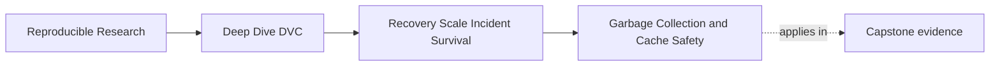
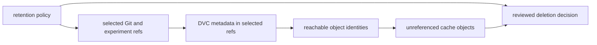

# Garbage Collection and Cache Safety


<!-- page-maps:start -->
## Page Maps




<!-- page-maps:end -->

`dvc gc` answers a narrow mechanical question:

> Which cache objects are not referenced by the revision scope I was told to preserve?

It does not answer the policy question:

> Which revisions and experiments still carry obligations?

The maintainer supplies that meaning. A syntactically valid garbage-collection command
can implement the wrong retention policy perfectly.

This page teaches how to review the preservation set before any deletion occurs.

## Understand the object under review

DVC's cache is content-addressed. DVC metadata in `.dvc` files and `dvc.lock` points to
cache objects by hash. Garbage collection reads metadata from a selected set of revisions,
builds the set of referenced objects to keep, and treats other cache objects as
collectable.



If a protected tag is missing from `refs`, its object may fall into `candidates`.
Garbage collection cannot infer that the tag supports a publication.

## Read scope flags as preservation claims

The current DVC command uses `--dry` to preview removal. These examples perform no
deletion:

```bash
dvc gc --workspace --dry
dvc gc --all-branches --dry
dvc gc --all-tags --dry
dvc gc --all-commits --dry
dvc gc --all-experiments --dry
```

Each flag expands the set of DVC metadata DVC reads to decide what remains reachable:

| Scope | Preserves objects referenced by | Important limit |
| --- | --- | --- |
| `--workspace` | current workspace metadata | historical branches, tags, commits, and experiments may be outside the set |
| `--all-branches` | all local Git branches plus workspace | tags not reachable by those branch selections need separate consideration |
| `--all-tags` | all local Git tags plus workspace | untagged branch or commit history is not automatically policy-complete |
| `--all-commits` | Git commit history plus workspace | DVC experiment refs are not included by this flag |
| `--all-experiments` | DVC experiment refs plus workspace | Git release policy still needs its own selectors |

Flags can be combined. The right combination comes from the policy map, not from a
preference for the widest-looking option.

Local visibility matters. "All tags" means the tags present in the repository used for
the review. A shallow or incompletely fetched clone can supply an incomplete history even
when the flag sounds comprehensive.

## Translate policy rows into a preservation set

Suppose policy protects:

- `main`
- release tags `release-2025-q1` and `release-2025-q2`
- experiment `exp-threshold-62` until its decision closes

Before previewing collection, confirm that the review workspace can see those references:

```bash
git branch --all
git tag --list
dvc exp list --all
```

Then write the mapping:

| Obligation | Required reference | Visible? | Included by proposed scope? |
| --- | --- | --- | --- |
| current collaboration | `main` | yes | yes |
| published report | `release-2025-q1` | yes | yes |
| rollback | `release-2025-q2` | yes | yes |
| open candidate review | `exp-threshold-62` | yes | yes |

Do not run a destructive command while a row says "no" or "unknown."

A plausible preview for this policy might combine branches, tags, and experiments:

```bash
dvc gc --all-branches --all-tags --all-experiments --dry
```

That command is an example of a mapped scope, not a universal recipe.

## Dry output is a candidate list, not approval

`--dry` changes the operation from deletion to observation. It does not validate the
retention policy.

For every candidate family, ask:

- Which pointer, lock entry, or experiment once referenced it?
- Did the governing decision close?
- Does a tag, branch, or external manifest still promise recovery?
- Is the object absent from the keep set because it expired, or because the review clone
  lacks a reference?
- Is another DVC project sharing this cache?
- Is a remote or archive still expected to provide recovery after local removal?
- Does an incident hold temporarily protect the object?

The output becomes decision evidence only after those questions are answered.

## Local collection and remote collection have different blast radii

Without `--cloud`, `dvc gc` removes from the local cache. DVC can fetch a locally removed
object again if a governed remote still has it and access still works.

With `--cloud`, the command also removes collectable objects from remote storage. Remote
deletion can remove the shared recovery source for every clean collaborator and CI job.

| Operation | Immediate scope | Recovery after mistaken deletion |
| --- | --- | --- |
| local cache collection | one cache | possible from another complete remote or archive |
| shared cache collection | every project using that cache | other projects may lose linked content |
| remote collection with `--cloud` | governed remote | possible only from another surviving copy |
| last-copy remote collection | all users of that state | impossible without an independent backup |

Previewing remote collection still requires an explicit remote and preservation scope.
Treat even the preview as a high-risk review artifact:

```bash
dvc gc --all-tags --all-experiments --cloud --remote archive --dry
```

Do not copy that command into a project until its reference map and remote ownership are
clear.

## A push immediately before cleanup can hide policy gaps

This sequence looks cautious:

```bash
dvc push
dvc gc --all-branches --dry
```

It proves less than many readers assume.

A plain `dvc push` covers DVC outputs referenced by the current workspace. It does not
automatically establish that every protected historical revision and experiment exists
in the remote. The cleanup preview may also omit tags or experiment refs that policy
protects.

Separate the claims:

- migration or publication populates the remote for a defined scope
- a read-only recovery audit verifies that scope from empty caches
- garbage-collection review maps retention obligations to keep references
- collection executes only the approved candidate set

One successful current push cannot substitute for the other three.

## Shared caches require a project inventory

Two repositories can use one DVC cache. An object unreferenced by repository A may still
be essential to repository B.

DVC provides a `--projects` option so collection can preserve the union of references
from multiple project paths. That mechanism is useful only if the maintainer knows every
project sharing the cache and makes their relevant revisions visible.

Before touching a shared cache:

- identify all consuming projects
- identify their protected revisions
- fetch the Git references needed for policy coverage
- confirm the cache configuration really is shared
- include the project paths in the preview
- obtain review from the other owners

If the consumer inventory is incomplete, stop. A larger local scope cannot compensate for
an unknown second project.

## Build a cleanup review packet

A reviewable packet contains:

| Artifact | Purpose |
| --- | --- |
| retention map | names the obligations and end conditions |
| reference inventory | shows visible branches, tags, and experiments |
| policy-to-scope table | explains why each flag is present |
| dry output | identifies proposed cache removals |
| remote coverage proof | shows protected state remains recoverable where promised |
| shared-consumer inventory | protects other projects using the cache |
| approval record | names the authority and allowed execution window |
| post-action check plan | states how surviving promises will be tested |

The packet should exist before deletion. Reconstructing it afterward turns a controlled
maintenance action into an incident investigation.

## Review a flawed proposal

Proposal:

> Disk usage is high. Run `dvc gc --workspace --force`, then use `--cloud` if that does
> not save enough.

Findings:

| Finding | Why it blocks |
| --- | --- |
| no retention map | the workspace cannot express historical obligations |
| no dry preview | candidate removals are not reviewable |
| `--workspace` only | release tags and experiment refs may be excluded |
| `--force` | confirmation is bypassed before evidence exists |
| remote escalation based on disk pressure | shared recovery would be traded for local capacity |
| no alternate-copy proof | remote deletion may remove the final copy |

Repair the proposal by naming obligations, fetching and enumerating refs, choosing a
matching preview scope, verifying remote or archive recovery, and recording approval.
Only then is there a deletion decision to consider.

## Use the recovery audit before remote retirement

The course audit does not run destructive garbage collection. It tests the precondition
that matters most before a remote is retired:

```bash
make capstone-recovery-readiness-audit
```

Compare:

- `COMPLETE_MIGRATION`, where both protected revisions restore
- `CURRENT_ONLY_COPY`, where a current-state check would falsely suggest coverage
- `RELEASE_ONLY_COPY`, where audit history survives but active work does not

If the candidate remote cannot restore the protected set, remote garbage collection or
legacy decommissioning is not reviewable yet.

## Write the stop conditions first

A cleanup review should stop when:

- a protected policy row has no concrete reference
- an expected branch, tag, or experiment is not visible
- a candidate object cannot be traced to an expired obligation
- a shared cache consumer is unknown
- the surviving remote has not passed a cache-empty restore
- a legal, publication, or incident hold is unresolved
- the proposed command has broader storage scope than the approval
- the dry output differs materially when rerun before execution

Stop conditions prevent schedule pressure from redefining safety during the operation.

## Review checkpoint

You are ready to continue when you can:

- explain that garbage collection computes reachability from a supplied revision scope
- use the current `--dry` preview flag correctly
- distinguish branch, tag, commit, experiment, workspace, and shared-project scopes
- explain why `--all-commits` does not preserve DVC experiments
- reject a current `dvc push` as proof of protected historical coverage
- distinguish local, shared-cache, and remote deletion blast radii
- assemble a review packet and state explicit stop conditions

Garbage collection is safe only when the preservation set already expresses the
retention policy and the proposed removals can be defended one obligation at a time.
