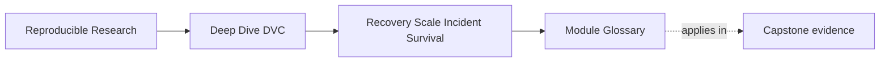

# Module Glossary

<!-- page-maps:start -->
## Page Maps

<!-- page-maps:end -->

This glossary belongs to **Module 08: Recovery, Scale, and Incident Survival** in
**Deep Dive DVC**.

Use it to keep the module language stable while you move between the core lessons, the
worked example, the exercises, and capstone review.

## How to use this glossary

Read the module index first. Return here when two nearby ideas begin to blur. The terms
below are decision tools, not vocabulary trivia.

## Recovery contract terms

| Term | Meaning in this module | Evidence example |
| --- | --- | --- |
| recovery unit | The smallest complete state whose restoration satisfies a real use, audit, or rollback promise. | dataset pointer, content identity, parameters, and release manifest |
| durability boundary | The combination of identity, storage, access, and verification expected to survive local loss. | Git tag, candidate remote, read role, cache-empty receipt |
| protected revision | A concrete Git revision whose DVC-referenced state still carries an obligation. | `main` or `release-2025-q1` |
| recovery point objective (RPO) | The maximum acceptable recorded-state loss. | no loss of either protected specimen revision |
| recovery time objective (RTO) | The maximum acceptable duration from recovery start to usable restored state. | complete protected restore within an agreed interval |
| content identity | A claim that recognizes the exact restored bytes. | SHA-256 or DVC object hash |
| semantic verification | A check that restored state still has the promised meaning or shape. | expected row count, schema, population, or release verifier |
| cache-empty restore | A restore performed without a pre-existing local artifact cache that could hide an incomplete remote. | separate reviewer clone with `.dvc/cache` removed |
| read-only verification | A proof route that observes candidate storage without populating or reconfiguring it. | checkout, pull, digest, and verifier commands without push |
| evidence independence | The property that a check does not create the state it claims to observe. | candidate pull performed by a role without write permission |

## Storage and authority terms

| Term | Meaning in this module | Common confusion |
| --- | --- | --- |
| workspace | Materialized files used by commands now. | file presence is mistaken for durable storage |
| local DVC cache | Machine-local content-addressed objects. | a complete author cache hides remote gaps |
| DVC remote | A configured content store that DVC can push to or pull from. | configuration is mistaken for object coverage |
| recovery authority | The storage boundary the project currently promises will restore protected state. | every configured remote is treated as equally authoritative |
| candidate remote | Storage being populated and evaluated for possible authority. | a successful current pull is treated as accepted cutover |
| legacy remote | Prior authority retained during migration, rollback, or archive review. | continued existence is mistaken for a tested rollback plan |
| cutover | The governed decision that changes recovery authority. | URL change is mistaken for authority acceptance |
| rollback interval | A bounded period during which authority can return to the prior source. | source is deleted immediately after candidate acceptance |
| source-exit gate | Evidence and approval required before decommissioning the prior source. | a migration audit is treated as deletion permission |

## Retention and cleanup terms

| Term | Meaning in this module |
| --- | --- |
| obligation | The active operational, rollback, publication, legal, decision, or incident reason state must remain available. |
| retention class | Protected, time-bounded, archive, or disposable treatment that leads to concrete actions. |
| end condition | An observable event that permits a retention class to change. |
| hold | A temporary override that prevents ordinary expiry because incident, legal, or review evidence is still needed. |
| disposition evidence | The identity, authority, scope, and reason recorded when state expires, moves, or is deleted. |
| reference scope | The workspace, branches, tags, commits, experiments, and other projects DVC reads to build the preservation set. |
| reachability | Whether selected DVC metadata refers to a cache object that must be kept. |
| garbage collection | Removal of cache or remote objects outside the selected preservation set. |
| `--dry` preview | Current DVC option that prints garbage-collection candidates without removing them. |
| remote collection | Garbage collection using `--cloud`, with a larger shared blast radius than local cache collection. |
| shared cache | One cache used by more than one DVC project, requiring the union of their protected references. |

## Incident and handoff terms

| Term | Meaning in this module |
| --- | --- |
| recovery incident | Any event that makes promised state unavailable, unverifiable, or too slow, even if bytes still exist. |
| containment | Temporary control that prevents deletion, cutover, publication, or uncontrolled repair from widening the incident. |
| first failure | The earliest preserved evidence of the broken promise before repair changes the state. |
| affected obligation | A promise shown to fail by evidence. |
| unknown obligation | A promise not yet tested; neither affected nor safe. |
| last known good contract | The most recent accepted combination of revisions, identities, authority, executor, access role, time, and result. |
| bounded repair | A mutation limited to the diagnosed boundary, authorized source, target, object set, and stop conditions. |
| closure proof | New read-only recovery evidence produced after repair from an independent empty-cache reviewer. |
| incident packet | Contract, receipts, environment, impact, timeline, repair, verification, and follow-up evidence. |
| maintainer handoff | Independent demonstration that an incoming steward can find, run, diagnose, and govern the recovery route. |
| human cache | Undocumented knowledge held by one maintainer about remotes, credentials, exceptions, and decisions. |

## Distinctions that matter

| Do not collapse | Why |
| --- | --- |
| revision resolves / object restores | Git history and DVC content fail at different boundaries |
| object restores / identity matches | available bytes may not be the promised bytes |
| identity matches / meaning is accepted | a digest cannot decide scientific or downstream validity |
| current state / protected history | current workspace coverage may omit releases |
| migration / verification | write-enabled copy can repair candidate storage |
| candidate acceptance / source retirement | rollback, holds, archive, and deletion authority remain |
| RPO / RTO | state coverage and recovery duration are different objectives |
| failed / unknown | untested state should not be declared affected or safe |
| repair receipt / closure proof | a successful write does not prove later read-only recovery |
| `result: PASS` / `decision: ACCEPT` | a correctly rejected teaching case passes its test by deciding `BLOCK` |

## Stable review questions

Use these when a claim feels broad:

- Which artifact family and protected revisions are in scope?
- Which obligation protects each revision?
- What are the expected content identity and semantic checks?
- What RPO and RTO were declared before the drill?
- Did every reviewer begin without artifact cache?
- Could the verification identity write to candidate storage?
- Did Git resolve before DVC retrieval was attempted?
- Does garbage-collection scope include protected branches, tags, experiments, and shared
  projects?
- What would `dvc gc ... --dry` propose, and who may approve action?
- Which evidence was preserved before repair?
- Which new reviewer supplied closure proof?
- Does the decision accept candidate authority, retire the source, or neither?
