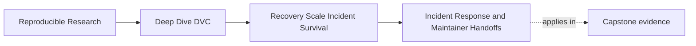
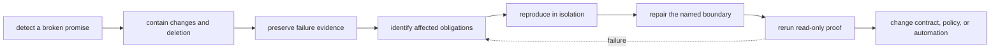

# Incident Response and Maintainer Handoffs


<!-- page-maps:start -->
## Page Maps




<!-- page-maps:end -->

A recovery incident is any event that makes a promised state unavailable, unverifiable, or
too slow to restore. The bytes do not have to be gone:

- a release tag resolves but its DVC object does not
- the object exists but the recovery identity cannot read it
- the artifact restores but no longer matches its manifest
- the documented route mutates storage before checking it
- restore succeeds after the stated recovery-time objective
- only one departing maintainer knows which remote is authoritative

The response must protect two things at once: the state under obligation and the evidence
needed to explain what happened.

## Repair can erase the failure

Suppose `dvc pull` reports that an object is missing. A maintainer who still has the object
locally runs `dvc push`; the next pull passes.

The content may now be safe, but unanswered questions remain:

- When did the candidate remote become incomplete?
- Which other protected revisions are missing?
- Did migration scope, garbage collection, or an access error cause the failure?
- Which users were affected?
- Was the repaired object the one the release contract expected?
- Did the verification route hide similar failures in earlier drills?

Preserve the first failure before repair. A screenshot alone is weak evidence. Capture the
command, revision, remote name, return code, standard output, standard error, executor
identity, and time.

## Use an evidence-first response loop



Containment comes before broad experimentation. Verification after repair uses the same
contract that exposed the incident.

## Decide whether the event is an incident

Not every failed pull is a storage-loss incident.

| Observation | Possible boundary | First discriminating evidence |
| --- | --- | --- |
| Git revision does not resolve | missing or unfetched Git history | local and remote ref inventory |
| DVC reports missing object | incomplete remote coverage | pointer identity and remote listing or copy receipt |
| DVC reports authentication failure | access path | credential role, expiry, and denied operation |
| pull succeeds but digest differs | stale contract or wrong artifact | expected and actual identities |
| clean CI fails but maintainer succeeds | executor, credentials, or hidden cache | compare runtime and cache conditions |
| restore succeeds too slowly | recovery capacity | measured duration, object volume, transfer path |
| published result cannot be interpreted | semantic evidence | manifest, parameters, population, and metric contract |

Classify with evidence rather than choosing the most dramatic explanation.

## Freeze the dangerous surfaces

Containment should be proportional. Common temporary controls include:

- pause garbage collection and lifecycle deletion on implicated storage
- pause source-remote retirement
- stop publishing new releases from an uncertain state
- preserve relevant caches instead of cleaning them
- prevent force-updating protected tags or branches
- keep the last accepted CI executor available
- restrict remote writes to the incident operator when uncontrolled repair would obscure
  evidence

Containment is not a permanent operating model. Record who applied it, what it protects,
and the condition for removal.

## Define the affected obligation set

"DVC is down" is too broad to guide recovery.

Create an impact table:

| Obligation | Protected state | Expected source | Observed result | Status |
| --- | --- | --- | --- | --- |
| current collaboration | `main` dataset | candidate remote | restores and matches | unaffected |
| published audit | `release-2025-q1` dataset | candidate remote | object missing | affected |
| rollback | `release-2025-q2` model | archive remote | not tested | unknown |
| open experiment decision | `exp-threshold-62` outputs | candidate remote | access denied | unknown |

Unknown is not the same as affected, but it still requires investigation before declaring
containment complete.

The table also prevents a successful current restore from closing an incident involving
historical state.

## Choose a last known good contract, not merely a commit

The latest commit may never have passed recovery. The last known good point needs several
coordinates:

- Git revision and protected reference set
- artifact identities
- authoritative remote
- accepted recovery bundle
- CI workflow revision and executor identity
- credential role used by the proof
- timestamp and result

Write:

> Recovery bundle `R-184` verified `main`, `release-2025-q1`, and `release-2025-q2`
> against remote `archive-primary` from empty caches using CI image digest `sha256:…`.

Do not write only:

> Commit `abc123` was good.

A commit cannot prove that remote bytes and access were available at that time.

## Preserve evidence in an incident packet

An incident packet should let a reviewer reconstruct decisions without shell history.

Recommended contents:

| Surface | Evidence |
| --- | --- |
| detection | failing command receipt and monitoring event |
| contract | protected revisions, identities, RPO, and RTO |
| environment | Git, DVC, Python, runner, and workflow versions |
| storage | named remotes, authority status, and non-secret access role |
| references | branch, tag, and experiment inventory |
| impact | obligation table with affected, unaffected, and unknown states |
| timeline | evidence and decisions with timestamps |
| repair | exact mutation, operator, reason, and objects affected |
| verification | cache-empty read-only receipts after repair |
| follow-up | policy, automation, ownership, or documentation changes |

Store generated packets in the repository's governed artifacts location or incident
system, not inside source directories.

Never include secret values. Credential identifiers and permission boundaries are useful;
tokens and keys are liabilities.

## Assign decision roles

One person may hold several roles on a small team, but the decisions remain distinct:

| Role | Owns |
| --- | --- |
| incident lead | timeline, containment, coordination, closure gate |
| storage operator | remote inventory, copy or repair, deletion freeze |
| repository maintainer | Git and DVC reference integrity, recovery route |
| domain reviewer | whether restored state still supports the scientific or product claim |
| release owner | downstream impact, publication or rollback decision |
| security or platform owner | credential and provider incidents |

The storage operator can say bytes were restored. The domain reviewer decides whether the
restored evidence still supports the conclusion. Do not collapse those judgments.

## Keep investigation read-only where possible

Useful early evidence routes include:

```bash
git status --short
git branch --all
git tag --list
dvc remote list
dvc status
dvc version
```

The exact commands depend on the failure. The principle is to observe before changing
cache, workspace, pointers, references, or remote content.

Potentially evidence-destroying actions include:

- pushing from an unverified cache
- running garbage collection
- changing the default remote without recording the prior configuration
- force-updating release tags
- rerunning a nondeterministic pipeline over missing outputs
- deleting a failed workspace
- rotating or replacing credentials before recording the access failure

Some of these actions may become necessary. Preserve evidence and authorize the mutation
first.

## Reproduce without contaminating the original

Use an isolated reviewer when feasible:

- clone Git history into a separate directory
- fetch the protected refs required by the contract
- configure only the remote and access path under investigation
- begin without the author's artifact cache
- select one protected revision
- run the read-only restore and verifier
- preserve the receipt even when it fails

Isolation distinguishes repository-wide failure from one damaged workspace. It also
prevents an author's complete cache from making the remote look healthy.

The course audit creates separate reviewers for `main` and `release-2025-q1`. That design
is directly useful during incidents:

```bash
make capstone-recovery-readiness-audit
```

`CURRENT_ONLY_COPY` is an incident model: one obligation passes and another fails. Its two
revision records show why the response must scope by promise.

## Repair the smallest named boundary

Repair should follow diagnosis:

| Diagnosed boundary | Bounded repair |
| --- | --- |
| missing candidate object with valid source copy | copy the identified object under change control |
| incomplete revision copy scope | repopulate the candidate for the approved protected set |
| expired recovery credential | restore the intended role and document the access interruption |
| stale expected digest | investigate contract authority; amend only after content meaning is confirmed |
| missing Git tag | restore from authoritative Git evidence; do not invent a replacement name |
| slow recovery path | change tier, concurrency, or objective through review |
| broken runbook command | correct and test the runbook against the same contract |

Avoid broad "sync everything" repairs unless the approved policy genuinely protects
everything. Broad copying can import expired or untrusted state and obscure which object
resolved the incident.

## Verify the promise, not just the repair command

After repair:

- use a new empty-cache reviewer
- test every affected or uncertain protected state
- compare content identity and semantic checks
- measure against RPO and RTO
- use the intended recovery credential class
- keep the verification route read-only
- compare with the last known good contract

A successful repair upload is not closure evidence. A successful restore from the repaired
authority is.

## Write a timeline that separates facts and decisions

Good timeline entries identify type:

| Time | Type | Entry |
| --- | --- | --- |
| 09:12 | fact | release reviewer pull failed for `release-2025-q1` with missing object |
| 09:18 | decision | paused candidate cutover and remote garbage collection |
| 09:27 | fact | `main` restored; `release-2025-q2` not yet tested |
| 09:41 | hypothesis | migration copied only current workspace state |
| 10:03 | fact | legacy remote restored the expected release digest |
| 10:11 | decision | copy missing protected release objects from legacy |
| 10:34 | fact | new candidate-only reviewers restored all protected revisions within RTO |

Facts, hypotheses, and decisions should not blur. Later reviewers need to know what was
observed and what was inferred.

## Close only after the learning is durable

Closure criteria should include:

- affected obligations restore from the authoritative boundary
- unknown states were tested or explicitly removed from incident scope by authority
- semantic reviewers accept restored meaning
- containment controls are removed deliberately
- downstream users receive any required notice
- retention and cutover decisions are corrected
- a regression check reproduces the original failure class
- ownership and runbooks no longer depend on private memory

If the same false assurance can recur undetected, repair is complete but incident learning
is not.

## Design maintainer handoffs as recovery drills

Maintainer turnover removes human cache:

- which release tags are protected
- why an old remote still exists
- which credential is read-only
- where recovery bundles are stored
- which failure is accepted temporarily
- who approves garbage collection

A handoff is complete when the incoming maintainer can demonstrate the contract without
the outgoing maintainer operating the keyboard.

Handoff exercise:

1. incoming maintainer reads the retention and recovery contracts
2. incoming maintainer identifies current authority and rollback source
3. incoming maintainer runs the cache-empty audit using their own access
4. incoming maintainer explains one blocked case from evidence
5. outgoing maintainer observes and records only the gaps
6. both owners update the durable surface that caused each gap

The output is not "knowledge transferred." It is a set of independently demonstrated
capabilities and repaired gaps.

## Use a handoff ledger

| Responsibility | Durable surface | Incoming proof | Owner |
| --- | --- | --- | --- |
| remote authority | recovery contract and DVC config | names source, candidate, and rollback state | repository maintainer |
| access renewal | access runbook | authenticates with intended read role | platform owner |
| release retention | policy and protected tag list | maps each release to restore proof | release owner |
| garbage collection | cleanup review packet | produces safe dry preview | storage operator |
| incident response | incident guide and packet template | classifies a simulated failure | incident lead |
| executor continuity | CI contract | compares platform and recovery receipts | automation owner |

Any empty proof cell is a recovery risk, not an onboarding inconvenience.

## Write an incident note that teaches

A durable note answers:

- Which promise failed?
- What was the first preserved evidence?
- Which obligations were affected, unaffected, or unknown?
- What boundary caused the failure?
- Which mutation repaired it?
- Which new read-only evidence proves recovery?
- Did restored meaning receive domain review?
- What changed so the failure is detected earlier next time?

Example:

> Candidate remote cutover was blocked because `main` restored but
> `release-2025-q1` did not. The failed release pull and both revision receipts were
> preserved before repair. Migration had copied only current workspace objects. The
> storage operator copied the protected release set from the still-authoritative legacy
> remote. New cache-empty reviewers restored both revisions, matched contract digests,
> and met the 30-second lab objective. The cutover checklist now requires protected
> revision enumeration and read-only per-revision receipts.

The note names the broken promise, preserved evidence, diagnosis, bounded repair, closure
proof, and durable change.

## Review checkpoint

You are ready to continue when you can:

- define a recovery incident without requiring total data loss
- preserve the first failure before any repair mutation
- scope impact by obligation and keep unknown separate from unaffected
- identify a last known good contract with storage and executor coordinates
- use isolation to distinguish workspace, access, Git, remote, identity, and timing
  failures
- assign technical and semantic decisions to explicit roles
- close an incident only after a regression check and durable learning
- require an incoming maintainer to demonstrate recovery independently

Incident survival means repairing availability without erasing the evidence that makes the
repair trustworthy.
