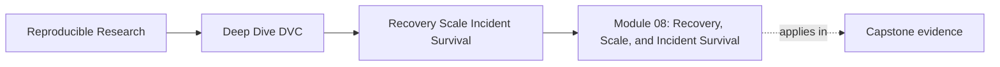

# Module 08: Recovery, Scale, and Incident Survival


<!-- page-maps:start -->
## Page Maps




<!-- page-maps:end -->

A reproducible result has a future tense.

It is not enough for the result to exist now. The project must decide which recorded
states still matter, preserve the right Git and DVC evidence, rehearse recovery without
hidden local help, and survive storage or maintainer change without rewriting history.

The module's central decision is:

> May a project trust a candidate recovery boundary enough to change storage authority,
> clean old objects, or release the prior source?

You will answer with evidence from distinct protected revisions, not with "the remote
works."

## What you will build

By the end, your learner packet will contain:

- a recovery contract with identity, RPO, RTO, access, and verification claims
- a retention map driven by obligations and observable end conditions
- a garbage-collection review that maps policy to revision scope
- a remote cutover review with separate migration and verification permissions
- an executor-drift comparison
- an incident packet that preserves the first failure before repair
- an independently demonstrated maintainer handoff
- a final decision that separates candidate acceptance from source retirement

The capstone supplies an executable audit with six cases. Two protected revisions contain
different data:

- `release-2025-q1` represents published evidence
- `main` represents current collaboration

A current-only migration restores real data and still blocks. That mixed result is the
module's main teaching surface.

## Prerequisites

Before starting, you should be able to:

- explain how a `.dvc` file or `dvc.lock` entry names content
- distinguish Git metadata, workspace files, local DVC cache, and remote DVC objects
- read a simple JSON contract
- run a Make target from the course directory
- interpret command return codes and structured audit output

If those boundaries are unclear, revisit:

- [Module 02: Data Identity and Content Addressing](../module-02-data-identity-content-addressing/index.md)
- [Module 04: Truthful Pipelines and Declared Dependencies](../module-04-truthful-pipelines-declared-dependencies/index.md)
- [Module 07: Collaboration, CI, and Social Contracts](../module-07-collaboration-ci-social-contracts/index.md)

You do not need a cloud account. The lab uses isolated local remotes generated under
`artifacts/`.

## Protect your working environment

The capstone audit is non-destructive to the source specimen. It creates its own Git
repositories, DVC caches, and remotes in generated workspace directories.

This module discusses garbage collection and remote retirement. Do not translate a
preview example into deletion on a real repository. In particular:

- use DVC's current `--dry` flag for collection previews
- do not add `--force` merely to avoid a prompt
- do not use `--cloud` without explicit remote-deletion authority
- do not run cleanup while protected refs, shared caches, or incident holds are unknown

The exercises require review artifacts, not destructive action.

## Learning contract

At completion, you should be able to defend these claims:

| Capability | Evidence you produce |
| --- | --- |
| define durability | contract names exact state, source, access, identity, RPO, RTO, and proof |
| govern history | retention class follows an obligation and observable end condition |
| review cleanup | every collection scope flag maps to a protected reference class |
| migrate authority | write-enabled copy is separated from read-only verification |
| diagnose recovery | Git, access, object coverage, identity, meaning, and timing failures stay distinct |
| preserve incidents | first failure survives repair and closure comes from a new reviewer |
| survive turnover | incoming maintainer demonstrates the route without private coaching |

"I ran `dvc pull`" does not satisfy the contract.

## Full-session route

Allow a serious session, not a quick read:

| Work block | Focus | Output |
| --- | --- | --- |
| 45–60 minutes | durability and retention pages | first recovery contract and retention map |
| 40–50 minutes | garbage collection and migration pages | cleanup scope and cutover gates |
| 30–40 minutes | incident and handoff page | evidence-first response outline |
| 45–60 minutes | worked investigation and audit | case predictions and evidence map |
| 90–120 minutes | ten cumulative exercises | completed learner packet |
| 30 minutes | answer comparison | revisions with reasons |

Take a break between the reading and the full exercise packet. The second half requires
careful evidence comparison.

## Reading route

```mermaid
flowchart LR
  promise["durability promise"]
  value["retention obligations"]
  reachability["collection reachability"]
  authority["remote authority"]
  incident["incident evidence"]
  investigation["worked investigation"]
  practice["cumulative packet"]
  answers["reasoning comparison"]

  promise --> value --> reachability --> authority
  authority --> incident --> investigation --> practice --> answers
```



Read in this order:

1. [Durability Boundaries and Recovery Goals](durability-boundaries-and-recovery-goals.md)
   defines identity, storage, access, verification, protected revisions, RPO, and RTO.
2. [Retention Policy and History Value](retention-policy-and-history-value.md) maps
   obligations to protected, time-bounded, archive, and disposable state.
3. [Garbage Collection and Cache Safety](garbage-collection-and-cache-safety.md) explains
   how policy becomes a revision preservation set.
4. [Remote Migration and CI Drift](remote-migration-and-ci-drift.md) separates storage
   population from independent cutover proof.
5. [Incident Response and Maintainer Handoffs](incident-response-and-maintainer-handoffs.md)
   protects failed evidence and human continuity.
6. [Worked Example: Restoring After Local Cache Loss](worked-example-restoring-after-local-cache-loss.md)
   investigates a current-only migration from decision to receipt.
7. [Exercises](exercises.md) builds one cumulative packet.
8. [Exercise Answers](exercise-answers.md) compares decisions, evidence, and limits.

Use the [Glossary](glossary.md) when a term changes the decision boundary. Do not interrupt
every paragraph to memorize definitions.

## Pressure routes

If you arrive with a specific problem:

| Problem | Start here | Then prove |
| --- | --- | --- |
| "What must survive?" | durability page | named recovery unit and protected revisions |
| "Can we delete old cache?" | retention, then garbage collection | obligation map, visible refs, `--dry` candidates |
| "Can we retire the old remote?" | migration page | separate copy, recovery, authority, and source-exit gates |
| "The pull failed" | incident page | preserve receipt and discriminate Git, access, content, identity, or time |
| "CI changed" | migration and CI page | same protected scope under both executors |
| "A maintainer is leaving" | incident and handoff page | incoming operator demonstrates recovery independently |
| "I missed class" | this page, then full reading route | completed packet and answer comparison |

## Execute the proof surface

From the course directory:

```bash
make capstone-recovery-readiness-audit
```

The generated bundle contains:

```text
recovery-readiness/
├── RECOVERY_READINESS_AUDIT_GUIDE.md
├── manifest.json
├── report.json
├── review-questions.txt
├── route.txt
├── summary.tsv
├── scripts/
├── specimen/
├── tests/
└── workspace/
    ├── complete-migration/
    ├── current-only-copy/
    ├── release-only-copy/
    ├── stale-release-claim/
    ├── mutating-recovery-route/
    └── missing-time-objective/
```

Read:

1. `summary.tsv` for decisions
2. `report.json` for failed checks
3. one case's `revision-evidence.json` for restored identity and duration
4. that case's `receipts.json` for command-level corroboration
5. specimen contract, implementation, and tests after you understand the decision

This route is deliberately decision-first. Raw logs are evidence, not the syllabus.

## The six cases as a concept map

| Case | Mechanism | Teaching boundary |
| --- | --- | --- |
| complete migration | both protected DVC objects copied | whole contract can pass |
| current-only copy | only current object copied | current recovery does not prove release history |
| release-only copy | only published object copied | audit history does not prove current continuity |
| stale release claim | bytes restore under wrong expected digest | availability does not prove identity |
| mutating recovery route | check contains a candidate push | repair cannot masquerade as verification |
| missing time objective | restores have no declared limit | measurement without objective cannot pass a contract |

Predict each decision before running the audit. A correct prediction is stronger learning
evidence than recognizing the answer afterward.

## Command boundaries

Course-owned routes:

```bash
make capstone-recovery-readiness-audit
make capstone-recovery-readiness-selftest
make capstone-recovery-drill
make capstone-recovery-review
```

Purpose:

| Command | Use |
| --- | --- |
| readiness audit | compare complete and rejected protected-history cutovers |
| readiness selftest | enforce the decision rules in the focused audit |
| recovery drill | restore the governed capstone pipeline outputs after local cache loss |
| recovery review | package the main capstone's restore evidence |

The readiness audit teaches historical coverage and cutover decisions. The main capstone
drill teaches restoration of its current governed pipeline outputs. Neither silently
claims the other's scope.

Reference commands used in reviews:

```bash
git branch --all
git tag --list
dvc exp list --all
dvc remote list
dvc status
dvc gc --all-branches --all-tags --all-experiments --dry
```

The garbage-collection line is a non-destructive example whose flags correspond to a
particular hypothetical policy. Derive your own scope from your retention map.

## Proof boundaries

The executable audit proves that:

- an isolated DVC specimen can model two protected revisions
- empty-cache reviewers distinguish complete and partial candidate remotes
- content checks distinguish transfer from identity
- route inspection rejects verification that writes to candidate storage
- a declared time objective participates in the decision
- focused tests preserve those boundaries

It does not prove:

- cloud durability or geographic redundancy
- production-scale RTO
- recovery for artifacts outside the specimen contract
- credential rotation under a real identity provider
- organizational authority to delete storage

State those limits in the final exercise.

## Completion rubric

You have completed the module when you can do all of the following without the answer
page:

- explain why Git metadata, DVC objects, access, and verification cooperate
- write a protected revision contract with distinct current and historical obligations
- separate RPO from RTO
- map retention obligations to visible branches, tags, commits, and experiment refs
- use `--dry` correctly and explain why preview is not approval
- keep remote population, read-only verification, authority transfer, and source exit
  separate
- diagnose mixed results without broad repair
- preserve the first failed receipt
- close repair from a new empty-cache reviewer
- hand the route to another maintainer without private commands or credentials

Your exercise packet should make those capabilities reviewable.

## Continue after this module

Module 09 uses the durability reasoning here to ask what a promoted bundle must expose to
downstream consumers. Carry forward:

- protected identity
- explicit trust boundary
- manifest evidence
- authority changes
- audit and source-exit limits

Recovery answers whether promised state survives. Promotion answers which surviving state
others may trust.
