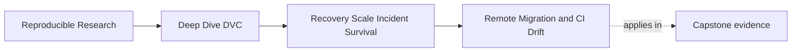
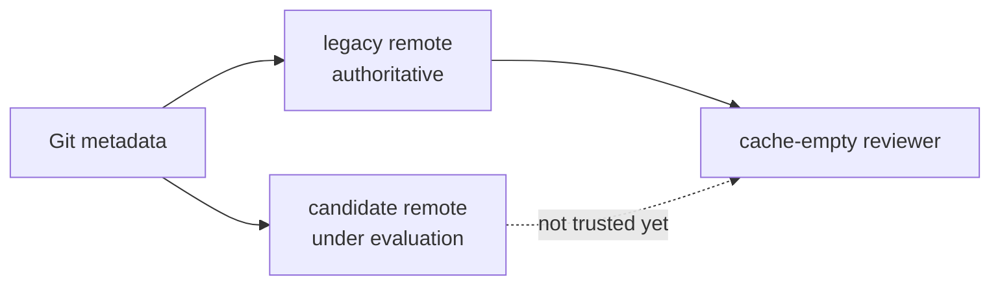
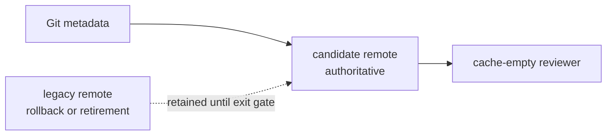

# Remote Migration and CI Drift


<!-- page-maps:start -->
## Page Maps




<!-- page-maps:end -->

A remote migration changes the place from which recorded state is expected to survive.
A CI update changes the executor expected to prove that survival. Both changes can make a
repository look healthy while weakening recovery.

This page keeps the two contracts separate:

- **content continuity** — every protected DVC object can be restored from the candidate
  storage
- **executor continuity** — the recovery check still runs under a known environment and
  produces interpretable evidence

A safe cutover needs both.

## Treat migration as a change of authority

Adding a second DVC remote is configuration. Making it the recovery authority is a
governance decision.

Before cutover:



After accepted cutover:



The arrow changes only after evidence shows that the candidate satisfies the same
protected-state promise.

## Define the cutover contract before copying

A migration contract should name:

| Contract field | Review question |
| --- | --- |
| source remote | Which location is authoritative before cutover? |
| candidate remote | Which exact location and configuration are under test? |
| protected revision set | Which current and historical states must move? |
| expected identities | How will restored content be recognized? |
| permitted exclusions | Which expired states are intentionally left behind? |
| access identities | Which learner, CI, and recovery roles must read the candidate? |
| recovery objectives | How much state and time may be lost? |
| rollback boundary | Until when can the source resume authority? |
| retirement gate | Which evidence permits decommissioning the source? |

Writing this after the copy makes it easy to define success around whatever happened to
move. Write it first so the migration can fail honestly.

## Keep migration and verification permissions distinct

Migration needs write permission to candidate storage. Independent verification should
need read permission only.

| Route | Legacy access | Candidate access | Purpose |
| --- | --- | --- | --- |
| inventory | read | none | identify promised source state |
| copy | read | write | populate candidate storage |
| verification | none or read for comparison | read | test candidate without repairing it |
| rollback | read | optional | restore prior authority |
| retirement | governed deletion | read | end source obligation after approval |

If the verification route includes `dvc push`, it can fill a missing object from the
operator's cache. A passing result then means "the candidate was repairable," not "the
candidate was complete at the start of review."

This permission separation is one of the strongest ways to prevent a migration check from
creating its own proof.

## Use gates that can stop the cutover

A durable migration has decision gates, not one long command transcript.

### Contract gate

Required evidence:

- retention policy identifies protected artifact families
- every protected family maps to Git revisions or explicit object identities
- exclusions have closed obligations and recorded authority
- RPO and RTO are declared

Block when scope is unknown.

### Candidate population gate

Required evidence:

- candidate remote configuration is reviewable
- copy receipts name the revision scope used
- copy failures and skipped revisions remain visible
- source remote stays authoritative

Block when copy output is incomplete or ambiguous.

### Independent recovery gate

Required evidence:

- clean Git reviewers can resolve every protected revision
- reviewer artifact caches begin empty
- candidate access uses the intended recovery identity
- every artifact restores and matches its contract
- observed durations satisfy the objective
- no verification command mutates candidate storage

Block on any protected revision failure.

### Authority gate

Required evidence:

- the default or documented recovery route points to the candidate
- CI and learner setup use the new authority
- monitoring and ownership transfer are complete
- rollback remains available for a stated interval

Block when configuration changed but users still depend on the source implicitly.

### Source exit gate

Required evidence:

- the rollback interval closed without unresolved failures
- final candidate audit passes
- retention or archival obligations for the source are resolved
- retirement approval names the exact storage target
- decommission evidence will be retained

Block when deleting the source would erase the only known copy of any promised state.

These gates turn "migration finished" into several smaller claims with different evidence
and permissions.

## Copy scope must match retention scope

Common scope mismatches:

| Copy choice | Hidden loss |
| --- | --- |
| current workspace only | protected releases and historical rollback states |
| all Git commits only | selected DVC experiments that carry open decisions |
| all objects in storage | cost and clutter from expired state; unclear ownership |
| release tags only | current mainline continuity |
| one successful target | other artifact families in the same protected release |

There is no single widest flag that expresses every organization's policy. The migration
plan must map obligations to branch, tag, commit, experiment, and artifact scopes
deliberately.

## Verify object identity after transfer

Storage-provider copy counts can say that objects moved. They do not necessarily say that
the repository can resolve and use them.

Review from the repository boundary:

1. clone the Git repository without the author's DVC cache
2. select one protected revision
3. remove any materialized artifact and local object cache
4. pull the named DVC target from the candidate remote
5. compare restored digest, schema, row count, or release verifier with the contract
6. preserve duration and command receipts
7. repeat in a separate reviewer for each protected revision

The separate reviewer prevents the first restoration from populating cache for later
checks.

The course audit performs this pattern:

```bash
make capstone-recovery-readiness-audit
```

Read `CURRENT_ONLY_COPY` and `RELEASE_ONLY_COPY` together. Each candidate remote contains
real data and passes one restore. Each still blocks cutover because the protected set is
incomplete.

## Plan rollback as a return of authority

"The old bucket still exists" is not a rollback plan.

A rollback plan states:

- the event that triggers rollback
- who can decide
- how default remote configuration returns to the source
- which writes occurred after candidate cutover
- how those writes will be reconciled
- how users learn which remote is authoritative
- which verification reruns after the return

Dual writing complicates rollback. If both remotes receive new objects after cutover,
their coverage can diverge. Name whether the migration uses:

- source-authoritative copying, where the candidate is read-only to users until cutover
- dual publication, where both remotes receive governed writes for a bounded interval
- candidate-authoritative operation with source frozen as rollback evidence

The model must be explicit. Otherwise rollback can restore an older but incomplete view.

## CI drift can invalidate the recovery witness

A scheduled recovery job is useful only if its executor remains understood.

CI drift can change:

- DVC command behavior and supported flags
- remote protocol dependencies
- certificate and credential handling
- filesystem link behavior in the cache
- Git clone depth and visible references
- dependency installation time
- artifact transfer performance
- checksum or schema tooling

A green job after an executor update may still test a narrower revision set. A red job may
indicate an access or tooling change rather than missing content. Preserve enough runtime
evidence to distinguish those causes.

## Record the executor contract beside recovery evidence

At minimum, a recovery receipt should make these facts recoverable:

| Surface | Example evidence |
| --- | --- |
| workflow identity | CI configuration revision and job name |
| operating environment | image digest or runner image identifier |
| Python runtime | executable path and version |
| DVC runtime | `dvc version` output |
| Git behavior | version, clone depth, fetched refs |
| remote identity | DVC remote name, not secret-bearing URL output |
| credential role | stable role name or identity class, never token contents |
| timing | start, finish, and measured restore duration |
| result contract | revision identities and verifier output |

Secrets are not evidence to archive. Preserve the name and permission boundary of the
credential, not its value.

## Decide whether executor drift changes meaning

Use a controlled comparison:

| Old executor | New executor | Interpretation |
| --- | --- | --- |
| same protected set, same restored identities, similar duration | same | recovery evidence remains comparable |
| same identities, slower than RTO | content continuity holds; time objective fails |
| fewer Git refs visible | new job tests a narrower promise |
| pull fails with authentication error | access continuity fails; content coverage remains unknown |
| pull succeeds, verifier differs | runtime or semantic drift needs investigation |
| DVC flag no longer exists | runbook and pinned tool contract are stale |

Do not normalize a new result merely because the CI update was planned.

## Upgrade the executor without losing the baseline

For a CI image or DVC upgrade:

- capture the last accepted recovery bundle from the old executor
- run the new executor against the same protected contract
- compare resolved revisions, restored identities, durations, and failure classes
- explain every material difference
- accept the new executor only after the comparison is reviewed
- keep the evidence that connects the old and new witness

Pinning can make comparisons easier, but permanent pinning is not the objective. Controlled
change is.

## Diagnose migration failures precisely

| Symptom | First boundary to inspect | Do not conclude yet |
| --- | --- | --- |
| revision checkout fails | Git reference coverage | candidate DVC object is missing |
| pull reports missing object | candidate object coverage and pointer identity | all candidate history is incomplete |
| pull reports permission error | recovery identity and remote access | object does not exist |
| digest mismatch after pull | contract freshness, object identity, verifier | transfer alone proved correctness |
| restore exceeds RTO | transfer path, object size, concurrency, executor | data is unrecoverable |
| old CI passes, new CI fails | executor comparison | storage migration failed |

Name the boundary before repair. That keeps the failed evidence useful.

## Write the cutover note

An acceptable note answers:

- Which source and candidate remotes were compared?
- Which protected revisions and artifact families were in scope?
- Which states were intentionally excluded, under what authority?
- Did empty-cache, read-only restores match identity and time objectives?
- Which CI executor produced the evidence?
- What rollback interval remains?
- Who approved authority transfer?
- What exact evidence permits or blocks source retirement?

"Changed the DVC URL and tests pass" answers none of the hard questions.

## Review checkpoint

You are ready to continue when you can:

- distinguish candidate configuration from recovery authority
- define contract, population, recovery, authority, and source-exit gates
- keep migration writes separate from read-only verification
- map retention scope to migration scope
- verify content identity from independent empty-cache reviewers
- describe rollback as a controlled return of authority
- record enough CI executor evidence to interpret drift
- separate missing content, missing access, missing Git refs, identity mismatch, and RTO
  failure

Migration preserves trust only when storage authority and its verification executor change
under explicit, reversible decisions.
