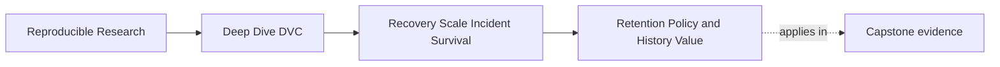
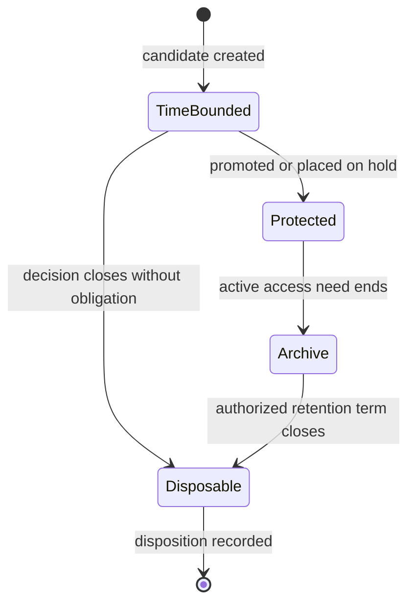

# Retention Policy and History Value


<!-- page-maps:start -->
## Page Maps




<!-- page-maps:end -->

Retention is the decision that comes before safe cleanup:

> Which recorded states still carry an obligation, and what evidence allows that
> obligation to end?

Age alone cannot answer. Yesterday's discarded experiment may already have no remaining
value. A five-year-old release may still support a paper, regulated decision, rollback,
or customer contract.

This page turns "keep important data" into a policy a maintainer can apply without knowing
the private history of every artifact.

## Begin with obligations, not file extensions

The same file type can carry very different value:

- a model file may be an abandoned trial
- another model file may be the promoted production rollback target
- a CSV may be disposable scratch output
- another CSV may define the population behind a published conclusion

Classify the obligation first:

| Obligation | Why the state matters | Typical ending event |
| --- | --- | --- |
| current operation | collaborators or automation need the state now | superseded by a verified replacement |
| rollback | maintainers may need to restore an accepted earlier state | rollback window closes under policy |
| published evidence | a report, paper, or release depends on it | publication retention term ends |
| legal or regulatory | external rules require preservation | authorized disposition date arrives |
| active decision | reviewers still need the candidate | decision closes and evidence is recorded |
| incident evidence | diagnosis or accountability depends on it | incident closure and evidence disposition approval |
| exploratory learning | state may help the author but supports no promise | short review window closes |

One artifact can carry several obligations. The strongest active obligation governs its
retention.

## Separate record retention from content retention

DVC projects distribute a historical state across Git and object storage. Keeping one
side does not preserve the whole state.

| Retained surface | What remains | What may still be lost |
| --- | --- | --- |
| Git commit only | pointer, pipeline declaration, lock metadata | content object named by the pointer |
| DVC object only | bytes identified by a content hash | human meaning, revision context, parameters, release decision |
| publish bundle only | consumer-facing result and selected evidence | internal data or intermediate state needed for reconstruction |
| Git plus all required DVC objects | restorable recorded state | access, runtime, or semantic interpretation if undocumented |
| recovery contract plus tested state | explicit promise and observed restore evidence | guarantees outside the test boundary |

A retention rule should say which combination must survive. "Keep the tag" is incomplete
if the remote later discards the tag's DVC objects.

## Use retention classes that lead to actions

Labels help only when they change behavior. This course uses four:

| Class | Meaning | Cleanup behavior | Required evidence |
| --- | --- | --- | --- |
| protected | loss would break an active obligation | exclude from deletion scope | named revision, owner, reason, recovery proof |
| time-bounded | obligation has a known review or expiry date | delete only after the date and closure check | expiry event, decision record, approver |
| archive | infrequent access is acceptable but later recovery is required | move through verified archival cutover | archive location, identity check, restore route |
| disposable | no active obligation remains | remove after ordinary review | reason no protected reference depends on it |

"Keep forever" is not a useful fifth class. If there is truly no authorized end date,
write the governing obligation and review cadence. Policies still need ownership, cost
review, and a way to detect when access or formats decay.

## A complete policy record has seven fields

For every governed artifact family, record:

1. **scope** — paths, DVC outputs, revision selectors, or release identifiers
2. **obligation** — the user, decision, rule, or recovery purpose being protected
3. **retention class** — protected, time-bounded, archive, or disposable
4. **end condition** — an event and, where useful, a date
5. **authority** — the role allowed to approve a class change or disposition
6. **recovery evidence** — how a clean reader proves the state remains usable
7. **disposition evidence** — what must be recorded when state expires, moves, or is
   deleted

An example:

```yaml
artifact_family: published-observations
scope:
  revision: release-2025-q1
  dvc_target: data/observations.csv.dvc
obligation: reproduce the population cited by the quarterly report
retention_class: protected
end_condition: report retention term closes
authority: research-release-owner
recovery_evidence:
  - cache-empty pull from governed remote
  - restored SHA-256 equals release manifest
disposition_evidence:
  - owner approval
  - affected publication list
  - final recovery receipt
```

The syntax is optional. The fields are not.

## End conditions must be observable

Weak end conditions:

- when old
- when storage gets expensive
- when no longer needed
- after the project moves on

Nobody can apply these consistently.

Observable end conditions connect to an event:

- 90 days after an experiment decision is recorded
- after a replacement release passes rollback rehearsal and the prior rollback window
  closes
- seven years after the publication date, subject to legal hold
- when an incident owner approves evidence disposition after the review closes

A date alone may also be insufficient. If a candidate becomes incident evidence one day
before its scheduled expiry, its class changes. The policy needs a hold mechanism.



Retention is a lifecycle, not a permanent property stamped on file creation.

## Revisions are the bridge from policy to DVC

The policy may say "protect published releases," but a cleanup tool needs concrete
references.

Map the obligation to revision selectors:

| Policy statement | Concrete reference surface |
| --- | --- |
| protect current work | current workspace and mainline branch |
| protect released states | signed or governed Git tags |
| protect active lines of work | named branches with owners |
| protect decision-relevant DVC experiments | selected experiment refs |
| protect a publication snapshot | immutable revision plus manifest identity |

DVC garbage collection decides what to keep by reading DVC metadata from the revision
scope supplied to the command. If the policy's protected release is not represented in
that scope, the command cannot infer the obligation.

This leads to a review question:

> Can every protected policy row be mapped to a revision or artifact identity the
> cleanup review can enumerate?

If not, repair the map before cleanup.

## Work through a retention decision

A team has four states:

| State | Known facts |
| --- | --- |
| `release-2025-q1` | cited by a published report; tag and manifest exist |
| `main` | current pipeline input; CI pulls it |
| `exp-threshold-62` | candidate rejected yesterday; comparison note exists |
| `debug-sample.csv` | local sample used while diagnosing missing rows |

Reason from obligations:

**`release-2025-q1`**

- Obligation: published evidence.
- Class: protected or archive, depending on access objective.
- End condition: publication retention term, not artifact age.
- Proof: check out tag in a clean clone, pull from governed storage, compare manifest
  identity.

**`main`**

- Obligation: current operation.
- Class: protected.
- End condition: a verified successor becomes authoritative.
- Proof: clean collaborator or CI identity restores the current pointer.

**`exp-threshold-62`**

- Obligation: active decision has ended, but the decision record may still reference
  metrics and parameters.
- Class: time-bounded until the review window closes; then disposable if the decision
  record remains interpretable without its large output.
- Proof before deletion: promotion decision and comparison evidence remain available.

**`debug-sample.csv`**

- Obligation: uncertain. If the incident is open and the sample shows the failure, it is
  incident evidence and becomes protected by a hold. If the incident closed and the
  sample adds nothing beyond retained logs, it may be disposable.
- Proof: incident owner records the classification.

The result came from obligations and evidence, not size or recency.

## Cost belongs in the design

Retention consumes storage, transfer, verification time, access-management effort, and
format-maintenance work. Ignoring cost produces a policy people route around.

Use cost to choose among safe implementations:

| Pressure | Safer design response |
| --- | --- |
| frequent state is expensive on hot storage | move protected cold state to a tested archive |
| intermediate outputs dominate volume | preserve inputs and deterministic rebuild contract if the rebuild is actually verified |
| duplicated releases consume space | use content addressing while keeping distinct revision meaning |
| experiment history grows without decisions | require candidate ownership and review-window closure |
| restore time grows beyond objective | tier protected current state separately from archival history |

Cost can change the storage tier, recovery objective, or justified scope. It does not
silently cancel an active obligation.

## Know when rebuild is a retention strategy

Some outputs need not be stored if they can be reconstructed from retained inputs,
declarations, parameters, code, and environment.

Accept "rebuild instead of retain output" only when:

- every required input remains protected
- the pipeline declares the real dependencies
- runtime requirements are available
- reconstruction has been rehearsed from the retained boundary
- the rebuilt result satisfies the same identity or acceptable equivalence contract
- rebuild time meets the recovery objective

If training is nondeterministic or the original environment cannot be reconstructed,
"we can rerun it" is not a retention plan. It is an untested replacement claim.

## Produce disposition evidence

Deletion is the final policy decision, not an invisible storage event.

A useful disposition record contains:

- artifact family and identities affected
- policy class before disposition
- end condition that was satisfied
- protected references reviewed
- dry-run or inventory evidence
- approving role
- date and command scope
- surviving recovery sources
- exceptions, holds, or failures

This record lets a later incident distinguish intentional expiry from accidental loss.

## Apply the policy to the course audit

Open the recovery specimen's `recovery-contract.json`.

The contract protects `release-2025-q1` and `main` for different reasons. Then compare:

- `COMPLETE_MIGRATION`, where both obligations survive
- `CURRENT_ONLY_COPY`, where current operation survives but published evidence does not
- `RELEASE_ONLY_COPY`, where audit history survives but current operation does not

The audit does not treat one successful state as a percentage score. A cutover either
preserves every obligation in scope or blocks with a named missing revision.

## Review checkpoint

You are ready to continue when you can:

- classify obligations before classifying files
- distinguish Git record retention from DVC content retention
- write scope, obligation, class, end condition, authority, recovery evidence, and
  disposition evidence
- map protected policy rows to concrete revision selectors
- explain how incident evidence can place a hold on otherwise disposable state
- evaluate rebuild as a tested recovery strategy rather than an assumption
- use cost to redesign safe retention without silently deleting obligations

Retention policy is an agreement about which history still deserves a future. Cleanup
must implement that agreement, not invent it.
