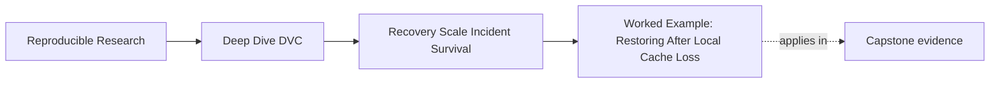
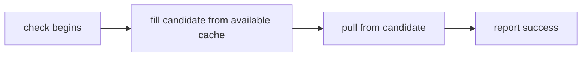

# Worked Example: Restoring After Local Cache Loss


<!-- page-maps:start -->
## Page Maps




<!-- page-maps:end -->

This investigation begins after an apparently successful remote migration.

The migration operator copied the current DVC state to a candidate remote and changed a
test workspace to use it. A pull from `main` succeeds. The operator proposes retiring the
legacy remote.

The repository has two active promises:

- `main` must remain recoverable for current collaboration
- `release-2025-q1` must remain recoverable because a published report cites it

The example shows why current recovery is real evidence but insufficient evidence.

## Start with the promises

The course specimen records:

```json
{
  "artifact": "data/observations.csv",
  "protected_revisions": [
    {
      "revision": "release-2025-q1",
      "expected_row_count": 3,
      "reason": "published evidence remains auditable"
    },
    {
      "revision": "main",
      "expected_row_count": 4,
      "reason": "current collaborators and automation can resume work"
    }
  ],
  "recovery_time_objective_seconds": 30,
  "verification_mode": "cache_empty_restore"
}
```

The two revisions refer to different DVC object identities. That fact is essential. If
both names pointed to the same content, a current-only copy could accidentally satisfy
both checks without teaching historical coverage.

The cutover decision is:

> May the candidate remote become recovery authority and permit the legacy remote to
> retire?

Acceptance requires every protected revision, not a majority.

## Examine the tempting evidence

The operator reports:

```text
candidate remote configured
main pull succeeded
four rows restored
```

All three statements can be true while the cutover remains unsafe.

| Evidence | What it proves | What it does not prove |
| --- | --- | --- |
| candidate remote configured | DVC can locate a named storage endpoint | storage contains required objects |
| `main` pull succeeded | candidate has the current pointer's object and access worked | protected release objects exist |
| four rows restored | current content shape matches one claim | published three-row content remains auditable |

The error would be moving from "current state restores" to "protected history is
complete."

## Run the independent audit

From the course directory:

```bash
make capstone-recovery-readiness-audit
```

The audit builds each case in the generated `artifacts/audit/` tree. It does not initialize
the authored specimen in place.

Open `summary.tsv`. The relevant rows have this shape:

```text
finding           expected  decision  result
COMPLETE_MIGRATION ACCEPT    ACCEPT    PASS
CURRENT_ONLY_COPY  BLOCK     BLOCK     PASS
RELEASE_ONLY_COPY  BLOCK     BLOCK     PASS
```

`PASS` in the final column means the audit reached the expected teaching decision. It does
not mean the migration case was accepted. `CURRENT_ONLY_COPY` correctly passes its test
by producing `BLOCK`.

This distinction prevents a test harness result from being mistaken for a storage
decision.

## Compare the two current-only reviewers

Open:

```text
workspace/current-only-copy/revision-evidence.json
```

The release record is structurally equivalent to:

```json
{
  "revision": "release-2025-q1",
  "revision_resolved": true,
  "restored": false,
  "expected_row_count": 3,
  "actual_row_count": null,
  "content_claim_matches": false
}
```

The main record is structurally equivalent to:

```json
{
  "revision": "main",
  "revision_resolved": true,
  "restored": true,
  "expected_row_count": 4,
  "actual_row_count": 4,
  "content_claim_matches": true
}
```

The result localizes the failure:

| Boundary | Release | Main | Finding |
| --- | --- | --- | --- |
| Git revision resolution | passes | passes | Git history is available |
| candidate access | attempted | passes | access is not globally broken |
| candidate object coverage | fails | passes | candidate contains only part of protected state |
| content identity | unavailable | passes | release meaning cannot be checked |
| cutover | blocked | blocked as one decision | legacy authority must remain |

The main success helps diagnosis. It rules out several broad claims such as "the candidate
remote is entirely unreachable." It cannot cancel the release failure.

## Read receipts only after the decision

Open:

```text
workspace/current-only-copy/receipts.json
```

Find three command groups:

- the author's migration command, which pushes current state to `candidate`
- the release reviewer's cache-empty pull, which fails
- the main reviewer's cache-empty pull, which succeeds

Check:

- command arguments name the candidate remote
- the reviewers use separate clone directories
- each reviewer removes local artifact cache before pulling
- the failed receipt preserves return code, standard output, and standard error
- no reviewer command pushes or repairs remote content

The receipts corroborate the structured findings. They are not the first reading surface
because forcing every reviewer to infer policy from raw command logs is error-prone.

## Preserve the incident before repair

At this point the team knows:

- source: candidate remote after current-only migration
- affected obligation: published recovery of `release-2025-q1`
- unaffected obligation: current `main` recovery
- unknowns: any other protected release not named by the lab contract
- likely cause: copy scope covered only current workspace state
- containment: do not retire or garbage-collect the legacy remote

The team preserves:

- `summary.tsv`
- `report.json`
- current-only revision evidence
- current-only command receipts
- the recovery contract
- migration operator's original copy receipt

Only now should a write repair be authorized.

## Reject the wrong repair route

An operator suggests adding `dvc push --remote candidate` to the verification script.

That would make the next check convenient, but it would collapse repair and verification:



The green result could not say whether candidate storage was complete before the check.

The audit includes `MUTATING_RECOVERY_ROUTE`. Both revisions restore, but the decision
still blocks because the proposed verification route includes a remote write.

Use two routes:

- a write-authorized repair route that copies the missing protected set
- a new read-only, empty-cache verification route that tests candidate state afterward

## Bound the repair

The diagnosed gap is not "all data may be missing." It is "the protected release object
was omitted by current-only copy scope."

The repair plan should name:

| Field | Decision |
| --- | --- |
| source authority | legacy remote remains authoritative during repair |
| target | candidate remote |
| protected scope | `release-2025-q1` plus any other policy-protected revisions discovered by inventory |
| mutation owner | storage operator |
| success evidence | candidate-only empty-cache restores and content-identity checks |
| stop condition | source identity mismatch, missing source object, or unexpected protected revision |
| rollback | no authority transfer; legacy remains in service |

The example does not use "copy everything" because expired exploratory state is outside
the stated obligation. In a real repository, inventory may reveal a wider protected set.

## Re-verify without the repair cache

After the storage operator copies the approved set, verification must start fresh:

- create new reviewer clones
- select each protected revision independently
- discard local artifact cache
- pull from candidate with read-only access
- compare restored SHA-256 and row count
- measure duration against the declared objective
- preserve new receipts

The expected pattern matches `COMPLETE_MIGRATION`:

| Revision | Resolved | Restored | Identity | Duration |
| --- | --- | --- | --- | --- |
| `release-2025-q1` | pass | pass | pass | within lab objective |
| `main` | pass | pass | pass | within lab objective |

Only this evidence can support candidate authority.

## Do not overclaim the measured time

The specimen declares a 30-second recovery-time objective and transfers tiny files on a
local filesystem. A pass proves that the audit enforces a declared objective. It does not
predict production transfer time.

A production review would need:

- representative object sizes and directory shapes
- real remote protocol and region
- intended recovery identity
- expected concurrency and bandwidth
- cold-cache conditions
- repeated measurements or an agreed percentile
- operational overhead beyond the data transfer

Keep the lab conclusion bounded:

> Both protected specimen revisions restored within the declared local audit objective.

Do not write:

> Production recovery takes less than 30 seconds.

## Decide on authority and legacy retirement separately

Candidate acceptance and source deletion are related but distinct:


The team may accept candidate authority while retaining the legacy remote for rollback or
archive policy. Source retirement needs:

- closed rollback interval
- final protected-set audit
- no unresolved holds
- explicit deletion or decommission approval
- preserved disposition record

A migration test does not authorize deletion by itself.

## Write the incident and cutover note

A useful note:

> Candidate cutover was blocked because an empty-cache reviewer restored `main` but could
> not restore protected release `release-2025-q1`. Git resolved both revisions, so the
> failure was candidate object coverage rather than missing history. We preserved the
> failed release receipt before repair and kept the legacy remote authoritative. The
> storage operator copied the policy-protected release set. New candidate-only reviewers
> restored both revisions, matched their contracted SHA-256 and row counts, and met the
> lab recovery-time objective. Candidate authority may proceed; legacy retirement remains
> subject to the rollback and source-exit gates.

Every sentence has a job:

| Sentence | Evidence role |
| --- | --- |
| blocked decision | prevents premature cutover |
| mixed revision result | scopes affected and unaffected obligations |
| Git resolution | narrows diagnosis |
| preserved receipt | protects pre-repair evidence |
| bounded copy | records mutation |
| new reviewers | proves repair from independent state |
| separate retirement gate | avoids treating acceptance as deletion authority |

## Repeat the investigation yourself

Without reading the script first:

1. run the recovery-readiness audit
2. use `summary.tsv` to predict which protected revision each partial-copy case lacks
3. confirm the prediction in each `revision-evidence.json`
4. inspect only the receipts needed to explain the missing object
5. compare `STALE_RELEASE_CLAIM` with `CURRENT_ONLY_COPY`
6. explain why one is an availability failure and the other an identity failure
7. draft a blocked cutover note with a bounded repair and a separate source-exit gate

Then read the audit implementation and focused tests. Check whether the code enforces the
decision rule you inferred from the evidence.

## Mastery review

You understand the example when you can explain:

- why current-state recovery is valid but incomplete evidence
- why each protected revision gets an independent empty-cache reviewer
- why structured findings should be read before raw receipts
- why a successful pull can still fail a stale content claim
- why verification must not push
- why repair evidence and post-repair recovery evidence are different
- why candidate acceptance does not authorize source retirement

The migration becomes trustworthy when the team can preserve and explain a blocked
cutover, not only when the final pull is green.
