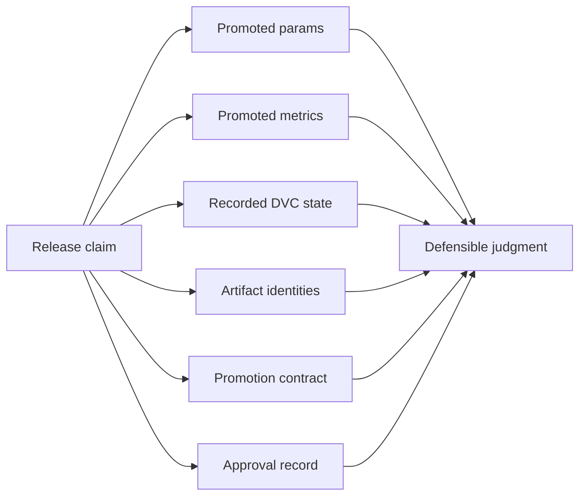
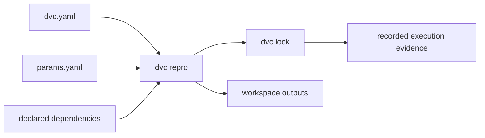
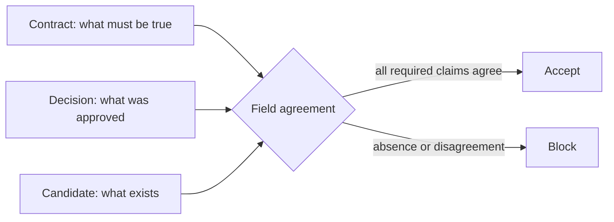
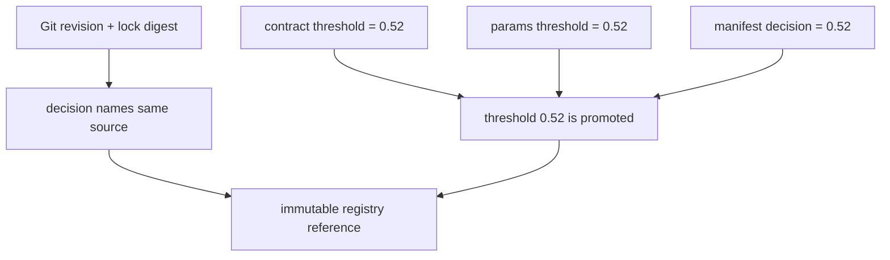

# Audit Evidence: Params, Metrics, Locks, Manifests, and Decisions

## Page Maps




An audit is not a pile of files. It is a route from a claim to the independent evidence
needed to accept or reject that claim.

Consider:

> Release `incident-escalation-2026-07` uses threshold `0.52`, came from the approved DVC
> state, contains the reviewed artifacts, and may be used by the documented consumer.

No single file can establish that sentence. Parameters show a control value. Metrics
describe measured behavior. `dvc.lock` records pipeline state. A manifest identifies
artifact bytes. A contract states the release rule. A decision supplies authority. This
lesson teaches how to connect them without pretending one surface proves everything.

## Turn a release statement into atomic claims

Break the sentence above into questions:

| Atomic claim | Primary evidence | Corroborating evidence |
| --- | --- | --- |
| the release identity is immutable | promotion contract | registry record |
| the threshold is `0.52` | promoted `params.yaml` | bundle manifest decision claim |
| the measured result belongs to that control | metric contract and evaluation output | report and predictions |
| the artifacts are the reviewed bytes | bundle manifest | retrieved payload digests |
| the source is the reviewed pipeline state | Git revision and `dvc.lock` identity | promotion decision |
| required roles approved it | promotion decision | policy in promotion contract |
| consumers may use named files | consumer contract | bundle inventory and schema checks |

This decomposition exposes missing evidence early. If a reviewer cannot name a primary
surface for a claim, the release story depends on inference.

## Four kinds of evidence failure

Promotion review becomes clearer when failures are classified:

| Failure class | Question | Example |
| --- | --- | --- |
| absence | is required evidence missing? | no risk-reviewer approval |
| integrity | do bytes match their recorded identity? | report digest mismatch |
| consistency | do independent records make the same claim? | params say `0.67`, contract says `0.52` |
| provenance | does evidence connect to the reviewed source? | approval names another Git revision |

A fifth class, **policy**, asks whether otherwise consistent evidence satisfies the
release rule. A mutable `latest` reference can be internally consistent and still violate
the immutability policy.

Do not use “manifest problem” for all five. The class determines the repair.

## Parameters state controls, not outcomes

Promoted parameters answer questions such as:

- which decision threshold was used;
- which split policy or seed governed evaluation;
- which training controls shaped the model;
- which release-relevant configuration consumers must reproduce.

They do not prove that the model was actually evaluated with those values. For that, the
parameter path must connect to the recorded stage and the resulting evidence.

Read the capstone chain:

```text
params.yaml
  -> dvc.yaml stage params
  -> dvc.lock recorded stage state
  -> metrics/metrics.json
  -> publish/v1/params.yaml and publish/v1/metrics.json
```

At each arrow, ask whether the relationship is declared, recorded, or merely assumed.

The promoted parameter surface should be smaller than the entire internal configuration.
Publish controls needed to interpret or reproduce the released behavior. Do not expose
secrets, infrastructure credentials, or irrelevant tuning details as a consumer contract.

## Metrics need meaning and lineage

A number such as:

```json
{"f1": 0.84}
```

is not yet a release claim. A reviewer still needs:

- metric definition and averaging rule;
- evaluation population and exclusions;
- threshold or decision policy;
- baseline or acceptance criterion;
- producing source identity;
- limitations and uncertainty appropriate to the use.

Module 05 established metric semantics, and Module 06 established comparison boundaries.
Module 09 asks a later question: did the promotion preserve the metric meaning that
justified authority?

A dangerous bundle can contain syntactically valid metrics from another cohort or
threshold. Schema validation passes. Range validation passes. The release story is still
false.

Use precise evidence language:

> `metrics.json` reports F1 `0.84` for the promoted evaluation output. The metric contract
> defines F1 and the population; `params.yaml` states threshold `0.52`; the source and
> decision records bind these surfaces to the approved release.

That sentence names both meaning and lineage.

## `dvc.lock` records execution state, not release authority

For each pipeline stage, `dvc.lock` records identities for declared dependencies,
parameters, and outputs after execution. This is crucial provenance:



But a lock file does not say:

- that the candidate met a release objective;
- that required reviewers approved it;
- that a registry entry is immutable;
- which bundle files consumers may use;
- that remote objects are still recoverable.

Treating `dvc.lock` as the whole audit trail confuses reproducible execution with release
governance. Treating it as optional loses the connection between a promoted artifact and
the state that produced it.

The promotion specimen records a SHA-256 digest of the lock file in both contract and
decision. That does not move the DVC objects or validate the science. It makes source
agreement testable.

## A manifest proves a byte-level claim

A manifest entry binds a relative path to byte size and digest. Verify it from the
retrieved candidate, not from the producer's memory.

The core loop is:

```text
for each recorded artifact:
  reject unsafe or absent path
  compare byte size
  compute digest from retrieved bytes
  compare computed digest with recorded digest

compare recorded paths with the exact contract inventory
compare present paths with the same inventory
```

The manifest itself also needs an authority route. If anyone can replace both a payload
and its manifest without detection, digest agreement proves only that those two current
files agree. The promotion decision, signature, attestation, protected Git revision, or
registry controls must bind the reviewed manifest identity.

## A contract states policy; a decision instantiates it

The contract says:

- which release identity and registry reference are permitted;
- which source and inventory are required;
- which public claim must agree;
- which roles must approve;
- which files consumers may use.

The decision says:

- this exact release was accepted or rejected;
- these reviewers acted in the required roles;
- this source revision and lock identity were reviewed;
- this registry reference received authority;
- this rationale explains the judgment.

Compare them field by field. A complete-looking decision can still be stale if it refers
to a previous candidate. A contract can be perfectly written and still lack any approval.



## Read the threshold-drift case as a proof problem

Run the audit and open:

```text
workspace/threshold-drift/assessment.json
workspace/threshold-drift/promotion-contract.json
workspace/threshold-drift/publish/params.yaml
workspace/threshold-drift/publish/manifest.json
```

The case changes the threshold in `params.yaml` to `0.67`, then deliberately recomputes
that file's byte size and digest in the manifest. Therefore:

| Check | Result | Reason |
| --- | --- | --- |
| inventory | pass | no paths changed |
| artifact integrity | pass | manifest records the new params bytes |
| source lock | pass | capstone lock still matches the contract |
| approval roles | pass | required reviewers remain present |
| promoted claims agree | fail | params disagree with contract and manifest decision |

This is the central audit lesson:

> Strong evidence for one proposition cannot repair missing evidence for another.

The digest is strong evidence of byte identity. It is no evidence that `0.67` is the
approved threshold.

## Build an evidence graph before reading prose

For any release, draw nodes for:

- claim;
- contract;
- source revision;
- lock identity;
- candidate manifest;
- parameters;
- metrics;
- approval;
- immutable registry reference;
- consumer action.

Draw an edge only when a record contains a checkable identifier or rule. “The author says
these belong together” is not an edge.

Example:



A disconnected node reveals a hidden assumption. For example, metrics may be present but
lack a source or cohort identifier that connects them to the promoted claim.

## Choose the next action from the failure class

| Finding | Unsafe response | Evidence-preserving response |
| --- | --- | --- |
| required file absent | remove it from the contract after the fact | rebuild candidate or formally revise and re-review the contract |
| digest mismatch | replace checksum only | investigate change, rebuild manifest, renew approval |
| threshold disagreement | edit the easiest record | return to intended source, regenerate coherent bundle, re-review |
| approval names another source | copy approval file forward | obtain a decision for this source |
| registry reference is mutable | document what `latest` meant in prose | publish and record immutable identity |
| lock object unavailable remotely | keep release because manifest exists | block recoverability claim and run recovery review |

The safe response may require returning to an earlier lifecycle state. That is preferable
to manufacturing agreement after publication.

## Evidence retention and review order

Retain enough information to reconstruct the decision after the workspace and local cache
are gone:

1. immutable release and source identities;
2. promotion contract and decision;
3. candidate manifest;
4. promoted parameters, metrics, report, and required artifacts;
5. the referenced Git state, including `dvc.lock`;
6. recovery and registry receipts appropriate to the environment.

Review in a different order:

1. read the decision rule;
2. inspect the summary of checks;
3. follow only the failed or material claims into detailed evidence;
4. inspect enforcement code when deciding whether the checks themselves are adequate.

This avoids drowning the judgment in undifferentiated files.

## Proof routes and their limits

| Route | Strongest supported claim | Important limit |
| --- | --- | --- |
| `make -C capstone verify` | healthy bundle satisfies artifact schemas and manifest checks | tests only the current healthy bundle |
| `make -C capstone release-audit` | current release evidence is packaged for review | does not contrast adversarial promotion cases |
| promotion integrity audit | seven controlled cases reach expected authority decisions | does not select the scientifically best candidate |
| experiment comparability audit | candidate comparison and promotion request are separated | does not publish a registry entry |
| recovery readiness audit | protected revisions restore under the modeled cutover | does not grant consumer authority |

Choose the route that matches the claim. Running more commands does not help if none
address the actual decision.

## Independent review checkpoint

You are ready for the registry-boundary lesson when you can:

- split a release statement into atomic claims;
- classify a failure as absence, integrity, consistency, provenance, or policy;
- state what params, metrics, `dvc.lock`, manifest, contract, and decision each prove;
- explain why valid digests do not rescue threshold drift;
- draw a checkable evidence graph with no memory-only edges;
- choose an evidence-preserving repair for a stale approval;
- select a proof route whose boundary matches the question.

Auditability is achieved when a future reviewer can trace each material claim to
independent evidence, see disagreements, and reproduce the decision without the original
author's narration.
