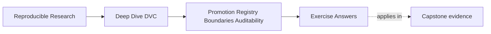
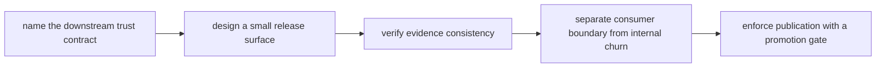

# Exercise Answers


<!-- page-maps:start -->
## Page Maps




<!-- page-maps:end -->

These answers are model explanations, not the only acceptable wording.

## How to use the answer page well

Do not read the model answer first and then reduce promotion to "copy the model and the
metrics."

A better rhythm is:

1. finish the exercise with your own promotion packet
2. name the consumer, trusted files, and public boundary
3. compare your reasoning with the model answer
4. revise anywhere your answer blurs internal convenience with consumer contract

What matters is whether the reasoning connects promotion, consumer trust, and audit
evidence.

Strong Module 09 answers usually do five things:

- they say exactly what is being promoted and to whom
- they keep the release surface small and versioned
- they detect inconsistent evidence before publication
- they separate DVC recovery duties from registry-facing product duties
- they enforce publication with a clear gate instead of taste

The strongest self-study packets also leave behind six concrete artifacts:

- one promotion contract
- one release-surface table
- one audit-gap review note
- one deterministic manifest
- one ownership split
- one promotion gate

If your answers rely only on "the bundle looks complete," the reasoning is still too
thin.

## Answer 1: Write a promotion contract

Strong promotion statement:

> Promote `incident-escalation/v1` for downstream incident escalation review. Consumers
> may use only the model and release files listed in the manifest. The promoted params and
> metrics travel with the bundle and show the threshold policy and recall-oriented review
> basis. Candidate outputs, debug plots, intermediate pipeline paths, and local
> convenience directories remain unsupported internal state.

What the consumer must not infer:

- that every internal experiment artifact or repository path is part of the public
  contract simply because it exists nearby

## Answer 2: Design a release surface

Reasonable bundle:

```text
publish/v1/
  manifest.json
  model.json
  metrics.json
  params.yaml
  review.md
```

Why these belong:

- `manifest.json` defines the supported files and immutable identities
- `model.json` is the promoted artifact
- `metrics.json` carries release evidence
- `params.yaml` records the promoted semantic controls
- `review.md` explains the promotion rationale, scope, and limits

Internal surface to exclude:

- intermediate feature or candidate-output directories, because consumers should not
  depend on internal pipeline structure

Repository file allowed but not released:

- a debug plot or exploratory notebook that aids internal review but does not belong in
  the durable consumer contract

## Answer 3: Find the audit gap

Strong review note:

> This bundle is not ready for promotion. It has no manifest, so consumers cannot tell
> which files are supported, and the metrics were produced before the promoted parameter
> change, so the evidence is inconsistent with the claimed release state. Regenerate or
> replace the metrics from the intended promoted state, add a manifest that lists the
> supported files and identities, and rerun the release audit route before accepting the
> bundle.

What should block publication immediately:

- any mismatch between promoted parameters and the metrics or artifacts used to justify
  the release

## Answer 4: Define a registry boundary

Stronger contract:

> Consumers should use only versioned registry entry `incident-escalation/v1` or
> `publish/v1/` as documented in the manifest. Supported files are the model, metrics,
> params, manifest, and review note listed there. Consumers must ignore `outputs/latest/`,
> intermediate pipeline paths, debug files, and candidate artifacts. New versions should
> appear as new immutable entries such as `v2`, not by silently changing a moving path.

Why `latest` is unsafe:

- it is a moving internal convenience target, not a durable or auditable consumer contract

## Answer 5: Reject or repair a promotion

Strong answer:

> Reject the promotion until the bundle is repaired. The current surface mixes debug
> plots, ambiguous model identity, stale metrics, and no review rationale. Require a
> manifest, one clearly promoted model or a justified multi-artifact contract, matching
> promoted params and metrics, removal or explicit exclusion of debug files, and a review
> note that explains the release basis.

Ambiguity that must be removed:

- which model is authoritative and which evidence actually supports it

Proof needed before re-acceptance:

- a coherent release audit in which artifacts, params, metrics, and manifest all describe
  the same promoted state

## Answer 6: Build a deterministic release manifest

The manifest should record:

- supported file path
- byte size
- checksum
- source revision
- data identity
- parameter identity
- schema version

A consumer verifies it by checking that every listed file matches the declared checksum
and that the manifest itself corresponds to the documented release identity.

One field that should usually be excluded:

- creation time or absolute workspace path, because it breaks determinism without
  improving contract meaning

## Answer 7: Verify a bundle as a consumer

A consumer should be able to:

- verify file integrity from the manifest
- identify source and promoted controls
- read the metric meaning
- determine compatibility from schema or version data

If the consumer still has to ask questions like "Which file is the real model?" or "Which
metric definition am I comparing against?" the bundle is not yet a complete public
contract.

## Answer 8: Separate registry and DVC-remote duties

Healthy split:

- DVC remote: producer-side recovery and internal tracked objects
- registry or release store: approved immutable release artifacts and consumer-facing
  version contracts
- repository: declarations, review notes, and history
- another named operational system: access policy, monitoring, or consumer support if
  those concerns live elsewhere

The main lesson is that treating the DVC cache as the public registry weakens both
retention and support expectations.

## Answer 9: Compare two promoted releases

Strong comparison review:

- trace every metric or artifact difference to governed source, data, parameter, or
  approved process changes
- verify new artifact checksums and manifest identities
- distinguish intended release change from unexplained drift

A changed checksum without a corresponding governed cause is not just "new version" noise;
it is an audit problem.

## Answer 10: Design a promotion gate

Strong ordered checks:

1. required files and manifest exist
2. params, metrics, and artifacts describe one coherent promoted state
3. release evidence is reproducible or recoverably linked
4. immutable identities are recorded
5. consumer verification succeeds
6. policy approval is documented

Failures that block publication:

- missing required files
- inconsistent evidence
- unverifiable identities
- failed consumer verification

Failures that may use an exception:

- a narrow policy waiver with named owner, scope, expiry, and compensating evidence

Exception approval:

- by the explicitly named policy or release owner, not by quiet convention

## Self-check

If your answers consistently explain:

- what is being promoted
- who may consume it
- which evidence travels with it
- which internal files are unsupported
- why a neat bundle can still fail audit review

then you are using Module 09 correctly.
