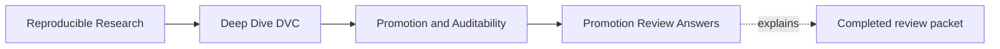
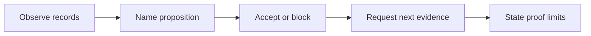
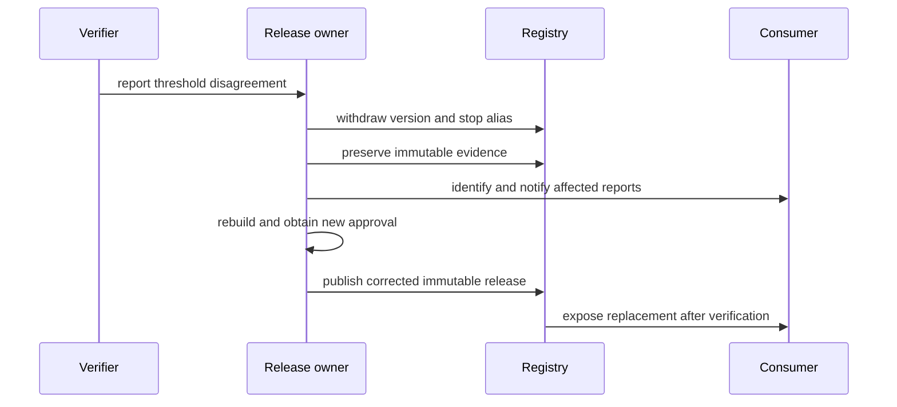

# Exercise Answers

## Page Maps





These are reasoning models, not phrases to copy. Compare them with your completed packet.
If your judgment differs, decide whether you used different evidence or crossed a proof
boundary.

A strong answer follows this pattern:

1. name the proposition under review;
2. cite the exact records;
3. distinguish passing checks from the failed check;
4. choose an authority decision;
5. request evidence that could support a new decision;
6. state what remains unknown.

## Compare decisions before prose

The generated audit should produce:

| Finding | Decision | Isolated failed check |
| --- | --- | --- |
| `COMPLETE_PROMOTION` | `ACCEPT` | none |
| `TAMPERED_ARTIFACT` | `BLOCK` | artifact integrity |
| `UNLISTED_ARTIFACT` | `BLOCK` | exact inventory |
| `THRESHOLD_DRIFT` | `BLOCK` | promoted claim agreement |
| `MUTABLE_REGISTRY_REFERENCE` | `BLOCK` | immutable registry identity |
| `STALE_SOURCE_APPROVAL` | `BLOCK` | decision-to-source binding |
| `MISSING_REQUIRED_REVIEW` | `BLOCK` | required reviewer role |

If your report differs, rerun the audit before using these answers.

## Answer: Define the release lifecycle and authority contract

A complete lifecycle definition is:

| State | Meaning | Observable entry condition |
| --- | --- | --- |
| candidate | the pipeline assembled a specific bundle | candidate manifest and source identity exist |
| eligible | comparison and release-quality policy passed | comparison decision names this candidate |
| approved | required roles accepted this exact source and bundle | promotion decision matches contract and candidate |
| published | consumers can resolve an immutable supported interface | registry receipt identifies immutable release |
| superseded | a later approved release is preferred | lifecycle record names replacement without changing old identity |
| withdrawn | new use is forbidden because authority was revoked | withdrawal decision and consumer containment record exist |

Model promotion sentence:

> Candidate `incident-escalation-2026-07`, produced from Git revision
> `8b9e4fdc2b5f9e6d84c2dd6dd8fb21a7bce4d170` and the contract's `dvc.lock`
> digest, is approved by the model-owner and risk-reviewer for documented incident scoring
> at immutable reference `incident-escalation/2026-07`. Consumers may use the supported
> model, params, metrics, and report; workspace paths, cache objects, and experiment queue
> entries remain unsupported.

Quality and authority separation:

| Evidence | What it may establish | What it cannot establish |
| --- | --- | --- |
| experiment comparison | candidate is eligible under metric and comparability rules | reviewers approved publication |
| bundle verification | schemas, inventory, and artifact identities pass | intended use is authorized |
| promotion decision | required roles approved exact source | backing content is durably recoverable |
| registry receipt | immutable version was exposed | scientific suitability |

A published release should enter withdrawn state when a defect invalidates its supported
use—for example, the promoted threshold is shown to disagree with the reviewed source.
Withdrawal retains the original release and decision evidence so impact can be traced.

Why this answer is stronger than “approved means ready”: each transition has an observable
record, and no state inherits authority from a vague adjective.

## Answer: Prove the exact inventory boundary

For the healthy case, the sets are:

```text
required by contract
= recorded by manifest
= present payload files
= {
  data-profile.json,
  metrics.json,
  model.json,
  params.yaml,
  predictions.csv,
  report.md
}
```

`manifest.json` itself describes payload inventory and is excluded from that payload set.

For `UNLISTED_ARTIFACT`, the present set also contains:

```text
debug-notes.txt
```

The manifest-recorded artifacts still match their sizes and digests. That is why artifact
integrity passes while exact inventory fails.

Two repairs:

1. **Keep the boundary unchanged.** Preserve the failed assessment, remove
   `debug-notes.txt` from the candidate assembly, determine how it crossed the boundary,
   rebuild, and re-review.
2. **Expand the boundary deliberately.** Classify the file as supported or audit-only,
   review privacy and meaning, add it to contract and manifest, define compatibility
   expectations, rebuild, and obtain a decision for the expanded candidate.

The second repair is not a checksum update. It changes what the release contains and
therefore what reviewers and consumers may infer.

## Answer: Predict and verify all promotion decisions

A defensible prediction table includes reasons:

| Case | Prediction | Evidence reason |
| --- | --- | --- |
| complete | accept | all independent records agree |
| tampered | block | report bytes no longer match manifest |
| unlisted | block | present inventory exceeds contract and manifest |
| threshold drift | block | params contradict the release-defining threshold claim |
| mutable reference | block | `latest` cannot preserve historical identity |
| stale source | block | approval refers to another Git revision |
| missing review | block | risk-reviewer authority is absent |

The valuable part of a wrong prediction is its diagnosis. Examples:

- Predicting that threshold drift fails integrity reveals that digest validity and
  semantic truth were conflated.
- Predicting that the unlisted file passes reveals that a manifest was treated as a
  minimum list rather than an exact boundary.
- Predicting that stale approval passes reveals that approval was treated as generic
  ceremony rather than source-bound evidence.

Only `COMPLETE_PROMOTION` receives authority because the gate is conjunctive. A strong
metric, valid digest, or one reviewer cannot compensate for another false proposition.

## Answer: Investigate post-approval artifact change

The tampered case adds a sentence to:

```text
publish/report.md
```

The manifest entry still records the original byte size and digest. Independent
calculation over the changed file therefore disagrees.

Checks that remain true include:

- immutable registry reference;
- exact path inventory;
- promoted threshold agreement;
- source lock agreement;
- decision field agreement;
- required roles;
- bounded consumer contract.

Regenerating only the digest would make the manifest describe the changed bytes, but the
promotion decision would still describe the earlier candidate. The authority problem
would be hidden, not repaired.

Lifecycle responses:

| Exposure state | Decision | Required action |
| --- | --- | --- |
| unpublished candidate | block | preserve, investigate, rebuild, renew review |
| immutable release already exposed | withdraw or restrict | preserve retrieval evidence, assess consumers, publish corrected identity |

Evidence to preserve before repair:

- failed assessment;
- changed report bytes;
- original manifest;
- contract and decision;
- source revision and lock identity;
- registry resolution or exposure receipts;
- known consumer retrievals.

The key reasoning is temporal: a digest identifies current bytes, while approval must bind
to the exact candidate reviewers saw.

## Answer: Diagnose semantic drift with valid digests

The three threshold claims are:

| Surface | Threshold |
| --- | --- |
| promotion contract | `0.52` |
| promoted params | `0.67` |
| bundle manifest decision | `0.52` |

The params byte size and SHA-256 digest match their manifest entry because the case
regenerates that entry after changing the value.

Correct completion:

> Artifact integrity passes because the manifest accurately records the current params
> bytes, while promotion blocks because those valid bytes make a threshold claim that
> disagrees with the contract and manifest decision.

Known:

- exact candidate contents;
- contract and manifest claim `0.52`;
- params claim `0.67`;
- current lock digest matches contract;
- decision names the contract source and roles.

Unknown:

- which threshold the reviewers actually evaluated;
- whether model, metrics, predictions, and report were regenerated;
- whether either threshold is suitable for real use;
- whether consumers were exposed.

Evidence needed:

- internal params at the named Git revision;
- `dvc.lock` and stage parameter record;
- comparison evidence and evaluation output;
- reviewer materials;
- candidate assembly receipts.

If `0.52` is authoritative, rebuild the entire promoted bundle from the `0.52` source and
renew approval. If `0.67` is authoritative, revise the candidate contract, regenerate all
threshold-dependent artifacts, rebuild the manifest, and obtain a new decision. If source
evidence is inconclusive, reject the candidate and reproduce a new one.

## Answer: Review source binding and independent approval

The important comparison is:

| Field | Contract | Complete | Stale source | Missing review |
| --- | --- | --- | --- | --- |
| release ID | `incident-escalation-2026-07` | matches | matches | matches |
| registry reference | `incident-escalation/2026-07` | matches | matches | matches |
| Git revision | `8b9e…d170` | matches | another revision | matches |
| lock digest | `25e2…25e5` | matches | matches | matches |
| decision | `APPROVE` required | matches | matches | matches |
| roles | model-owner, risk-reviewer | both | both | risk-reviewer absent |

The stale-source case fails because authority is attached to a different declared project
state. Valid candidate bytes do not prove that reviewers considered the code,
configuration, and lock state that produced them.

The missing-review case fails because independent roles represent separate policy
questions. Model ownership cannot silently supply risk acceptance.

New evidence:

- stale source: a fresh decision in which required reviewers approve this exact Git and
  lock identity after considering relevant changes;
- missing review: a decision from the risk-reviewer for this exact candidate, or a
  prospectively governed policy change followed by review under the new rule.

Editing the old decision is unsafe because it would assert a review event that did not
occur.

## Answer: Assign registry, repository, and remote responsibilities

One healthy assignment is:

| Responsibility | Owner | Stable identity | Verification |
| --- | --- | --- | --- |
| source declaration | Git repository | commit | signed or protected revision and file review |
| recorded DVC state | Git repository | `dvc.lock` at commit | digest and stage inspection |
| artifact storage | DVC remote or release store | content identity | retrieval and digest |
| candidate comparison | repository audit evidence | baseline and candidate IDs | comparability audit |
| promotion policy | governed contract | contract revision | policy review |
| approval history | registry or decision store | release decision ID | role and source binding |
| immutable discovery | promotion registry | immutable release version | resolve and verify |
| consumer schema | release contract | schema version | clean consumer validation |
| lifecycle aliases | registry | alias event plus immutable target | resolution history |
| recovery | storage and release owners | protected release identities | cache-empty restore drill |

The proposal “pull whichever model object is newest in the DVC remote” lacks at least:

- an approved release identity;
- a connection to Git and `dvc.lock`;
- a supported model and params interface;
- semantic metric and threshold evidence;
- reviewer authority;
- a stable consumer reference;
- protection against unreviewed experimental objects;
- lifecycle and withdrawal behavior.

The DVC remote is valuable in this design, but its job is content availability. Promotion
authority remains explicit elsewhere.

## Answer: Verify from the consumer side

A clean consumer route is:

1. resolve `incident-escalation/2026-07`;
2. record that immutable identity;
3. retrieve contract, decision, manifest, and payload files;
4. compare contract required paths, manifest paths, and present payload paths;
5. reject missing or unexpected files;
6. recompute byte sizes and SHA-256 digests;
7. compare threshold across contract, params, and manifest;
8. compare decision release, registry, Git, lock, decision value, and roles with contract;
9. validate supported model, params, metrics, and report schemas;
10. retain a verification receipt with source and release identities.

Supported files are those named by `consumer_contract.supported_files`. Other manifest
payloads can be audit-only. Workspace and cache paths remain internal.

`dvc get <repository-url> <path> --rev <immutable-revision>` can retrieve a DVC-tracked
path from a repository into a clean directory. It helps reproduce byte retrieval for a
named revision. It does not prove promotion because it does not establish required
approval, supported use, or registry lifecycle.

Proof limits:

- no conclusion about scientific or ethical suitability;
- no production access-control test;
- no guarantee of future remote availability;
- no proof that all real reviewers have trusted identities;
- no consumer performance or operational monitoring result.

## Answer: Plan containment for an exposed defective release

For an exposed threshold-drift release:

1. stop aliases from sending new consumers to the defective version;
2. mark the immutable release withdrawn without changing its files;
3. preserve contract, decision, manifest, payloads, assessment, registry metadata, and
   access records;
4. identify the two reports by recorded immutable release identity or artifact digest;
5. notify owners that the threshold claim is inconsistent and judgments may require
   regeneration;
6. investigate the authoritative source;
7. build a corrected candidate under a new immutable release identity;
8. repeat comparison, semantic, integrity, provenance, and approval gates;
9. publish and communicate the replacement;
10. retain the original promotion, detection, containment, and correction chronology.

A suitable sequence is:



Do not repair in place. Immutability protects the ability to determine what the two
reports consumed.

If backing artifacts cannot be retrieved, invoke the recovery-readiness route as a
separate investigation. Semantic correction and storage recovery answer different
questions.

## Answer: Defend a promotion gate

A defensible gate order is:

| Gate | Claim | Block condition | Proof limit |
| --- | --- | --- | --- |
| comparability | candidate is eligible under stable baseline and metric meaning | invalid comparison or changed metric contract | does not grant approval |
| identity | release reference is immutable | alias or retargetable identity | does not prove bytes |
| inventory | present, recorded, and required paths are equal | missing or extra file | does not prove meaning |
| integrity | every payload matches size and digest | any mismatch | does not prove correctness |
| semantic consistency | release-defining claims agree | params, metrics, manifest, or contract conflict | does not prove suitability |
| provenance | candidate binds to exact Git and DVC state | missing or mismatched source | does not prove authority |
| approval | required roles accept exact source | missing, stale, or rejected decision | does not prove availability |
| consumer verification | clean consumer can validate supported interface | producer-only assumptions or schema failure | does not prove operational fitness |
| recovery | protected release restores under policy | object unavailable or objective missed | does not grant promotion |
| publication | complete verified version becomes visible atomically | mixed state or missing receipt | does not monitor later use |

Every failed material gate blocks. If a project permits exceptions, the policy must define
eligible failures, owner, expiry, compensating evidence, and consumer disclosure before a
candidate arrives. The modeled integrity, provenance, semantic, and authority failures
should not be waived silently.

The self-test enforces seven controlled classifications. It does not test:

- real registry transactions;
- real reviewer identity systems;
- scientific suitability;
- access control;
- production consumer behavior;
- all possible schema and semantic drift;
- remote recovery beyond the separate specimen.

The gate is credible because its success leaves records that another reviewer can inspect,
not because the test output is green.

## Packet self-review

Your packet is ready for independent review when:

- [ ] lifecycle transitions have observable evidence;
- [ ] exact inventory is checked in both directions;
- [ ] integrity and semantic consistency remain distinct;
- [ ] approval binds to exact source;
- [ ] registry authority and DVC storage remain distinct;
- [ ] consumer verification works outside producer internals;
- [ ] exposed defects preserve immutable history;
- [ ] the gate names block conditions and proof limits;
- [ ] all seven audit decisions are explained;
- [ ] all ten answer artifacts can be traced to evidence.
