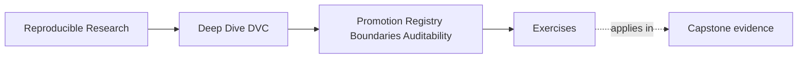

# Exercises


<!-- page-maps:start -->
## Page Maps




<!-- page-maps:end -->

Use these exercises to practice promotion judgment, not only file movement.

The strongest answers will explain what is being promoted, who can trust it, and which
evidence makes that trust defensible.

## Exercise 1: Write a promotion contract

A candidate model is ready for downstream incident escalation review.

Write a short promotion statement that names:

- what is being promoted
- which downstream consumer may use it
- which params and metrics justify it
- what should remain internal

## Exercise 2: Design a release surface

Design a `publish/v1/` bundle for a promoted DVC result.

List the files you would include and explain why each file belongs there.

Also name one internal file or directory that should not be part of the consumer contract.

## Exercise 3: Find the audit gap

A bundle has:

```text
publish/v1/
  model.json
  metrics.json
  params.yaml
```

There is no manifest, and the metrics were produced before the promoted parameter change.

Write a review note that explains the audit gap and the repair.

## Exercise 4: Define a registry boundary

A team tells consumers:

> Use whatever model is in `outputs/latest/`.

Rewrite this as a stronger registry or publish-boundary contract.

Your answer should say what consumers may depend on and what they should ignore.

## Exercise 5: Reject or repair a promotion

A promoted release contains debug plots, two model files, old metrics, and no review note.

Decide whether you would reject the promotion or repair it before acceptance.

Explain what evidence or bundle changes you would require.

## Exercise 6: Build a deterministic release manifest

Create a manifest that lists every promoted file, byte size, checksum, source revision,
data identity, parameter identity, and schema version. Regenerate it and explain any
unstable field.

## Exercise 7: Verify a bundle as a consumer

Move a release bundle outside the working repository. Using only its public instructions,
verify integrity, identify provenance, read metrics, and determine compatibility.

## Exercise 8: Separate registry and DVC-remote duties

Write an ownership table for internal cache objects, approved release artifacts, metadata,
retention, access control, and consumer support. Assign each duty to the DVC remote,
registry, repository, or another named system.

## Exercise 9: Compare two promoted releases

Produce a review that connects source, data, parameters, metrics, and artifact checksums
across two releases. Distinguish intended change from unexplained drift.

## Exercise 10: Design a promotion gate

Specify ordered checks for completeness, reproducibility, policy approval, immutable
identity, and consumer verification. State which failures block publication and which
require an explicit documented exception.

## Mastery check

You have a strong grasp of this module if your answers consistently keep five ideas
visible:

- promotion is a downstream trust contract
- release surfaces should be small and stable
- params, metrics, locks, and manifests answer different audit questions
- registry boundaries protect consumers from internal churn
- neat-looking bundles can still be rejected when evidence is inconsistent
