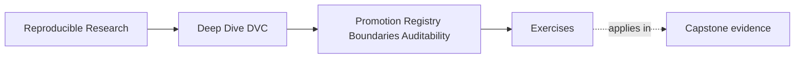
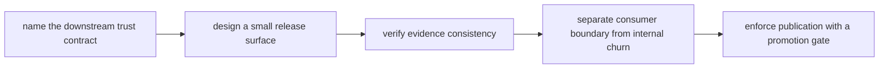
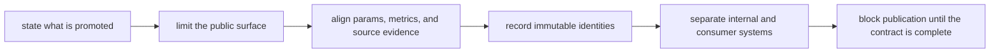

# Exercises


<!-- page-maps:start -->
## Page Maps




<!-- page-maps:end -->

Use these exercises to practice promotion judgment, not only file movement.

The goal of the day is to stop treating promotion as copying artifacts into a nicer
directory. Promotion is a downstream trust contract. A release surface should be small,
stable, versioned, and auditable. Consumers need to know what they may trust and what
remains internal.

## How to work through this set

Treat the ten exercises as one full lab day on promotion, registry boundaries, and audit
discipline.

Before each answer:

1. name the consumer who will rely on the promoted state
2. name the exact files or claims that consumer may trust
3. say what evidence must travel with the release so trust is reconstructable later

Do the exercises in order. The day is one progression:

- Exercises 1-3 define the promotion contract and detect audit gaps
- Exercises 4-5 separate public release surfaces from internal pipeline churn
- Exercises 6-8 make manifests and ownership boundaries explicit
- Exercises 9-10 compare promoted releases and enforce publication with a gate

Keep one promotion packet as you go. By the end of the day it should contain:

- one promotion contract statement
- one consumer-facing release surface
- one audit-gap review note
- one deterministic manifest design
- one ownership split for registry and DVC remote duties
- one promotion gate with ordered checks

If those six artifacts are missing, you are probably still packaging files instead of
designing a trustworthy release boundary.

## Recommended working layout

If you want one lab tree that can support the whole day, use something like:

```text
module09-lab/
├── artifacts/
├── notes/
├── publish/
├── registry/
└── review/
```

Keep one release-surface table while you work:

| File or artifact | Consumer-visible? | Why it belongs | What it cannot answer alone |
| --- | --- | --- | --- |

Also keep one audit table:

| Audit question | Evidence file or route | Failure if missing |
| --- | --- | --- |



Use that route on purpose. It keeps the day centered on downstream trust instead of on
artifact copying.

## Exercise 1: Write a promotion contract

A candidate model is ready for downstream incident escalation review.

Write a short promotion statement that names:

- what is being promoted
- which downstream consumer may use it
- which params and metrics justify it
- what should remain internal
- one sentence describing what the consumer must not infer from the bundle

Study note:
The first step in a trustworthy release is to say exactly what the release means and what
it does not mean.

## Exercise 2: Design a release surface

Design a `publish/v1/` bundle for a promoted DVC result.

List the files you would include and explain why each file belongs there.

Also name:

- one internal file or directory that should not be part of the consumer contract
- one file that is allowed in the repository but not in the release bundle

Study note:
Small release surfaces are easier to audit and safer for consumers to depend on.

## Exercise 3: Find the audit gap

A bundle has:

```text
publish/v1/
  model.json
  metrics.json
  params.yaml
```

There is no manifest, and the metrics were produced before the promoted parameter change.

Write a review note that explains:

- the audit gap
- why the current bundle is not trustworthy yet
- the repair path
- one sentence naming what should block publication immediately

Study note:
A neat directory can still hide contradictory evidence.

## Exercise 4: Define a registry boundary

A team tells consumers:

> Use whatever model is in `outputs/latest/`.

Rewrite this as a stronger registry or publish-boundary contract.

Your answer should say:

- what consumers may depend on
- what they should ignore
- how versioning should work
- one sentence explaining why `latest` is not a durable contract

Study note:
This is where students usually realize that convenience paths and consumer boundaries are
different things.

## Exercise 5: Reject or repair a promotion

A promoted release contains debug plots, two model files, old metrics, and no review note.

Decide whether you would reject the promotion or repair it before acceptance.

Explain:

- what evidence or bundle changes you would require
- what ambiguity must be removed
- what proof you need before re-accepting the bundle

Study note:
Promotion should fail fast when the bundle tells multiple incompatible stories.

## Midday self-check

Before you move into manifests, consumer verification, and promotion gates, make sure
your packet can already answer these questions clearly:

- what a promoted bundle promises to consumers
- why the release surface should stay small and versioned
- how params, metrics, and manifests answer different audit questions
- why internal convenience paths are unsafe consumer contracts

If you cannot answer those four questions in plain language, return to Exercises 1-5 and
make the packet more explicit before continuing.

## Exercise 6: Build a deterministic release manifest

Create a manifest that lists every promoted file, byte size, checksum, source revision,
data identity, parameter identity, and schema version. Regenerate it and explain any
unstable field.

What to hand in:

- the manifest shape
- one example entry
- one sentence explaining how a consumer verifies it
- one sentence naming a field that should be excluded if it breaks determinism

Study note:
The manifest matters because auditability depends on immutable identities, not on good
intentions.

## Exercise 7: Verify a bundle as a consumer

Move a release bundle outside the working repository. Using only its public instructions,
verify integrity, identify provenance, read metrics, and determine compatibility.

What to hand in:

- the verification route
- the consumer questions the bundle answered
- the unanswered question that proves the bundle still needs repair, if any

Study note:
This is how you test whether the bundle is truly public and reviewable, not just tidy.

## Exercise 8: Separate registry and DVC-remote duties

Write an ownership table for:

- internal cache objects
- approved release artifacts
- metadata
- retention
- access control
- consumer support

Assign each duty to the DVC remote, registry, repository, or another named system.

Study note:
Clear boundaries prevent the cache from accidentally becoming the public product surface.

## Exercise 9: Compare two promoted releases

Produce a review that connects:

- source
- data
- parameters
- metrics
- artifact checksums

across two releases. Distinguish intended change from unexplained drift.

Study note:
Release comparison should be at least as disciplined as experiment comparison.

## Exercise 10: Design a promotion gate

Specify ordered checks for:

- completeness
- reproducibility
- policy approval
- immutable identity
- consumer verification

State:

- which failures block publication
- which require an explicit documented exception
- who approves an exception

Study note:
The strongest promotion gates fail with enough structure that the repair path is obvious.

## Mastery check

You have a strong grasp of this module if your answers consistently keep five ideas
visible:

- promotion is a downstream trust contract
- release surfaces should be small and stable
- params, metrics, locks, and manifests answer different audit questions
- registry boundaries protect consumers from internal churn
- neat-looking bundles can still be rejected when evidence is inconsistent
