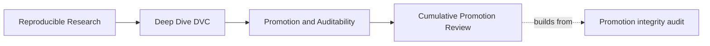

# Exercises

## Page Maps

```mermaid
flowchart LR
  contract["Define authority"] --> inventory["Bound inventory"]
  inventory --> predict["Predict audit"]
  predict --> integrity["Investigate bytes"]
  integrity --> meaning["Investigate claims"]
  meaning --> approval["Bind approval"]
  approval --> registry["Design registry"]
  registry --> consume["Verify as consumer"]
  consume --> incident["Plan containment"]
  incident --> gate["Defend promotion gate"]
```





These ten exercises form one cumulative release-review packet. You will not edit the
course's capstone source. You will generate isolated audit cases, inspect them, and write
review artifacts under `artifacts/`.

The packet is complete when another learner can read your evidence and reproduce every
accept-or-block decision without asking what you meant.

## Prepare the lab packet

From the repository root:

```bash
make PROGRAM=reproducible-research/deep-dive-dvc \
  capstone-promotion-integrity-audit

packet_dir=artifacts/practice/reproducible-research/deep-dive-dvc/promotion-review
audit_dir=artifacts/audit/reproducible-research/deep-dive-dvc/promotion-integrity
mkdir -p "$packet_dir"
```

Keep generated writing and command output in `packet_dir`. Do not place lab notes beside
the course source pages.

Your final packet should contain:

```text
promotion-review/
  approval-review.md
  consumer-verification.md
  failure-decisions.md
  incident-response.md
  inventory-review.md
  lifecycle-contract.md
  promotion-gate.md
  registry-boundary.md
  threshold-investigation.md
  verification-summary.md
```

## How to assess your work

Use four standards throughout:

| Standard | Evidence in your answer |
| --- | --- |
| specificity | names exact records, fields, cases, and failed checks |
| boundary discipline | separates quality, integrity, provenance, authority, and availability |
| reproducibility | another learner can repeat the inspection from commands and paths |
| repair integrity | proposes new evidence rather than editing records into agreement |

An answer that says only “the bundle is invalid” is incomplete. Name the proposition that
failed and the evidence needed next.

## Exercise: Define the release lifecycle and authority contract

Write `lifecycle-contract.md` for the capstone release. Include:

- definitions of candidate, eligible, approved, published, superseded, and withdrawn;
- one observable transition condition between each adjacent state;
- a complete promotion sentence naming candidate, source, required roles, consumer action,
  immutable registry reference, and unsupported surfaces;
- a table separating candidate quality evidence from promotion authority evidence;
- the event that would force a published release into withdrawn state.

Use the actual specimen contract and decision:

```text
capstone/repro/promotion-integrity/promotion-contract.json
capstone/repro/promotion-integrity/promotion-decision.json
```

Acceptance criteria:

- no lifecycle state is defined by “looks ready”;
- the approval transition binds to exact Git and `dvc.lock` identities;
- publication requires an immutable reference rather than `latest`;
- withdrawal preserves historical evidence.

## Exercise: Prove the exact inventory boundary

Compare:

```text
$audit_dir/workspace/complete-promotion/
$audit_dir/workspace/unlisted-artifact/
```

Write `inventory-review.md` with:

1. the required paths from `promotion-contract.json`;
2. the recorded paths from `publish/manifest.json`;
3. the files actually present under `publish/`;
4. the equality rule used by the audit;
5. the extra path in the blocked case;
6. two possible repairs and the policy consequence of each.

Do not assume an extra file is harmless. Explain what review would be required if it were
deliberately added to the supported or audit-only surface.

Acceptance criteria:

- distinguishes manifest integrity from exact inventory;
- explains why recorded files can all pass while the candidate still blocks;
- does not recommend merely ignoring the extra path.

## Exercise: Predict and verify all promotion decisions

Before opening `report.json`, copy the seven finding names from the audit guide into
`verification-summary.md`. Predict:

- decision;
- single most relevant failed check;
- evidence you expect to inspect.

Then read the report and append actual results. For every wrong prediction, write one
sentence explaining the mistaken evidence boundary.

Your table should cover:

- complete promotion;
- tampered artifact;
- unlisted artifact;
- threshold drift;
- mutable registry reference;
- stale source approval;
- missing required review.

Acceptance criteria:

- contains all seven cases;
- separates expected from actual results;
- explains prediction errors instead of erasing them;
- records that only one case receives release authority.

## Exercise: Investigate post-approval artifact change

Compare the complete and tampered cases. Write the relevant section of
`failure-decisions.md`.

Answer:

- which file changed;
- how byte size and digest reveal the change;
- which other checks remain true;
- why regenerating only the digest would make the old approval stale;
- whether the response is block, withdraw, or supersede under both unpublished and
  already-published scenarios;
- which evidence must be preserved before repair.

Include an independent digest command using Python or `sha256sum`.

Acceptance criteria:

- distinguishes detection from repair;
- treats approval as bound to candidate bytes;
- gives different lifecycle responses for unpublished and exposed releases.

## Exercise: Diagnose semantic drift with valid digests

Follow the worked investigation for `THRESHOLD_DRIFT`, then write your own
`threshold-investigation.md`.

Include:

- contract threshold;
- promoted params threshold;
- manifest decision threshold;
- params byte size and digest comparison;
- the exact passing and failing checks;
- known facts and unresolved questions;
- the evidence needed to determine which threshold was intended;
- a repair plan for both possible authoritative thresholds.

Finish this sentence:

> Artifact integrity passes because …, while promotion blocks because …

Acceptance criteria:

- does not call the case corrupt;
- does not choose the intended threshold without source evidence;
- requires regeneration of dependent artifacts when the intended threshold changes;
- requires renewed approval for the coherent candidate.

## Exercise: Review source binding and independent approval

Compare:

```text
$audit_dir/workspace/complete-promotion/
$audit_dir/workspace/stale-source-approval/
$audit_dir/workspace/missing-required-review/
```

Write `approval-review.md` with a field-by-field comparison of contract and decision:

| Field | Contract | Complete decision | Stale-source case | Missing-review case |
| --- | --- | --- | --- | --- |
| release ID |  |  |  |  |
| registry reference |  |  |  |  |
| Git revision |  |  |  |  |
| lock digest |  |  |  |  |
| required decision |  |  |  |  |
| reviewer roles |  |  |  |  |

Then explain:

- why a valid bundle cannot repair approval for another source;
- why one reviewer role cannot silently satisfy two independent roles;
- what new evidence each case requires.

Acceptance criteria:

- names the exact field disagreement or absence;
- proposes a new decision rather than copying or editing approval;
- distinguishes source provenance from reviewer authority.

## Exercise: Assign registry, repository, and remote responsibilities

Write `registry-boundary.md`. Assign an owning system for:

- source declaration;
- recorded DVC state;
- content-addressed storage;
- candidate comparison;
- promotion policy;
- approval history;
- immutable release discovery;
- consumer schemas;
- lifecycle aliases;
- recovery and retention.

For each responsibility, name:

- stable identifier;
- read path;
- write authority;
- verification evidence;
- failure owner.

Then analyze this proposal:

> Consumers should pull whichever model object is newest in the DVC remote.

Identify at least four missing promises.

Acceptance criteria:

- does not call the DVC remote a registry without qualifying the specific responsibility;
- records immutable identity beneath any movable alias;
- gives consumers a supported interface rather than a producer cache path.

## Exercise: Verify from the consumer side

Pretend the audit workspace is all the consumer received. Write
`consumer-verification.md` describing a clean verification route for
`complete-promotion`.

The route must:

1. identify the immutable release;
2. read the promotion contract and decision;
3. compare exact inventory;
4. recompute artifact sizes and digests;
5. validate the threshold claim across contract, params, and manifest;
6. identify supported versus audit-only files;
7. record the source revision and lock identity;
8. state what remains unproved.

Add one paragraph explaining how `dvc get <repo> <path> --rev <revision>` could retrieve a
repository-backed release and why retrieval alone would not grant promotion authority.

Acceptance criteria:

- never relies on the producer's local cache;
- produces a durable resolved identity;
- includes proof limits covering scientific suitability and remote durability.

## Exercise: Plan containment for an exposed defective release

Assume `THRESHOLD_DRIFT` was published and used by two monthly reports before detection.
Write `incident-response.md`.

Include:

- immediate containment for aliases and new use;
- evidence snapshot before any edits;
- how to identify affected downstream reports;
- decision between withdrawal and in-place repair;
- correction and renewed review route;
- consumer notification contents;
- retained chronology;
- link to the separate recovery route if content availability is uncertain.

Draw a sequence diagram showing verifier, release owner, registry, and consumer actions.

Acceptance criteria:

- never replaces files under the immutable release identity;
- preserves the original decision and failed evidence;
- separates semantic correction from remote recovery;
- identifies concrete downstream impact evidence.

## Exercise: Defend a promotion gate

Write `promotion-gate.md` as the final synthesis. Define ordered gates for:

- candidate comparability;
- immutable release identity;
- exact inventory;
- artifact integrity;
- semantic claim consistency;
- source provenance;
- required approval;
- consumer verification;
- remote recoverability when required by policy;
- atomic publication and retained receipts.

For each gate, provide:

| Field | Required content |
| --- | --- |
| claim | one falsifiable sentence |
| evidence | exact record or command |
| block condition | observable failure |
| repair owner | named role |
| proof limit | what passing does not establish |

Run the self-test:

```bash
make PROGRAM=reproducible-research/deep-dive-dvc \
  capstone-promotion-integrity-selftest
```

Record the result, but do not use a passing test count as the whole gate defense. Explain
which adversarial cases the tests enforce and which real-world concerns remain outside the
specimen.

Acceptance criteria:

- every material failure blocks rather than relying on an undocumented exception;
- gates are ordered so candidate selection precedes promotion authority;
- a passing gate leaves an inspectable evidence packet;
- the final section states at least four honest proof limits.

## Packet review

Before reading the answer key, exchange packets with another learner if possible. If
studying alone, wait briefly, then review your packet as a consumer who has never seen the
capstone source.

Check:

- [ ] Every accept or block judgment names a specific proposition.
- [ ] Every repair requests new evidence rather than rewritten history.
- [ ] Registry authority and DVC object availability remain separate.
- [ ] Immutable identities appear in consumer and incident records.
- [ ] Commands and evidence paths are reproducible.
- [ ] Proof limits are explicit.
- [ ] All ten packet files exist.
