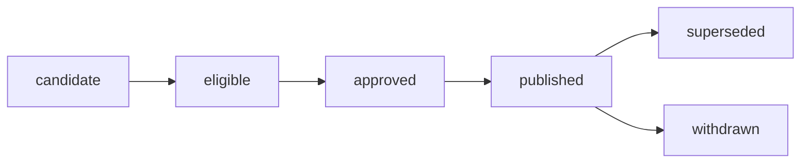

# Module Glossary

## Page Maps

Use this glossary when two records appear to describe the same release concept but
actually carry different authority. The distinctions are part of the review model, not
alternative wording.

## Lifecycle terms

| Term | Meaning in this module | Evidence expected |
| --- | --- | --- |
| candidate | one specific assembled result proposed for review | source identity and candidate manifest |
| eligible | candidate that passed declared comparison and release-quality gates | comparison decision bound to candidate |
| approved | candidate accepted by all required roles under the promotion contract | source-bound promotion decision |
| published | approved release exposed through an immutable supported reference | registry or publication receipt |
| superseded | valid historical release no longer preferred because another approved release replaces it | lifecycle event naming old and new immutable identities |
| withdrawn | release whose authority for new use has been revoked | withdrawal decision, reason, and consumer containment record |

Eligibility is not approval. Approval is not publication. Superseded does not mean invalid;
withdrawn does.

## Identity and inventory terms

### Immutable release reference

A machine-resolvable name that continues to identify the same release bytes and metadata,
such as `incident-escalation/2026-07`. An immutable reference can remain retrievable after
it is superseded or withdrawn, subject to retention policy.

### Movable alias

A convenience name whose target may change, such as `latest`, `approved`, or `production`.
It can help discovery but cannot be the sole historical identity. Consumers resolve it to
an immutable reference and record that result.

### Release ID

The durable logical identity named by the promotion contract and decision. A release ID
and registry reference may share a string, but reviewers still check that the records
agree.

### Exact inventory

The requirement that contract-required paths, manifest-recorded paths, and present payload
paths form the same set. It rejects missing and unexpected files.

### Manifest

A machine-readable inventory that records artifact-relative paths, sizes, and
cryptographic digests, plus any explicitly defined bundle claims. A manifest proves
recorded byte identity after independent verification. It does not grant approval or prove
semantic correctness.

### Artifact integrity

Agreement between retrieved artifact bytes and the size and digest recorded in the
manifest.

## Meaning and provenance terms

### Semantic consistency

Agreement among independent records about release-defining meaning, such as threshold,
metric definition, evaluation cohort, feature schema, or intended use. The threshold-drift
case fails semantic consistency while passing artifact integrity.

### Provenance

The checkable connection from a release candidate to its declared and recorded source. In
this module, that includes a full Git revision and the identity of `dvc.lock`.

### Git revision

The immutable project revision containing code, configuration, stage declarations,
committed parameters, and the lock file used by the release review. A moving branch name
is not enough for historical provenance.

### Lock identity

The cryptographic identity of `dvc.lock` at the reviewed source revision. It anchors the
promotion record to DVC's recorded stage dependencies, parameters, and outputs. It does
not itself grant authority or guarantee remote recovery.

### Promoted claim

A release-defining statement that must agree across named evidence surfaces. The capstone
specimen models the decision threshold as one promoted claim.

### Evidence graph

A map from atomic release claims to the independent records that support or contradict
them. An edge exists only when a stable identifier, field, or declared rule makes the
connection checkable.

## Authority terms

### Promotion

The governed transition that grants a specific candidate authority for a specific
consumer use. Promotion is not a file copy and is not implied by DVC tracking.

### Promotion contract

The policy instance defining release identity, source, exact inventory, promoted claims,
required reviewer roles, and consumer boundary. Its clauses are falsifiable.

### Promotion decision

The record that named roles approve or reject the exact release, registry reference, Git
revision, and lock identity under the contract.

### Required reviewer role

A distinct authority required by policy. Presence of another role cannot satisfy it unless
the policy explicitly permits role combination.

### Source binding

Field-level agreement that the decision applies to the same release and source named by
the contract. The stale-source case breaks source binding.

### Authority

Permission for named consumers to depend on the release for the supported action.
Authority can be granted, superseded, restricted, or withdrawn while historical identity
remains intact.

## Interface terms

### Release surface

The deliberately small set of files, schemas, and behaviors exposed to downstream
consumers.

### Supported file

A release file whose schema or behavior consumers may depend on. Changes require
compatibility review.

### Audit-only file

Evidence retained to explain a release but not promised as a runtime consumer interface.
It remains integrity-protected and readable.

### Internal surface

A producer implementation detail, such as a workspace path, cache object, experiment
queue entry, or intermediate output. Consumers must not depend on it.

### Consumer contract

Testable clauses naming immutable identity, supported action and files, verification,
provenance, exclusions, compatibility, and lifecycle behavior.

### Consumer verification

Independent validation after retrieval: resolve immutable identity, compare exact
inventory, recompute artifact digests, validate promoted claims and schemas, check source
and approval binding, and record proof limits.

### Atomic publication

Publication behavior in which consumers observe either the previous complete release or
the new complete release, never a mixture.

### Compatibility

Preservation of supported consumer behavior and meaning across releases. Structural
compatibility covers paths and schemas; semantic compatibility covers definitions,
cohorts, units, and intended use.

## Storage and registry terms

### DVC remote

Configured storage used by DVC to push and pull content-addressed objects needed by tracked
project state. It supplies availability, not promotion authority.

### DVC-backed data registry

A Git and DVC repository intentionally used as a versioned discovery and retrieval
surface. Consumers may use routes such as `dvc get` with repository, path, and immutable
revision. The repository still needs a consumer contract if retrieval carries a supported
product promise.

### Promotion registry

A system or governed release surface that names immutable approved versions and retains
authority and lifecycle metadata. It may also store bytes, but storage and authority
remain distinct responsibilities.

### Registry alias

A movable discovery reference managed by the registry. Alias movement is a lifecycle
event and should record the immutable old and new targets.

### Recoverability

Ability to restore protected release content from governed storage under the declared
objective. Promotion integrity does not prove recoverability; Module 08 tests that
boundary.

## Failure and repair terms

### Absence failure

Required evidence does not exist, such as a missing reviewer role.

### Integrity failure

Artifact bytes disagree with the recorded manifest identity.

### Consistency failure

Independent records make contradictory release claims.

### Provenance failure

Candidate, contract, and decision do not bind to the same source.

### Policy failure

Evidence may be internally consistent but violates a declared release rule, such as using
a mutable alias as the release identity.

### Evidence-preserving repair

A repair that retains the failed candidate and assessment, returns to authoritative
source, creates a coherent new candidate, and obtains a new decision. It does not edit old
records to make them appear retrospectively consistent.

### In-place mutation

Replacement of files or metadata under an immutable release identity. This is forbidden
because it destroys the ability to know what earlier consumers received.

## Contrasts to remember

| Do not collapse | First question | Second question |
| --- | --- | --- |
| integrity and semantics | do bytes match? | do claims agree and mean what policy expects? |
| DVC remote and promotion registry | can content be restored? | which release may consumers trust? |
| candidate and approved release | was a result produced? | did required authority accept it? |
| immutable version and alias | what exact release? | which release is currently preferred? |
| manifest and promotion decision | which bytes are recorded? | who approved this exact candidate? |
| withdrawal and deletion | is new use forbidden? | has historical evidence been erased? |
| repair and rewriting | was new evidence reviewed? | were old records edited into apparent agreement? |

## Review questions

When terminology becomes vague, ask:

- Which lifecycle state is this result in?
- Which immutable identity names it?
- Is this evidence about bytes, meaning, provenance, authority, or availability?
- Which file or behavior is supported for consumers?
- Which system owns storage, discovery, approval, and lifecycle?
- What would disprove the claim?
- Would the proposed repair preserve what reviewers and consumers originally saw?
