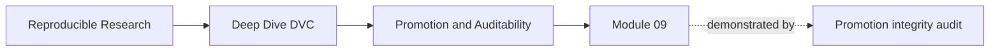
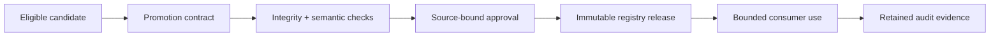
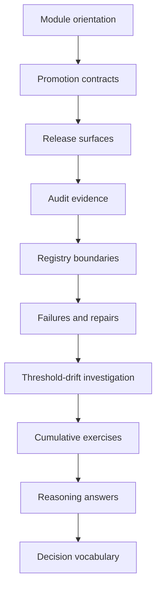

# Module 09: Promotion, Registry Boundaries, and Auditability

## Page Maps





Module 09 asks when a reproducible result earns downstream authority.

A DVC pipeline may reproduce a candidate. A remote may store every required object. An
experiment comparison may show an improvement. None of those facts alone entitles a
consumer to depend on the result. Promotion adds a separate claim:

> This exact candidate, from this exact source, passed the declared release gates, received
> the required authority, and is available through this immutable supported interface.

This module teaches how to make that claim falsifiable and how to block neat-looking
bundles whose evidence disagrees.

## Prerequisites

Before starting, you should be able to:

- distinguish Git-tracked declaration from DVC-tracked artifact content;
- read stage and output identities in `dvc.lock`;
- explain a metric contract and a controlled candidate comparison;
- distinguish local cache, DVC remote, and workspace output;
- run a repository-root Make target.

If one prerequisite is unfamiliar, use these routes:

| Need | Return to |
| --- | --- |
| pointer, cache, workspace, and remote identity | Module 02 |
| truthful stage declarations and recorded state | Module 04 |
| parameter and metric meaning | Module 05 |
| candidate comparability and baseline anchoring | Module 06 |
| recovery and retention | Module 08 |

Module 09 depends on those concepts but does not reteach them from the beginning.

## The problem you will solve

The capstone has a healthy `publish/v1/` bundle. A healthy example alone is weak teaching
evidence because it does not show whether the review rule rejects plausible defects.

The promotion integrity audit creates seven isolated cases:

| Case | Core question |
| --- | --- |
| complete promotion | what must agree before authority is granted? |
| tampered artifact | can post-review byte change be detected? |
| unlisted artifact | is the release inventory exact or merely a minimum? |
| threshold drift | can valid digests hide contradictory meaning? |
| mutable registry reference | can the release identity change later? |
| stale source approval | did reviewers approve another Git revision? |
| missing required review | can one authority silently replace another? |

Only the complete case should be accepted.

## Learning outcomes

After completing the reading, investigation, and packet, you should be able to:

- define candidate, eligible, approved, published, superseded, and withdrawn states;
- write a promotion contract bound to Git and DVC state;
- derive a minimal release surface from a consumer action;
- distinguish exact inventory, artifact integrity, semantic consistency, provenance, and
  approval;
- explain the separate responsibilities of a DVC remote, DVC-backed data registry,
  promotion registry, and release bundle;
- resolve movable aliases to immutable release identities;
- investigate a digest-valid semantic contradiction;
- preserve evidence while blocking, withdrawing, repairing, or superseding a release;
- verify a release from a clean consumer perspective;
- defend a promotion gate with explicit proof limits.

## One serious self-study session

Plan for roughly four hours. Split the session if needed, but keep the order because later
work uses evidence created earlier.

| Block | Time | Work | Concrete output |
| --- | ---: | --- | --- |
| orient | 20 min | read this page and inspect specimen contract | prediction of the complete gate |
| authority | 35 min | study promotion contracts | lifecycle and authority notes |
| interface | 35 min | study release surfaces | supported/audit-only/internal table |
| evidence | 40 min | study audit evidence | claim-to-record graph |
| registry | 30 min | separate registry and remote jobs | responsibility table |
| failure response | 30 min | study evidence-preserving repairs | block/withdraw/supersede matrix |
| investigation | 35 min | follow threshold-drift worked route | bounded repair decision |
| practice | 60–120 min | complete cumulative exercises | ten-file review packet |

Do not compress practice into reading the answers. The key skill is making a decision
before seeing the model reasoning.

## Generate the proof environment

From the repository root:

```bash
make PROGRAM=reproducible-research/deep-dive-dvc \
  capstone-promotion-integrity-audit
```

Evidence is written to:

```text
artifacts/audit/reproducible-research/deep-dive-dvc/promotion-integrity/
```

Start with:

```text
PROMOTION_INTEGRITY_AUDIT_GUIDE.md
report.json
route.txt
review-questions.txt
```

Then inspect individual workspaces. Generated cases stay outside the course source tree,
so comparison does not dirty the repository.

For the enforcement route:

```bash
make PROGRAM=reproducible-research/deep-dive-dvc \
  capstone-promotion-integrity-selftest
```

The audit report teaches decisions. The self-test shows that the modeled decisions are
enforced. Neither route establishes scientific suitability or real registry controls.

## Reading route

Read in this order on the first pass:



Use a targeted route only after you understand the full boundary:

| Current confusion | Read | Inspect |
| --- | --- | --- |
| “The candidate has good metrics, so why block?” | promotion contracts | missing-review case |
| “The digests pass, so how can the bundle be wrong?” | audit evidence | threshold-drift case |
| “Why reject an extra harmless file?” | release surfaces | unlisted-artifact case |
| “Isn't the DVC remote already the registry?” | registry boundaries | responsibility matrix |
| “Can I just regenerate the manifest?” | failures and repairs | tampered-artifact case |
| “How do I conduct the review?” | worked investigation | generated assessment files |

## Module map

| Page | Decision responsibility |
| --- | --- |
| [Promotion Contracts and Downstream Trust](promotion-contracts-and-downstream-trust.md) | separates candidate quality, release authority, and consumer scope |
| [Release Surfaces and Bundle Shape](release-surfaces-and-bundle-shape.md) | designs exact inventory, compatibility, atomic publication, and clean verification |
| [Audit Evidence: Params, Metrics, Locks, Manifests, and Decisions](audit-evidence-params-metrics-locks-manifests.md) | connects atomic claims to independent evidence |
| [Registry Boundaries and Consumer Contracts](registry-boundaries-and-consumer-contracts.md) | assigns discovery, storage, authority, lifecycle, and consumer responsibilities |
| [Promotion Failures and Evidence-Preserving Repairs](promotion-failures-and-review-repairs.md) | chooses block, withdrawal, repair, or supersession without erasing evidence |
| [Worked Investigation: A Digest-Valid Release with the Wrong Threshold](worked-example-investigating-threshold-drift-before-promotion.md) | follows one semantic contradiction through a reproducible investigation |
| [Exercises](exercises.md) | builds a cumulative ten-artifact promotion review packet |
| [Exercise Answers](exercise-answers.md) | teaches proposition-level judgment and repair reasoning |
| [Glossary](glossary.md) | stabilizes vocabulary where similar words imply different authority |

## Keep the boundaries visible

Five distinctions carry the module:

| Distinction | First side | Second side |
| --- | --- | --- |
| quality vs authority | evidence that a candidate performs under a contract | permission for consumers to depend on it |
| integrity vs meaning | bytes match recorded digest | records make coherent true claims |
| storage vs registry | objects can be restored | release is named, approved, and supported |
| immutable version vs alias | historical identity never retargets | convenience pointer may move |
| repair vs rewriting | new evidence and new decision preserve chronology | edits make old evidence appear to agree |

When an explanation becomes vague, identify which distinction was collapsed.

## A promotion gate is conjunctive

The course audit models:

```text
accept =
  immutable release identity
  AND exact inventory
  AND artifact integrity
  AND promoted claim agreement
  AND source lock agreement
  AND decision-to-candidate agreement
  AND required reviewer roles
  AND bounded consumer contract
```

One false term blocks. Strong evidence for another term cannot compensate.

Examples:

- valid digests cannot supply missing reviewer authority;
- reviewer approval cannot repair a digest mismatch;
- remote availability cannot make `latest` immutable;
- exact inventory cannot prove threshold meaning.

## Capstone evidence map

| Question | Source surface | Generated audit surface |
| --- | --- | --- |
| what is the healthy published bundle? | `capstone/publish/v1/` | `workspace/complete-promotion/publish/` |
| which payload bytes are recorded? | `publish/v1/manifest.json` | each case `publish/manifest.json` |
| what does promotion require? | `repro/promotion-integrity/promotion-contract.json` | each case contract |
| who approved which source? | specimen decision | each case decision |
| which proposition passed or failed? | audit script | `assessment.json` and `report.json` |
| how is enforcement reviewed? | audit tests | copied script and tests in audit bundle |
| how does ordinary release review differ? | `make ... capstone-release-audit` | healthy release evidence only |

The generated audit uses the real capstone publish bundle as its healthy candidate, then
changes one controlled property per blocked case.

## Proof-route decision table

| Question | Use | Do not infer |
| --- | --- | --- |
| does the current bundle satisfy schema and digest checks? | `capstone-verify` | required roles approved it |
| can a reviewer inspect the healthy release packet? | `capstone-release-audit` | adversarial cases are rejected |
| do modeled promotion defects reach expected decisions? | promotion integrity audit | candidate is scientifically best |
| did experiment comparisons preserve meaning? | experiment comparability audit | release was published |
| can protected revisions be restored? | recovery readiness audit | release has consumer authority |

Run the route that matches the claim instead of using the largest command as a universal
proof.

## Common misconceptions to test early

### “A DVC-tracked output is promoted”

DVC tracking supplies version and content identity. Promotion requires policy, approval,
and a supported consumer interface.

### “A matching digest means the release is correct”

A digest establishes byte identity. The threshold-drift case shows valid bytes with
contradictory release meaning.

### “The registry can point to `latest` because the decision is recorded”

The decision would preserve what reviewers intended, but consumers resolving the alias
later could receive another release. Record and consume an immutable identity.

### “A release can be corrected under the same immutable version”

Replacing files destroys the ability to determine what earlier consumers received.
Withdraw or supersede and publish a new immutable version.

### “The DVC remote proves availability and approval”

It can support retrieval. Authority is a separate record and recovery needs a separate
test.

## Completion rubric

Rate each dimension from 0 to 2:

| Dimension | 0 | 1 | 2 |
| --- | --- | --- | --- |
| authority | equates success with promotion | names approval but not source binding | models lifecycle and exact authority |
| interface | copies convenient outputs | lists files | derives supported surface from consumer action |
| evidence | cites one file as proof | names several files | maps each atomic claim to independent evidence |
| registry | conflates remote and release | separates them conceptually | assigns ownership, identity, verification, and failure response |
| failure response | edits until green | proposes repair | preserves chronology, contains consumers, and renews review |
| independent verification | depends on producer workspace | gives partial commands | clean consumer can reproduce judgment and limits |

A score below 10 of 12 means return to the weakest dimension before Module 10.

## Leave the module with one defensible statement

You should be able to complete:

> I would accept or block this release because **specific proposition**, established by
> **named evidence**, under **declared policy**. The decision does not prove **explicit
> limits**, and the next required evidence is **concrete action**.

That sentence is the bridge from technical files to reviewable release stewardship.
