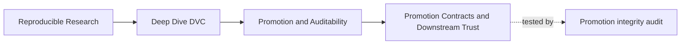
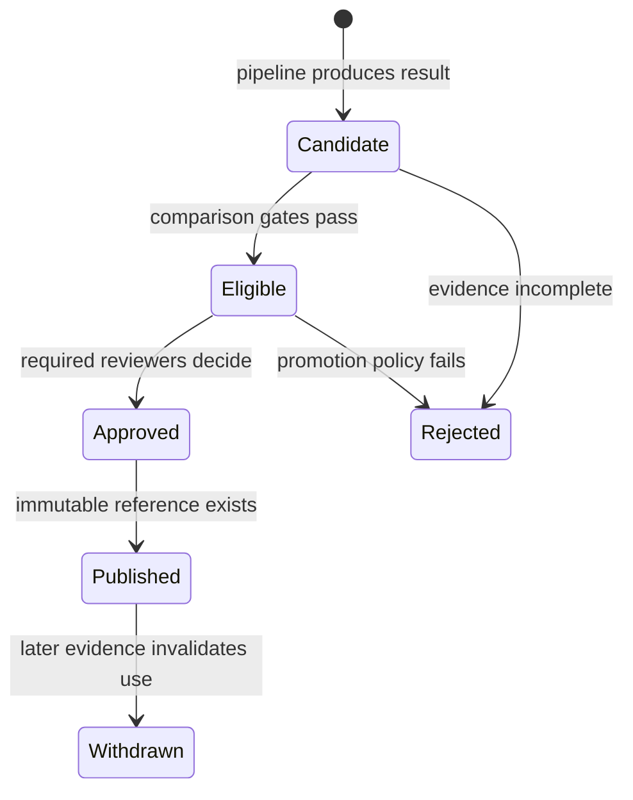
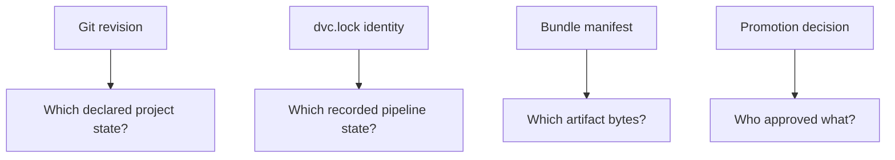

# Promotion Contracts and Downstream Trust

## Page Maps





Promotion changes what other people are entitled to do with a result. Before promotion,
a model or report may be reproducible and worth comparing. After promotion, a named
consumer may rely on it for a named purpose. That change in authority needs a contract
that can be reviewed independently of the person who ran the pipeline.

This lesson builds that contract from first principles. By the end, you should be able to
separate candidate quality from release authority, bind an approval to exact DVC state,
and state both the positive and negative promises made to consumers.

## Begin with a concrete consumer

Imagine an operations analyst who needs the incident-escalation model for a monthly
review. The analyst did not attend the training run and should not need to explore the
repository to discover which output is approved.

A useful promotion statement answers six questions:

| Question | Example answer |
| --- | --- |
| What is the release? | `incident-escalation-2026-07` |
| Who may consume it? | operations analysts preparing the monthly review |
| For what action? | score the documented feature schema and interpret the release report |
| Which exact source was reviewed? | one Git revision and one `dvc.lock` identity |
| Which evidence justified authority? | integrity, claim consistency, and two required approvals |
| What remains unsupported? | cache paths, experiment queue entries, and training intermediates |

If any answer is “whatever is latest,” “the model in the output folder,” or “ask the
author,” there is no durable consumer contract yet.

## Candidate, eligible, approved, and published are different states

Teams often compress four decisions into the word “ready”:

| State | Claim | Evidence needed |
| --- | --- | --- |
| candidate | the pipeline produced this result | output and recorded execution state |
| eligible | this result passed comparison and policy gates | baseline, metric contract, and candidate comparison |
| approved | authorized reviewers accepted this exact source | decision record bound to source identity |
| published | consumers can resolve an immutable supported interface | registry reference, inventory, and availability |

The distinctions prevent two common errors.

First, a candidate with excellent metrics is not automatically approved. Metric quality
cannot supply missing authority. Second, an approved source is not necessarily published.
Consumers still need a stable reference and a usable bundle.

Use this sentence pattern when reviewing a release:

> Candidate **X**, produced from source **Y**, is approved by roles **R** for consumer
> action **A** at immutable reference **Z**, subject to limits **L**.

Each noun should resolve to evidence, not memory.

## Bind approval to source identity

A promotion decision should identify the state reviewers actually considered. In a DVC
project, that usually requires at least:

- a Git revision for code, configuration, `dvc.yaml`, and the committed lock file;
- the identity of `dvc.lock` or the recorded output identities it contains;
- the candidate bundle manifest and its artifact digests;
- the release contract and review decision.

These records answer different questions:



Recording only the branch name `main` is insufficient because the branch moves. Recording
only a DVC object hash is also insufficient because it does not explain code, params,
approval, or consumer intent.

The capstone specimen uses a full Git revision and a SHA-256 digest of `dvc.lock`. A real
system may use signed Git tags, attestations, registry metadata, or another provenance
format. The invariant is stable binding: the evidence reviewed and the artifact
published must describe the same source.

## Write a falsifiable promotion contract

Open:

```text
capstone/repro/promotion-integrity/promotion-contract.json
```

Its fields are deliberately small:

```json
{
  "release_id": "incident-escalation-2026-07",
  "registry_reference": "incident-escalation/2026-07",
  "source": {
    "git_revision": "<full revision>",
    "dvc_lock_sha256": "<lock digest>"
  },
  "required_artifacts": ["model.json", "metrics.json", "params.yaml"],
  "promoted_claims": {
    "decision_threshold": 0.52
  },
  "approval": {
    "required_decision": "APPROVE",
    "required_roles": ["model-owner", "risk-reviewer"]
  }
}
```

The full specimen has a larger inventory, but the structure is the important part. Each
field creates a possible test:

- change the reference to `latest` and immutability should fail;
- add an unlisted file and exact inventory should fail;
- change the threshold and claim agreement should fail;
- approve another source revision and source binding should fail;
- remove a required role and approval should fail.

A contract is strong when you can say what evidence would disprove compliance.

## Separate release quality from release authority

Suppose a candidate has the best F1 score in the experiment table but lacks the
risk-reviewer decision required by policy.

The correct judgment is:

> The candidate may remain eligible for promotion, but promotion is blocked because the
> required authority is absent.

Do not say:

> The metric is strong enough, so the missing review is probably fine.

That substitutes quantitative evidence for governance evidence. Different evidence
surfaces are not interchangeable.

The reverse matters too. Two reviewers can approve a bundle whose manifest does not match
the artifact bytes. Approval does not make incorrect evidence correct. The promotion
gate is conjunctive:

```text
accept =
  immutable identity
  AND exact inventory
  AND artifact integrity
  AND coherent claims
  AND source binding
  AND required approval
  AND bounded consumer interface
```

One false term blocks release authority.

## State the consumer promise and its limit

Positive promises tell consumers what they may do:

> Consumers may load `model.json`, take the decision threshold from `params.yaml`, read
> performance from `metrics.json`, and interpret limitations in `report.md`.

Negative promises are equally important:

> Consumers must not depend on capstone workspace paths, cache paths, or experiment queue
> entries. Those are internal implementation surfaces and may change without a release
> compatibility review.

Without the negative boundary, every visible path risks becoming an accidental API.

Use this table to review consumer scope:

| Surface | Consumer status | Reason |
| --- | --- | --- |
| immutable registry reference | supported entry point | identifies the approved release |
| files named by the consumer contract | supported | reviewed public interface |
| additional manifest files | auditable but not necessarily direct API | may support review rather than runtime use |
| `dvc.lock` | provenance evidence | useful to maintainers, not a runtime consumer API |
| DVC remote objects | storage implementation | content-addressed objects lack release meaning by themselves |
| cache and workspace paths | unsupported | local and internal |

## Read an approval as evidence, not ceremony

Open:

```text
capstone/repro/promotion-integrity/promotion-decision.json
```

Check it against the contract rather than reading it in isolation:

1. Does `release_id` match?
2. Does the immutable registry reference match?
3. Do the Git revision and lock digest match?
4. Is the decision value the one required by policy?
5. Are all required roles present?
6. Is the rationale about this release rather than a generic approval?

The `STALE_SOURCE_APPROVAL` audit case changes only the Git revision in the decision. The
bundle stays intact and the capstone lock still matches the contract, but the approval is
for another source. This is precisely the kind of defect that a green pipeline cannot
detect unless the approval binding is modeled.

## Guided evidence route

Run:

```bash
make PROGRAM=reproducible-research/deep-dive-dvc \
  capstone-promotion-integrity-audit
```

Then compare these findings in `report.json`:

| Comparison | Keep constant | Changed evidence | Lesson |
| --- | --- | --- | --- |
| `COMPLETE_PROMOTION` vs `STALE_SOURCE_APPROVAL` | candidate bytes and contract | approved Git revision | approval must bind to the candidate source |
| `COMPLETE_PROMOTION` vs `MISSING_REQUIRED_REVIEW` | source, bundle, and first approval | required role | authority cannot be inferred from another reviewer |
| `COMPLETE_PROMOTION` vs `MUTABLE_REGISTRY_REFERENCE` | source and artifact bytes | consumer reference | agreement on a movable name does not make it immutable |

Write one sentence for each blocked case using this form:

> Promotion is blocked because **record A** disagrees with **contract B** about **specific
> claim C**; repair requires **new evidence D**, not a manual exception.

If the sentence cannot name the records, inspect the evidence again.

## Decision table

| Situation | Candidate status | Promotion decision | Required next evidence |
| --- | --- | --- | --- |
| comparison fails | not eligible | block | corrected or newly evaluated candidate |
| candidate passes, approval missing | eligible | block | approval for the exact source |
| approval matches, digest fails | changed after review | block | renewed candidate review and manifest |
| all gates pass, immutable reference absent | approved but unpublished | block publication | immutable registry entry |
| all gates pass | approved and publishable | accept | retain the decision and evidence |
| later defect invalidates use | previously published | withdraw or supersede | incident record and replacement decision |

Promotion is not irreversible. Withdrawal is another authority change and should retain
the original evidence rather than erase it.

## Reasoning traps

### “The pipeline passed”

Pipeline success proves execution, not approval, consumer compatibility, or registry
identity.

### “The manifest hashes match”

Integrity proves recorded bytes, not semantic truth. The threshold-drift case has valid
digests and still blocks.

### “Both reviewers approved the model”

Ask which exact source and bundle they approved. A generic approval cannot safely attach
itself to a later candidate.

### “Consumers can use the DVC remote”

A DVC remote stores restorable objects. It does not by itself name an approved release or
state a supported consumer interface.

## Independent review checkpoint

You are ready for the next lesson when you can answer without instructor help:

- What authority changes at promotion?
- Which evidence distinguishes eligible from approved?
- Why are Git revision, lock identity, manifest, and decision separate?
- What makes a promotion contract falsifiable?
- What is the supported consumer action, and what remains unsupported?
- Which new evidence would repair a stale-source approval?

Promotion is defensible when another reviewer can reconstruct the decision from stable
records and reach the same accept-or-block judgment.
