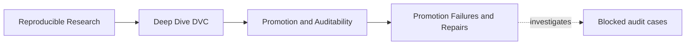
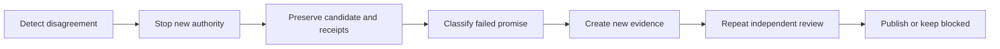
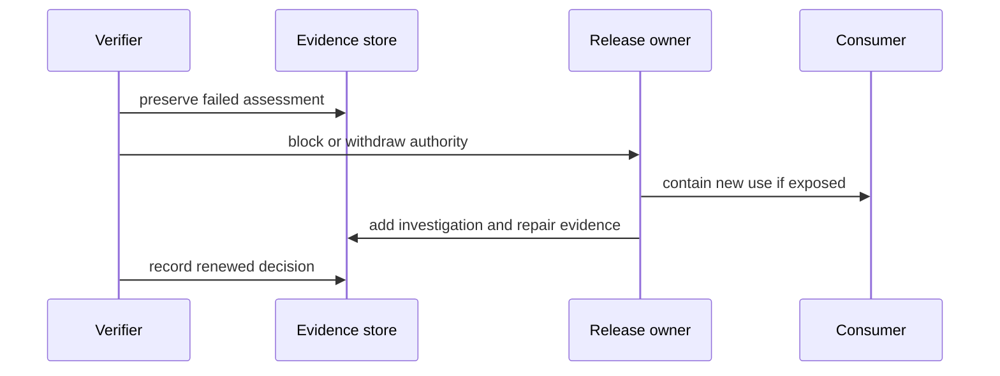
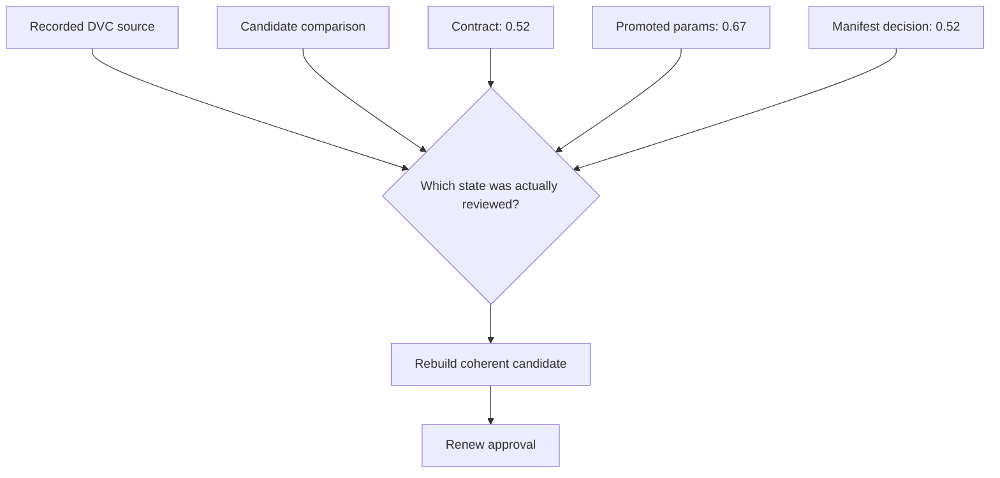
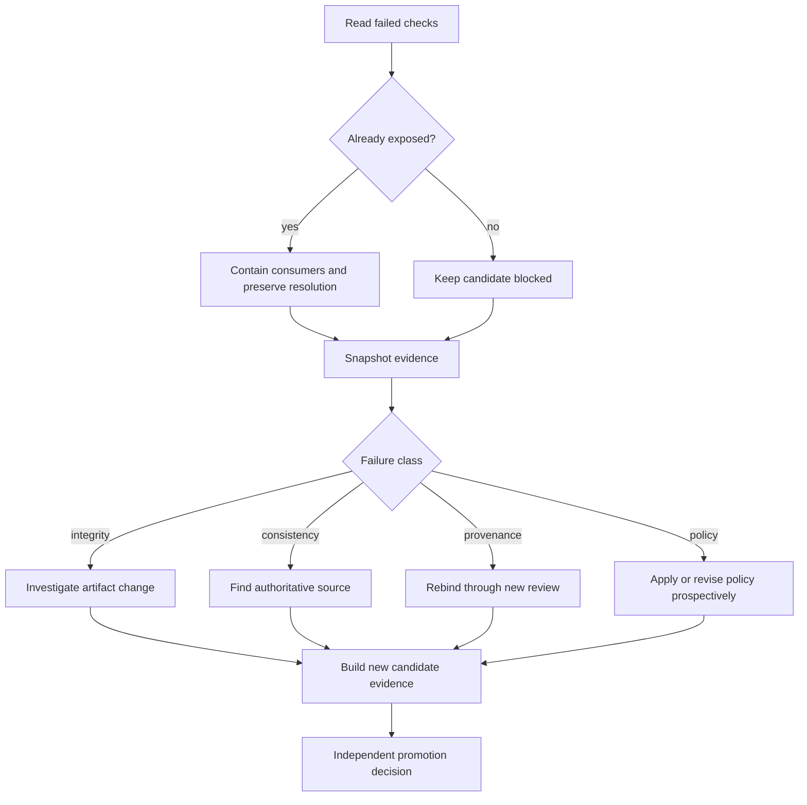

# Promotion Failures and Evidence-Preserving Repairs

## Page Maps





Promotion failures are often more dangerous than pipeline crashes because they can look
orderly. The bundle exists, JSON parses, the report opens, and the registry shows a
release. Yet the evidence may describe different sources, an unapproved change, a moving
identity, or incomplete authority.

The right response is not to make the directory green as quickly as possible. It is to
contain consumer risk, preserve what happened, classify the broken promise, and generate
the evidence required for a new decision.

## Separate detection from repair

When a promotion gate fails, do not edit immediately. First record:

- immutable candidate or registry identity, if one exists;
- source Git revision and `dvc.lock` identity;
- promotion contract and decision;
- candidate manifest and computed verification results;
- failed check names;
- time of detection and known consumers;
- whether the release was merely a candidate or already exposed.

This snapshot prevents repair work from erasing the original disagreement.



If you overwrite the candidate before preserving it, later reviewers may know that a fix
was made but not what consumers originally saw.

## Classify the broken promise

Use the failed check to choose the investigation:

| Failed promise | Immediate question | Evidence to preserve |
| --- | --- | --- |
| immutable identity | could the reference have moved? | alias resolution history and immutable target |
| exact inventory | was a file omitted, added, or exposed accidentally? | directory listing, manifest, contract |
| artifact integrity | when and where did bytes change? | retrieved artifact, recorded digest, transfer receipts |
| promoted claim consistency | which source is authoritative for the claim? | params, metrics, manifest, contract, source state |
| source binding | did the decision approve another candidate? | decision, Git revision, lock digest |
| required approval | which role or decision is absent? | policy and available reviewer records |
| consumer boundary | did a consumer need an internal path? | consumer command, contract, dependency list |

Avoid the generic label “release metadata issue.” It hides the affected trust promise and
encourages the wrong repair.

## Decide whether to block, withdraw, or supersede

The response depends on lifecycle state:

| State when defect is found | Authority response | Consumer response |
| --- | --- | --- |
| candidate not yet approved | keep blocked | none beyond review team |
| approved but not exposed | revoke pending publication | prevent registry creation |
| immutable release exposed but unused | withdraw and correct discovery pointers | notify intended consumers |
| release consumed downstream | withdraw or restrict, assess impact | identify uses and affected outputs |
| defect does not invalidate supported use | preserve release, document bounded correction | communicate limits without rewriting history |

Do not silently replace files under an immutable identity. Publish a corrected release and
retain the defective release record with its withdrawal status.

## Failure: artifact changed after manifest creation

In `TAMPERED_ARTIFACT`, `report.md` receives an extra sentence after its digest is
recorded. Inventory still matches, but integrity fails.

Unsafe repair:

```text
compute a new digest
replace the manifest entry
keep the old approval
```

This makes the checksum agree while attaching a prior decision to new bytes.

Evidence-preserving repair:

1. preserve the changed report and failed assessment;
2. determine whether the change was intended and authorized;
3. return the bundle to candidate state;
4. rebuild the manifest over the intended final files;
5. repeat semantic and schema checks;
6. obtain approval for the new candidate identity;
7. publish under a new immutable release if the old identity was exposed.

The repair is complete only when byte identity and authority refer to the same candidate.

## Failure: an unlisted file crosses the boundary

`UNLISTED_ARTIFACT` adds `debug-notes.txt`. Every recorded artifact still has a valid
digest. Exact inventory blocks.

Investigate before deleting:

- Does the file contain sensitive rows or credentials?
- Did a consumer retrieve it?
- Was it generated by the declared publish route or copied manually?
- Is it genuinely required for the supported action?
- Does its presence reveal a broader pattern of uncontrolled publication?

Two legitimate repairs exist:

- remove it from the candidate because it is internal, then rebuild and review;
- deliberately add it to the contract and manifest because consumers require it, then
  review its schema, meaning, privacy, and compatibility.

“It is harmless” is not evidence. Boundary expansion is a release decision.

## Failure: valid bytes tell a contradictory story

`THRESHOLD_DRIFT` changes `params.yaml` to threshold `0.67` and updates that file's
manifest digest. Integrity passes; the promoted claim fails.

Do not choose the value that is easiest to edit. Determine the intended source:



Possible findings differ:

- `params.yaml` was copied from the wrong run;
- the manifest and contract are stale because `0.67` was intentionally reviewed;
- the model and metrics also came from another threshold;
- no evidence can establish which candidate the reviewers saw.

The last case cannot be repaired by reconciliation alone. Re-run or reconstruct a new
candidate from recorded state and obtain a new decision.

## Failure: approval is attached to another source

`STALE_SOURCE_APPROVAL` keeps the candidate and contract intact but changes the Git
revision in the decision.

This may happen when:

- a decision record is copied from an earlier release;
- code changes after review but before publication;
- an automation job binds approval to a branch name;
- a queued candidate is superseded without invalidating its pending approval.

Repair requires approval for the exact current source, not a textual correction to the
revision field. The reviewers must know what changed and decide again.

Use this impact table:

| Source change | Can prior evidence be reused? | New decision needed? |
| --- | --- | --- |
| no source or artifact change; clerical display error elsewhere | likely | verify identity binding before correction |
| documentation inside supported bundle changes | candidate changed | yes |
| code changes but generated candidate bytes happen to match | provenance changed | yes under exact-source policy |
| unrelated repository file changes outside release source boundary | depends on declared boundary | document and apply policy |
| params, data, model, or evaluation changes | candidate meaning changed | yes |

The promotion contract should make the source boundary explicit enough to decide the final
row without improvisation.

## Failure: required authority is absent

`MISSING_REQUIRED_REVIEW` removes the risk-reviewer approval. The model-owner approval
cannot stand in for the missing role.

Do not:

- duplicate one person under two role labels without policy support;
- infer approval from a chat reaction;
- lower the policy after seeing the result;
- publish now and collect the decision later.

Do:

- keep the candidate and evidence stable;
- provide the required reviewer an independent review route;
- record accept or reject against the exact candidate;
- preserve both decisions when roles are intentionally independent.

If a role is genuinely unnecessary, revise the policy prospectively with governance
review. Do not rewrite the rule solely to admit one waiting candidate.

## Failure: a mutable alias is used as identity

`MUTABLE_REGISTRY_REFERENCE` uses `incident-escalation/latest`. Contract and decision
agree, but the name can resolve differently tomorrow.

Repair by:

- publishing the candidate under an immutable version;
- recording that version in the decision;
- making any alias point to the immutable release only after checks pass;
- recording alias movement as a separate lifecycle event.

Do not “freeze” the meaning in prose while leaving the machine reference movable.
Consumers and automation need the immutable identity.

## Failure: content is approved but unavailable

The promotion integrity audit assumes the capstone source and bundle are readable. In a
real system, an approved registry entry may outlive its backing DVC objects.

That is a recovery incident, not an excuse to mutate the release:

1. preserve the failed retrieval receipt;
2. stop claiming the release is available;
3. test protected source and remote identities;
4. restore from a governed replica if policy permits;
5. verify the restored content against the immutable manifest;
6. record recovery or withdrawal.

Module 08's recovery-readiness audit tests this separate boundary. A promotion audit
cannot prove remote durability merely because local files exist.

## Repair without erasing chronology

An audit-friendly record is append-oriented:

```text
candidate created
verification failed
promotion blocked
investigation classified threshold disagreement
candidate rebuilt from source revision X
new manifest recorded
independent approvals recorded
immutable release published
```

Avoid rewriting history into:

```text
release published successfully
```

The compact version hides the failure and makes it impossible to learn whether consumers
were exposed or controls worked.

## Write a review note that supports action

A useful note contains:

1. **Identity:** affected candidate or immutable release.
2. **Detection:** failed check and evidence location.
3. **Impact:** lifecycle state and known consumers.
4. **Cause:** confirmed cause or bounded uncertainty.
5. **Containment:** block, withdrawal, or alias change.
6. **Repair:** new evidence created.
7. **Decision:** who reviewed the repaired candidate.
8. **Limits:** what remains unproved.

Example:

> Candidate `incident-escalation-2026-07` blocked because promoted
> `params.yaml` recorded threshold `0.67` while the contract and bundle claim recorded
> `0.52`. Artifact digests were valid, so the defect was semantic rather than transfer
> corruption. No immutable release was exposed. The candidate was rebuilt from the
> contract's source revision, all promoted claims were rechecked, and both required roles
> approved the rebuilt candidate. Remote recovery was not tested by this review.

That note lets a future reviewer distinguish failure, containment, repair, and proof
limits.

## Triage route for a blocked case

Use this order:



This order keeps consumer safety and evidence preservation ahead of file editing.

## Independent review checkpoint

You are ready for the worked investigation when you can:

- preserve a failed candidate before attempting repair;
- classify failure by the promise it breaks;
- choose block, withdrawal, or supersession from lifecycle state;
- explain why updating a checksum can invalidate prior approval;
- distinguish removal of an accidental file from deliberate boundary expansion;
- repair stale-source approval through a new decision;
- keep availability incidents separate from promotion authority;
- write a review note with identity, impact, repair, decision, and proof limits.

A successful repair does more than make checks pass. It creates a new, reviewable evidence
chain while preserving the chronology of the failed decision.
