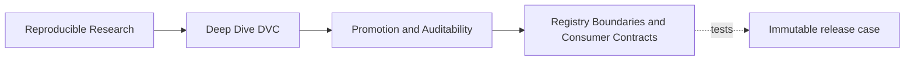
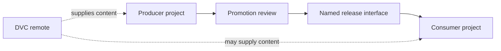
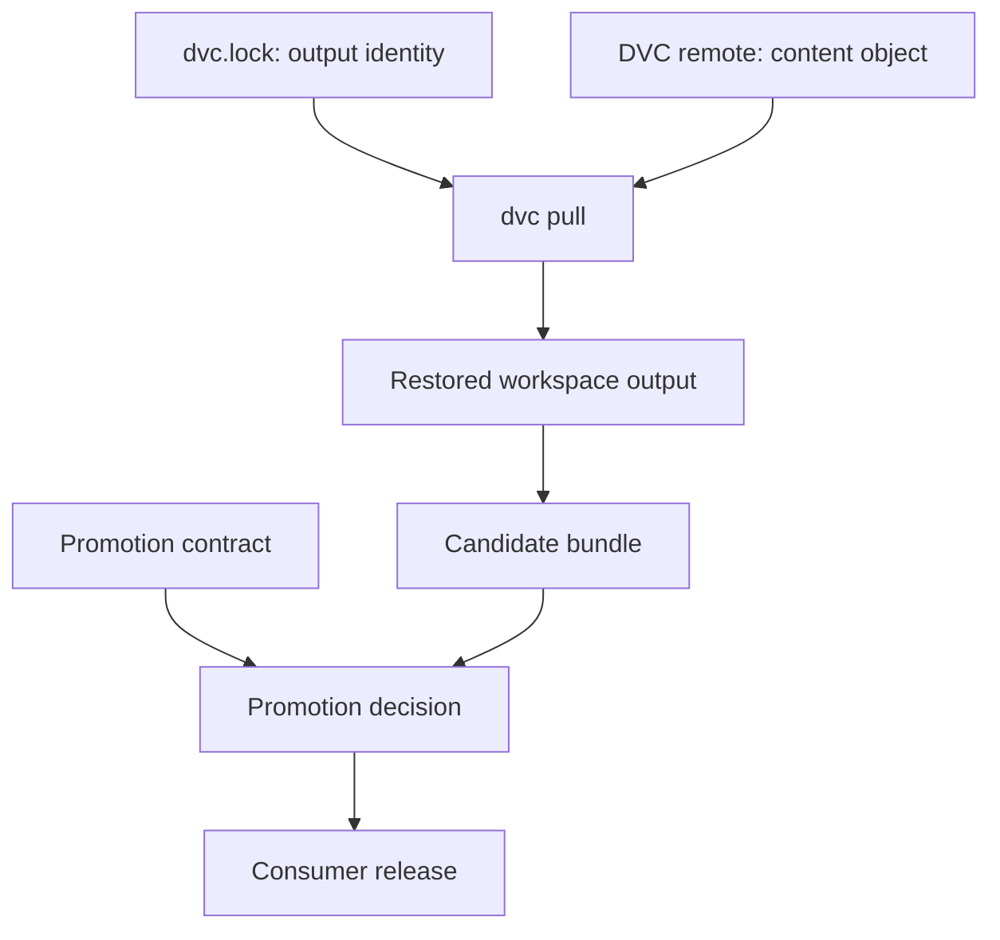
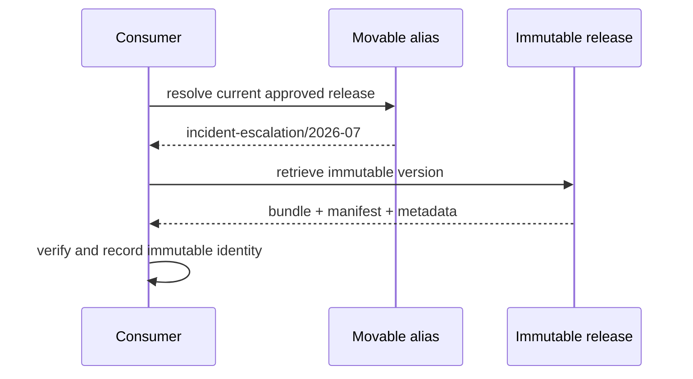

# Registry Boundaries and Consumer Contracts

## Page Maps





“Registry” is often used for any place that contains artifacts. That loose language hides
important differences in authority, discovery, storage, and consumption.

A DVC remote can hold the bytes needed to restore tracked outputs. A DVC repository can
publish versioned data for `dvc get` or `dvc import`. A model registry can add lifecycle
and approval metadata. A release directory can expose a small local interface. These
surfaces can cooperate, but they do not make the same promise.

This lesson gives you a decision model for assigning each responsibility and writing a
consumer contract that survives internal project change.

## Name the boundary by the question it answers

| Boundary | Primary question | Typical identity |
| --- | --- | --- |
| Git repository | which declared project revision? | commit or immutable tag |
| DVC lock state | which recorded pipeline dependencies and outputs? | committed `dvc.lock` at a Git revision |
| DVC remote | where can content-addressed data be pushed or pulled? | configured remote plus object identity |
| DVC-backed data registry | which versioned dataset or artifact can another project discover and retrieve? | repository URL, path, and revision |
| promotion registry | which candidate has authority for a supported use? | immutable release version plus decision metadata |
| release bundle | which public files and schemas form the consumer interface? | exact manifest inventory |

When one tool implements several boundaries, keep the questions separate. A model
registry might store artifact bytes and approval metadata, but reviewers still need to
distinguish availability from authority.

## A DVC remote is not a promotion registry

`dvc push` transfers cache objects needed by tracked outputs to a configured remote.
`dvc pull` obtains objects for the selected project state and places outputs in the
workspace. These operations support collaboration and recovery.

They do not inherently answer:

- which candidate passed comparison;
- which release reviewers approved;
- what a consumer may do with an object;
- which schema is supported;
- whether a movable alias changed;
- when a release is deprecated or withdrawn.



The remote enables restoration. Promotion grants authority. A remotely available object
may be experimental, obsolete, or unreviewed.

## A DVC repository can act as a data registry

A separate consumer can retrieve a DVC-tracked path from a repository at a named revision:

```bash
dvc get <repository-url> <path> --rev <immutable-revision>
```

This is useful when the producer repository itself is the discovery and versioning
surface. The consumer does not need to initialize a DVC project merely to use `dvc get`.

If the consumer wants a tracked dependency with an update relationship, `dvc import` may
be more appropriate. The exact choice belongs to dependency-management design, but the
release questions remain:

- Which repository and path are supported?
- Which immutable revision was approved?
- What schema and behavior does the path promise?
- How does the consumer verify the retrieved content?
- What happens when a new release appears?

Retrieving without `--rev` uses the repository's current default revision. That may be
convenient for exploration but is too weak for a historical audit claim.

## A model registry adds authority and lifecycle

A model registry commonly adds concepts such as:

- named model or product;
- immutable versions;
- approval status or lifecycle stage;
- annotations, owners, and review links;
- discovery APIs;
- access controls;
- deprecation, withdrawal, or supersession.

These features are useful only when their semantics are explicit. A stage called
`production` is a movable authority pointer. Record the immutable model version beneath
it. A version called `7` is stable only if the registry forbids retargeting or replacement.

The course does not require one registry vendor. Evaluate any implementation against the
same invariants:

| Invariant | Review question |
| --- | --- |
| immutable identity | can this version ever resolve to different bytes or metadata? |
| source binding | can I identify the Git and DVC state that produced it? |
| exact inventory | can I determine every artifact in the release? |
| approval binding | are reviewers attached to this exact version? |
| consumer contract | are supported files, schemas, and uses documented? |
| recoverability | can the backing content still be retrieved under the retention promise? |
| lifecycle history | can I see promotion, supersession, and withdrawal without erasing events? |

## Design separate producer and consumer views

The producer sees internal richness:

```text
raw data
prepared data
feature outputs
candidate models
experiment results
evaluation tables
debug plots
release candidate
```

The consumer should see a bounded product:

```text
incident-escalation/2026-07
  manifest
  model
  params
  metrics
  report
```

This asymmetry is intentional. The registry protects consumers from pipeline refactors and
protects maintainers from having every internal path become a permanent dependency.

Ask consumers what action they need, not which producer folders they want.

## Write the consumer contract as testable clauses

A useful contract contains:

### Identity

> Consumers resolve `incident-escalation/2026-07`. The identifier is immutable.

### Supported action

> Consumers may score rows matching the documented feature schema and use threshold
> `0.52` for the documented review workflow.

### Supported files

> `model.json`, `params.yaml`, `metrics.json`, and `report.md` are supported interfaces.

### Verification

> Consumers verify exact inventory and artifact digests against `manifest.json` before
> use.

### Provenance

> The release record identifies the approved Git revision and `dvc.lock` digest.

### Exclusions

> Workspace paths, cache objects, experiment records, and producer intermediates are not
> supported consumer interfaces.

### Lifecycle

> A release is never modified in place. Corrections create a new immutable release;
> withdrawal retains the original decision history and blocks new use.

Every clause implies a test or observable process.

## Resolve aliases safely

Movable aliases are useful for discovery:

```text
candidate
approved
production
latest
```

They are dangerous when recorded as the only identity.

A safe consumer route is:



After resolution, logs, reports, caches, and downstream lock files should name
`incident-escalation/2026-07`, not merely `approved`.

The promotion audit's `MUTABLE_REGISTRY_REFERENCE` case changes both contract and decision
to `incident-escalation/latest`. The two records agree, yet the release blocks because
agreement on a moving target cannot preserve historical identity.

## Prevent producer internals from leaking into consumption

Review a proposed consumer command:

```bash
python score.py \
  --model ../../producer/models/model.json \
  --params ../../producer/params.yaml
```

It leaks:

- producer directory layout;
- workspace availability;
- current rather than immutable state;
- two files that may come from different revisions;
- no integrity or approval check.

A stronger conceptual route is:

```bash
resolve incident-escalation/2026-07
verify manifest and supported schemas
score with verified model and params
record incident-escalation/2026-07 in the result
```

The exact command depends on the registry, but the consumer obligations do not.

## Separate schema compatibility from lifecycle authority

A new release can be schema-compatible and still require explicit promotion. A release can
also retain authority while becoming unsuitable for new consumers because policy changed.

Use two axes:

| Schema compatibility | Lifecycle authority | Meaning |
| --- | --- | --- |
| compatible | approved | ordinary supported consumption |
| compatible | withdrawn | parser may work, but new use is forbidden |
| breaking | approved under a new interface version | consumers must migrate deliberately |
| breaking | accidentally replacing old version | registry integrity failure |

Do not use a lifecycle label to communicate schema compatibility. `production` does not
mean “same API as the previous version.”

## Plan supersession and withdrawal

Immutable does not mean eternally recommended. It means historical identity does not
change.

When release `2026-08` supersedes `2026-07`:

- publish a new immutable identity;
- retain the old manifest, source, and decision;
- update movable discovery aliases only after the new release verifies;
- record compatibility and migration notes;
- keep or retire old content according to the retention contract.

When a release must be withdrawn:

- preserve the original record;
- add the withdrawal decision and reason;
- stop aliases and new consumers from resolving to it;
- identify affected downstream uses;
- publish a corrected version when available.

Deleting the record erases the evidence needed to investigate impact.

## Registry and remote failure matrix

| Registry state | DVC content state | Consumer consequence | Review response |
| --- | --- | --- | --- |
| release absent | object present | bytes exist without authority | do not consume as promoted |
| release approved | object absent | authority exists but retrieval fails | incident and recovery response |
| release points to wrong source | object present | retrievable but untrustworthy | block or withdraw |
| immutable release valid | object present | expected state | verify and consume |
| alias points to withdrawn version | object present | discovery authority is stale | correct alias and assess impact |

Availability and authority are independent dimensions. Test both.

## Evaluate a registry design

For one registry or release mechanism, complete this table:

| Responsibility | Owning system | Stable identifier | Verification evidence |
| --- | --- | --- | --- |
| source declaration |  |  |  |
| recorded DVC state |  |  |  |
| artifact storage |  |  |  |
| promotion decision |  |  |  |
| immutable release discovery |  |  |  |
| consumer schema |  |  |  |
| lifecycle history |  |  |  |
| recovery |  |  |  |

If one system owns multiple rows, describe its separate records or APIs. If no system owns
a row, the design has an ungoverned boundary.

## Independent review checkpoint

You are ready for promotion failure analysis when you can:

- distinguish a Git revision, DVC lock state, DVC remote, data registry, promotion
  registry, and release bundle;
- explain what `dvc get --rev` contributes and what it does not prove;
- write testable identity, action, verification, provenance, exclusion, and lifecycle
  clauses;
- resolve a movable alias to an immutable recorded identity;
- identify producer-path leakage in a consumer workflow;
- analyze availability and authority as independent dimensions;
- describe supersession without modifying history.

A registry boundary is effective when the consumer can discover, verify, and use an
approved immutable product without acquiring accidental dependencies on the producer's
workspace.
