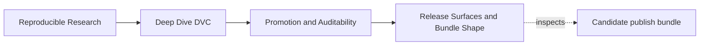
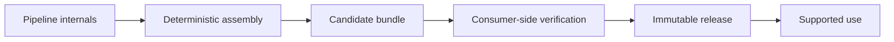
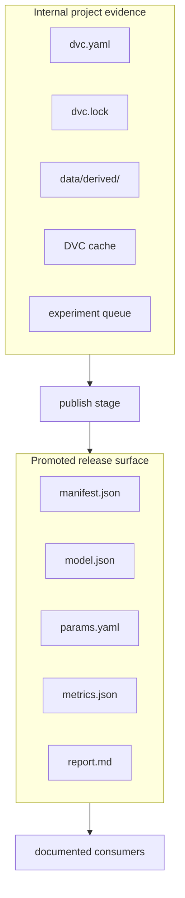
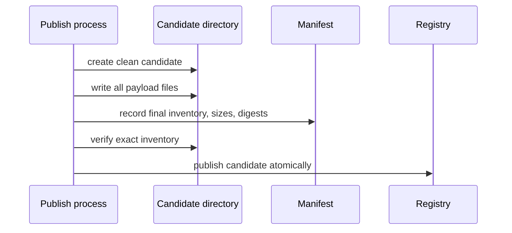

# Release Surfaces and Bundle Shape

## Page Maps





A release surface is a deliberately small interface between a changing project and a
downstream consumer. Its shape should let someone answer three questions without browsing
the repository:

1. Which files belong to this release?
2. Did I receive the bytes that were reviewed?
3. Which files and behaviors am I allowed to depend on?

This lesson treats bundle design as interface design. A neat directory is not enough. The
inventory must be exact, publication must avoid mixed states, and compatibility must be
defined from the consumer's point of view.

## Start from the consumer action

Do not begin by copying every interesting pipeline output. Begin with one supported
action.

For the capstone, a consumer may need to:

- load the promoted scoring model;
- use the promoted decision threshold;
- inspect the release metrics and limitations;
- reproduce an audit of the candidate inventory.

Map each action to the smallest sufficient file set:

| Consumer action | Required release file | Why it belongs |
| --- | --- | --- |
| load scoring behavior | `model.json` | stable serialized model contract |
| apply the reviewed decision rule | `params.yaml` | promoted threshold and controls |
| interpret measured performance | `metrics.json` | quantitative release evidence |
| understand limitations and intended use | `report.md` | human-facing meaning |
| verify artifact identities | `manifest.json` | inventory, size, and digest |

The capstone also includes `predictions.csv` and `data-profile.json` for deeper review.
Their presence is justified by the course's audit use case; they should not be included
merely because the files already exist.

## Public surface and internal evidence are different

Some records support an audit without becoming a runtime consumer interface.



`dvc.lock` remains important provenance. It does not need to sit inside the public bundle
if the release record binds to its identity and maintainers can retrieve it. Conversely,
putting a file into `publish/` does not automatically make its schema a supported public
API. The consumer contract must say which surfaces are stable.

Use three classifications:

| Classification | Meaning | Change expectation |
| --- | --- | --- |
| supported | consumers may build against it | compatibility review required |
| audit-only | retained to explain the release | readable and integrity-protected, but not a runtime API |
| internal | implementation detail | may change without consumer compatibility |

This classification prevents accidental promises.

## Exact inventory closes both sides of the boundary

A weak manifest says which known files have digests but ignores extra files. That proves
“these six files are present,” not “these are the only release files.”

An exact inventory requires:

```text
contract required paths
  = manifest recorded paths
  = candidate directory paths, excluding the manifest itself
```

The equality matters in both directions:

- a required but missing file makes the interface incomplete;
- a recorded but unrequired file expands the contract without policy review;
- a present but unrecorded file bypasses integrity and meaning checks.

The `UNLISTED_ARTIFACT` case adds `debug-notes.txt`. Every recorded artifact still passes
its digest check, yet promotion blocks because the directory contains unapproved material.
This is not pedantry. Debug notes may expose sensitive data, provisional claims, or
unsupported instructions.

## A manifest records identity, not meaning

The capstone manifest contains entries like:

```json
{
  "bytes": 270,
  "path": "metrics.json",
  "sha256": "213a26e570541a14119c85c8b5c4483d371be57b991bc3026211a439e5b858c7"
}
```

This lets a verifier:

1. locate the intended relative path;
2. reject a missing path;
3. compare byte size;
4. compute and compare the cryptographic digest.

Those checks can detect truncation, substitution, and post-review edits. They cannot tell
whether the metrics use the right cohort, whether a threshold is justified, or whether
the model is approved. Integrity is necessary but narrower than correctness.

Use precise language:

| Check result | Safe statement | Unsafe leap |
| --- | --- | --- |
| digest matches | these bytes match the manifest record | the file's claims are correct |
| inventory matches | candidate paths match the declared release set | every file is safe for every consumer |
| manifest is signed or approved | this manifest received named authority | the source evidence is complete |

## Make assembly deterministic

Release assembly should be a declared operation, not an improvised copy session. For the
capstone, the `publish` stage assembles `publish/v1/` from declared upstream outputs and
parameters.

A deterministic assembly route should:

- start from named input artifacts;
- write into a clean candidate location;
- use stable serialization where practical;
- compute the manifest after all payload files exist;
- fail if required inputs are absent;
- produce the same bundle from the same recorded state.

Ordering is important:



Computing a manifest and then continuing to edit payloads creates a stale manifest.
Copying files directly into a live consumer path can expose a mixture of old and new
release state.

## Publish atomically

Consumers should observe either the previous complete release or the new complete release,
never a half-written combination.

The mechanism depends on the registry:

- upload under a new immutable version, verify it, then move a convenience alias;
- assemble in a separate directory, verify it, then rename within one filesystem;
- create an object-store manifest only after all versioned objects are available;
- use a registry transaction or release API that exposes the version after validation.

The invariant is observational:

> At any point, a consumer resolving an immutable release sees one complete verified
> inventory.

A successful series of copy commands is not proof of atomic visibility.

## Immutable identities and movable aliases have different jobs

An immutable release reference must continue to resolve to the same approved release:

```text
incident-escalation/2026-07
```

A movable alias may help discovery:

```text
incident-escalation/latest
```

The alias is not suitable as the sole audit identity because its target changes.

Use this retrieval rule:

> A consumer may begin with a convenience alias, but must resolve and record the immutable
> release identity before making a reproducibility, audit, or rollback claim.

If a system offers lifecycle stages such as `candidate`, `approved`, or `production`,
record the immutable version underneath the stage. The stage describes current authority;
the version preserves historical identity.

## Design compatibility around observed behavior

Bundle compatibility is not only about filenames. Consumers may depend on:

- JSON keys and value types;
- CSV columns and ordering;
- model feature names;
- parameter paths;
- metric meanings and units;
- report sections;
- path and reference conventions.

Classify changes by consumer impact:

| Change | Likely compatibility | Required review |
| --- | --- | --- |
| correct spelling in prose without changing meaning | compatible | ordinary release review |
| add optional manifest metadata ignored by consumers | usually compatible | schema and parser check |
| rename `decision.threshold` | breaking | new interface version or coordinated migration |
| change F1 from macro to weighted without renaming | semantically breaking | reject silent change |
| remove a model feature | breaking | model and consumer migration |
| add an audit-only file and update exact inventory | interface-neutral only if not supported | release policy review |

Semantic changes can be more dangerous than structural changes because parsers still
succeed. A `metrics.json` file with the same keys but a different cohort or averaging rule
may be syntactically compatible and scientifically incomparable.

## Let a consumer verify independently

A producer-side “upload succeeded” receipt proves movement. A stronger route gives the
consumer enough information to verify after retrieval:

```text
resolve immutable release
retrieve manifest
retrieve exactly the recorded payloads
reject path traversal and unexpected paths
compare byte sizes and digests
validate supported schemas
record the resolved release identity
```

The consumer should not need the producer's local cache. If verification works only
inside the author's workspace, the release surface is not standalone.

For a DVC repository, `dvc get` can retrieve a tracked path at a named Git revision
without turning the consumer directory into a DVC project. That can be useful for
repository-backed distribution. It still does not replace the promotion contract:
retrievability answers where bytes come from, while promotion answers which bytes are
approved for which use.

## Guided comparison: integrity and inventory

Run the promotion integrity audit, then compare:

```text
workspace/complete-promotion/
workspace/tampered-artifact/
workspace/unlisted-artifact/
```

Complete this table from `assessment.json` before inspecting file contents:

| Case | Integrity result | Inventory result | What changed? | Correct repair |
| --- | --- | --- | --- | --- |
| complete | pass | pass | nothing | retain evidence |
| tampered | fail | pass | recorded report bytes | return change to candidate review |
| unlisted | pass | fail | unsupported extra path | remove it or deliberately revise contract and review |

Notice that “regenerate the manifest” is not automatically the repair. If an artifact
changed after approval, the approval may now be stale. A new digest records the changed
bytes but does not authorize them.

## Bundle design worksheet

For a release in your own project, write:

1. **Consumer action:** one verb and object, such as “score documented rows.”
2. **Supported files:** the minimum files required for that action.
3. **Audit-only files:** evidence retained for review but not promised as a runtime API.
4. **Internal surfaces:** paths consumers must not use.
5. **Immutable identity:** the reference that never retargets.
6. **Compatibility boundary:** schemas and meanings that require review when changed.
7. **Verification route:** the commands or procedure a clean consumer uses.
8. **Publication invariant:** how mixed old and new state is prevented.

If you cannot fill one row, the bundle is not ready to become a downstream dependency.

## Independent review checkpoint

You are ready for the audit-evidence lesson when you can:

- derive bundle contents from a consumer action;
- distinguish supported, audit-only, and internal surfaces;
- explain why exact inventory rejects both missing and extra files;
- state what a digest proves and what it cannot prove;
- describe an atomic publication route;
- distinguish immutable release identities from movable aliases;
- name one structural and one semantic compatibility break;
- outline verification from a clean consumer environment.

A release surface succeeds when consumers can use a small stable interface while
maintainers remain free to change unpromoted internals.
