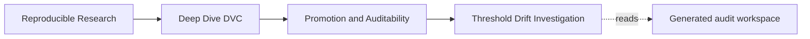
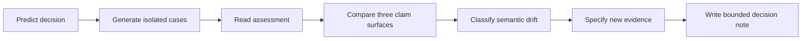
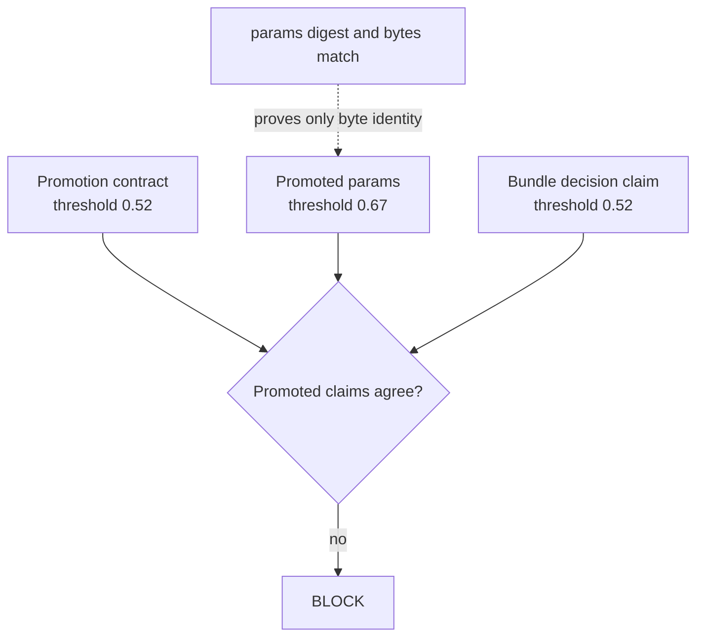
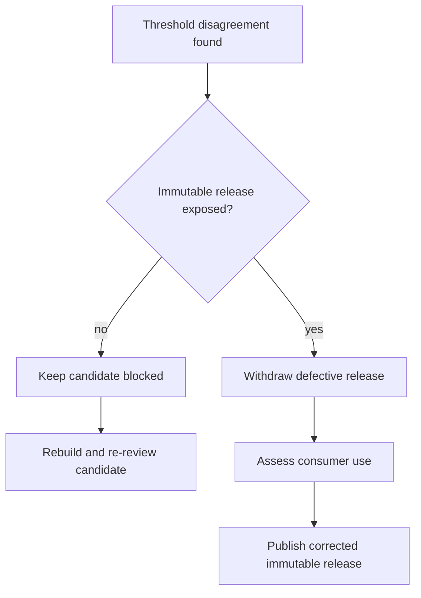

# Worked Investigation: A Digest-Valid Release with the Wrong Threshold

## Page Maps





The investigation follows one promotion failure from prediction to repair plan. The
candidate is intentionally deceptive:

- its directory has the expected files;
- its manifest digests match every recorded artifact;
- its source lock matches the promotion contract;
- both required reviewer roles appear;
- its promoted threshold disagrees across evidence surfaces.

The objective is to explain why promotion blocks even though artifact integrity passes,
then design a repair that does not attach old approval to new meaning.

You can complete the investigation without modifying source files. All generated cases
are written under the repository's `artifacts/` directory.

## The release claim

The promotion contract claims:

```text
release: incident-escalation-2026-07
registry reference: incident-escalation/2026-07
decision threshold: 0.52
source: one Git revision and one dvc.lock digest
required reviewers: model-owner and risk-reviewer
```

The suspicious candidate has `params.yaml` threshold `0.67`. Its manifest was regenerated
after that change, so the params digest is valid.

Before running anything, predict these check results:

| Check | Your prediction | Reason |
| --- | --- | --- |
| immutable registry reference |  |  |
| exact inventory |  |  |
| artifact integrity |  |  |
| promoted claims agree |  |  |
| source lock matches |  |  |
| decision matches candidate |  |  |
| required review roles |  |  |
| consumer contract bounded |  |  |

Do not use “the audit should fail” as the prediction. The learning comes from identifying
which proposition fails while the others remain true.

## Generate the evidence

From the repository root:

```bash
make PROGRAM=reproducible-research/deep-dive-dvc \
  capstone-promotion-integrity-audit
```

Set a short path for the rest of the investigation:

```bash
audit_dir=artifacts/audit/reproducible-research/deep-dive-dvc/promotion-integrity
```

Read the route first:

```bash
sed -n '1,120p' "$audit_dir/route.txt"
```

The route directs you to the report before the individual files. This keeps the decision
rule visible while you inspect details.

## Read the assessment without searching for a preferred number

Use Python so the command works without requiring `jq`:

```bash
python3 - "$audit_dir/report.json" <<'PY'
import json
import sys

report = json.load(open(sys.argv[1], encoding="utf-8"))
record = next(
    item
    for item in report["findings"]
    if item["finding"] == "THRESHOLD_DRIFT"
)
print("decision:", record["decision"])
print("failed checks:", ", ".join(record["failed_checks"]))
for name, passed in record["checks"].items():
    print(f"{name}: {passed}")
PY
```

Expected decision evidence:

```text
decision: BLOCK
failed checks: promoted_claims_agree
registry_reference_is_immutable: True
inventory_matches_contract: True
artifact_integrity_matches_manifest: True
promoted_claims_agree: False
source_lock_matches_contract: True
decision_matches_candidate: True
required_review_roles_approved: True
consumer_contract_is_bounded: True
```

Now compare this with your prediction table. If you predicted an integrity failure, keep
that disagreement visible; the next section explains why integrity passes.

## Locate the three threshold claims

The case keeps three independent statements:

```bash
case_dir="$audit_dir/workspace/threshold-drift"
```

Read the contract claim:

```bash
python3 - "$case_dir/promotion-contract.json" <<'PY'
import json
import sys

contract = json.load(open(sys.argv[1], encoding="utf-8"))
print(contract["promoted_claims"]["decision_threshold"])
PY
```

Expected:

```text
0.52
```

Read the promoted parameter:

```bash
sed -n '1,120p' "$case_dir/publish/params.yaml"
```

The `decision.threshold` value is:

```text
0.67
```

Read the manifest's decision claim:

```bash
python3 - "$case_dir/publish/manifest.json" <<'PY'
import json
import sys

manifest = json.load(open(sys.argv[1], encoding="utf-8"))
print(manifest["decision"]["threshold"])
PY
```

Expected:

```text
0.52
```

The evidence graph is:



## Prove that integrity really passes

Find the manifest entry for `params.yaml`:

```bash
python3 - "$case_dir/publish/manifest.json" <<'PY'
import json
import sys

manifest = json.load(open(sys.argv[1], encoding="utf-8"))
entry = next(
    item for item in manifest["artifacts"]
    if item["path"] == "params.yaml"
)
print(json.dumps(entry, indent=2, sort_keys=True))
PY
```

Compute the digest independently:

```bash
python3 - "$case_dir/publish/params.yaml" <<'PY'
import hashlib
import pathlib
import sys

path = pathlib.Path(sys.argv[1])
print("bytes:", path.stat().st_size)
print("sha256:", hashlib.sha256(path.read_bytes()).hexdigest())
PY
```

The byte size and digest match the manifest entry. The file has not changed since this
manifest was created.

Write the correct inference:

> The manifest accurately identifies the current `params.yaml` bytes.

Reject the incorrect inference:

> Therefore threshold `0.67` was approved.

Approval and semantic consistency require other evidence.

## Compare against the complete case

Use a unified diff:

```bash
diff -u \
  "$audit_dir/workspace/complete-promotion/publish/params.yaml" \
  "$case_dir/publish/params.yaml" || true
```

Then compare assessment files:

```bash
diff -u \
  "$audit_dir/workspace/complete-promotion/assessment.json" \
  "$case_dir/assessment.json" || true
```

Ignore evidence path differences. Focus on:

- `promoted_claims_agree`;
- decision;
- failed check list.

The audit constructed the case so those decision fields isolate the meaningful change.

## Determine what is known and unknown

Known from the generated evidence:

- the contract and manifest claim `0.52`;
- the candidate params claim `0.67`;
- current candidate bytes match their manifest entry;
- the capstone lock matches the contract;
- the decision record matches the contract's source and required roles;
- the release must block under the declared rule.

Not established by this evidence:

- whether `0.52` or `0.67` is scientifically preferable;
- whether a model and metrics were actually regenerated at `0.67`;
- whether reviewers ever saw the changed params;
- whether this candidate was exposed to consumers;
- whether the underlying remote can restore the release.

Do not invent answers for the unknowns. A disciplined review can block with bounded
uncertainty.

## Classify the failure precisely

This is not:

- a missing-file failure;
- transfer corruption;
- a registry alias failure;
- missing reviewer authority;
- a DVC remote recovery failure.

It is a semantic consistency failure: independent promoted records disagree about a
release-defining control.

That classification rules out a checksum-only repair.

## Choose the authoritative intended source

Before rebuilding, a maintainer must decide which candidate was intended for promotion.
Review:

- the candidate comparison and baseline anchor;
- the Git revision named by the contract;
- `dvc.lock` at that revision;
- internal `params.yaml` and evaluation output;
- reviewer materials and decision rationale.

Three outcomes are possible:

| Investigation result | Safe response |
| --- | --- |
| source evidence consistently supports `0.52` | rebuild publish bundle from that source and renew approval |
| source evidence consistently supports `0.67`, but contract is stale | revise the candidate contract, rebuild all dependent evidence, and renew approval |
| source evidence cannot establish one coherent candidate | reject this candidate and reproduce a new one from declared state |

Do not take a majority vote among files. Determine the actual reviewed source or create a
new reviewable source.

## Specify the repair evidence

Assume the investigation confirms `0.52` as intended. The repair plan should produce:

1. a clean candidate assembled from the recorded `0.52` source;
2. matching promoted params, model, metrics, predictions, and report;
3. a manifest computed after final assembly;
4. a passing exact-inventory and schema verification;
5. a promotion decision bound to the rebuilt candidate and source;
6. an immutable registry publication receipt;
7. a review note preserving the blocked threshold-drift assessment.

The old decision cannot simply be copied forward because the candidate observed during
this investigation contained contradictory meaning. Reviewers need to confirm the rebuilt
candidate.

## Decide whether the release identity may be reused

If the threshold-drift case was only an unpublished candidate, the team may repair and
publish the intended release identity after policy-compliant review.

If `incident-escalation/2026-07` was already exposed as an immutable release, do not replace
its files in place. Withdraw it and publish a corrected immutable identity according to
the project's release naming policy.

Use this decision:



## Write the review note

A defensible note for the unpublished scenario is:

> Candidate `incident-escalation-2026-07` was blocked before publication because promoted
> `params.yaml` recorded decision threshold `0.67`, while the promotion contract and
> bundle decision claim recorded `0.52`. The params artifact matched its manifest digest,
> so byte integrity passed; semantic claim agreement failed. Source review established
> `0.52` as the intended candidate. The publish bundle must be rebuilt from that recorded
> source and receive new approval before an immutable registry entry is created. This
> investigation did not test remote recoverability or scientific suitability.

Check that the note contains:

- identity;
- failed proposition;
- passing evidence that might otherwise confuse reviewers;
- lifecycle and exposure status;
- authoritative source finding;
- required new evidence;
- proof limits.

## Reviewer questions

Answer these before reading the model answer summary:

1. Why does regenerating the params digest not repair the candidate?
2. Which evidence would distinguish a stale params file from a stale contract?
3. Why must model and metrics be considered when the threshold changes?
4. Under what lifecycle condition can the intended release identity still be published?
5. Which module's proof route would you run to test remote availability?
6. Which evidence is still needed to decide whether the threshold is scientifically
   suitable?

## Investigation conclusion

The candidate blocks for one isolated reason: its promoted claims disagree. The worked
route proves that a bundle can be inventory-complete and digest-valid while remaining
unfit for promotion.

The repair is not an edit to whichever file is inconvenient. It is a return to one
coherent recorded source, deterministic regeneration of all affected release evidence,
and a new authority decision bound to the rebuilt candidate.
