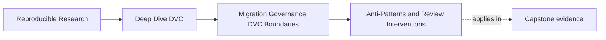

# Anti-Patterns and Review Interventions

<!-- page-maps:start -->
## Page Maps




<!-- page-maps:end -->

An anti-pattern is a recurring choice that weakens a state contract while
remaining attractive in the short term. The attraction matters. A review that
only labels the choice “wrong” will not change the conditions that produced it.

Use this diagnostic form:

```text
shortcut -> hidden mechanism -> trust consequence -> repair -> closure proof
```

## Diagnose the mechanism

Do not infer intent from a diff. Observe what contract becomes untestable.

| Symptom | Possible mechanism | Contract to inspect |
|---|---|---|
| model copied to `latest/` | path substituted for immutable identity | promotion |
| `dvc.lock` changed alone | objects or generating declaration absent | reproducibility and recovery |
| metric value changed unexpectedly | hidden population or runtime influence | comparability |
| remote cleanup removes old objects | current-workspace success substituted for history | retention and recovery |
| pipeline reads a local config | undeclared influence bypasses invalidation | stage truth |
| target copy exists | storage success substituted for consumer acceptance | migration |

The symptom is a lead, not a verdict. Inspect direct evidence before writing a
finding.

## Path as identity

**Temptation:** filenames and aliases are easy to communicate.

**Mechanism:** a mutable path such as `models/latest/model.json` changes
meaning without changing the reference a consumer holds.

**Consequence:** an approval, incident, or evaluation cannot reconstruct which
bytes were used.

**Intervention:**

> This consumer reference is mutable, so it does not identify the reviewed
> candidate after another promotion. Publish an immutable release reference
> with manifest, digests, source provenance, and decision record; keep
> `latest` only as a convenience pointer whose resolved identity is logged.

**Closure proof:** resolve the durable reference twice across a later promotion
and show that it still returns the original manifest digest.

Do not demand DVC tracking merely because a file exists. Demand an identity
appropriate to the decision.

## Hidden control surface

**Temptation:** a local constant or environment variable is faster than
changing reviewed configuration.

**Mechanism:** a result-changing value is absent from the dependency and
parameter contract.

**Consequence:** DVC may consider a stage unchanged even though rerunning it
would produce different output; experiments cannot explain their differences.

**Intervention:**

> `ALERT_THRESHOLD` changes evaluation decisions but is read from the shell and
> is absent from the stage contract. Move it into the reviewed parameter
> surface or record and verify its external identity, then demonstrate that
> changing it invalidates the intended stage.

**Closure proof:** a focused invalidation test plus a receipt showing the value
in experiment and release evidence.

Not every environment value belongs in `params.yaml`. Debug verbosity may be
operational and output-neutral. Classify by effect.

## Metadata-only collaboration

**Temptation:** Git review makes DVC metadata look like the complete change.

**Mechanism:** pointer and lock records are shared while referenced objects
remain only in one contributor's cache.

**Consequence:** CI or another maintainer can review declarations but cannot
materialize or verify the state.

**Intervention:**

> The metadata names new content, but the shared recovery route has not proved
> those objects reachable. Push the required stage outputs to the governed
> remote and run a clean-cache pull for the affected revision.

**Closure proof:** restore from an empty cache using only the documented remote
and verify content identity.

The repair is not “commit the data to Git.” It is complete collaboration across
both Git and the artifact boundary.

## Workspace success as history proof

**Temptation:** the current pipeline and `dvc pull` both work.

**Mechanism:** current state is tested while protected historical revisions are
ignored.

**Consequence:** a remote migration or cleanup can silently strand an approved
release.

**Intervention:**

> Current `main` restores, but the retention contract also protects
> `release-2025-q1`. Exercise both revisions against the candidate remote in an
> empty cache before cutover or deletion.

**Closure proof:** per-revision restoration, identity, and duration receipts.

Use:

```console
make PROGRAM=reproducible-research/deep-dive-dvc \
  capstone-recovery-readiness-audit
```

Compare `COMPLETE_MIGRATION` with `CURRENT_ONLY_COPY`.

## Metric delta without semantic comparability

**Temptation:** experiment tables put values in adjacent columns.

**Mechanism:** numeric proximity is mistaken for shared definition,
population, direction, and units.

**Consequence:** a candidate can be promoted for an improvement that is not a
valid comparison.

**Intervention:**

> The accuracy values use different evaluation populations, so their delta has
> no supported interpretation. Recompute the candidate under the baseline
> metric contract or treat this as a new baseline rather than a comparison.

**Closure proof:** equal semantic identities plus a bounded parameter diff.

Never repair this by adding a disclaimer beside the delta while continuing to
use it for a decision.

## Experiment as release

**Temptation:** the best row in `dvc exp show` already contains parameters and
metrics.

**Mechanism:** exploratory comparison is substituted for consumer approval.

**Consequence:** consumers receive a mutable or incomplete candidate without a
manifest, source identity, verification, or authorized decision.

**Intervention:**

> The experiment is comparable and may be nominated, but it is not a promoted
> release. Materialize the candidate, verify the publish contract, bind it to
> immutable provenance, and record the release decision.

**Closure proof:** promotion integrity audit accepts exactly that candidate.

## Copy success as migration acceptance

**Temptation:** transfer tools report success and inventories look plausible.

**Mechanism:** producer-side storage evidence stands in for consumer use,
rollback readiness, and ownership.

**Consequence:** the old boundary is retired before anyone proves the new route
works for its intended user.

**Intervention:**

> Target bytes match, but no consumer-equivalent retrieval receipt or tested
> rollback is attached. Keep the source active, run target acceptance through
> the real consumer path, and record rollback readiness before cutover.

**Closure proof:** the boundary migration audit approves all premises:

```console
make PROGRAM=reproducible-research/deep-dive-dvc \
  capstone-boundary-migration-audit
```

## Cleanup driven by storage pressure

**Temptation:** deletion gives immediate, measurable cost relief.

**Mechanism:** object age or apparent reachability is treated as a retention
decision without evaluating protected history and consumer promises.

**Consequence:** releases or audit evidence become unrecoverable.

**Intervention:**

> The cleanup inventory is based on the current revision, while retention also
> protects named releases. Compute reachability across every protected
> revision, run a dry report, obtain storage-owner approval, and verify recovery
> before destructive execution.

**Closure proof:** approved inventory, dry-run receipt, post-cleanup recovery
for protected revisions, and documented deletion result.

Do not use a production cleanup as the recovery test.

## Tool ownership overreach

**Temptation:** one tool already touches most artifacts, so centralizing policy
there feels simpler.

**Mechanism:** technical capability is confused with authority and runtime
context.

**Consequence:** DVC may be asked to own deployment health, consumer lifecycle,
access policy, or incident response that it cannot observe or enforce.

**Intervention:**

> DVC can provide the immutable artifact identity and lineage. The registry
> should own the durable consumer reference, CI the shared verification, and
> the deployment platform rollout health. Record a handoff receipt connecting
> those identities.

**Closure proof:** each responsibility has one authoritative system and the
handoff preserves the same artifact digest.

## Generic blocks without repair

**Temptation:** short review comments save reviewer time.

**Mechanism:** a label replaces an evidence-backed contract finding.

**Consequence:** the contributor must guess what will satisfy the reviewer;
similar defects recur.

Replace:

> This is an anti-pattern.

With:

> This release reference is mutable, so an approval cannot identify stable
> bytes. Publish an immutable manifest-bound reference. Close this finding with
> a retrieval receipt that resolves to the approved manifest digest.

A good intervention contains:

1. observed evidence;
2. broken or unverified contract;
3. decision consequence;
4. bounded repair;
5. closure proof.

## Choose the smallest sufficient intervention

Do not turn every concern into a repository-wide redesign.

| Finding | Proportionate intervention | Excessive response |
|---|---|---|
| one hidden threshold | declare and test that control | replace all configuration tooling |
| one missing promoted file | rebuild and verify candidate | redesign pipeline architecture |
| one unverified consumer | run consumer acceptance | adopt a new registry product |
| one stale exception | block, remove, or renew with evidence | rewrite all governance |
| unclear deployment owner | document handoff and authority | make DVC own deployment |

The intervention is sufficient when it restores the affected contract and
creates evidence that would catch recurrence.

## Avoid anti-pattern inflation

Reserve the term for recurring mechanisms that damage:

- identity;
- reproducibility;
- comparability;
- promotion trust;
- recoverability;
- consumer contract;
- responsibility clarity.

Naming style, preferred command spelling, or an imperfect folder layout may be
worth discussing, but they are not automatically state-contract anti-patterns.
Overuse turns review language into noise and makes blocking findings harder to
recognize.

## Intervention worksheet

For each suspected anti-pattern, write:

```markdown
### Observation
Exact file, command, or receipt.

### Mechanism
How the shortcut bypasses a state contract.

### Consequence
Decision or consumer that can no longer trust the claim.

### Requested repair
Smallest complete contract restoration.

### Closure proof
Falsifying route that must now pass.

### Scope
Related concerns explicitly not included.
```

If the mechanism or consequence cannot be stated, continue investigating
before labeling the change.

## Reader checkpoint

You can intervene constructively when you can:

- distinguish a symptom from its trust mechanism;
- explain why the shortcut is locally attractive;
- name the state decision it undermines;
- request the smallest complete repair;
- define evidence that closes the finding;
- separate migration, experiment, promotion, and recovery failures;
- avoid turning style preferences into blocking anti-patterns.

Review intervention is not scolding. It is a compact teaching act that restores
a contract and makes recurrence easier to detect.
