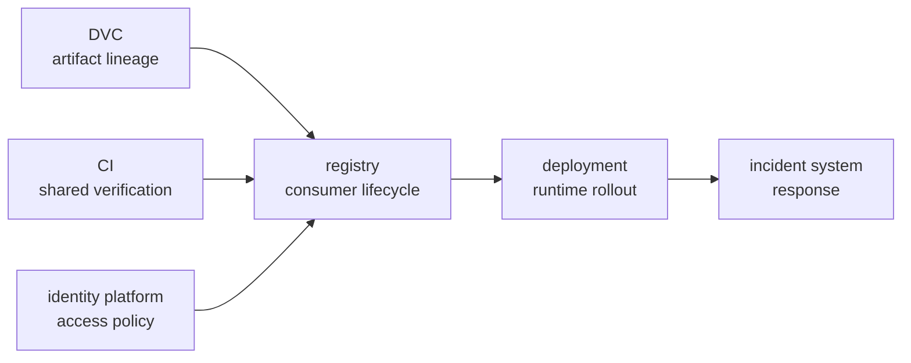

# DVC Tool Boundaries and System Ownership

<!-- page-maps:start -->
## Page Maps



<!-- page-maps:end -->

Knowing how to use DVC includes knowing which decisions its evidence can
support. DVC can identify tracked content, record pipeline state, compare
declared experiments, and retrieve artifacts through configured remotes. It
does not therefore own every system that stores, approves, serves, secures, or
responds to those artifacts.

Tool boundaries are evidence boundaries.

## Distinguish capability, evidence, and authority

For any responsibility, ask three different questions:

1. **Capability:** can this tool perform an operation?
2. **Evidence:** can it observe the facts needed for the decision?
3. **Authority:** is it the system or role permitted to enforce the decision?

DVC can upload a model to object storage. That capability does not mean it can
observe consumer adoption, authorize production deployment, or enforce an
organization's retention policy.

| Decision | DVC capability | Missing context | Better authority |
|---|---|---|---|
| artifact content identity | strong | none for tracked bytes | DVC |
| stage invalidation | strong when declaration is truthful | hidden runtime influences | DVC plus tests/CI |
| release approval | can supply candidate evidence | authorization and consumer promise | release owner/registry |
| production rollout | can supply artifact | service health and traffic policy | deployment platform |
| access entitlement | can use credentials | identity and authorization policy | identity platform |
| incident response | can help restore artifact | paging, impact, response state | incident system |

The answer can be hybrid. State which system is authoritative for each fact.

## What DVC can own

DVC is well suited to:

- content-addressed identity of tracked data and artifacts;
- declared stage commands, dependencies, parameters, and outputs;
- recorded execution state in `dvc.lock`;
- workspace materialization from recorded state;
- experiment records tied to repository declarations;
- metric and parameter display after semantic contracts are established;
- transfer to and from configured remotes;
- lineage evidence connecting outputs to repository state.

Even here, ownership depends on honest declarations and available objects.
`dvc.lock` cannot record an input the stage reads secretly. A `.dvc` pointer
cannot recover content that was never pushed.

## What Git owns beside DVC

Git identifies and reviews the lightweight declaration layer:

- source code;
- `dvc.yaml`;
- `dvc.lock`;
- parameter files;
- DVC pointer files;
- verification code;
- documentation and decision records.

DVC and Git form one collaboration contract:


Neither side alone is a complete reproducibility claim. A Git revision without
reachable DVC objects is descriptive but not recoverable. Objects without the
Git declaration lack the intended computation and history context.

## What CI owns

CI is the shared execution witness. It can:

- run checks outside the contributor's local cache;
- verify that credentials and remotes work for the team boundary;
- exercise clean materialization;
- retain status and compact evidence;
- prevent merge or promotion when a contract fails.

CI does not automatically prove production behavior. It also should not mutate
the candidate remote during a recovery check, because repair would contaminate
the observation.

A good handoff from DVC to CI includes:

```text
Git revision
DVC stage or artifact identity
declared remote
verification command
expected contract
result and retained receipt
```

## What a registry owns

A registry may own:

- immutable consumer-facing release references;
- release metadata and lifecycle;
- approval state;
- consumer discovery;
- deprecation or retirement;
- retrieval policy.

DVC supplies the artifact identity and lineage. The registry must preserve
them. Re-uploading a file under a mutable registry label without its manifest
breaks the handoff.

Minimum handoff receipt:

```json
{
  "source_revision": "recorded-git-sha",
  "dvc_artifact": "recorded-content-identity",
  "publish_manifest_sha256": "recorded-manifest-digest",
  "registry_reference": "incident-escalation/2026-07",
  "registry_immutable": true,
  "verification_result": "PASS"
}
```

The exact schema is local. The invariant is that both systems name the same
artifact.

## What a scheduler owns

DVC declares a reproducible graph and decides what is stale relative to its
recorded inputs. A production scheduler may own:

- trigger time and event policy;
- retries and concurrency;
- resource placement;
- secrets injection;
- service-level objectives;
- cross-workflow dependencies;
- operational alerts.

Using a scheduler to invoke `dvc repro` does not transfer stage semantics to the
scheduler. Copying the graph into a scheduler can create two authorities.
Choose a boundary:

- DVC owns internal stage graph; scheduler invokes a coarse workflow, or
- scheduler owns orchestration; individual jobs preserve explicit artifact
  identities and contracts.

Document how changes stay synchronized if both describe dependencies.

## What deployment owns

Promotion chooses an artifact for consumers. Deployment changes running
service state. Deployment needs facts DVC does not normally observe:

- target environment;
- configuration and secrets;
- rollout cohort;
- health and latency;
- traffic shift;
- runtime rollback;
- incident impact.

DVC evidence should travel into deployment as immutable artifact identity and
verification result. Deployment should return a receipt connecting runtime
state to that identity.

```text
promoted artifact identity
    -> deployment release
    -> environment and rollout
    -> health decision
    -> runtime rollback or completion
```

Do not use `dvc push` as a synonym for deploy.

## What identity and access systems own

DVC remote configuration can specify how a client reaches storage. It should
not become the authority for:

- who is entitled to which protected data;
- credential issuance and rotation;
- separation of duties;
- audit of access;
- regulatory access decisions.

Keep secrets out of tracked configuration. Record the credential **class** used
by a proof route, not the secret. For a consumer acceptance test, show that
consumer-equivalent authorization succeeded without publishing credentials.

## What incident systems own

DVC may restore a model or data artifact during an incident. Incident response
still needs:

- impact and severity;
- responder ownership;
- timeline;
- communications;
- mitigation decision;
- post-incident learning.

A DVC recovery receipt becomes evidence inside that larger record. It does not
replace the record.

## Assign one authority per fact

Hybrid ownership fails when two systems can disagree without a resolution
rule.

| Fact | Authority | Copies allowed? | Reconciliation |
|---|---|---:|---|
| tracked content digest | DVC metadata | yes | copies must match digest |
| source revision | Git | yes | record exact revision |
| release approval | registry/release record | yes | registry decision is authoritative |
| deployed artifact | deployment platform | yes | must reference approved release identity |
| access entitlement | identity platform | no local override | policy evaluation |
| incident status | incident system | yes for reporting | incident record wins |

The goal is not one tool. It is one unambiguous authority for each claim.

## Design handoffs as contracts

A handoff needs:

- producer identity;
- artifact or decision identity;
- consumer;
- required invariant;
- acceptance receipt;
- failure owner;
- replay or recovery route.

Example:

| Handoff | Invariant | Acceptance | Failure owner |
|---|---|---|---|
| DVC to registry | registry bytes match promoted manifest | registry verification passes | release owner |
| registry to deployment | deployment resolves approved immutable release | preflight records same digest | service owner |
| DVC remote to CI | protected objects reachable read-only | clean recovery passes | storage owner |
| deployment to incident response | running revision identifiable | diagnostic reports release identity | service owner |

If the handoff only says “system B reads output from system A,” identity and
failure behavior remain undefined.

## Detect ownership overreach

Warning signs include:

- DVC alias used as the only release approval;
- CI status used as proof of production health;
- registry label used as the only source provenance;
- scheduler retry used as recovery strategy;
- deployment platform asked to infer training inputs;
- local remote credentials treated as access policy;
- “the platform team” named without a responsibility.

The course audit includes a case where all owner fields are populated but DVC
and registry duties are swapped:

```console
make PROGRAM=reproducible-research/deep-dive-dvc \
  capstone-boundary-migration-audit
```

Inspect `TOOL_OWNERSHIP_OVERREACH`. It fails even though no owner is blank.
Completeness and correctness of ownership are separate checks.

## Resolve a boundary dispute

When two teams both assume the other owns a decision:

1. name the exact fact or action;
2. identify which system can observe it;
3. identify which role can authorize it;
4. choose one durable authority;
5. define the evidence supplied by the other system;
6. record acceptance and failure routes;
7. test the handoff with one rejected case.

Do not resolve the dispute by assigning an entire lifecycle to whichever tool
already has the most configuration.

## Responsibility worksheet

For a repository you maintain, complete:

| Responsibility | Evidence producer | Decision authority | Consumer | Failure route |
|---|---|---|---|---|
| pipeline state |  |  |  |  |
| experiment comparison |  |  |  |  |
| release approval |  |  |  |  |
| artifact retention |  |  |  |  |
| consumer reference |  |  |  |  |
| deployment |  |  |  |  |
| access |  |  |  |  |
| incident response |  |  |  |  |

Blank rows expose responsibility gaps. One system in every column may expose
overreach.

## Reader checkpoint

You understand DVC's system boundary when you can:

- separate tool capability, available evidence, and decision authority;
- explain the complementary identities owned by Git and DVC;
- use CI as a shared witness without treating it as production proof;
- hand immutable lineage into a registry and deployment system;
- keep scheduling, access, and incident responsibilities with systems that can
  observe and enforce them;
- assign one authority to each fact;
- design handoffs with identity, acceptance, and failure routes;
- reject ownership maps that are complete but wrong.

The mature design is not “DVC everywhere.” It is DVC as the authority for the
state evidence it can genuinely produce, connected to other authorities by
explicit, testable handoffs.
