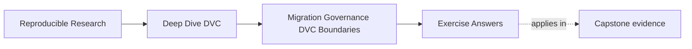
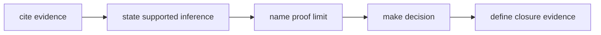

# Exercise Answers

<!-- page-maps:start -->
## Page Maps




<!-- page-maps:end -->

These are reasoning models, not unique wording. A strong answer may use
different evidence if it preserves the same contract and states its proof
limits.

Compare in this order:

1. Did you cite direct evidence?
2. Does your conclusion stay inside what that evidence proves?
3. Did you name the affected decision?
4. Is the repair smaller than an unrelated redesign?
5. Can another maintainer tell when the finding is closed?

## Answer: Inventory the repository trust claims

A compact model:

| Claim | Direct evidence | Falsifying route | Result | Proof limit |
|---|---|---|---|---|
| declarations identify current computation | `dvc.yaml`, `dvc.lock`, stage code | stage contract audit changes declared and hidden influences | verified for modeled cases | cannot prove every runtime influence absent |
| promoted inventory is complete | `publish/v1/manifest.json`, verifier | remove a manifest-listed file and verify | verified for current publish contract | does not approve business use |
| complete target matches source | `complete-cutover/assessment.json` inventories | delete target `report.md` | verified in control | does not prove target availability |
| consumer can use target | decision receipt and consumer check | remove retrieval receipt | verified in control | specimen does not use a production identity provider |
| protected revisions recover | recovery readiness report | current-only and release-only remote cases | verified for named specimen revisions | does not prove future retention |
| responsibilities have authority | migration decision owner map | remove or swap one responsibility | verified in control | does not prove organization directory membership |

The important distinction is result language. `PARTIAL_COPY` contradicts target
identity. A production registry service objective remains out of scope. An
unattempted real production retrieval would be unverified, not contradicted.

An answer that says “verified because the file exists” is weak. The
falsification route should manipulate or challenge the claim.

## Answer: Write a contract finding from the partial copy

Model finding:

> The migration claims to change only consumer location while preserving the
> promoted inventory. In
> `workspace/partial-copy/assessment.json`, source inventory includes
> `report.md` and target inventory does not; the audit records only
> `target_matches_source` as false. The target therefore cannot represent the
> approved seven-file release. Block cutover and keep the source available.
> Repeat the copy, target verification, digest comparison, and
> consumer-equivalent retrieval. Close the finding when the assessment shows
> equal inventories and all required checks pass. This evidence does not show
> whether the loss arose from selection, transfer, or registry reliability.

Adding `report.md` is necessary but not by itself sufficient. The repaired
target also needs:

- matching digest;
- target release verification;
- consumer retrieval;
- retained rollback;
- correct owners and current exception state.

The answer is bounded because it does not diagnose an unobserved root cause.

## Answer: Review the migration change budget

The contract should yield:

| Surface | Record |
|---|---|
| source | `publish/v1` |
| target | `incident-escalation/2026-07` |
| permitted change | consumer location |
| preserved | inventory, bytes, release meaning, provenance |
| before | source manifest and verification |
| after | target manifest and verification |
| acceptance | consumer retrieval receipt |
| rollback | retained source and ready route |
| owners | DVC lineage, registry lifecycle, CI verification, release decision |
| exception | owner, reason, expiry, removal condition |

`UNBOUNDED_CHANGE` blocks because `metric-schema` changes interpretation rather
than location. Combining it with the registry move prevents independent
verification and rollback.

A separate semantic contract could say:

> Introduce metric contract `evaluation-v2`, changing field names and
> population description while retaining `evaluation-v1` for a compatibility
> window. Recompute baseline and candidate under `evaluation-v2`; prohibit
> numeric deltas across versions; require consumer acceptance before retiring
> `evaluation-v1`.

That decision can fail without reversing the registry location.

## Answer: Prove consumer acceptance and rollback readiness

Model consumer contract:

```text
reference: incident-escalation/2026-07
identity: manifest digest equals approved source
access: consumer-equivalent credential class
operation: retrieve manifest, verify files, load threshold and predictions
receipt: command identity, status, resolved digest, useful-operation result
```

Model rollback contract:

```text
trigger: target retrieval or verification fails
authority: release owner
retained source: publish/v1 remains readable
route: restore durable consumer reference to source
objective: complete within declared duration
validation: consumer operation passes against restored source
window: retained through named date or duration
retirement: separately approved after window
```

Equal inventories can coexist with failed consumer acceptance because
producer-side access may not match consumer authorization, durable reference,
schema support, or retrieval path.

“We can switch back” omits retained state, authority, measured route, and
validation. It is an intention, not readiness evidence.

## Answer: Build a proportional governance register

One defensible register:

| Trigger | Contract | Evidence route | Block condition | Authority | Receipt |
|---|---|---|---|---|---|
| stage dependency or code | truthful invalidation | stage contract audit | hidden result influence | pipeline maintainer | audit report |
| behavior parameter | reproducible control | rerun and parameter/metric evidence | value absent from record | pipeline maintainer | run receipt |
| metric semantics | comparability | metric contract audit | population or definition differs | evaluation owner | comparison report |
| promotion request | immutable candidate | promotion integrity audit | identity, provenance, verification, or approval fails | release owner | decision |
| publish bundle | consumer contract | release verifier | inventory or digest mismatch | release owner | verification |
| remote migration | protected history | recovery readiness audit | any protected revision fails | storage owner | recovery report |
| location cutover | preserved boundary | boundary migration audit | any cutover premise fails | release owner | cutover decision |
| deletion | retention and recovery | reachability report, dry run, recovery test | protected state at risk | storage owner | deletion approval |

Risk classes rise from reproducibility and comparison through consumer and
protected-history consequences. A docs typo does not touch these triggers.

A filename-only rule misses shared code, environment, credential, or policy
changes that affect the same contract.

## Answer: Evaluate an expired exception

The stale specimen's exception has an owner, reason, removal condition, and
expiry of `2025-12-31`. The audit evaluates it on `2026-07-28`, so it is not
current.

Decision:

> Keep cutover blocked. Do not extend the date in place. If consumer retrieval
> is now available, run it and remove the exception. If it remains unavailable,
> issue a fresh exception decision that explains why, narrows the permitted
> action, keeps the source authoritative, and sets a new expiry and removal
> condition.

Expiry forces reconsideration at a known time. Removal condition identifies
the observable fact that ends the exception. Evidence of a clean
consumer-equivalent retrieval would satisfy this specimen's removal condition.

Silently changing the date destroys the record of whether anyone reevaluated
the risk.

## Answer: Intervene on a mutable release shortcut

Model intervention:

> `latest/model.json` is a mutable path, so deployment cannot reconstruct which
> reviewed bytes it used after another promotion. This breaks the immutable
> release identity contract. Publish the candidate under an immutable registry
> reference bound to the Git revision, DVC artifact identity, promoted manifest
> digest, and release decision. Keep `latest` only as a convenience pointer and
> record its resolved immutable identity at deployment. Close the finding by
> resolving the immutable reference before and after a later promotion and
> showing that it retains the approved manifest digest. This finding does not
> evaluate deployment health or registry availability.

The identity chain is:

```text
Git revision
-> DVC recorded content
-> verified publish manifest
-> immutable registry release
-> consumer retrieval receipt
```

Each arrow needs a receipt that preserves the preceding identity.

## Answer: Assign cross-system ownership

Model map:

| Fact or decision | Evidence producer | Authority | Handoff receipt | Failure owner |
|---|---|---|---|---|
| source revision | Git | Git repository | revision in manifest | repository maintainer |
| artifact lineage | DVC | DVC metadata | content identity | pipeline maintainer |
| shared verification | CI | CI policy | check result with revision | CI owner |
| release lifecycle | registry | registry | immutable release record | release owner |
| access entitlement | identity platform | identity policy | access decision | security owner |
| rollout | deployment platform | service policy | deployed release identity | service owner |
| incident response | incident system | incident policy | incident record | incident commander |
| cutover | decision record | release owner | cutover decision | release owner |
| deletion | storage policy | storage owner | approved inventory and result | storage owner |

DVC is authoritative for tracked artifact lineage. The registry is
authoritative for consumer release lifecycle. The overreach specimen fails
because those responsibilities are swapped, even though every field contains a
value.

Correct ownership follows observable evidence and enforcement authority, not
which tool is already familiar.

## Answer: Decide whether cutover is approved

Decision: `BLOCK_CUTOVER`.

| Premise | Result |
|---|---|
| target identity matches | pass |
| only declared boundary changes | pass |
| before and after proofs pass | pass |
| consumer acceptance passes | pass |
| rollback is exercised and ready | **unverified** |
| responsibilities are correct | pass |
| exception policy is current | pass |

The decisive gap is rollback. Strong target evidence cannot prove restoration
behavior. Keep the source active, exercise the declared rollback through the
real consumer path, measure it against the objective, and attach the receipt.

The observation that changes the decision is a passing rollback receipt with:

- retained source identity;
- authorized trigger route;
- measured duration;
- consumer validation after restoration.

Even then, `APPROVE_CUTOVER` authorizes switching consumers. It does not
authorize source deletion. Source retirement follows the rollback window and
its own retention decision.

## Answer: Conduct an independent stewardship handoff

A useful route:

| Need | Entry | Expected evidence | Proof limit | Failure owner |
|---|---|---|---|---|
| declarations | `dvc.yaml`, `dvc.lock`, `params.yaml` | stage and recorded state | hidden influences need tests | pipeline maintainer |
| reproduction | `make ... capstone-repro` or capstone `make repro` | materialized outputs | current run only | pipeline maintainer |
| release | publish contract and verifier | manifest-bound promoted files | not business approval alone | release owner |
| experiment | comparability audit | semantic and bounded comparison | not promotion | evaluation owner |
| recovery | recovery readiness audit | protected revision restores | named revisions/date only | storage owner |
| migration | boundary migration audit | invariant, consumer, rollback, owner checks | modeled target, not service load | release owner |
| authority | ownership map | one authority per fact | people mapping may live externally | repository owner |
| finding closure | failed assessment and test | repeated falsifying route passes | only named contract | finding owner |

Answers to the handoff questions:

1. DVC identifies tracked artifact bytes; the promoted manifest and immutable
   registry record carry that identity to consumers.
2. Source retirement needs target acceptance, elapsed rollback window,
   protected-history recovery, retention authorization, and a separate owner
   decision.
3. The capstone does not verify real production availability, organization-wide
   access policy, or runtime deployment health.

Any route ending with “ask the original maintainer” identifies missing durable
evidence. Replace the private explanation with a contract, receipt, owner, or
explicit out-of-scope boundary.

## Final self-check

Your answer packet is stronger than these models if it:

- cites the actual evidence generated in your run;
- distinguishes false, missing, and out-of-scope claims;
- records the exact observation behind every block;
- gives a repair route and closure condition;
- keeps cutover, source retirement, promotion, and deployment separate;
- assigns authority to systems that can observe and enforce the decision.

If your wording differs but those properties hold, preserve your own reasoning.
