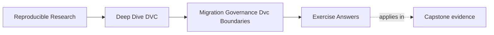

# Exercise Answers

<!-- page-maps:start -->
## Page Maps

<!-- page-maps:end -->

These answers are model explanations, not the only acceptable wording.

What matters is whether the reasoning makes evidence, risk, repair, and ownership clear.

## Answer 1: Review a repository by evidence

Strong outline:

- identity and state layers: inspect `.dvc` files, `dvc.lock`, and `make -C capstone state-summary`
- pipeline and experiment truth: inspect `dvc.yaml`, `params.yaml`, and experiment review notes
- metrics, promotion, and release surfaces: inspect `metrics/`, `publish/v1/`, and release audit output
- remote, retention, and recovery: inspect remote config, recovery guide, and recovery review output
- tool-boundary recommendations: inspect deployment or registry handoff points and name what DVC should own

The main lesson is that final review starts from evidence surfaces, not impressions.

## Answer 2: Plan one safe migration

Strong plan:

1. Inventory the existing `publish/v1/` manifest, params, metrics, review note, and artifacts.
2. Copy the supported bundle to `registry/incident-escalation/v1/`.
3. Keep `publish/v1/` temporarily as a rollback boundary.
4. Run release audit and recovery review against the new boundary.
5. Update consumer documentation to name the registry entry.
6. Remove or deprecate the old boundary only after verification and consumer handoff.

The main lesson is to move one boundary and verify before cutting over.

## Answer 3: Write a governance rule

Strong rule:

> Any change to `params.yaml`, `dvc.lock`, or `publish/` must include a review note naming
> the state contract being changed and must pass the relevant verification route before
> merge.

Contract protected:

- parameter and metric comparability
- lock evidence consistency
- promoted release auditability

The main lesson is that governance should protect a named contract.

## Answer 4: Intervene on an anti-pattern

Strong intervention:

> `outputs/latest/` gives consumers a moving internal target. Please publish a versioned
> bundle such as `publish/v1/` or a registry entry with a manifest, promoted params,
> promoted metrics, and review note. Consumers should depend on that versioned boundary,
> not the internal `latest` path.

The main lesson is to replace the shortcut with a repair path.

## Answer 5: Decide tool ownership

Strong ownership split:

- DVC should own artifact lineage, data identity, pipeline evidence, params, metrics, and recovery for tracked outputs.
- A registry should own model lifecycle and consumer-facing version contracts.
- A deployment platform should own rollout, runtime health, and serving policy.
- Alerting should belong to operational monitoring, not DVC.

DVC can provide evidence to those systems, but it should not become responsible for every
production concern.

## Answer 6: Audit a repository against current truth

A mature audit distinguishes declared policy from observed state. Each finding cites a
file, command, object, or recovery attempt and names the consequence. Maintainer memory
can guide investigation but cannot close an evidence gap.

## Answer 7: Migrate one artifact family safely

The migration has an inventory, immutable identity comparison, clean recovery test,
consumer validation, rollback route, and explicit cutover decision. The old path remains
available until the new boundary proves every required property.

## Answer 8: Write an exception with an expiry

An exception is narrow and reviewable. It identifies accountable ownership and a
measurable removal condition. A CI or review check surfaces expiry; prose hidden in a
ticket does not prevent a temporary compromise from becoming permanent policy.

## Answer 9: Decide whether DVC should keep ownership

Choose by capability and contract. DVC can reference external identities and orchestrate
commands, but it should not become a secret manager, scheduler, environment solver, or
consumer registry merely because those concerns touch a pipeline.

## Answer 10: Conduct a stewardship review

Success means the incoming maintainer can execute and explain the critical routes without
oral history. Every unexplained credential, authority, retention rule, interpretation, or
rollback decision becomes a concrete governance repair.

## Self-check

If your answers consistently explain:

- which evidence proves the current state
- how migration preserves or changes a boundary
- which governance rule protects which contract
- how to repair shortcuts before they become normal
- where DVC authority ends

then you are using Module 10 correctly.
