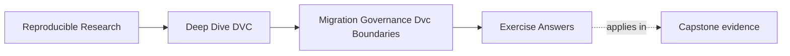
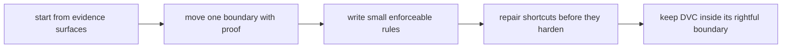

# Exercise Answers

<!-- page-maps:start -->
## Page Maps

<!-- page-maps:end -->

These answers are model explanations, not the only acceptable wording.

## How to use the answer page well

Do not read the model answer first and then collapse the module into "DVC is good for
data pipelines."

A better rhythm is:

1. finish the exercise with your own stewardship packet
2. name the contract, evidence surface, and boundary under review
3. compare your reasoning with the model answer
4. revise anywhere your answer hides risk behind broad governance language or fuzzy tool
   ownership

What matters is whether the reasoning makes evidence, risk, repair, and ownership clear.

Strong Module 10 answers usually do five things:

- they start from evidence surfaces instead of impressions
- they move one boundary at a time with rollback
- they write rules that protect named contracts
- they repair shortcuts before they become norms
- they keep DVC responsible for artifact lineage rather than every operational concern

The strongest self-study packets also leave behind six concrete artifacts:

- one evidence-first review outline
- one migration plan
- one governance rule
- one anti-pattern intervention
- one boundary-ownership table
- one stewardship handoff review

If your answers rely only on "the maintainers know how it works," the reasoning is still
too thin.

## Answer 1: Review a repository by evidence

Strong outline:

- identity and state layers
  - inspect `.dvc` files, `dvc.lock`, or a state summary route
  - catch confusion between workspace files, tracked identity, and durable state
- pipeline and experiment truth
  - inspect `dvc.yaml`, `params.yaml`, and experiment review records
  - catch hidden reads, coarse stage boundaries, or uninterpretable candidates
- metrics, promotion, and release surfaces
  - inspect `metrics/`, `publish/v1/`, manifests, and release audit output
  - catch meaning drift or unsupported consumer surfaces
- remote, retention, and recovery
  - inspect remote config, retention documentation, and recovery review output
  - catch unrecoverable promised state or unsafe cleanup assumptions
- tool-boundary recommendations
  - inspect deployment or registry handoff points
  - catch concerns DVC is being asked to own beyond artifact lineage

The main lesson is that final review begins from proof surfaces, not from general
confidence.

## Answer 2: Plan one safe migration

Strong plan:

1. Inventory the existing `publish/v1/` manifest, params, metrics, review note, and
   promoted artifacts.
2. Copy the supported bundle to `registry/incident-escalation/v1/`.
3. Keep `publish/v1/` alive temporarily as the rollback boundary.
4. Run release audit and recovery review against the new boundary.
5. Update consumer documentation to name the registry entry.
6. Cut over only after consumer verification succeeds.
7. Retire the old boundary only after rollback is no longer needed.

What must stay unchanged during the move:

- the promoted artifact identities and the evidence that justifies them

## Answer 3: Write a governance rule

Strong rule:

> Any change to `params.yaml`, `dvc.lock`, or `publish/` must include a review note naming
> the state contract being changed and must pass the relevant verification route before
> merge.

Contract protected:

- parameter and metric comparability
- lock evidence consistency
- promoted release auditability

Why a vaguer rule would be worse:

- broad instructions like "review carefully" are harder to enforce and easier to ignore

## Answer 4: Intervene on an anti-pattern

Strong intervention:

> `outputs/latest/` is a moving internal convenience path, not a durable consumer
> contract. Please publish a versioned boundary such as `publish/v1/` or a registry entry
> with a manifest, promoted params, promoted metrics, and a review note. Consumers should
> depend only on that versioned boundary, not on an internal mutable path.

What evidence must travel with the repair:

- manifest, promoted params, promoted metrics, provenance, and the review rationale

## Answer 5: Decide tool ownership

Strong ownership split:

- DVC should own artifact lineage, data identity, pipeline evidence, params, metrics, and
  recovery for tracked outputs
- a registry should own model lifecycle and consumer-facing version contracts
- a deployment or approval platform should own rollout and deployment approval
- monitoring or operational tooling should own alerting

DVC can supply evidence to those layers, but it should not be stretched into replacing
them.

## Answer 6: Audit a repository against current truth

A mature audit compares:

- documentation promises
- `dvc.yaml` declarations
- `dvc.lock` recorded state
- remote configuration
- CI verification routes
- release bundles

Every promise without executable or recoverable evidence becomes a concrete finding with a
named consequence. Maintainer memory can guide the search, but it cannot close the gap.

## Answer 7: Migrate one artifact family safely

The migration should include:

- explicit inventory of the governed artifact family
- identity comparison across old and new boundaries
- validation of both recovery routes during the migration window
- a named rollback condition if verification fails

The old path may be retired only after the new boundary proves recovery, auditability, and
consumer continuity.

## Answer 8: Write an exception with an expiry

A healthy exception is:

- narrow
- reviewable
- owned by a named person or role
- backed by compensating evidence
- bounded by a measurable expiry condition

The overdue-exception check must be visible in CI or review workflow. Hidden prose in a
ticket is not enough to prevent a temporary departure from hardening into policy.

## Answer 9: Decide whether DVC should keep ownership

Choose by contract and capability:

- DVC may own tracked artifact lineage and references
- DVC may reference external identities or commands
- DVC must not own concerns like secrets, scheduler policy, consumer registry lifecycle,
  or full environment solving merely because those concerns touch the pipeline

The question is not "can DVC be used here?" but "should this contract belong to DVC at
all?"

## Answer 10: Conduct a stewardship review

Success means the incoming maintainer can:

- recover promised state
- reproduce one governed result
- compare runs or releases correctly
- explain the promotion boundary
- follow the incident route
- make one safe bounded change

Every unexplained credential path, retention rule, authority decision, or rollback step
becomes a concrete governance repair.

## Self-check

If your answers consistently explain:

- which evidence proves the current state
- how migration preserves or changes a boundary
- which governance rule protects which contract
- how to repair shortcuts before they become normal
- where DVC authority ends

then you are using Module 10 correctly.
