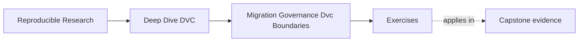
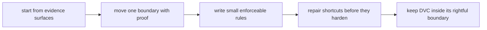
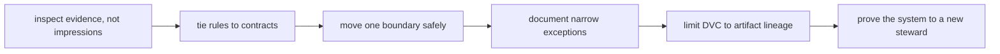

# Exercises


<!-- page-maps:start -->
## Page Maps




<!-- page-maps:end -->

Use these exercises to practice final stewardship judgment.

The goal of the day is to end the course with durable repository thinking rather than
tool enthusiasm. Strong stewardship starts from evidence surfaces, moves one boundary at a
time, writes small enforceable rules, and refuses to assign DVC ownership for every
production concern just because DVC is already present.

## How to work through this set

Treat the ten exercises as one full lab day on repository stewardship, migration
discipline, and tool-boundary governance.

Before each answer:

1. name the contract or boundary under review
2. name the evidence surface that proves the current state
3. say what repair or migration would preserve that proof

Do the exercises in order. The day is one progression:

- Exercises 1-3 review repositories by evidence and write minimal governance rules
- Exercises 4-5 intervene on shortcuts and clarify DVC's rightful ownership
- Exercises 6-8 audit lived truth, migrate one boundary safely, and document narrow
  exceptions
- Exercises 9-10 decide where DVC should stop and test the repository with a new steward

Keep one stewardship packet as you go. By the end of the day it should contain:

- one evidence-first repository review outline
- one safe migration plan
- one governance rule tied to a state contract
- one anti-pattern intervention
- one tool-boundary decision
- one stewardship review handoff list

If those six artifacts are missing, you are probably still describing preferences instead
of governing the repository.

## Recommended working layout

If you want one lab tree that can support the whole day, use something like:

```text
module10-lab/
├── artifacts/
├── governance/
├── migrations/
├── notes/
└── stewardship/
```

Keep one governance table while you work:

| Contract | Evidence surface | Enforcing rule or check | Failure if absent |
| --- | --- | --- | --- |

Also keep one boundary table:

| Concern | DVC owns | DVC references | DVC must not own | Why |
| --- | --- | --- | --- | --- |



Use that route on purpose. It keeps the day centered on durable stewardship instead of on
general good intentions.

## Exercise 1: Review a repository by evidence

Write a five-section review outline for a DVC repository:

- identity and state layers
- pipeline and experiment truth
- metrics, promotion, and release surfaces
- remote, retention, and recovery
- tool-boundary recommendations

For each section, name one file or command you would inspect and one risk the evidence is
supposed to catch.

Study note:
This exercise matters because stewardship begins with observable proof, not maintainers'
confidence.

## Exercise 2: Plan one safe migration

A team wants to move promoted artifacts from `publish/v1/` to
`registry/incident-escalation/v1/`.

Write a migration plan that preserves trust and rollback.

Your answer should include:

- inventory
- verification
- consumer communication
- rollback point
- one sentence naming what must stay unchanged during the move

Study note:
The best migrations move one trust boundary at a time and prove each step.

## Exercise 3: Write a governance rule

Write one durable governance rule for future changes to `params.yaml`, `dvc.lock`, or
`publish/`.

Explain:

- which state contract your rule protects
- how the rule is enforced
- one sentence naming why a broader vaguer rule would be worse

Study note:
Good governance is small enough to follow and concrete enough to verify.

## Exercise 4: Intervene on an anti-pattern

A reviewer sees this comment:

> We copied the best model to `outputs/latest/`; consumers can use that.

Write a better review intervention with a repair path.

Include:

- why the shortcut is unsafe
- what consumer-safe boundary should replace it
- what evidence must travel with the repair

Study note:
This is where stewardship means correcting the path, not just criticizing it.

## Exercise 5: Decide tool ownership

A team wants DVC to handle:

- artifact lineage
- deployment approval
- model registry lifecycle
- alerting

Explain which concerns DVC should own and which should probably belong to another layer.

Study note:
The strongest answer protects DVC from being stretched into a weak substitute for other
systems.

## Midday self-check

Before you move into repository audit, safe exceptions, and handoff review, make sure
your packet can already answer these questions clearly:

- which evidence surface proves each major contract
- how a migration preserves trust and rollback
- why governance should be small and enforceable
- where DVC authority should stop

If you cannot answer those four questions in plain language, return to Exercises 1-5 and
make the packet more explicit before continuing.

## Exercise 6: Audit a repository against current truth

Interview the files, not only the maintainers. Compare documentation, `dvc.yaml`,
`dvc.lock`, remotes, CI, and release bundles. Record every promise that lacks executable
or recoverable evidence.

Study note:
The important habit here is to record each missing proof surface as a concrete finding,
not as a vague concern.

## Exercise 7: Migrate one artifact family safely

Move one governed artifact family to a new storage or workflow boundary. Preserve old and
new recovery routes during validation, compare identities, and define the rollback point.

What to hand in:

- the migrated family
- the validation route
- the rollback condition
- one sentence naming when the old path may finally be retired

Study note:
Retirement is a decision after proof, not immediately after the first successful copy.

## Exercise 8: Write an exception with an expiry

Document one justified departure from repository policy. Include:

- owner
- reason
- affected artifacts
- risk
- compensating evidence
- expiry condition
- the check that detects an overdue exception

Study note:
Narrow exceptions are healthy only when their removal is observable and enforced.

## Exercise 9: Decide whether DVC should keep ownership

Evaluate one concern such as:

- model registry
- secrets
- streaming data
- scheduler policy
- environment construction

Use requirements to decide whether DVC owns, references, or must not own it.

Study note:
This exercise matters because teams often confuse "related to the pipeline" with "owned
by DVC."

## Exercise 10: Conduct a stewardship review

Present the repository to a new maintainer. Demonstrate:

- recovery
- reproduction
- comparison
- promotion
- incident response
- one safe change

Record every boundary the new maintainer cannot explain from durable evidence.

Study note:
This final exercise matters because real stewardship is proven when a new maintainer can
reason from the repository itself.

## Mastery check

You have a strong grasp of this module if your answers consistently keep five ideas
visible:

- review starts from evidence surfaces
- migration should move one boundary with proof
- governance should be small and enforceable
- anti-patterns are shortcuts that damage state contracts
- DVC should own artifact lineage, not every production concern
